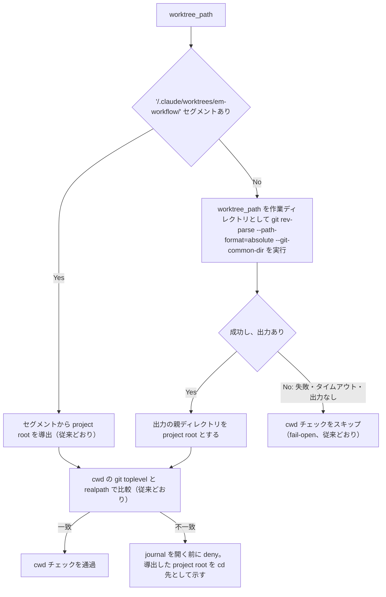

# canonical-worktree-path-guards - 要件定義書

## 1. 概要

### 1.1 背景

`.claude`、`.claude/worktrees`、`.claude/worktrees/em-workflow` のいずれかが、メインワークツリー内に解決されるリンクになっているレイアウトがある。implement-phase.md は implementer に正規の（strict realpath の）`worktree_path` を渡す。

フィーチャー cd-prefix-canonical-path-only は、その IMPLEMENTATION.md に Open Question を残している。

### 1.2 目的

- 上記のレイアウトで、起動ガードと stale-launched の識別子バインドが、正規の `worktree_path` を受け入れる。
- cd-prefix-canonical-path-only が残した Open Question を閉じる。結論は「両方の利用側を揃える」。

### 1.3 スコープ

対象:

- 起動ガード `em-workflow/hooks/queue_launch_guard.py`
- stale-launched の識別子バインド `em-workflow/scripts/recover-orphaned-task.py`
- implement-phase.md の Same-session extension 呼び出し契約にある `--task-worktree` の記述
- 上記に対応するテストと、固定された文言

対象外:

- リンクがメインワークツリーの外に解決されるレイアウト
- リンク先自体が入れ子の `/.claude/worktrees/em-workflow/` セグメントを含む場合（`rfind` が誤った root を導出し、偽の deny が起こり得る）
- 過去フィーチャーの SPEC / IMPLEMENTATION 文書の編集

## 2. ビジネス要件

### 2.1 ビジネス目標

- リンクを含むレイアウトでも、起動ガードと stale-launched の識別子バインドが正規の `worktree_path` を受け入れる。
- cd-prefix-canonical-path-only の Open Question を、両方の利用側を揃える形で閉じる。

### 2.2 対象ユーザー

該当なし

### 2.3 期待される効果

2.1 を参照。

## 3. ユースケース

該当なし

## 4. 機能要件

### 4.1 機能一覧

| ID | 機能名 | 説明 |
|----|--------|------|
| FR1 | 揃える方針の決定 | 起動ガードと stale-launched の識別子バインドの両方を、正規の `worktree_path` に揃える |
| FR2 | 起動ガード: project root のフォールバック | セグメントが無いとき、git common dir の親を project root とする |
| FR3 | 起動ガード: docstring | フックのモジュール docstring を新しい導出規則に合わせる |
| FR4 | stale-launched: リンクを許容するワークツリーのバインド | 両側を非 strict の realpath で解決してから比較する |
| FR5 | stale-launched: 文書と固定文言 | implement-phase.md と固定文言・docstring を新しい比較規則に合わせる |
| FR6 | テスト: リンクを含むレイアウトでの起動ガード | 3 つのリンク配置それぞれで allow / deny を確かめる |
| FR7 | テスト: リンクを含むレイアウトでの stale-launched バインド | バインド成功と各種失敗を確かめる |

### 4.2 機能詳細

#### FR1: 揃える方針の決定

**説明**: `.claude`、`.claude/worktrees`、`.claude/worktrees/em-workflow` のいずれかがメインワークツリー内に解決されるリンクになっているレイアウトで、起動ガード（`em-workflow/hooks/queue_launch_guard.py`）と stale-launched の識別子バインド（`em-workflow/scripts/recover-orphaned-task.py`）の両方を、正規の `worktree_path` に揃える。

#### FR2: 起動ガード: project root のフォールバック

**説明**: 起動ガードが cwd チェックに使う project root の導出に、セグメントが無い場合のフォールバックを加える。

**処理フロー**:

**ビジネスルール**:

- `worktree_path` の `/.claude/worktrees/em-workflow/` セグメントからの project root 導出は変えない。
- セグメントが無いときは、`worktree_path` を作業ディレクトリとして `git rev-parse --path-format=absolute --git-common-dir` を既存の git タイムアウトの下で実行し、その出力の親ディレクトリを project root とする。
- その git 呼び出しが失敗・タイムアウト・出力なしのときは、従来どおり cwd チェックをスキップする（fail-open）。
- 導出した root は、従来どおり cwd の git toplevel と realpath で比較する。
- cwd の toplevel が別の root である起動は、journal を開く前に deny する。deny は導出した project root を cd 先として示す。

**エラーケース**:

| エラー | 条件 | 対応 |
|--------|------|------|
| cwd 不一致 | cwd の toplevel が導出した project root と異なる | journal を開く前に deny。project root を cd 先として示す |
| root 導出不能 | セグメントが無く、git 呼び出しが失敗・タイムアウト・出力なし | cwd チェックをスキップ（fail-open） |

#### FR3: 起動ガード: docstring

**説明**: フックのモジュール docstring から、「`.claude/worktrees/em-workflow/` レイアウトの外にあるワークツリーパスは常に cwd チェックをスキップする」という記述を除く。代わりに、セグメントからの導出、セグメントが無いときの git-common-dir フォールバック、どちらでも解決できないときの fail-open を記述する。

#### FR4: stale-launched: リンクを許容するワークツリーのバインド

**説明**: `resolve_bound_stop_target` で、記録されたエントリの `worktree_path` と `--task-worktree` を、リンクを解決したうえで比較する。

**ビジネスルール**:

- エントリの `worktree_path` と `--task-worktree` は、それぞれ空でない文字列で、かつ絶対パスでなければならない。そうでなければバインド失敗（`agent-identity-unproven`）とする。
- 2 つの値は `os.path.realpath`（strict なし）を通してから比較する。存在しなくなったワークツリーでも、記録されたワークツリーを指していればバインドする。
- どちらかの解決中に送出されたエラー（`OSError`、埋め込み NUL などによる `ValueError`）はバインド失敗（`agent-identity-unproven`）とし、スクリプトの外に例外を出さない。
- 既存の条件は変えない。候補の取得元は `agent_ids` のみ、異なる候補がちょうど 1 つであること、`--stop-target` がその候補と一致すること。
- `resolve_bound_stop_target` のソーステキストはトークン `session_id` を含まない。

**バリデーション**:

| 項目 | ルール | 結果 |
|------|--------|------|
| エントリの `worktree_path` | 空でない文字列、絶対パス | 違反時 `agent-identity-unproven` |
| `--task-worktree` | 空でない文字列、絶対パス | 違反時 `agent-identity-unproven` |

**エラーケース**:

| エラー | 条件 | 対応 |
|--------|------|------|
| ワークツリー不一致 | 解決後の 2 つの値が異なる | `agent-identity-unproven` |
| 解決時の例外 | `OSError`、`ValueError` など | `agent-identity-unproven`（例外は外に出さない） |

#### FR5: stale-launched: 文書と固定文言

**説明**:

- implement-phase.md の Same-session extension 呼び出し契約で、`--task-worktree` の値はタスクの想定ワークツリーパス（`$WT_ROOT/{T}`）のままとし、そのパスが存在するかどうかに関わらず渡す。
- その文から「compared ... as a plain string」を除く。代わりに、識別子バインドの段階で、両側のリンクを解決したうえで Agent index エントリに記録されたワークツリーと比較することを記述する。
- `tests/test_stale_launched_missing_artifacts_doc_contract.py` の定数 `R4_NEW_STATEMENT`、`resolve_bound_stop_target` の docstring、`TestChainTaskWorktreeExistenceIrrelevant` の「plain string」を含む docstring を、この規則に合わせて更新する。

#### FR6: テスト: リンクを含むレイアウトでの起動ガード

**説明**: サブプロセスで起動ガードを動かすテストを加える。

- 一時的な git プロジェクトを作り、フィーチャーのワークツリールートの下に、実際の `git worktree add` で integration ワークツリーとタスクワークツリーを作る。
- 3 つのリンク配置（`.claude`、`.claude/worktrees`、`.claude/worktrees/em-workflow`。それぞれプロジェクト内のディレクトリへのシンボリックリンク）ごとに行う。
- `worktree_path` にはタスクワークツリーの strict realpath を渡す。
- cwd がメインワークツリーの起動は allow され、`launched` が追記される。
- cwd が integration ワークツリーの起動は deny され、理由に project root が示され、journal は変わらない。

#### FR7: テスト: リンクを含むレイアウトでの stale-launched バインド

**説明**: リンクを含むレイアウトで `recover-orphaned-task.py` を確かめるテストを加える。

- 正規の `worktree_path` を記録したエントリが、リンク経由で渡した `--task-worktree` `$WT_ROOT/{T}` にバインドし、スタブのヘルパーを通して chain が `recovered` に達する。
- タスクワークツリーが存在しなくても、バインドは成功する。
- 別のワークツリー、どちらかの側の空・相対・文字列以外の値、解決時に例外を送出する値は、いずれも `agent-identity-unproven` となり、journal は変わらない。

## 5. 非機能要件

### 5.1 非機能要件一覧

| ID | 名称 | 要件 |
|----|------|------|
| NFR1 | 標準ライブラリのみ | フック、スクリプト、新規・変更されるテストモジュールはすべて標準ライブラリだけを import する |
| NFR2 | フックの出力規律 | 起動ガードはどの入力に対しても終了コード 0 で終わる。判定できない状態（不正な入力、git が解決できない・タイムアウト、リポジトリ外のパス）は引き続き fail-open とする。deny された起動は `launched` イベントを残さない |
| NFR3 | 証拠の連鎖での安全側 | stale-launched のバインドに疑いがあれば residual とし、`recovered` にしない。residual は journal をバイト単位で変えない |
| NFR4 | 読み取り専用の git 呼び出し | フォールバックの git 呼び出しは `git rev-parse` のみで、既存の `GIT_TIMEOUT_SECONDS` で上限を設け、セグメントが無いときだけ実行する |
| NFR5 | 決定的なテスト | リンクを含むレイアウトは一時ディレクトリ内のシンボリックリンクで作る。負荷やタイミングに依存するテストを作らない |

### 5.2 パフォーマンス要件

該当なし

### 5.3 セキュリティ要件

該当なし

### 5.4 可用性要件

該当なし

### 5.5 保守性要件

- ドキュメント: FR3、FR5 を参照

### 5.6 互換性要件

- 起動ガードの in-flight / merged の deny、journal より前に deny する順序、既存の fail-open の規約は変えない。
- 正規の生成側より前に記録された agents.jsonl のエントリ（`$WT_ROOT/{T}` 形式）も、両側を解決するためバインドする。

## 6. UI/UX要件

該当なし

## 7. データ要件

該当なし

## 8. 外部連携

該当なし

## 9. 制約条件

### 9.1 技術的制約

- 標準ライブラリのみを使う（NFR1）。
- フォールバックの git 呼び出しは `git rev-parse` のみ（NFR4）。
- プラグインの version は変更しない。

### 9.2 ビジネス上の制約

- 過去フィーチャーの SPEC / IMPLEMENTATION 文書は編集しない。cd-prefix-canonical-path-only の Open Question は、このフィーチャーの文書で回答する。

### 9.3 スケジュール制約

該当なし

### 9.4 宣言された変更集合

このフィーチャー固有のパスは手動で列挙せず、create-plan で `workflow.yaml` の各タスクの `files` から導出する（`references/phases/create-plan-phase.md`）。

**デフォルトメンバー**（SPEC作成者が明示的に除外しない限り、常に宣言に含まれる）:
- `feature-docs/canonical-worktree-path-guards/**`
- `test-docs/canonical-worktree-path-guards/**`

`feature-docs/canonical-worktree-path-guards/**` に含まれるもの: `REQUIREMENTS.md`、`SPEC.md`、`IMPLEMENTATION.md`、`workflow.yaml`、`phase-state/`、`tasks/`、`reviews/roundN.yaml`、`VERIFICATION.md`、`retrospect.yaml`、およびデザインステップが生成するデザイン成果物。生成主体は各フェーズドキュメントおよび `references/phase-state.md` を参照（引用のみ、ルールは再掲しない）。

`test-docs/canonical-worktree-path-guards/**` に含まれるもの: `{T}.tests.yaml`（パス形式: `test-docs/canonical-worktree-path-guards/{T}.tests.yaml`）。生成主体は `implement-phase.md` を参照（引用のみ、ルールは再掲しない）。

**意味論**:
- デフォルトのメンバーは、SPEC作成者が明示的に除外しない限り宣言に含まれる。除外は意図的な絞り込みであり、記載漏れによる省略ではない。
- この宣言はスーパーセット（superset）の主張であり、実際の変更集合は宣言に含まれる（CONTAINED IN）必要がある。実際には生成されないパスが宣言されていても違反にはならない。implementタスクを1つも生成しないフィーチャーは `test-docs/{feature}/` ディレクトリを生成しないが、宣言された `test-docs/{feature}/**` は依然として正しい。

## 10. 想定される課題とリスク

### 10.1 技術的課題

| 課題 | 影響度 | 対応策 |
|------|--------|--------|
| リンク先自体が入れ子の `/.claude/worktrees/em-workflow/` セグメントを含むと、`rfind` が誤った root を導出し、偽の deny が起こり得る | — | 本フィーチャーでは修正しない（対象外） |

### 10.2 ビジネスリスク

該当なし

## 11. 成功基準

### 11.1 受け入れ基準

- [ ] AC1（FR1）: SPEC に、両方の利用側を揃える決定が記録されている。
- [ ] AC2（FR2, FR6）: 3 つのリンク配置それぞれで、cwd がメインワークツリーの起動は allow され `launched` が追記される。cwd が integration ワークツリーの起動は deny され、理由に project root が示され、journal は変わらない。
- [ ] AC3（FR2, NFR2）: セグメントが無く git common dir を解決できないとき（例: どのリポジトリにも属さない `worktree_path`、存在しない `worktree_path`）、起動ガードは従来どおり fail-open となる。`tests/test_queue_launch_guard.py` の既存テストは `test_worktree_path_outside_layout_fails_open` を含めすべて通る。
- [ ] AC4（FR3）: フックの docstring が、セグメントからの導出、git-common-dir フォールバック、どちらでも解決できないときの fail-open を記述し、レイアウト外のパスは常にチェックをスキップするという記述を含まない。
- [ ] AC5（FR4, FR7）: リンクを含むレイアウトで、正規の記録済みワークツリーが `$WT_ROOT/{T}` にバインドし、chain が `recovered` に達する。存在しない `--task-worktree` でもバインドする。不一致・空・相対・文字列以外の値、解決時に例外を送出する値は `agent-identity-unproven` となる。
- [ ] AC6（FR4）: 単一候補の規則、候補の取得元が `agent_ids` のみであること、`resolve_bound_stop_target` のソースに `session_id` が無いことが引き続き成り立つ。`tests/test_stale_launched_recovery_chain.py` と `tests/test_recover_orphaned_task.py` の既存テストが通る。
- [ ] AC7（FR5）: implement-phase.md が `--task-worktree` のリンクを解決する比較を記述し、更新した `R4_NEW_STATEMENT` がそれと一致する。変更前の「as a plain string」の文言はその文に無く、否定の証明（negative proof）を伴う。
- [ ] AC8（NFR1, NFR5）: `python3 -m unittest discover -s tests` が `tests/test_tests_yaml_id_resolution.py` を含めてすべて通る。

### 11.2 KPI

該当なし

## 12. テストシナリオ

### 12.1 テスト観点

| ID | 対応 AC | シナリオ |
|----|---------|----------|
| TS1 | AC2 | 起動ガード、リンクが `.claude/worktrees/em-workflow`: メインワークツリーからは allow（`launched` 追記）、integration ワークツリーからは deny（journal 不変、理由に project root） |
| TS2 | AC2 | TS1 と同じ。リンクは `.claude/worktrees` |
| TS3 | AC2 | TS1 と同じ。リンクは `.claude` |
| TS4 | AC3 | セグメントが無く git が解決できない（リポジトリでない一時ディレクトリ内のパス）: 終了コード 0、出力なし、fail-open。既存のレイアウト外テストも引き続き通る |
| TS5 | AC4 | 文書テスト: フックの docstring がフォールバックの記述を含み、旧来のレイアウト外スキップの記述を含まない。各アサーションに偽造テキストによる否定の証明を対にする |
| TS6 | AC5 | リンクを含むレイアウトでの `recover-orphaned-task.py`: エントリは正規パスを記録、`--task-worktree` はリンク経由のパス、結果は `recovered` でスタブのヘルパーがちょうど 1 回呼ばれる |
| TS7 | AC5 | 同じリンク付きフィクスチャでタスクワークツリーを削除しても、バインドし `recovered` に達する |
| TS8 | AC5 | `agent-identity-unproven` になること: 別のワークツリー、空文字列、相対パス、文字列以外の値（エントリ側・引数側）、NUL を含む値。journal はバイト単位で同一で、ヘルパーは呼ばれない |
| TS9 | AC6 | 既存のソースレベルの `session_id` 固定テストと単一候補のテストが変更なしで通る |
| TS10 | AC7 | 文書テスト: implement-phase.md の `--task-worktree` の文が更新後の `R4_NEW_STATEMENT` と一致し、旧来の「plain string」の文言が無い。変更前の文をそのまま使った否定の証明を伴う |
| TS11 | AC8 | 全スイートが通る |

### 12.2 エッジケース

- リンク先自体が入れ子の `/.claude/worktrees/em-workflow/` セグメントを含む場合: `rfind` が誤った root を導出し、偽の deny が起こり得る。本フィーチャーでは修正せず、対象外とする。
- missing-artifacts の場合にタスクワークツリーが無い: 非 strict の realpath により引き続きバインドする。
- 正規の生成側より前に記録された agents.jsonl のエントリ（`$WT_ROOT/{T}` 形式）: 両側を解決するため引き続きバインドする。
- リンクがメインワークツリーの外に解決される場合: 対象外（bash_guard FR5 がそこへの cd プレフィックスをすべて拒否する）。
- プロジェクトルート自身またはその上位にあるリンク: セグメントは消えない（`WT_ROOT` は git の toplevel から来る）ため、挙動は変わらない。

## 13. 用語定義

| 用語 | 定義 |
|------|------|
| 正規の `worktree_path` | strict realpath で解決したワークツリーパス。implement-phase.md が implementer に渡す |
| 起動ガード | `em-workflow/hooks/queue_launch_guard.py` |
| stale-launched の識別子バインド | `em-workflow/scripts/recover-orphaned-task.py` の `resolve_bound_stop_target` |
| セグメント | `worktree_path` に含まれる `/.claude/worktrees/em-workflow/` |
| リンク配置 | `.claude`、`.claude/worktrees`、`.claude/worktrees/em-workflow` のいずれかがメインワークツリー内に解決されるリンクであること |

## 14. 確認事項

### 14.1 確認済み事項

- [x] 方針: 起動ガードと stale-launched の識別子バインドの両方を揃える。
- [x] スコープ: リンクがメインワークツリー内に解決されるレイアウトに限る。
- [x] 起動ガードの in-flight / merged の deny、journal より前に deny する順序、既存の fail-open の規約は変えない。
- [x] フォールバックで導出する project root は git common dir の親とする。common dir がメインワークツリーの `.git` ディレクトリであるとき、これはメインワークツリーと一致する。em-workflow はプロジェクトルートから `git worktree add` でタスクワークツリーを作る。
- [x] 過去フィーチャーの SPEC / IMPLEMENTATION 文書は編集しない。cd-prefix-canonical-path-only の Open Question は、このフィーチャーの文書で回答する。
- [x] プラグインの version は変更しない。
- [x] デザインステップ: スキップ（UI なし）。

### 14.2 未確認・保留事項

なし

## 15. 参考資料

- `feature-docs/cd-prefix-canonical-path-only/IMPLEMENTATION.md`: 本フィーチャーが閉じる Open Question
