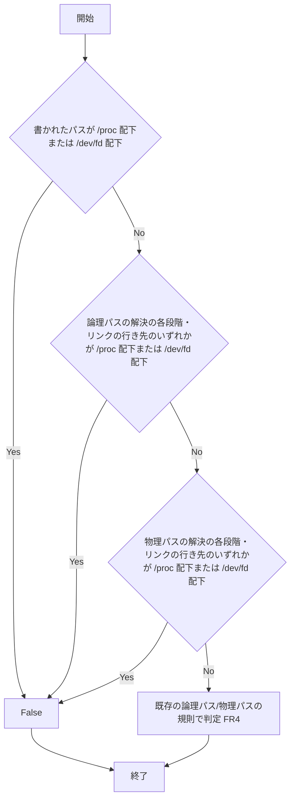

# cd-prefix-process-dependent-paths - 要件定義書

## 1. 概要

### 1.1 背景

`em-workflow/hooks/bash_guard.py` の cd プレフィックス許可は、解決するプロセスによって行き先が変わるパスを通すことで、承認済みコマンドを `.claude/worktrees/em-workflow/` の外で Bash に実行させうる。攻撃シナリオは `cd "/proc/self/cwd/../tests" && <approved>` である。

### 1.2 目的

- cd プレフィックス許可で、解決するプロセスによって行き先が変わるパスを通した承認済みコマンドの実行を、`.claude/worktrees/em-workflow/` の外では一切許さない。攻撃シナリオ `cd "/proc/self/cwd/../tests" && <approved>` を成立させない。
- cd プレフィックス許可における /proc 配下と /dev/fd 配下のパスの扱いを、このフィーチャーの SPEC で決め直す。`/proc/self/root/..` 前置の形は許可しなくなる。
- フックプロセスの cwd と入力の cwd が異なる状況の回帰テストを用意する。

### 1.3 スコープ

対象:

- `em-workflow/hooks/bash_guard.py` のパス判定 `is_below(path, area)`
- `bash_guard.py` のモジュール docstring にある cd プレフィックス段落の `path:` 項目
- `em-workflow/references/command-execution-protocol.md` の Verbatim execution rule にある path 項目
- `tests/test_bash_guard_cd_prefix.py` のテスト追加と、既存テスト 2 件の期待値変更

対象外:

- /proc 以外のパスにマウント（バインドマウントを含む）された procfs と、/proc 以外のパスにある他のプロセスごとのファイルシステム（14.3 の A4）
- フックの判定から Bash の cd までの間にリンクが変更される場合（14.3 の A5）
- `feature-docs/is-below-physical-fallback/SPEC.md` の編集（14.3 の A2）

## 2. ビジネス要件

### 2.1 ビジネス目標

- 攻撃シナリオ `cd "/proc/self/cwd/../tests" && <approved>` が成立しない。
- /proc 配下と /dev/fd 配下のパスの扱いが、このフィーチャーの SPEC で決まっている。
- フックプロセスの cwd と入力の cwd が異なる状況の回帰テストがある。

### 2.2 対象ユーザー

該当なし

### 2.3 期待される効果

- 解決するプロセスによって行き先が変わるパスを経由した、`.claude/worktrees/em-workflow/` の外での承認済みコマンドの実行が cd プレフィックス許可で通らない。
- `/proc/self/root/..` 前置の形が許可されない。

## 3. ユースケース

### 3.1 ユースケース一覧

該当なし

### 3.2 ユースケース詳細

該当なし

## 4. 機能要件

### 4.1 機能一覧

| ID | 機能名 | 説明 | 状態 |
|----|--------|------|------|
| FR1 | /proc または /dev/fd 配下のパスはパス判定に失敗する | 書かれたパス、論理パスと物理パスの解決の各段階とリンクの行き先のいずれかが /proc 配下または /dev/fd 配下なら `is_below` は False | 確定 |
| FR2 | `/proc/self/root/..` 前置の形を許可しない | `/proc/self/root/..` 前置も FR1 で除外し、書き換えの例外を設けない | 確定 |
| FR3 | 除外された形は cd プレフィックスが無いものとして判定する | FR1/FR2 で除外された形は cd プレフィックスが無い場合と同じ判定になる。新たな deny を生まない | 確定 |
| FR4 | 他の判定は変えない | 構文・承認・演算子・安全側の条件など既存の判定を維持する | 確定 |
| FR5 | 2 か所の記述を更新する | `bash_guard.py` の docstring と command-execution-protocol.md に FR1 の規則を記述する | 確定 |
| FR6 | 回帰テスト | `tests/test_bash_guard_cd_prefix.py` にテストを追加し、既存テスト 2 件の期待値を変更する | 確定 |

### 4.2 機能詳細

#### FR1: /proc または /dev/fd 配下のパスはパス判定に失敗する

**説明**: `is_below(path, area)` は、次のいずれかが /proc 配下または /dev/fd 配下にあるとき False を返す。

- (a) 書かれた `<path>`
- (b) 論理パス（各 `..` を、その直前に書かれた構成要素と先に相殺したパス）を構成要素ごとに解決する途中で到達する各段階。辿った各リンクの行き先を含む。
- (c) 物理パス（書かれたとおりのパス。各 `..` は、その時点で到達しているディレクトリに適用する）を構成要素ごとに解決する途中で到達する各段階。辿った各リンクの行き先を含む。

判定は、最終的な realpath や normpath の結果だけに依らない。

**入力**:

- path: 文字列 - cd プレフィックスに書かれたパス
- area: 文字列 - 判定対象のディレクトリ

**出力**:

- 判定結果: 真偽値 - 上記 (a)〜(c) のいずれかが /proc 配下または /dev/fd 配下なら False

**処理フロー**:

**ビジネスルール**:

- 「/proc 配下」とは、パスを構成要素ごとに比べ、空の構成要素と `.` を無視したとき、最初の構成要素が `proc` であること。
- 「/dev/fd 配下」とは、同じ比べ方で、最初の 2 つの構成要素が `dev`、`fd` であること。
- /proc 自体、/dev/fd 自体も含む。
- 字句上の変形も同じに扱う: `//proc/...`（POSIX の normpath は先頭の `//` を残す）、`/./proc/...`、`/x/../proc/...`、末尾のスラッシュ。
- /dev/fd がリンクである環境では /proc/self/fd へ辿られる。どちらの場合も /dev/fd は自身の名前で除外される。
- 次は除外しない:
    - `proc` で始まるだけの最初の構成要素（`/procfoo`）
    - ルート直下にない `proc`（または `dev/fd`）という名前のディレクトリ。エリア内にある普通の `proc` ディレクトリなど。

**エラーケース**:

| エラー | 条件 | 対応 |
|--------|------|------|
| 解決・段階の検査中の例外 | OSError または ValueError が発生 | 判定は False（NFR4） |
| リンクのループ・上限超過 | 段階的な解決で辿るリンク数が上限を超える、またはループする | 判定は False（NFR5） |

#### FR2: `/proc/self/root/..` 前置の形を許可しない

**説明**: `cd "/proc/self/root/..<worktree の絶対パス>" && <approved>` は、他の /proc パスと同様に FR1 で除外される。

**ビジネスルール**:

- 先頭の /proc/self/root を書き換える例外は設けない。
- この決定は、フィーチャー is-below-physical-fallback の FR3/AC-1 を上書きする。
- is-below-physical-fallback の SPEC は編集しない。

#### FR3: 除外された形は cd プレフィックスが無いものとして判定する

**説明**: FR1/FR2 で除外された形は、cd プレフィックスが無い場合とまったく同じに判定する。

**ビジネスルール**:

- 完全一致で承認されていれば allow。
- `workflow.yaml` でコマンド全体が宣言されていれば、未承認として deny。
- それ以外は出力なし。
- FR1/FR2 は新たな deny を生まない。

#### FR4: 他の判定は変えない

**説明**: 次の判定は変えない。

**ビジネスルール**:

- 構文・承認・演算子・安全側の条件
- FR1 で除外されないパスに対する論理パス/物理パスの規則
- `..` の前にある通常ファイル、存在しない構成要素、またはそれらへのリンクで判定に失敗する規則。既存の「`..` の前の非ディレクトリ」検査は維持する。`tests/test_bash_guard_cd_prefix.py` 870-915 行にある `/proc/self/root/..` 前置の変形も維持する。
- 拒否パターンによる deny
- 完全一致による allow
- 未承認の deny
- 無関係なコマンドに対する無出力

#### FR5: 2 か所の記述を更新する

**説明**: 次の 2 か所に FR1 の規則（/proc 配下または /dev/fd 配下のパスは、書かれたパス、両方の解決の各段階とリンクの行き先で判定し、パス判定に失敗する）を記述する。

- `bash_guard.py` のモジュール docstring にある cd プレフィックス段落の `path:` 項目
- `em-workflow/references/command-execution-protocol.md` の Verbatim execution rule にある path 項目

**ビジネスルール**:

- 更新後の記述は既存のマッチャーを満たし続ける。
- 文字列 `logical path`、`physical path`、`strictly below`、`existing directory`、`otherwise`、`both` を残す。
- パターン ``logical path (...`..`...)`` と `physical path (...as written...)` を残す。
- command-execution-protocol.md には `realpath` と `.claude/worktrees/em-workflow/` を残す。
- 記述に `realpath of <path> is an existing directory` と `path's realpath is an existing directory` を含めない。
- docstring の `cd prefix:` 段落は、`tests/test_bash_guard_cd_prefix_operators.py` の `STATEMENT_PATTERNS` に一致し続ける。

#### FR6: 回帰テスト

**説明**: `tests/test_bash_guard_cd_prefix.py` に次を追加・変更する。

1. フックのサブプロセスのプロセス cwd が入力の cwd と異なる、フック単位のケース。
    - `Fixture.run_hook` に任意指定のプロセス cwd 引数を追加する。既存の呼び出し元は変えない。
    - ケースは、承認済み文字列の前に置いた `cd "/proc/self/cwd/../<name>"` と `cd "/proc/self/cwd/<name>"`。プロセス cwd は、フックプロセス内でパスがエリアの下に解決される位置に置く。
    - 入力の cwd がメインツリーの場合と git worktree の場合の両方で、出力なしになる。
2. パス判定が False になるケース:
    - `/proc/self/cwd/<name>`
    - `/proc/thread-self/cwd/<name>`
    - エリア内のディレクトリを開いた fd に対する `/proc/self/fd/<N>` と `/dev/fd/<N>`
    - `/proc/<自プロセスの pid>/cwd/<name>`
    - `/proc/self/root<inside>`
    - 字句上の変形 `//proc/...`、`/./proc/...`、`/<既存ディレクトリ>/../proc/...`
    - エリア内にあり、行き先が `/proc/self/cwd` のリンク
    - エリア内にあり、行き先が `/dev/fd/<N>` のリンク
    - エリア内にあり、行き先が `/proc/self` のリンクに `/cwd/<name>` を続けたもの
3. パス判定が True のままのケース:
    - エリア内の `proc` という名前のディレクトリ
    - エリア内の `procfoo` という名前のディレクトリ
    - エリア内の `dev/fd` ディレクトリ

**ビジネスルール**:

- `/proc/self/root/..` の形を固定している既存テスト 2 件を変更する。
    - `test_ac1_proc_self_root_dotdot_before_an_absolute_worktree_path_is_allowed`（689-696 行）: ALLOW から SILENT に変える。テスト名とクラスの配置も新しい期待値に合わせる。
    - `test_ac1_proc_self_root_dotdot_in_front_changes_nothing` の最後のアサーション（855-856 行）: True から False に変える。
- モジュール docstring の 39-40 行も合わせて変更する。
- /proc を必要とするテストは、/proc/self がディレクトリでない環境ではスキップする。

## 5. 非機能要件

### 5.1 パフォーマンス要件

該当なし

### 5.2 セキュリティ要件

- 認証: 該当なし
- 認可: 該当なし
- データ保護: 該当なし
- 入力検証:
    - NFR3: `<path>` は解決するだけで、子プロセスの cwd や引数には使わない。パス判定は子プロセスを起動しない（`test_ac6_the_path_check_starts_no_child_process` で固定）。
    - NFR4: 解決または段階の検査中に OSError か ValueError が発生したら判定は False。フックは終了コード 0 で終わり、stderr に何も書かない。`os.path.realpath` または `os.path.isdir` が例外を送出しても `is_below` は False を返す（`test_ac5_a_resolution_error_makes_the_path_check_false`、787-795 行で固定）。`os.path.realpath` を strict を無視する寛容な版に差し替えても結果を保つ（`test_ac4_the_decision_does_not_depend_on_strict_mode_realpath`、905-915 行）。
    - NFR5: 段階的な解決で辿るリンクの数に上限を設ける。ループまたは上限超過で判定は False。

### 5.3 可用性要件

該当なし

### 5.4 保守性要件

- ログ出力: 該当なし
- 監視: 該当なし
- ドキュメント: FR5 を参照
- 実行テキスト: NFR2: `bash_guard.py` の実行テキストに `status` という部分文字列を含めない（`test_ac7_hook_executable_text_has_no_status_substring` と `test_hook_classification_pin` で固定）。
- テスト: NFR6: 新しいテストは標準ライブラリだけを使い、実際の `~/.claude` の状態や実際の `workflow.yaml` を読まない（既存の Fixture による分離）。

### 5.5 互換性要件

- ブラウザサポート: 該当なし
- 依存ライブラリ: NFR1: `bash_guard.py` は標準ライブラリだけを import する（AC-7 の import テストで固定）。
- 関数シグネチャ: NFR7: `is_below(path, area)` のシグネチャと、その呼び出し元 `is_cd_prefixed_approved`（`bash_guard.py:307`）は変えない。

## 6. UI/UX要件

### 6.1 画面設計要件

該当なし

### 6.2 画面遷移

該当なし

### 6.3 レスポンシブ対応

該当なし

## 7. データ要件

### 7.1 データモデル概要

該当なし

### 7.2 データ項目

該当なし

### 7.3 データ保持期間

該当なし

## 8. 外部連携

### 8.1 連携システム

該当なし

### 8.2 API仕様要件

該当なし

## 9. 制約条件

### 9.1 技術的制約

- `bash_guard.py` は標準ライブラリだけを import する（NFR1）。
- `is_below(path, area)` のシグネチャと呼び出し元 `is_cd_prefixed_approved` は変えない（NFR7）。

### 9.2 ビジネス上の制約

- `feature-docs/is-below-physical-fallback/SPEC.md`（A3、FR3、AC-1、TS-1）は過去の記録として残し、編集しない。

### 9.3 スケジュール制約

該当なし

### 9.4 宣言された変更集合

このフィーチャー固有のパスは手動で列挙せず、create-plan で `workflow.yaml` の各タスクの `files` から導出する（`references/phases/create-plan-phase.md`）。

**デフォルトメンバー**（SPEC作成者が明示的に除外しない限り、常に宣言に含まれる）:
- `feature-docs/cd-prefix-process-dependent-paths/**`
- `test-docs/cd-prefix-process-dependent-paths/**`

`feature-docs/cd-prefix-process-dependent-paths/**` に含まれるもの: `REQUIREMENTS.md`、`SPEC.md`、`IMPLEMENTATION.md`、`workflow.yaml`、`phase-state/`、`tasks/`、`reviews/roundN.yaml`、`VERIFICATION.md`、`retrospect.yaml`、およびデザインステップが生成するデザイン成果物。生成主体は各フェーズドキュメントおよび `references/phase-state.md` を参照（引用のみ、ルールは再掲しない）。

`test-docs/cd-prefix-process-dependent-paths/**` に含まれるもの: `{T}.tests.yaml`（パス形式: `test-docs/cd-prefix-process-dependent-paths/{T}.tests.yaml`）。生成主体は `implement-phase.md` を参照（引用のみ、ルールは再掲しない）。

**意味論**:
- デフォルトのメンバーは、SPEC作成者が明示的に除外しない限り宣言に含まれる。除外は意図的な絞り込みであり、記載漏れによる省略ではない。
- この宣言はスーパーセット（superset）の主張であり、実際の変更集合は宣言に含まれる（CONTAINED IN）必要がある。実際には生成されないパスが宣言されていても違反にはならない。implementタスクを1つも生成しないフィーチャーは `test-docs/cd-prefix-process-dependent-paths/` ディレクトリを生成しないが、宣言された `test-docs/cd-prefix-process-dependent-paths/**` は依然として正しい。

## 10. 想定される課題とリスク

### 10.1 技術的課題

該当なし（前提は 14.3 に記載）

### 10.2 ビジネスリスク

該当なし

## 11. 成功基準

### 11.1 受け入れ基準

- [ ] AC-1: フックプロセスの cwd を、パスがエリアの下に解決される位置に置き、入力の cwd をメインツリー（および git worktree）にしたとき、`cd "/proc/self/cwd/../<name>" && <approved>` と `cd "/proc/self/cwd/<name>" && <approved>` は出力なしになる。
- [ ] AC-2: FR6 (2) のすべての形で `is_below` は False。最終的な解決先がエリアの真下にある形も含む。
- [ ] AC-3: エリア内の `proc`、`procfoo`、`dev/fd` という名前のディレクトリで `is_below` は True。
- [ ] AC-4: `cd "/proc/self/root/..<worktree のパス>" && <approved>` はメインツリーからも git worktree からも出力なしになり、`is_below("/proc/self/root/.." + <inside>)` は False。
- [ ] AC-5: 承認済み文字列を単独で実行する場合（完全一致）は引き続き allow。除外された形で、残りの部分が宣言済みかつ未承認のものは、cd の無いコマンドとして判定される（新たな deny は生まない）。
- [ ] AC-6: `bash_guard.py` の docstring と Verbatim execution rule が FR1 の規則を記述し、`TestPathConditionWording`、`STATEMENT_PATTERNS`（`test_bash_guard_cd_prefix_operators.py`）、`test_cd_prefix_exception_docs.py` が引き続き通る。
- [ ] AC-7: `python3 -m unittest discover -s tests` が通る。FR6 で変更する 2 件を除き、既存の期待値はすべて変わらず、870-915 行の検査は維持される。

### 11.2 KPI

該当なし

## 12. テストシナリオ

### 12.1 テスト観点

- [ ] 正常系: エリア内の `proc`、`procfoo`、`dev/fd` ディレクトリ、および既存のエリア内の形と `@HOP@/../sub` の形で `is_below` が True。既存のフック単位の PATH_CASES、演算子、安全側のテスト群が変わらない。
- [ ] 異常系: 既存の NUL、解決エラー、寛容な realpath のケースが引き続き通る。
- [ ] 境界値: 字句上の変形 `//proc/self/cwd/<name>`、`/./proc/self/cwd/<name>`、`/<既存ディレクトリ>/../proc/self/cwd/<name>`、末尾のスラッシュで `is_below` が False。
- [ ] セキュリティ: プロセス cwd が入力の cwd と異なるフックのサブプロセスで、承認済み文字列の前の `/proc/self/cwd` の形が出力なしになる（メインツリーと git worktree の両方）。`/proc/self/root/..` 前置が出力なしになる。エリア内のリンク経由（行き先 `/proc/self/cwd`、`/dev/fd/<N>`、`/proc/self` に `/cwd/<name>` を続けたもの）で `is_below` が False。
- [ ] パフォーマンス: 該当なし
- [ ] ドキュメント: `TestPathConditionWording`、`TestAc6DocstringStatesTheConditions`、`test_cd_prefix_exception_docs` が拡張後の記述で引き続き通る。

## 13. 用語定義

| 用語 | 定義 |
|------|------|
| /proc 配下 | パスを構成要素ごとに比べ、空の構成要素と `.` を無視したとき、最初の構成要素が `proc` であること。/proc 自体を含む |
| /dev/fd 配下 | 同じ比べ方で、最初の 2 つの構成要素が `dev`、`fd` であること。/dev/fd 自体を含む |
| 論理パス | 各 `..` を、その直前に書かれた構成要素と先に相殺したパス |
| 物理パス | 書かれたとおりのパス。各 `..` は、その時点で到達しているディレクトリに適用する |
| エリア | `is_below(path, area)` の `area`。判定対象のディレクトリ |
| 入力の cwd | フックへの入力に含まれる cwd |
| プロセス cwd | フックプロセス自身の cwd |

## 14. 確認事項

### 14.1 確認済み事項

- [x] `/proc/self/root/..` 前置の形の扱い: 許可しない。決定はこのフィーチャーの SPEC に記録し、`feature-docs/is-below-physical-fallback/SPEC.md`（A3、FR3、AC-1、TS-1）は過去の記録として残し、編集しない。
- [x] /proc 以外のパスにマウントされた procfs の扱い: 対象外として記録する。
- [x] デザインステップ: 実施しない。UI が無く、変更はフックのパス判定関数、2 か所の記述、テストに限られる。

### 14.2 未確認・保留事項

- [ ] Claude Code の下で、フックプロセスの cwd が Bash の cwd と実際に異なるかは未確認。要件はこれに依存せず、除外はどちらの場合も成り立つ（14.3 の A1）。

### 14.3 前提

| ID | 内容 | 理由 | 影響度 | 可逆 |
|----|------|------|--------|------|
| A1 | 要件は、Claude Code の下でフックプロセスの cwd が Bash の cwd と実際に異なるかに依存しない。除外はどちらの場合も成り立つ | タスク記述ではこの前提条件が未確認とされている。採用した方式は cwd の一致に頼らない | 中 | 可 |
| A2 | 決定はこのフィーチャーの SPEC に記録する。`feature-docs/is-below-physical-fallback/SPEC.md`（A3、FR3、AC-1、TS-1）は過去の記録として残し、編集しない | `requirement.proc-self-root-prefix.keep` への回答で確認済み | 低 | 可 |
| A3 | 他の cd プレフィックスの判定はすべて変わらず、既存テストで固定される（FR4） | `test_bash_guard_cd_prefix.py`、`test_bash_guard_cd_prefix_operators.py`、`test_cd_prefix_exception_docs.py` で固定されている | 低 | 可 |
| A4 | /proc 以外のパスにマウント（バインドマウントを含む）された procfs と、/proc 以外のパスにある他のプロセスごとのファイルシステムは対象外。FR1 は /proc と /dev/fd の構成要素だけで判定する | 回答の要約で対象外として記録された | 低 | 可 |
| A5 | フックの判定から Bash の cd までの間にリンクが変更される場合は、このフィーチャー以前と同じく対象外 | フックはファイルシステムのある時点の状態を判定する。このフィーチャーはその性質を変えない | 低 | 可 |

## 15. 参考資料

- `em-workflow/hooks/bash_guard.py`: 対象のフック
- `em-workflow/references/command-execution-protocol.md`: Verbatim execution rule
- `tests/test_bash_guard_cd_prefix.py`、`tests/test_bash_guard_cd_prefix_operators.py`、`tests/test_cd_prefix_exception_docs.py`: 既存テスト
- `feature-docs/is-below-physical-fallback/SPEC.md`: FR2 で上書きする決定（FR3/AC-1）を含む SPEC
