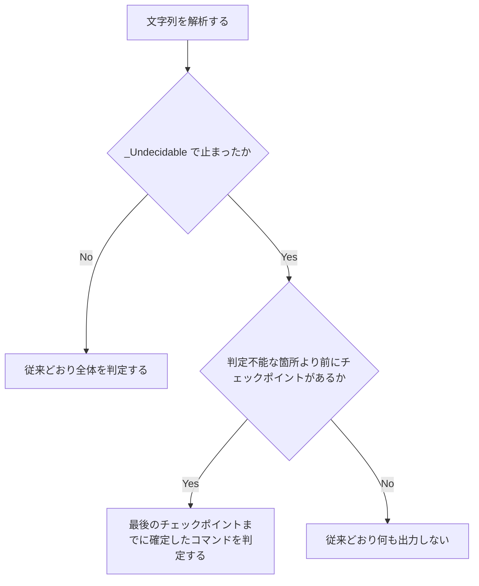

# codex-guard-backquote-comment-undecidable - 要件定義書

## 1. 概要

### 1.1 背景

codex-hook-interactive-guard（em-workflow / em-review の両コピー）は、文字列の解析が `_Undecidable` で止まると、その文字列の中のコマンドを判定しない。次の再現手順を `tool_input.command` に渡しても、1 行目の `python3 -B -S -i` は deny にならない。

```python
"bash -c " + shlex.quote("python3 -B -S -i\nfunction { :; } foo(`case x in x) echo x;; esac` # '\n)")
```

行番号は `tests/test_codex_hook_interactive_guard.py` のもの。

### 1.2 目的

- 両コピーで、文字列が判定不能になった箇所より前に読み終えた行の起動を deny にする。再現手順の先頭の `python3 -i` も含む。
- 再発を CASES で検出できるようにする。

### 1.3 スコープ

対象:

- `em-workflow/scripts/codex-hook-interactive-guard.py`
- `em-review/scripts/codex-hook-interactive-guard.py`
- `tests/test_codex_hook_interactive_guard.py` の CASES の行（FR4）と docstring テストの文言（FR6）

対象外（FR3）:

- `_Undecidable` 以外の例外の扱い
- コメントの例外の範囲、`_scan_parens`、`_read_argument_parens`、救済の規則、区切り・群・heredoc の読み
- 既存の CASES の行（削除も期待値の変更もしない）
- プラグインの version と deny の理由の文言（NFR3）

## 2. ビジネス要件

### 2.1 ビジネス目標

- 両コピーの codex-hook-interactive-guard.py で、文字列が判定不能になった箇所より前に読み終えた行の起動を deny にする（再現手順の先頭の `python3 -i` を含む）。
- 再発を CASES で検出できるようにする。

### 2.2 対象ユーザー

| ユーザータイプ | 説明 |
|----------------|------|
| em-workflow / em-review の利用者 | 両プラグインに入っている codex-hook-interactive-guard を使う |

### 2.3 期待される効果

- 再現手順が両コピーとも deny になる（AC1）。
- FR4 で足す行が、両コピーで期待どおりの値になる（AC2）。

## 3. ユースケース

### 3.1 ユースケース一覧

| ID | ユースケース名 | アクター |
|----|----------------|----------|
| UC01 | 判定不能で止まった文字列を最後のチェックポイントまで判定する | codex-hook-interactive-guard（両コピー） |

### 3.2 ユースケース詳細

#### UC01: 判定不能で止まった文字列を最後のチェックポイントまで判定する

**アクター**: codex-hook-interactive-guard（両コピー）

**事前条件**:
- フックのコマンドそのもの、または入れ子のリテラルなシェルの `-c` 文字列の解析が `_Undecidable` で止まる。

**基本フロー**:
1. 文字列を解析し、最上位でチェックポイントの条件を満たす改行を記録する（FR2）。
2. 解析が `_Undecidable` で止まる。
3. 最後のチェックポイントまでに確定したコマンドだけを、通常の順序でたどって判定する（FR2）。

**代替フロー**:
- 判定不能な箇所より前にチェックポイントが無い文字列は、従来どおり何も出力しない（FR3）。
- `_Undecidable` 以外の例外は従来どおりで、入れ子ならその文字列を飛ばし、最上位ならフックは何も出力せずに終わる（FR3）。

**事後条件**:
- 再現手順は両コピーとも deny になる（FR1）。

## 4. 機能要件

### 4.1 機能一覧

| ID | 機能名 |
|----|--------|
| FR1 | 再現手順を deny |
| FR2 | 判定不能のときは最後のチェックポイントまでを判定する |
| FR3 | 変えないもの |
| FR4 | 再発を検出する CASES の行 |
| FR5 | 2 つのコピー |
| FR6 | docstring |

### 4.2 機能詳細

共通の入力と出力:

- 入力: コマンド文字列（`tool_input.command`）
- 出力: `deny` または `silent`

#### FR1: 再現手順を deny

**説明**: 次の Python の式の値を `tool_input.command` に渡すと、両コピーとも permissionDecision が deny になる。

```python
"bash -c " + shlex.quote("python3 -B -S -i\nfunction { :; } foo(`case x in x) echo x;; esac` # '\n)")
```

#### FR2: 判定不能のときは最後のチェックポイントまでを判定する

**説明**: 文字列の解析が `_Undecidable` で止まったら、最後のチェックポイントまでに確定したコマンドだけを判定する。

**ビジネスルール**:
- チェックポイントは、reader 自身が最上位で読む改行のうち、次がすべて成り立つもの。
    - 開いている群が無い
    - 待っているパイプ（`|` / `|&`）が無い
    - 末尾の `&&` / `||` でリストが続いていない
    - その行の heredoc の本文を読み終えている
- `|`・`|&`・`&&`・`||` の後の空行、コメントだけの行、heredoc の本文は、次のコマンドが確定するまでチェックポイントを作らない。
- チェックポイントより前のコマンドは、接続と skip（関数定義の本体）を、チェックポイントより前に開いた群から取る。文字列全体を読んだときと同じ取り方にする。
- フックのコマンドそのものと、入れ子のリテラルなシェルの `-c` 文字列のすべてに当てはめる。
- こうして判定するコマンドは通常の順序でたどる。その中の `-c` 文字列と NESTED_READ_LIMIT も含む。
- 判定不能と分かった文字列も、NESTED_READ_LIMIT には全長で数える。

**処理フロー**:



#### FR3: 変えないもの

**説明**:
- 文字列の解析中に `_Undecidable` 以外の例外が起きた場合は従来どおり。入れ子ならその文字列を飛ばし、最上位ならフックは何も出力せずに終わる。
- 次は変えない。
    - コメントの例外の範囲
    - `_scan_parens`
    - `_read_argument_parens`
    - 救済の規則
    - 区切り・群・heredoc の読み
- 判定不能な箇所より前にチェックポイントの無い文字列は、従来どおり何も出力しない。
- 既存の CASES の行はすべてそのまま通る。行を消さず、期待値も変えない（例: 行 111-114、576-577、603-631、656-703 は silent のまま）。

#### FR4: 再発を検出する CASES の行

**説明**: `tests/test_codex_hook_interactive_guard.py` の CASES に次の行を足し、表を両コピーに流す。コマンドは Python の文字列リテラル。

deny の行:

```python
("deny", "判定不能で止まる前に読み終えた行の起動を拒否する (再現手順)", "bash -c 'python3 -B -S -i\nfunction { :; } foo(`case x in x) echo x;; esac` # '\"'\"'\n)'"),
("deny", "最上位で閉じない引用符より前の行の -i を拒否する", "python3 -i\necho '"),
("deny", "最上位で閉じない引用符より前の行のプログラムなしの起動を拒否する", "python3\necho '"),
("deny", "入れ子の -c 文字列で閉じない引用符より前の行の -i を拒否する", "bash -c 'python3 -i\necho '\"'\"''"),
("deny", "チェックポイントより前の閉じた群の中の起動を拒否する", "( python3 -i )\necho '"),
("deny", "チェックポイントより前の行の -c 文字列も判定する", "bash -c 'python3 -i'\necho '"),
("deny", "読み終えた heredoc の後の行の起動を拒否する", "python3 - <<EOF\nprint(1)\nEOF\npython3 -i\necho '"),
("deny", "既知の誤拒否: zsh は後ろの構文エラーで何も実行しない", "zsh -c 'python3 -i\nfunction { :; } foo(`case x in x) echo x;; esac` # '\"'\"'\n)'"),
("deny", "既知の誤拒否: 改行がシェルの実行単位の境界でない if の中の行", "if false; then\npython3 -i\necho '"),
```

silent の行:

```python
("silent", "同じ行の判定不能な箇所より前の起動は判定しない", "python3 -i; echo '"),
("silent", "| で続く行はチェックポイントにならない", "python3 -i |\necho '"),
("silent", "|& で続く行はチェックポイントにならない", "python3 -i |&\necho '"),
("silent", "&& で続く行はチェックポイントにならない", "python3 -i &&\necho '"),
("silent", "|| で続く行はチェックポイントにならない", "python3 -i ||\necho '"),
("silent", "&& の後の空行を越えても継続のまま", "python3 -i &&\n\necho '"),
("silent", "開いた群の中の行はチェックポイントにならない", "{ python3 -i\necho '"),
("silent", "heredoc の本文が終わらない行はチェックポイントにならない", "python3 -i <<EOF\nprint(1)"),
("silent", "チェックポイントより前の接続された群は接続の読みのまま", "( python3 ) < /dev/null\necho '"),
("silent", "チェックポイントより前の関数定義の本体は判定しない", "f() { python3 -i; }\necho '"),
("silent", "チェックポイントより前のパイプの右側は接続されている", "echo x | python3\necho '"),
```

#### FR5: 2 つのコピー

**説明**: `em-workflow/scripts/codex-hook-interactive-guard.py` と `em-review/scripts/codex-hook-interactive-guard.py` を同じ変更の中で直し、バイト単位で同一に保つ。

#### FR6: docstring

**説明**: モジュール docstring の「判定不能なら出力しない」旨の記述を FR2 に合わせて書き直す。対象:

- 手順 3（閉じない引用符・終わらない heredoc → 出力しない）
- 手順 4（閉じない群 → 出力しない）
- 手順 7（reader が読めない文字列は飛ばして通す）
- 手順 9（判定不能・想定外のものは出力しない）
- 「Everything the guard cannot positively identify passes」

`_scan` の docstring と `_Parser` の docstring（「Raises _Undecidable ...」）も同じ規則に直す。

**ビジネスルール**:
- 既存の文言はすべて残す。特に次の 2 つを残す。
    - "a string for which an unexpected error occurred while it was being read"
    - "the `}` is an ordinary word and the string stays undecidable"
- STALE_DOCSTRING_SENTENCES と STALE_GROUP_SENTENCES の文は書き戻さない。
- チェックポイントの規則を確かめる docstring テストの文言を足し、両コピーに流す。

**エラーケース**:

| エラー | 条件 | 対応 |
|--------|------|------|
| 既知の誤拒否 | 後ろに構文エラーのある zsh -c 文字列、改行がシェルの実行単位の境界でない行（`if` / `while` / `for` / `case` の中） | 受け入れる。deny の行として足し、ラベルに既知の誤拒否と書く（FR4・A2） |

## 5. 非機能要件

### 5.1 パフォーマンス要件

- NFR1: 解析は文字列の長さに対して線形のまま保つ。チェックポイントの記録は改行ごとに定数時間、チェックポイントより前の群を確定させる処理は群ごとに 1 回たどる。再帰は使わない。再帰と循環の検査、既存の性能テストが両コピーで通る。
- スループット: 該当なし
- 同時接続数: 該当なし

### 5.2 セキュリティ要件

- NFR2: 標準ライブラリだけを使い、ファイル・ネットワーク・子プロセスに触れない。判定はコマンド文字列だけで決まる（TestStaticConstraints）。
- NFR2: 入れ子の解析の例外処理の検査（nested_parse_handler_findings）が通る。`_Undecidable` と `Exception` の両方を捕まえ、`Exception` の処理は return も raise もしない。
- NFR2: 既存の deny は silent にならない。
- 認証・認可・データ保護: 該当なし

### 5.3 可用性要件

- 該当なし

### 5.4 保守性要件

- ドキュメント: FR6
- ログ出力・監視: 該当なし

### 5.5 互換性要件

- NFR3: plugin.json と marketplace.json の version は変えない。deny の理由の文言は変えない。
- 既存の CASES の行の結果が変わらない（FR3）。
- 2 つのコピーをバイト単位で同一に保つ（FR5）。

## 6. UI/UX要件

該当なし。デザインステップは skipped（フックの判定ロジックとそのテストだけで、UI が無い）。

## 7. データ要件

該当なし

## 8. 外部連携

該当なし

## 9. 制約条件

### 9.1 技術的制約

- 線形時間・再帰なし・標準ライブラリだけ（NFR1・NFR2）。
- 2 つのコピーをバイト単位で同一に保つ（FR5）。
- チェックポイントのコマンドを解析器から渡す形（例外の属性、返す組、ほかの形）は計画で決める。シンボルの削除・改名はしない（A3）。

### 9.2 ビジネス上の制約

- プラグインの version は変えない（NFR3・A4）。

### 9.3 スケジュール制約

- 該当なし

### 9.4 宣言された変更集合

このフィーチャー固有のパスは手動で列挙せず、create-plan で `workflow.yaml` の各タスクの `files` から導出する（`references/phases/create-plan-phase.md`）。

**デフォルトメンバー**（SPEC作成者が明示的に除外しない限り、常に宣言に含まれる）:
- `feature-docs/codex-guard-backquote-comment-undecidable/**`
- `test-docs/codex-guard-backquote-comment-undecidable/**`

`feature-docs/codex-guard-backquote-comment-undecidable/**` に含まれるもの: `REQUIREMENTS.md`、`SPEC.md`、`IMPLEMENTATION.md`、`workflow.yaml`、`phase-state/`、`tasks/`、`reviews/roundN.yaml`、`VERIFICATION.md`、`retrospect.yaml`、およびデザインステップが生成するデザイン成果物。生成主体は各フェーズドキュメントおよび `references/phase-state.md` を参照（引用のみ、ルールは再掲しない）。

`test-docs/codex-guard-backquote-comment-undecidable/**` に含まれるもの: `{T}.tests.yaml`（パス形式: `test-docs/codex-guard-backquote-comment-undecidable/{T}.tests.yaml`）。生成主体は `implement-phase.md` を参照（引用のみ、ルールは再掲しない）。

**意味論**:
- デフォルトのメンバーは、SPEC作成者が明示的に除外しない限り宣言に含まれる。除外は意図的な絞り込みであり、記載漏れによる省略ではない。
- この宣言はスーパーセット（superset）の主張であり、実際の変更集合は宣言に含まれる（CONTAINED IN）必要がある。実際には生成されないパスが宣言されていても違反にはならない。implementタスクを1つも生成しないフィーチャーは `test-docs/codex-guard-backquote-comment-undecidable/` ディレクトリを生成しないが、宣言された `test-docs/codex-guard-backquote-comment-undecidable/**` は依然として正しい。

## 10. 想定される課題とリスク

### 10.1 技術的課題

| 課題 | 影響度 | 対応策 |
|------|--------|--------|
| 既知の誤拒否: 後ろに構文エラーのある zsh -c 文字列（zsh は何も実行しない） | 中 | 受け入れる。deny の行として足し、ラベルに既知の誤拒否と書く（A1・A2・FR4） |
| 既知の誤拒否: 改行がシェルの実行単位の境界でない行（ガードが群として追わない `if` / `while` / `for` / `case` の中） | 中 | 受け入れる。deny の行として足し、ラベルに既知の誤拒否と書く（A2・FR4） |
| 起動行で終わらない heredoc（`python3 -i <<EOF\nprint(1)`）はチェックポイントが無く silent。bash は実行する | - | FR2 の定義で受け入れる見逃し |

### 10.2 ビジネスリスク

該当なし

## 11. 成功基準

### 11.1 受け入れ基準

- [ ] AC1: 再現手順の JSON で、両コピーとも deny を出力する。（FR1）
- [ ] AC2: FR4 で足す行が、両コピーですべて期待どおりの値になる。（FR2・FR4）
- [ ] AC3: 既存の CASES の行と TestNestedReadLimit がそのまま通る。test_a_string_that_proves_undecidable_still_counts も含む。（FR3）
- [ ] AC4: TestCopies.test_the_two_copies_are_byte_identical が通る。（FR5）
- [ ] AC5: 足した文言を含め、docstring テストが通る。（FR6）
- [ ] AC6: `python3 -m unittest tests.test_codex_hook_interactive_guard` と `python3 em-workflow/hooks/tests/run-destructive-guard.py && python3 -m unittest discover -s tests` が通る。（NFR1〜NFR3）

### 11.2 KPI

該当なし

## 12. テストシナリオ

### 12.1 テスト観点

- [ ] 正常系（deny）: TS1・TS2
- [ ] 既知の誤拒否（deny）: TS3
- [ ] 正常系（silent）: TS4
- [ ] 既存の行: TS5・TS6
- [ ] セキュリティ: TS6（nested_parse_handler_findings）
- [ ] パフォーマンス: TS7

### 12.2 シナリオ一覧

- TS1（AC1）: 再現手順の行 - deny
- TS2（AC2）: FR4 の deny の行。最上位の `-i`・プログラムなしの起動、入れ子の `-c`、閉じた群、チェックポイントより前の行の `-c`、読み終えた heredoc の後 - deny
- TS3（AC2）: FR4 の既知の誤拒否の行（後ろに構文エラーのある zsh -c、if の中の行）- deny。ラベルに既知の誤拒否と書く
- TS4（AC2）: FR4 の silent の行（同じ行、`|`・`|&`・`&&`・`||` の継続、`&&` の後の空行、開いた群、終わらない heredoc、接続された群、関数定義の本体、パイプの右側）- silent
- TS5（AC3）: 既存の CASES の行 - 変わらない
- TS6（AC4・AC5）: TestCopies、TestGuardDocumentation（足した文言）、入れ子の解析の例外処理の検査 - 通る
- TS7（NFR1）: 既存の性能テストと再帰の検査が、両コピーで制限内に通る
- IT1（AC6）: `python3 -m unittest tests.test_codex_hook_interactive_guard && python3 em-workflow/hooks/tests/run-destructive-guard.py && python3 -m unittest discover -s tests` - 通る

境界:

- ``function { python3 -i; } foo(`echo )` #)``（バッククォートの中の `)` で走査が早く終わり、本当の `)` は `#` の後にある）: コメントの例外の範囲を変えないので deny のまま。
- 起動行で終わらない heredoc（`python3 -i <<EOF\nprint(1)`）: チェックポイントが無いので silent。
- 行 113 の `cat <<EOF\npython3 -i`: 本文の行はコマンドにならないので silent のまま。
- `_Undecidable` 以外の例外: 従来どおりその文字列を飛ばす。

## 13. 用語定義

| 用語 | 定義 |
|------|------|
| 判定不能 | 文字列の解析が `_Undecidable` で止まること |
| チェックポイント | reader 自身が最上位で読む改行のうち、開いた群・待っているパイプ・`&&` / `||` の継続が無く、その行の heredoc の本文を読み終えているもの（FR2） |
| 既知の誤拒否 | A2 で受け入れる deny。後ろに構文エラーのある zsh -c 文字列と、改行がシェルの実行単位の境界でない行が当たる |

## 14. 確認事項

### 14.1 確認済み事項

- [x] シェルの動作（requirement.fix-approach）: bash -c は後ろの構文エラーを検出する前に 1 行目を実行する。zsh -c は文字列に parse error があると何も実行しない（A1。Codex が両方のシェルで実行した）
- [x] 既知の誤拒否（requirement.fix-approach）: 後ろに構文エラーのある zsh -c 文字列と、改行がシェルの実行単位の境界でない行（ガードが群として追わない `if` / `while` / `for` / `case` の中）の誤拒否を受け入れる（A2）
- [x] 実装の形: チェックポイントのコマンドを解析器から渡す形（例外の属性、返す組、ほかの形）は計画で決める。シンボルの削除・改名はしない（A3）
- [x] version: plugin.json と marketplace.json の version は変えない（A4。`.claude/rules/core-plugin-version-bump.md`）
- [x] ライセンス: LICENSE ファイルが無いので、ライセンスは検出なしとして扱う（A5）

### 14.2 未確認・保留事項

- なし

## 15. 参考資料

- `tests/test_codex_hook_interactive_guard.py`: 既存のテスト
- `.claude/rules/core-plugin-version-bump.md`: version の扱い
