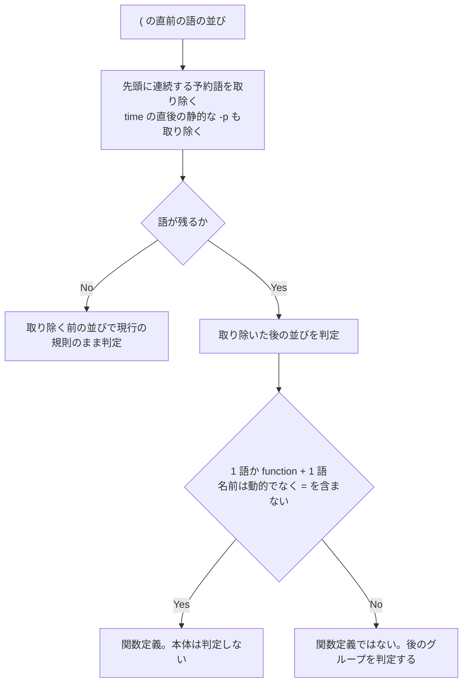

# codex-guard-reserved-word-funcdef - 要件定義書

## 1. 概要

### 1.1 背景
`codex-hook-interactive-guard.py`（em-workflow / em-review の両コピー）は、予約語の直後に書いた関数定義の本体を判定して deny する回帰を持つ。

### 1.2 目的
- 予約語の直後に書いた関数定義の本体を判定して deny する回帰をなくす。予約語の直後の関数定義は、単独の `f() { python3 -i; }` と同じく何も出力しない（silent）
- 予約語の直後の配列代入（`a=()` / `export a=()`）の後に置いたサブシェル・波括弧グループは、引き続き deny する

### 1.3 スコープ
対象:
- `em-workflow/scripts/codex-hook-interactive-guard.py`
- `em-review/scripts/codex-hook-interactive-guard.py`
- `tests/test_codex_hook_interactive_guard.py`

対象外:
- `time python3() { :; }` が deny のままであること（前提 A6）
- `time -p -p` や `time --` の `-p` 以降の除去（前提 A4）
- em-workflow / em-review の version（NFR6）

## 2. ビジネス要件

### 2.1 ビジネス目標
- `codex-hook-interactive-guard.py`（em-workflow / em-review の両コピー）が、予約語の直後に書いた関数定義の本体を判定して deny する回帰をなくす。予約語の直後の関数定義は、単独の `f() { python3 -i; }` と同じく何も出力しない（silent）
- 予約語の直後の配列代入（`a=()` / `export a=()`）の後に置いたサブシェル・波括弧グループは、引き続き deny する

### 2.2 対象ユーザー
該当なし

### 2.3 期待される効果
- 予約語の直後の関数定義が silent になる
- 予約語の直後の配列代入の後のサブシェル・波括弧グループは deny のまま

## 3. ユースケース

該当なし

## 4. 機能要件

### 4.1 機能一覧
| ID | 機能名 | 状態 |
|----|--------|------|
| FR1 | 先頭に連続する予約語を除いて関数名を判定する | resolved |
| FR2 | time の直後の静的な -p も取り除く | resolved |
| FR3 | 何も残らないときは現行の判定のまま | resolved |
| FR4 | 除去は関数定義の認識の中だけ | resolved |
| FR5 | 除去後の名前の条件は現行どおり | resolved |
| FR6 | docstring と _Group.head の説明を合わせる | resolved |
| FR7 | DOCSTRING_MARKERS に新しい記述のマーカーを足す | resolved |
| FR8 | CASES に回帰検出ケースを足す | resolved |
| FR9 | 両コピーを同時に直す | resolved |

### 4.2 機能詳細

#### FR1: 先頭に連続する予約語を除いて関数名を判定する

`_Parser._names_function` は、`(` の直前の語の並びの先頭に連続する予約語 `!` `do` `elif` `else` `if` `then` `time` `until` `while`（9 語）を取り除いてから、「1 語」か「`function` + 1 語」かを判定する。

#### FR2: time の直後の静的な -p も取り除く

取り除く途中で `time` を外したとき、その直後の語が動的でない `-p` であれば、その 1 語も合わせて取り除く。`time -p` の後に続く予約語も、FR1 に従って続けて取り除く（例: `time -p ! f()` → `f`）。

#### FR3: 何も残らないときは現行の判定のまま

取り除いた結果、語が 1 つも残らないときは、取り除く前の語の並びで現行の規則のまま判定する（例: `then()` は 1 語の関数名として扱われ、本体は判定しない。`time -p()` は 2 語なので定義にならない）。

#### FR4: 除去は関数定義の認識の中だけ

予約語の除去は `_names_function` の判定の内部に限る。`_flush` が `_Command` に積む語の並びは変えない。単純コマンドの判定は変えない（`time -p python3 -i` は silent、`time python3 -i` は deny のまま）。

#### FR5: 除去後の名前の条件は現行どおり

取り除くのは先頭に連続する予約語だけで、途中の予約語は取り除かない（`echo then f()` は 3 語のまま）。取り除いた後の名前は、動的でなく `=` を含まない 1 語に限る。配列代入（`a=` / `a+=`）、`export a=`、動的な語、除去後に 3 語以上の並びは関数定義にならず、その後のグループは判定する。

**処理フロー（FR1〜FR5）**:

#### FR6: docstring と _Group.head の説明を合わせる

モジュール docstring の手順 4 と `_Group.head` の説明に、`(` の直前の語の並びから先頭の予約語（FR1 の 9 語）と `time` の直後の `-p` を取り除いてから判定することを書く。「three words or more」は除去後の語数と読める書き方にする。既存の文「only `name()` and `function name()` start a function definition」は一字一句そのまま残す。

#### FR7: DOCSTRING_MARKERS に新しい記述のマーカーを足す

`tests/test_codex_hook_interactive_guard.py` の `TestGuardDocumentation.DOCSTRING_MARKERS` に、FR6 で docstring に書いた予約語除去の文を指すマーカーを 1 つ以上足す。既存のマーカーは消さない。

#### FR8: CASES に回帰検出ケースを足す

`tests/test_codex_hook_interactive_guard.py` の `CASES` に、予約語の直後の関数定義を silent として、予約語の直後の配列代入 + サブシェル / 波括弧グループを deny として `(期待する判定, ラベル, コマンド)` の形で追加する（具体的なケースは 12 章）。既存ケースは消さず、期待値も変えない。コマンドは表の中で重複させない。

#### FR9: 両コピーを同時に直す

`em-workflow/scripts/codex-hook-interactive-guard.py` と `em-review/scripts/codex-hook-interactive-guard.py` を同じ変更で直し、バイト単位で同一に保つ。

## 5. 非機能要件

| ID | 要件 |
|----|------|
| NFR1 | 両コピーはバイト単位で同一 |
| NFR2 | 標準ライブラリだけを使い、ファイル・ネットワーク接続・子プロセスに触れない。判定はコマンド文字列だけで決まる |
| NFR3 | 判定できない入力は何も出力しない（fail-open）。どの入力でも終了ステータスは 0、標準エラーは空 |
| NFR4 | グループは再帰を使わずスタックで追う。深く入れ子になった入力でも `TestMalformedAndDeepInput` の制限時間内に応答する |
| NFR5 | 既存の `CASES` の deny / silent ケースを消さず、判定も変えない |
| NFR6 | em-workflow / em-review の version（各 `.claude-plugin/plugin.json` と `.claude-plugin/marketplace.json`）は変えない |

## 6. UI/UX要件

該当なし

## 7. データ要件

該当なし

## 8. 外部連携

該当なし

## 9. 制約条件

### 9.1 技術的制約
- 標準ライブラリだけを使う（NFR2）
- 両コピーをバイト単位で同一に保つ（NFR1）

### 9.2 ビジネス上の制約
- em-workflow / em-review の version は変えない（NFR6）

### 9.3 スケジュール制約
該当なし

### 9.4 宣言された変更集合

このフィーチャー固有のパスは手動で列挙せず、create-plan で `workflow.yaml` の各タスクの `files` から導出する（`references/phases/create-plan-phase.md`）。

**デフォルトメンバー**（SPEC作成者が明示的に除外しない限り、常に宣言に含まれる）:
- `feature-docs/codex-guard-reserved-word-funcdef/**`
- `test-docs/codex-guard-reserved-word-funcdef/**`

`feature-docs/codex-guard-reserved-word-funcdef/**` に含まれるもの: `REQUIREMENTS.md`、`SPEC.md`、`IMPLEMENTATION.md`、`workflow.yaml`、`phase-state/`、`tasks/`、`reviews/roundN.yaml`、`VERIFICATION.md`、`retrospect.yaml`、およびデザインステップが生成するデザイン成果物。生成主体は各フェーズドキュメントおよび `references/phase-state.md` を参照（引用のみ、ルールは再掲しない）。

`test-docs/codex-guard-reserved-word-funcdef/**` に含まれるもの: `{T}.tests.yaml`（パス形式: `test-docs/codex-guard-reserved-word-funcdef/{T}.tests.yaml`）。生成主体は `implement-phase.md` を参照（引用のみ、ルールは再掲しない）。

**意味論**:
- デフォルトのメンバーは、SPEC作成者が明示的に除外しない限り宣言に含まれる。除外は意図的な絞り込みであり、記載漏れによる省略ではない。
- この宣言はスーパーセット（superset）の主張であり、実際の変更集合は宣言に含まれる（CONTAINED IN）必要がある。実際には生成されないパスが宣言されていても違反にはならない。implementタスクを1つも生成しないフィーチャーは `test-docs/codex-guard-reserved-word-funcdef/` ディレクトリを生成しないが、宣言された `test-docs/codex-guard-reserved-word-funcdef/**` は依然として正しい。

## 10. 想定される課題とリスク

該当なし

## 11. 成功基準

### 11.1 受け入れ基準
- [ ] AC-1（FR1, FR9）: `if true; then f() { python3 -i; }; fi` を `{"tool_input": {"command": "..."}}` として両コピーの標準入力に渡すと、何も出力せず終了ステータス 0 で終わる
- [ ] AC-2（FR1, FR2, FR5）: `do` / `!` / `time` / `else` / `elif` / `if` / `while` / `until` / `then function` / `time -p` / 連続した予約語（`! time`）の直後の関数定義が両コピーで silent になる（12 章の silent 群）
- [ ] AC-3（FR1）: 予約語の直後の関数定義で、`()` と本体の間に改行がある場合と、本体がサブシェル `( ... )` の場合も silent になる
- [ ] AC-4（FR5）: 予約語の直後の配列代入（`a=()` / `export a=()`）の後の改行とサブシェル / 波括弧グループは deny になる。`if true; then a=()` + 改行 + `(python3 -i)` + 改行 + `fi` を含む
- [ ] AC-5（FR5）: 途中の予約語は取り除かれない（`echo then f()` + 改行 + `(python3 -i)` は deny）。除去後に 2 語以上で `function` 形でない並び（`then a b()`）と動的な名前（`then $f()`）は deny
- [ ] AC-6（FR3）: 予約語だけの並び: `then()` + 改行 + `(python3 -i)` は silent、`time -p()` + 改行 + `(python3 -i)` は deny（現行と同じ）
- [ ] AC-7（FR4, NFR5）: 既存ケース `time -p python3 -i`（silent）と `time python3 -i`（deny）を含め、既存の `CASES` が全て元の期待値のまま通る
- [ ] AC-8（FR6, FR7）: 両コピーの docstring が FR6 の記述を持ち、`TestGuardDocumentation` が既存マーカーと FR7 で足したマーカーの両方で通る
- [ ] AC-9（FR9, NFR1）: 両コピーがバイト単位で同一
- [ ] AC-10（FR8）: `python3 -m unittest tests.test_codex_hook_interactive_guard` と `python3 -m unittest discover -s tests` が通る

### 11.2 KPI
該当なし

## 12. テストシナリオ

対象は `tests/test_codex_hook_interactive_guard.py` の `CASES`。コマンドは `CASES` と同じ Python 文字列リテラルの表記で、`\n` は改行を表す。全て両コピーに流す。

### 12.1 テスト観点

追加する silent ケース:

| ID | コマンド | 要件 |
|----|----------|------|
| TS-1 | `if true; then f() { python3 -i; }; fi` | FR1, FR8, FR9 |
| TS-2 | `for x in 1; do f() { python3 -i; }; done` | FR1, FR8 |
| TS-3 | `! f() { python3 -i; }` | FR1, FR8 |
| TS-4 | `time f() { python3 -i; }` | FR1, FR8 |
| TS-5 | `if false; then :; else f() { python3 -i; }; fi` | FR1, FR8 |
| TS-6 | `if false; then :; elif f() { python3 -i; }; then :; fi` | FR1, FR8 |
| TS-7 | `if f() { python3 -i; }; then :; fi` | FR1, FR8 |
| TS-8 | `while f() { python3 -i; }; do :; done` | FR1, FR8 |
| TS-9 | `until f() { python3 -i; }; do :; done` | FR1, FR8 |
| TS-10 | `time -p f() { python3 -i; }` | FR1, FR2, FR8 |
| TS-11 | `! time f() { python3 -i; }` | FR1, FR8 |
| TS-12 | `if true; then function f() { python3 -i; }; fi` | FR1, FR5, FR8 |
| TS-13 | `if true; then f()\n{ python3 -i; }\nfi` | FR1, FR8 |
| TS-14 | `if true; then f() (python3 -i); fi` | FR1, FR8 |
| TS-15 | `then()\n(python3 -i)` | FR3, FR8 |

TS-1 は回帰の再現ケースで、AC-1 のコマンドを hook の標準入力に渡し、標準出力が空であることを `CASES` の silent ケースとして確認する。

追加する deny ケース:

| ID | コマンド | 要件 |
|----|----------|------|
| TS-16 | `if true; then a=()\n(python3 -i)\nfi` | FR5, FR8 |
| TS-17 | `if true; then export a=()\n(python3 -i)\nfi` | FR5, FR8 |
| TS-18 | `for x in 1; do a=()\n(python3 -i)\ndone` | FR5, FR8 |
| TS-19 | `if false; then :; else a=()\n{ python3 -i; }\nfi` | FR5, FR8 |
| TS-20 | `echo then f()\n(python3 -i)` | FR5, FR8 |
| TS-21 | `if true; then a b()\n(python3 -i)\nfi` | FR5, FR8 |
| TS-22 | `if true; then $f()\n(python3 -i)\nfi` | FR5, FR8 |
| TS-23 | `time -p()\n(python3 -i)` | FR3, FR8 |

判定を変えない既存ケース:

| ID | 期待する判定 | コマンド | 要件 |
|----|--------------|----------|------|
| TS-24 | silent | `time -p python3 -i` | FR4, NFR5 |
| TS-25 | deny | `time python3 -i` | FR4, NFR5 |
| TS-26 | silent | `f() { python3; }` | NFR5 |
| TS-27 | deny | `a=()\n(python3 -i)` | FR5, NFR5 |
| TS-28 | deny | `a b c()\n(python3 -i)` | FR5, NFR5 |

その他:

| ID | 内容 | 要件 |
|----|------|------|
| TS-29 | `TestGuardDocumentation.DOCSTRING_MARKERS` に FR6 の文のマーカーを追加し、既存マーカーと合わせて通る | FR6, FR7 |
| TS-30 | 両コピーがバイト単位で同一 | FR9, NFR1 |
| TS-31 | `python3 -m unittest tests.test_codex_hook_interactive_guard` と `python3 -m unittest discover -s tests` が通る | FR8, NFR4 |

## 13. 用語定義

| 用語 | 定義 |
|------|------|
| 両コピー | `em-workflow/scripts/codex-hook-interactive-guard.py` と `em-review/scripts/codex-hook-interactive-guard.py` |
| 予約語 | `!` `do` `elif` `else` `if` `then` `time` `until` `while` の 9 語 |
| silent | hook が何も出力しないこと |
| deny | `CASES` で `deny` を期待する判定 |

## 14. 確認事項

### 14.1 確認済み事項

- [x] デザインステップ: スキップ。UI を持たない hook スクリプトの判定修正で、デザイン対象がない

### 14.2 前提

| ID | 前提 | 変更可能 |
|----|------|----------|
| A1 | 取り除くのは並びの先頭に連続する予約語だけ（`echo then f()` は取り除かない） | はい |
| A2 | 除去後の判定条件は現行どおり、1 語か `function` + 1 語、名前は動的でなく `=` を含まない | はい |
| A3 | 予約語の照合は語のテキストで行う。動的な語は一致しない。`_Word` は引用の有無を持たないため、`"then" f()` や `\then f()` のような引用付きの綴りも除去対象になる（bash では構文エラーになり、実行されないコマンド） | はい |
| A4 | `time` の後に取り除く `-p` は、`time` の直後の 1 語だけ。`time -p -p` や `time --` は対象外 | はい |
| A5 | docstring の「three words or more」は除去後の語数として読む | はい |
| A6 | `time python3() { :; }` が deny のままであることは対象外。`_flush` が積む語の並び `[time, python3]` は単純コマンドとして判定される | はい |
| A7 | em-workflow / em-review の version は変えない | はい |

### 14.3 未確認・保留事項
なし

## 15. 参考資料

該当なし
