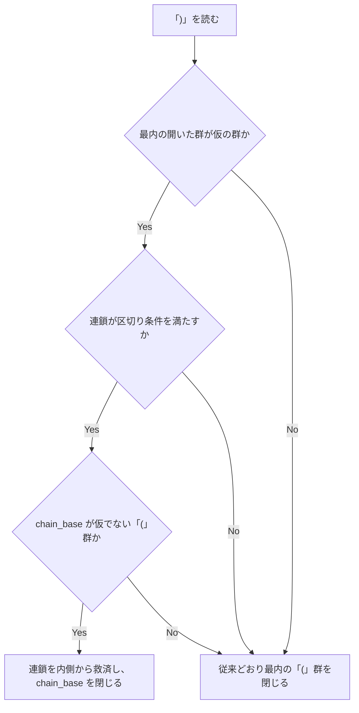

# codex-guard-subshell-anon-arg-semicolon - 要件定義書

## 1. 概要

### 1.1 背景

codex-hook-interactive-guard（em-workflow / em-review の両コピー）は、次の再現形を deny にしていない。

```
zsh -c 'setopt nobadpattern; ( function { :; } foo(a; python3 -i; )'
```

既存テストでは、行 661 の `} 救済 TS21` の行がこの再現形を deny 以外で期待していて、640 行目のコメントは TS21 を判定不能に数えている。

行番号は `tests/test_codex_hook_interactive_guard.py` のもの。`_close_paren 1071-1072` だけはスクリプトの行番号。

### 1.2 目的

サブシェル `( ... )` の中で、匿名関数の引数から仮に開いた `(` の最初の直接の区切りが `;` か単独の `&` で、後の `)` がその群を閉じる形を deny にする。

### 1.3 スコープ

対象:

- `em-workflow/scripts/codex-hook-interactive-guard.py`
- `em-review/scripts/codex-hook-interactive-guard.py`
- `tests/test_codex_hook_interactive_guard.py` の行（FR7・FR8）と、docstring テストが確かめる文言（FR9）

対象外:

- chain_base が None（最上位）の場合と `{` 群の場合の `)` の読み（FR4）
- 既存の区切り条件の定義（FR3・A4）
- プラグインの version（A3）

## 2. ビジネス要件

### 2.1 ビジネス目標

codex-hook-interactive-guard（em-workflow / em-review の両コピー）が、サブシェル `( ... )` の中で匿名関数の引数から仮に開いた `(` の最初の直接の区切りが `;` か単独の `&` で、後の `)` がその群を閉じる形を deny にする。

### 2.2 対象ユーザー

| ユーザータイプ | 説明 |
|----------------|------|
| em-workflow / em-review の利用者 | 両プラグインに入っている codex-hook-interactive-guard を使う |

### 2.3 期待される効果

- 再現形と、単独の `&`・入れ子の連鎖・語が残る `)`・`)` の後に続きがある形が deny になる（AC1・AC2）。
- この feature で足す読みのほかは、判定できない入力が silent のまま（NFR4）。

## 3. ユースケース

### 3.1 ユースケース一覧

| ID | ユースケース名 | アクター |
|----|----------------|----------|
| UC01 | サブシェルの中の仮の群の連鎖を `)` で判定する | codex-hook-interactive-guard（両コピー） |

### 3.2 ユースケース詳細

#### UC01: サブシェルの中の仮の群の連鎖を `)` で判定する

**アクター**: codex-hook-interactive-guard（両コピー）

**事前条件**:
- 入力のコマンド文字列に、匿名関数の引数から仮に開いた `(` 群の連鎖があり、そのすぐ外側（chain_base）が `(` 群である。

**基本フロー**:
1. `)` を読む。
2. 最内の開いた群が仮の群か、その連鎖が既存の区切り条件を満たすか、chain_base が仮でない `(` 群かを確かめる（FR2）。
3. すべて成り立てば、仮の群の連鎖を内側から救済し、chain_base を閉じる。
4. 救済した群のコマンドは、救済で閉じた `(` 群のコマンドとして判定する（FR6）。

**代替フロー**:
- 条件を満たさない `)` は、従来どおり最内の `(` 群を閉じる（FR2）。
- chain_base が None（最上位）か `{` 群の場合は、`)` の読みを変えない（FR4）。

**事後条件**:
- 再現形は両コピーとも deny になる（FR1）。

## 4. 機能要件

### 4.1 機能一覧

| ID | 機能名 |
|----|--------|
| FR1 | 再現形を deny |
| FR2 | `)` の時点での救済 |
| FR3 | 区切り条件は共通の定義のまま |
| FR4 | 対象は chain_base が `(` 群の場合だけ |
| FR5 | `)` の前に残る語 |
| FR6 | 救済後のコマンドの所属と閉じた後の読み |
| FR7 | 既存行 672 の扱い |
| FR8 | TS21 行 |
| FR9 | ドキュメントの更新 |
| FR10 | 2 つのコピー |

### 4.2 機能詳細

共通の入力と出力:

- 入力: コマンド文字列
- 出力: `deny` または `silent`

#### FR1: 再現形を deny

**説明**: `zsh -c 'setopt nobadpattern; ( function { :; } foo(a; python3 -i; )'` を両コピーとも deny にする。単独の `&` を区切りにした形 `( function { :; } foo(a & python3 -i; )` も deny にする。

#### FR2: `)` の時点での救済

**説明**: `)` を読んだときに次がすべて成り立てば、仮の群の連鎖を内側から救済し、連鎖のすぐ外側の `(` 群（chain_base）を閉じる。

- 最内の開いた群が仮の群であること
- その連鎖が既存の区切り条件を満たすこと（`_rescue_separator`・`outer_blocked`）。直接の first_sep だけで判断し、範囲を見つけた先読みは使わない。
- chain_base が仮でない `(` 群であること

**処理フロー**:



**ビジネスルール**:
- 判定は群を開いたときに `_mark_provisional` が固定した値だけを読み、定数時間で済ませる。
- 連鎖の各群は、開いた群から 1 回だけ取り除く。
- 救済した群の `(` は引数の語の文字として読み、群はその区切りで終わる。
- 条件を満たさない `)` は、従来どおり最内の `(` 群を閉じる。

#### FR3: 区切り条件は共通の定義のまま

**説明**: 救済の条件は `_rescue_separator` の定義 1 つを、入力の終わりでの救済・`}` での救済・`)` での救済で共有する。

**ビジネスルール**:
- 最初の直接の区切りが次のいずれかの場合は救済しない。
    - 改行
    - `&&`
    - `||`
    - `|`
    - `|&`
    - 引用符やバックスラッシュで打ち消した `;` / `&`
    - `&>` / `>&`
- 外側の仮の群に区切りが無ければ、内側の区切りを受け継ぐ。

#### FR4: 対象は chain_base が `(` 群の場合だけ

**説明**: chain_base が None（最上位）の場合と `{` 群の場合、`)` の読みは変えない。

**ビジネスルール**:
- 行 560 の `function { :; } foo(a; python3 -i)` は群として読んで deny にする。
- `{` 群の場合は、既存の `}` 救済の規則のまま。

#### FR5: `)` の前に残る語

**説明**: 読み替える `)` の前に語が残っていれば、それを閉じる `(` 群のコマンドとして確定してから群を閉じる。`)` は残る語の有無によらず、語を終えてサブシェルを閉じる。

#### FR6: 救済後のコマンドの所属と閉じた後の読み

**説明**: 救済した群のコマンドは移動しない。救済で閉じた `(` 群のコマンドとして判定する。

**ビジネスルール**:
- 群の後の入力リダイレクトやパイプの接続は、救済した群のコマンドにも届く。
- 関数定義の本体の中なら skipped になる。
- 群を閉じた後のテキストは群の外として読む。
- その後に対の無い `)` があれば、既存のコードのとおり区切りとして読む（`_close_paren` 1071-1072）。

#### FR7: 既存行 672 の扱い

**説明**:
- 行 672 の入力は `)` をコメントの中に移した `zsh -c 'setopt nobadpattern; ( function { :; } foo(a; python3 -i; } #)'` に直す。silent のまま、「仮の群のすぐ外側が ( 群なら } は閉じない」ことを確かめる行として残す。
- 元の入力 `zsh -c 'setopt nobadpattern; ( function { :; } foo(a; python3 -i; } )'` は deny の行として新しく足す。zsh 5.9 では parse error になる既知の誤拒否だとラベルに書く。

#### FR8: TS21 行

**説明**: 行 661 の `} 救済 TS21` の再現形は期待値を deny に変え、ラベルを新しい読みに合わせる。640 行目のコメント（TS21 を判定不能に数えている）も直す。

#### FR9: ドキュメントの更新

**説明**: 次の docstring を `)` での救済に合わせて直す。

- モジュール docstring の手順 4
- `_Parser`
- `_Group`（provisional・chain_base・outer_blocked）
- `_rescue_separator`
- `_rescue_argument_groups`
- `_read_argument_parens`
- `_close_paren`
- 変更・追加するメソッド

**ビジネスルール**:
- docstring テストが確かめている既存の文言（RESCUE_PROVISIONAL_MARKER、RESCUE_MARKERS、BRACE_CLOSE_MARKER、COMMENT_EXCEPTION_MARKERS など）は残す。
- STALE_DOCSTRING_SENTENCES と STALE_GROUP_SENTENCES の文は書き戻さない。

#### FR10: 2 つのコピー

**説明**: `em-workflow/scripts/codex-hook-interactive-guard.py` と `em-review/scripts/codex-hook-interactive-guard.py` を同じ変更の中で一緒に直し、バイト単位で同一に保つ。

**エラーケース**:

| エラー | 条件 | 対応 |
|--------|------|------|
| 既知の誤拒否 | TS12・TS13 の入力（zsh 5.9 では parse error） | deny の行として足し、ラベルに既知の誤拒否と書く（FR7・AC4・A2） |

## 5. 非機能要件

### 5.1 パフォーマンス要件

- NFR1: 解析は文字列の長さに対して線形時間のまま保つ。`)` での判定は定数時間で、各仮の群を取り除くのは 1 回だけにする。
- レスポンスタイム: chain_base が `(` 群で深い連鎖を `)` で閉じる規模テストが、制限時間内に答えを返す（AC6）。
- スループット: 該当なし
- 同時接続数: 該当なし

### 5.2 セキュリティ要件

- NFR3: 標準ライブラリだけを使い、ファイル・ネットワーク・子プロセスに触れない（既存の制約テスト）。
- NFR4: この feature で足す読みのほかは、判定できない入力を silent のままにする。
- 認証・認可・データ保護: 該当なし

### 5.3 可用性要件

- 該当なし

### 5.4 保守性要件

- NFR2: 再帰を使わない（`test_no_function_calls_itself_and_no_functions_form_a_cycle`）。
- ドキュメント: FR9
- ログ出力・監視: 該当なし

### 5.5 互換性要件

- 最上位の行（560、591-633）と `}` 救済の行（641-676、672 を除く）の結果が変わらない（AC5）。
- 2 つのコピーをバイト単位で同一に保つ（FR10）。

## 6. UI/UX要件

該当なし。デザインステップは skipped（UI の無いフックスクリプトの構文解析の修正で、デザインシステムの候補も無い）。

## 7. データ要件

該当なし

## 8. 外部連携

該当なし

## 9. 制約条件

### 9.1 技術的制約

- 線形時間・再帰なし・標準ライブラリだけ（NFR1・NFR2・NFR3）。
- 既存の区切り条件（行 603-615、656-657 で確かめている）は変えずに使う（A4）。
- 2 つのコピーをバイト単位で同一に保つ（FR10）。

### 9.2 ビジネス上の制約

- プラグインの version は変えない。push 時に Actions が patch を上げる（A3）。

### 9.3 スケジュール制約

- 該当なし

### 9.4 宣言された変更集合

このフィーチャー固有のパスは手動で列挙せず、create-plan で `workflow.yaml` の各タスクの `files` から導出する（`references/phases/create-plan-phase.md`）。

**デフォルトメンバー**（SPEC作成者が明示的に除外しない限り、常に宣言に含まれる）:
- `feature-docs/codex-guard-subshell-anon-arg-semicolon/**`
- `test-docs/codex-guard-subshell-anon-arg-semicolon/**`

`feature-docs/codex-guard-subshell-anon-arg-semicolon/**` に含まれるもの: `REQUIREMENTS.md`、`SPEC.md`、`IMPLEMENTATION.md`、`workflow.yaml`、`phase-state/`、`tasks/`、`reviews/roundN.yaml`、`VERIFICATION.md`、`retrospect.yaml`、およびデザインステップが生成するデザイン成果物。生成主体は各フェーズドキュメントおよび `references/phase-state.md` を参照（引用のみ、ルールは再掲しない）。

`test-docs/codex-guard-subshell-anon-arg-semicolon/**` に含まれるもの: `{T}.tests.yaml`（パス形式: `test-docs/codex-guard-subshell-anon-arg-semicolon/{T}.tests.yaml`）。生成主体は `implement-phase.md` を参照（引用のみ、ルールは再掲しない）。

**意味論**:
- デフォルトのメンバーは、SPEC作成者が明示的に除外しない限り宣言に含まれる。除外は意図的な絞り込みであり、記載漏れによる省略ではない。
- この宣言はスーパーセット（superset）の主張であり、実際の変更集合は宣言に含まれる（CONTAINED IN）必要がある。実際には生成されないパスが宣言されていても違反にはならない。implementタスクを1つも生成しないフィーチャーは `test-docs/codex-guard-subshell-anon-arg-semicolon/` ディレクトリを生成しないが、宣言された `test-docs/codex-guard-subshell-anon-arg-semicolon/**` は依然として正しい。

## 10. 想定される課題とリスク

### 10.1 技術的課題

| 課題 | 影響度 | 対応策 |
|------|--------|--------|
| 既知の誤拒否 2 件（TS12・TS13）。zsh 5.9 では parse error になり何も実行されない入力 | 低 | 受け入れる。deny の行として足し、ラベルに既知の誤拒否と書く（A2・FR7・AC4） |

### 10.2 ビジネスリスク

該当なし

## 11. 成功基準

### 11.1 受け入れ基準

- [ ] AC1: 再現形（TS21 の入力）が両コピーとも deny になる。（FR1・FR2・FR8）
- [ ] AC2: 単独の `&` の形、入れ子の連鎖の形、語が残る `)` の形、`)` の後に続きがある形が deny になる。（FR1・FR2・FR3・FR5・FR6）
- [ ] AC3: 最初の直接の区切りが `&&`・改行の形、閉じた群が接続される形、関数定義の本体の中の形、`)` がコメントの中にある形は silent になる。（FR3・FR4・FR6・FR7）
- [ ] AC4: 行 672 を `... } #)` の形に直して silent とし、元の入力を既知の誤拒否と書いた deny の行として足す。`( function { :; } foo(a; python3) ) < /dev/null` も既知の誤拒否と書いた deny の行として足す。（FR6・FR7）
- [ ] AC5: 最上位の行（560、591-633）と `}` 救済の行（641-676、672 を除く）の結果が変わらない。（FR4）
- [ ] AC6: chain_base が `(` 群で深い連鎖を `)` で閉じる規模テストが、制限時間内に答えを返す（deny）。（NFR1・NFR2）
- [ ] AC7: `python3 -m unittest tests.test_codex_hook_interactive_guard` が全て通り、2 つのコピーがバイト単位で同一のまま。docstring テストも通る。（FR9・FR10・NFR3）

### 11.2 KPI

該当なし

## 12. テストシナリオ

### 12.1 テスト観点

- [ ] 正常系（deny）: TS1〜TS5
- [ ] 正常系（silent）: TS6〜TS11、TS14
- [ ] 既知の誤拒否（deny）: TS12・TS13
- [ ] 境界値: 区切りが `&&`（TS6）・改行（TS7）、引用符の中の `)`（TS14）、コメントの中の `)`（TS11）
- [ ] セキュリティ: 該当なし
- [ ] パフォーマンス: TS15

### 12.2 シナリオ一覧

- TS1（deny）: 再現形（TS21 の行を反転）
    ```
    zsh -c 'setopt nobadpattern; ( function { :; } foo(a; python3 -i; )'
    ```
- TS2（deny）: 単独の `&`
    ```
    zsh -c 'setopt nobadpattern; ( function { :; } foo(a & python3 -i; )'
    ```
- TS3（deny）: (c) 語が残る `)`。zsh 5.9 は R3 を出力する
    ```
    zsh -c 'setopt nobadpattern; ( function { :; } foo(a; python3 -i )'
    ```
- TS4（deny）: (d) `)` の後のコマンド。zsh 5.9 は R4R5 を出力する
    ```
    zsh -c 'setopt nobadpattern; ( function { :; } foo(a; :; ); python3 -i'
    ```
- TS5（deny）: 入れ子の仮の群の連鎖
    ```
    zsh -c 'setopt nobadpattern; ( function { :; } foo(function { :; } bar(a; python3 -i; )'
    ```
- TS6（silent）: 最初の区切りが `&&`
    ```
    zsh -c 'setopt nobadpattern; ( function { :; } foo(a && python3 -i; )'
    ```
- TS7（silent）: 最初の区切りが改行。Python の文字列リテラルで書く（`\n` は改行）
    ```
    "zsh -c 'setopt nobadpattern; ( function { :; } foo(a\npython3 -i; )'"
    ```
- TS8（silent）: 閉じたサブシェルの入力リダイレクトが救済後のコマンドに届く
    ```
    zsh -c 'setopt nobadpattern; ( function { :; } foo(a; python3; ) < /dev/null'
    ```
- TS9（silent）: 閉じたサブシェルのパイプ接続が届く
    ```
    zsh -c 'setopt nobadpattern; echo x | ( function { :; } foo(a; python3; )'
    ```
- TS10（silent）: 関数定義の本体の中は skipped
    ```
    zsh -c 'setopt nobadpattern; f() ( function { :; } foo(a; python3 -i; )'
    ```
- TS11（silent）: 行 672 を直した形。`}` は閉じない
    ```
    zsh -c 'setopt nobadpattern; ( function { :; } foo(a; python3 -i; } #)'
    ```
- TS12（deny）: 既知の誤拒否。zsh 5.9 では parse error（(b)）。元の行 672 の入力
    ```
    zsh -c 'setopt nobadpattern; ( function { :; } foo(a; python3 -i; } )'
    ```
- TS13（deny）: 既知の誤拒否。zsh 5.9 では parse error（(a)）。救済で閉じた後の対の無い `)` は区切り
    ```
    zsh -c 'setopt nobadpattern; ( function { :; } foo(a; python3) ) < /dev/null'
    ```
- TS14（silent）: 引用符の中の `)` は契機にならず、群が開いたまま残る
    ```
    zsh -c 'setopt nobadpattern; ( function { :; } foo(a; python3 -i; ")"'
    ```
- TS15（deny）: 規模。制限時間内に答える（NFR1）。Python の式で組み立てる
    ```
    '( ' + 'function { :; } x(' * depth + '; python3 -i; )'
    ```

## 13. 用語定義

| 用語 | 定義 |
|------|------|
| 仮の群 | 匿名関数の引数から仮に開いた `(` 群 |
| chain_base | 仮の群の連鎖のすぐ外側の群 |
| first_sep | 群の最初の直接の区切り |
| 救済 | 仮の群の `(` を引数の語の文字として読み、群をその区切りで終えること |
| 既知の誤拒否 | zsh 5.9 では parse error になる入力を deny にする行（TS12・TS13） |

## 14. 確認事項

### 14.1 確認済み事項

- [x] `)` の読み替え（requirement.close-paren-reassociation）: `setopt nobadpattern` のもとで zsh は引数の語 `foo(a` を最初の引用符の外の `;` か単独の `&` で終え、後の `)` を外側のサブシェルの閉じとして読む（A1。タスクの再現手順 2 と、zsh 5.9 の実測 (c)(d)）
- [x] 既知の誤拒否（requirement.close-paren-reassociation・requirement.pending-words-at-close-paren）: TS12・TS13 は zsh 5.9 では parse error になり何も実行されない入力に限られ、受け入れる（A2。batch-codex-consultation）
- [x] version: プラグインの version は変えない。push 時に Actions が patch を上げる（A3。`.claude/rules/core-plugin-version-bump.md`）
- [x] 区切り条件: 既存の区切り条件（行 603-615、656-657 で確かめている）は変えずに使う（A4。既存テストで確かめている不変条件）

### 14.2 未確認・保留事項

- なし

## 15. 参考資料

- `tests/test_codex_hook_interactive_guard.py`: 既存のテスト
- `.claude/rules/core-plugin-version-bump.md`: version の扱い
