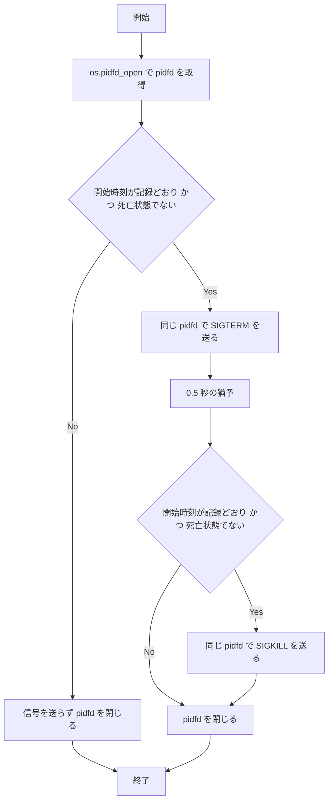

# codex-hook-tty-reaper-pid-reuse - 要件定義書

## 1. 概要

### 1.1 背景
`codex-hook-tty-reaper.py` について、タスクに 2 つの再現手順がある。

- 再現手順 1: 起点の子孫でないプロセス C の古い PPID と、PID が再利用された P の新しい PPID が 1 つのスナップショットに現れる。再利用された P の開始時刻は C の開始時刻より後である。
- 再現手順 2: 対象の `/proc/PID/stat` の読み取りが開始時刻 100 を返し、その後その PID のプロセスが開始時刻 200 のものに入れ替わる。

### 1.2 目的
`codex-hook-tty-reaper.py` が、PID の再利用が起きた場合を含むどの段階でも、起動した Codex（起点）の子孫でないプロセスに SIGTERM も SIGKILL も送らないようにする。

### 1.3 スコープ
- `em-workflow/scripts/codex-hook-tty-reaper.py`
- `em-review/scripts/codex-hook-tty-reaper.py`
- `tests/test_codex_hook_tty_reaper.py`

スクリプトのファイル名と、ただ 1 つの引数 `ANCHOR` は変えない。2 つの `run_codex_exec.sh` は変更しない（A2）。

## 2. ビジネス要件

### 2.1 ビジネス目標
`codex-hook-tty-reaper.py` は、PID の再利用が起きた場合を含むどの段階でも、起点の子孫でないプロセスに SIGTERM も SIGKILL も送らない。

### 2.2 対象ユーザー
該当なし

### 2.3 期待される効果
- 起点の子孫でないプロセスに SIGTERM / SIGKILL が送られない。

## 3. ユースケース

該当なし（UI のない、プロセスへ信号を送るスクリプトの内部の不具合修正）

## 4. 機能要件

### 4.1 機能一覧
| ID | 機能名 | 説明 | 優先度 |
|----|--------|------|--------|
| FR1 | 子孫リンクへの開始時刻の順序規則 | 親の開始時刻が子より後のリンクを子孫の計算に採用しない | 高 |
| FR2 | 確認の前に取得した pidfd を通じた送信 | pidfd を取ってから開始時刻と状態を確かめ、その pidfd で SIGTERM を送る | 高 |
| FR3 | SIGTERM から SIGKILL までの pidfd の保持 | SIGKILL も同じ pidfd を通じて送る | 高 |
| FR4 | pidfd が使えない場合 | 信号を送らず、何も止めない | 高 |
| FR5 | エラーの扱い | ProcessLookupError は対象を飛ばし、それ以外は実行を終える | 高 |
| FR6 | フックの祖先チェーンへの開始時刻の順序規則 | 親が子より後に開始したリンクがあれば何も止めない | 高 |
| FR7 | 2 つのコピー | 2 つのコピーを同じ変更で直し、バイト単位で同一に保つ | 高 |
| FR8 | 回帰テスト | 再現手順・境界・pidfd まわりのプロセス内テストを追加する | 高 |
| FR9 | docstring | モジュールの docstring に新しい動作を書く | 中 |

### 4.2 機能詳細

#### FR1: 子孫リンクへの開始時刻の順序規則

**説明**: 起点の子孫をスナップショットから求めるとき、子 C から親 P へのリンクは、P の記録上の開始時刻が C の開始時刻より後でない場合に限って採用する。

**ビジネスルール**:
- 開始時刻が等しいリンクは採用する。
- 採用しなかったリンクの子 C と、C を経由してしか到達できないすべてのプロセスは、子孫として扱わない。
- 起点の開始時刻はスナップショットから取る。
- 起点がスナップショットにないときは、何も止めない（A3）。

#### FR2: 確認の前に取得した pidfd を通じた送信

**説明**: 各対象について、まず `os.pidfd_open(pid)` で pidfd を取得する。その pidfd を保持したまま、`/proc/PID/stat` が記録した開始時刻のままであること、状態が死亡状態（`Z`、`X`、`x`）でないことを確かめる。確認が通ったときだけ、その pidfd に対して `signal.pidfd_send_signal` で SIGTERM を送る。

**ビジネスルール**:
- 確認が通らなかった対象には、その時点でも以後も信号を送らない。
- 確認が通らなかった対象の pidfd は閉じる。

**処理フロー**（FR2・FR3・NFR3 をまとめたもの）:

#### FR3: SIGTERM から SIGKILL までの pidfd の保持

**説明**: SIGTERM を送った各対象の pidfd を、猶予の待ちと SIGKILL の段階を通して保持する。SIGKILL は同じ pidfd を通じて、同じ開始時刻と死亡状態の確認を経て送る。

**ビジネスルール**:
- 1 つの対象に 2 つ目の pidfd を開かない。
- フックが開いたすべての pidfd を、どの経路でも実行が終わる前に閉じる。

#### FR4: pidfd が使えない場合

**説明**: `os.pidfd_open` か `signal.pidfd_send_signal` が存在しないとき、またはカーネルが pidfd に対応していないとき（例: ENOSYS）は、信号を送らず、何も止めない。

**ビジネスルール**:
- `os.kill` には戻らない。

#### FR5: エラーの扱い

**説明**: pidfd の取得と送信で起きたエラーを次のように扱う（A4）。

**エラーケース**:
| エラー | 条件 | 対応 |
|--------|------|------|
| ProcessLookupError | `pidfd_open` または `pidfd_send_signal` で発生 | エラーとして扱わない。その対象にはそれ以上信号を送らず、ほかの対象の処理は続ける |
| EMFILE | pidfd を開くときに発生 | 実行を終える。以後の信号は送らない |
| ENOSYS | 発生 | 実行を終える。以後の信号は送らない |
| 上記以外のエラー | 発生 | 実行を終える。以後の信号は送らない |

#### FR6: フックの祖先チェーンへの開始時刻の順序規則

**説明**: フック自身の祖先チェーンを PID 1 までたどるとき、プロセス X からその親 Y へのリンクを FR1 の規則で確かめる。

**ビジネスルール**:
- Y の開始時刻が X の開始時刻より後なら、何も止めない。
- 開始時刻が等しい場合は許容する。
- チェーンは引き続き、起点の妥当性の確認と、除外対象の両方に使う。

#### FR7: 2 つのコピー

**説明**: `em-workflow/scripts/codex-hook-tty-reaper.py` と `em-review/scripts/codex-hook-tty-reaper.py` を同じ変更の中で直し、バイト単位で同一に保つ。

#### FR8: 回帰テスト

**説明**: `tests/test_codex_hook_tty_reaper.py` に、次のプロセス内テストを追加する。
- タスクの 2 つの再現手順
- 開始時刻が等しい場合
- 祖先チェーンの規則
- pidfd が使えない場合
- pidfd の処理中のエラー

**ビジネスルール**:
- テストの差し替え口を、pidfd による送信に合わせて変える。
- 偽の `pidfd_open` と `pidfd_send_signal` は、pidfd を開いた時点でその PID を持っていたプロセスのインスタンスに pidfd を結びつける。
- `main()` の既定値を固定するテストは、`os.kill` ではなく実際の pidfd の関数を既定値として確かめる。

#### FR9: docstring

**説明**: モジュールの docstring の Flow の手順 4、6、8、10 とエラーの段落に、次を書く。
- 開始時刻によるリンクの規則（子孫と祖先チェーン）
- SIGKILL まで保持する pidfd による送信
- pidfd が使えないときの動作

## 5. 非機能要件

| ID | 要件 |
|----|------|
| NFR1 | 標準ライブラリだけを使う。`os.pidfd_open` と `signal.pidfd_send_signal` は Python 3.9 からあり、リポジトリは Python 3.14 を使う |
| NFR2 | どの経路でも終了コード 0 で、stdout にも stderr にも出力しない。環境変数を読まない。コピーを import しても何も実行しない。プラグインのディレクトリに `__pycache__` を残さない。既存のテストがこれらを固定している |
| NFR3 | 対象の選び方（新しいリンク規則を除く）、順序（深いものから。同じ深さは PID の昇順）、SIGTERM → 0.5 秒の猶予 → SIGKILL のタイミング、その他の既存の動作は変えない |
| NFR4 | プラグインの version を変えない（A1） |

### 5.1 パフォーマンス要件
- SIGTERM → 0.5 秒の猶予 → SIGKILL のタイミングを変えない（NFR3）。

### 5.2 セキュリティ要件
- 起点の子孫でないプロセスに信号を送らない（FR1〜FR6）。

### 5.3 可用性要件
該当なし

### 5.4 保守性要件
- ログ出力: どの経路でも stdout / stderr に出力しない（NFR2）。
- ドキュメント: モジュールの docstring を更新する（FR9）。

### 5.5 互換性要件
- Python: 標準ライブラリだけを使う（NFR1）。
- スクリプトのファイル名と引数 `ANCHOR` は変えない（A2）。

## 6. UI/UX要件

該当なし

## 7. データ要件

該当なし

## 8. 外部連携

該当なし

## 9. 制約条件

### 9.1 技術的制約
- 標準ライブラリだけを使う（NFR1）。
- pidfd が使えないときに `os.kill` へ戻らない（FR4）。

### 9.2 ビジネス上の制約
- プラグインの version を変えない（NFR4、A1）。

### 9.3 スケジュール制約
該当なし

### 9.4 宣言された変更集合

このフィーチャー固有のパスは手動で列挙せず、create-plan で `workflow.yaml` の各タスクの `files` から導出する（`references/phases/create-plan-phase.md`）。

**デフォルトメンバー**（SPEC作成者が明示的に除外しない限り、常に宣言に含まれる）:
- `feature-docs/codex-hook-tty-reaper-pid-reuse/**`
- `test-docs/codex-hook-tty-reaper-pid-reuse/**`

`feature-docs/codex-hook-tty-reaper-pid-reuse/**` に含まれるもの: `REQUIREMENTS.md`、`SPEC.md`、`IMPLEMENTATION.md`、`workflow.yaml`、`phase-state/`、`tasks/`、`reviews/roundN.yaml`、`VERIFICATION.md`、`retrospect.yaml`、およびデザインステップが生成するデザイン成果物。生成主体は各フェーズドキュメントおよび `references/phase-state.md` を参照（引用のみ、ルールは再掲しない）。

`test-docs/codex-hook-tty-reaper-pid-reuse/**` に含まれるもの: `{T}.tests.yaml`（パス形式: `test-docs/codex-hook-tty-reaper-pid-reuse/{T}.tests.yaml`）。生成主体は `implement-phase.md` を参照（引用のみ、ルールは再掲しない）。

**意味論**:
- デフォルトのメンバーは、SPEC作成者が明示的に除外しない限り宣言に含まれる。除外は意図的な絞り込みであり、記載漏れによる省略ではない。
- この宣言はスーパーセット（superset）の主張であり、実際の変更集合は宣言に含まれる（CONTAINED IN）必要がある。実際には生成されないパスが宣言されていても違反にはならない。implementタスクを1つも生成しないフィーチャーは `test-docs/codex-hook-tty-reaper-pid-reuse/` ディレクトリを生成しないが、宣言された `test-docs/codex-hook-tty-reaper-pid-reuse/**` は依然として正しい。

## 10. 想定される課題とリスク

### 10.1 技術的課題
該当なし

### 10.2 ビジネスリスク
該当なし

## 11. 成功基準

### 11.1 受け入れ基準
- [ ] AC-1: 再現手順 1 で C に信号を送らない。C の古い PPID と、再利用された P の新しい PPID が 1 つのスナップショットに現れ、再利用された P の開始時刻は C の開始時刻より後である。
- [ ] AC-2: 再現手順 2 で、開始時刻 200 のインスタンスに SIGTERM も SIGKILL も送らない。stat の読み取りが開始時刻 100 を返し、その後その PID のプロセスが開始時刻 200 のものに入れ替わる。
- [ ] AC-3: 親と子の開始時刻が等しい子孫リンクはたどられ、子は引き続き対象になる。
- [ ] AC-4: フックの祖先チェーンに、親が子より後に開始したリンクがあると、信号を一切送らない。チェーン上の開始時刻が等しいリンクは、停止を妨げない。
- [ ] AC-5: `os.pidfd_open` か `signal.pidfd_send_signal` が存在しないとき、または `pidfd_open` が ENOSYS で失敗したとき、信号を送らず、`os.kill` を一度も呼ばない。
- [ ] AC-6: `pidfd_open` または `pidfd_send_signal` の ProcessLookupError では、その対象を飛ばし、ほかの対象には信号が届く。EMFILE を含むそれ以外の OSError では、以後の信号を止める。
- [ ] AC-7: ある対象への SIGKILL は、その対象の SIGTERM の前に開いた pidfd を通じて送る。`main()` が戻った後、成功時もエラー時も、開いたままの pidfd はない。
- [ ] AC-8: 2 つのコピーがバイト単位で同一である。`python3 -m unittest tests.test_codex_hook_tty_reaper` と `python3 -m unittest discover -s tests` が、Linux での実プロセスのテストを含めて通る。

### 11.2 KPI
該当なし

## 12. テストシナリオ

### 12.1 テスト観点
- [ ] TS-1（AC-1）: FakeTable に、起点 A、ppid が P である無関係な古いプロセス C（開始 100）、A の下に作り直された P（開始 200）を置く。`main()` を実行し、C が SIGTERM も SIGKILL も受けないことを確かめる。
- [ ] TS-2（AC-2）: 開始 100 の対象を置く。偽の stat 読み取りは 100 を返し、その直後にその PID のプロセスが開始 200 になる。開始 200 のインスタンスに対する信号が記録されないことを確かめる（pidfd はインスタンス 100 を指す）。
- [ ] TS-3（AC-3）: 起点の下に、開始時刻が等しい親と子を置く。子が SIGTERM を受けることを確かめる。
- [ ] TS-4（AC-4）: フックの祖先チェーンに、親の開始時刻が子より後のリンクがある。信号が送られないことを確かめる。対になるケースとして、チェーン上の開始時刻が等しい場合は対象が止められることを確かめる。
- [ ] TS-5（AC-5）: `pidfd_open` の差し替え口を欠いた（または None の）状態で 1 回、OSError(ENOSYS) を投げる状態で 1 回実行する。信号が送られず、`os.kill` が使われないことを確かめる。
- [ ] TS-6（AC-6）: `pidfd_open` または `pidfd_send_signal` がある対象で ProcessLookupError を投げ、ほかの対象には信号が届くことを確かめる。OSError(EMFILE) または PermissionError を投げ、以後の信号が送られないことを確かめる。
- [ ] TS-7（AC-7）: 同じ対象の SIGTERM と SIGKILL に使った pidfd を記録し、同じであることを確かめる。エラー経路を含め、`main()` が戻った後にすべての偽の pidfd が閉じていることを確かめる。
- [ ] TS-8（AC-8）: 2 つのコピーのバイト同一性の既存テスト、pidfd の関数向けに更新した既定値のテスト、Linux での既存の実プロセスのテスト。

## 13. 用語定義

| 用語 | 定義 |
|------|------|
| 起点（anchor） | フックを起動した Codex のプロセス。スクリプトの引数 `ANCHOR` で渡される |
| スナップショット | 子孫の計算と祖先チェーンの確認に使う、プロセスの記録（PID・PPID・開始時刻・状態） |
| 開始時刻 | `/proc/PID/stat` に記録されたプロセスの開始時刻 |
| 死亡状態 | `/proc/PID/stat` の状態が `Z`、`X`、`x` のいずれか |
| pidfd | `os.pidfd_open(pid)` が返す、特定のプロセスを指すファイル記述子 |
| 祖先チェーン | フック自身から PID 1 までの親のたどり |

## 14. 確認事項

### 14.1 確認済み事項

- [x] pidfd が使えない場合の動作: 何も止めない（FR4）
- [x] 開始時刻が等しいリンクの扱い: 等しければ採用する（FR1、FR6）
- [x] pidfd の保持期間: SIGKILL まで保持する（FR3）
- [x] 開始時刻の順序規則の適用範囲: フックの祖先チェーンにも適用する（FR6）
- [x] デザインステップ: 実施しない（UI のない内部の不具合修正）

前提:

- [x] A1: この作業ではプラグインの version を変えない（`.claude/rules/core-plugin-version-bump.md`）。
- [x] A2: スクリプトのファイル名と、ただ 1 つの引数 `ANCHOR` は変えない。2 つの `run_codex_exec.sh` は変更しない。
- [x] A3: 起点がスナップショットにないときは、何も止めない。既存の方針「疑わしければ何も止めない」に従う。
- [x] A4: 既存のエラー規則を保つ。プロセスが存在しないことはエラーではなく、それ以外のエラーは以後の信号を送らずに実行を終える。pidfd のエラーも同じ規則に従う。
- [x] A5: 親と子の両方の pidfd を取った後の追加の再確認は加えない。

### 14.2 未確認・保留事項
なし

## 15. 参考資料

- `.claude/rules/core-plugin-version-bump.md`: プラグインの version の扱い
