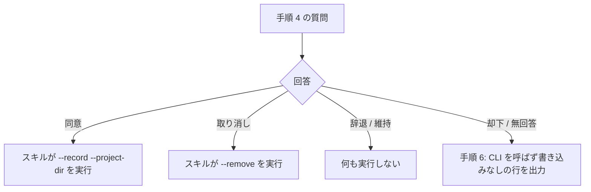

# contributor-consent-command-path - 要件定義書

## 1. 概要

### 1.1 背景
contributor-consent スキルの手順 5 は、スキル自身が `--record` / `--remove` を実行する設計になっている。`tests/test_contributor_consent_skill.py` は、特定の文言（コマンド文字列全体や特定のパス表記）を固定するテストを持っている。

### 1.2 目的
- contributor-consent スキルによる muse-spark のコントリビューター同意の記録と取り消しが、実際の利用で機能する。スキル自身が `--record` / `--remove` を実行する。
- 特定の文言を固定するテストを、構造的なテストに置き換える。このテストは、再発（ユーザーに見せる行が未解決の環境変数参照を含むこと）と、記録・削除の経路の消失を検出する。

### 1.3 スコープ
- `tests/test_contributor_consent_skill.py`
- `em-workflow/skills/contributor-consent/SKILL.md` と `em-review/skills/contributor-consent/SKILL.md`（テストとの整合を保つのに必要な場合だけ変更する）

## 2. ビジネス要件

### 2.1 ビジネス目標
- contributor-consent スキルによる muse-spark のコントリビューター同意の記録と取り消しが、実際の利用で機能する。スキル自身が `--record` / `--remove` を実行する。
- 特定の文言を固定するテストを構造的なテストに置き換え、ユーザーに見せる行が未解決の環境変数参照を含む再発と、記録・削除の経路の消失を検出する。

### 2.2 対象ユーザー
| ユーザータイプ | 説明 |
|----------------|------|
| スキル利用者 | em-workflow / em-review の contributor-consent スキルで同意を記録・取り消す |
| プラグイン開発者 | `python3 -m unittest discover -s tests` でテストを実行する |

### 2.3 期待される効果
- 同意の記録・取り消しをスキル自身が実行する経路が保たれる
- ユーザーに見せる行への未解決の環境変数参照の混入と、記録・削除の経路の消失をテストが検出する

## 3. ユースケース

### 3.1 ユースケース一覧
| ID | ユースケース名 | アクター | 優先度 |
|----|----------------|----------|--------|
| UC01 | 同意の記録・取り消し | スキル利用者 | 高 |
| UC02 | スキル本文の構造の検証 | プラグイン開発者 | 高 |

### 3.2 ユースケース詳細

#### UC01: 同意の記録・取り消し

**アクター**: スキル利用者

**事前条件**:
- contributor-consent スキルが手順 4 の質問を出している

**基本フロー**:
1. ユーザーが同意を選ぶと、スキルは `hooks/muse_guard.py` を `--record` と `--project-dir` 付きで実行する
2. ユーザーが取り消しを選ぶと、スキルは `hooks/muse_guard.py` を `--remove` 付きで実行する

**代替フロー**:
- 辞退または維持を選んだ場合、スキルは何も実行しない
- 質問が却下された、または回答がない場合（手順 6）、スキルは CLI を呼ばず、`同意ストアは変更していない。` を出力する

**事後条件**:
- 同意・取り消しの結果が、スキル自身の CLI 実行で同意ストアに反映されている

#### UC02: スキル本文の構造の検証

**アクター**: プラグイン開発者

**事前条件**:
- 2 つの SKILL.md のコピーが存在する

**基本フロー**:
1. `python3 -m unittest discover -s tests` を実行する
2. テストが、手順 5 の回答と実行内容の対応、ユーザーに見せるテキストの未解決の環境変数参照の有無、手順 5 の実行主体を両方のコピーについて確かめる

**代替フロー**:
- 記録または削除の手順が消えた場合、分類されない要素がある場合、ユーザーに見せるテキストが未解決の環境変数参照を含む場合は、テストが失敗する

**事後条件**:
- すべてのテストが通っている

## 4. 機能要件

### 4.1 機能一覧
| ID | 機能名 | 説明 | 優先度 |
|----|--------|------|--------|
| FR1 | スキルが実行する設計の維持 | 手順 5 でスキル自身がガード CLI を実行する設計を維持する | 高 |
| FR2 | 文言固定の削除 | コマンド文字列を固定する定数と assertion を削除する | 高 |
| FR3 | 回答と実行内容の対応のテスト | 手順 5・手順 6 の各分岐と実行内容の対応を構造的に確かめる | 高 |
| FR4 | ユーザーに見せる行の未解決変数の検査 | 本文の要素を 2 種類に分類し、ユーザーに見せるテキストの未解決の環境変数参照を検出する | 高 |
| FR5 | ユーザー端末での実行指示がないことの検査 | 手順 5 がユーザー自身の端末での実行を指示していないことを確かめる | 高 |
| FR6 | task0009 の記述の整合 | task0009 のテスト名・コメント・docstring をスキルが実行する設計の記述にそろえる | 中 |
| FR7 | 2 つのコピーの一致 | 2 つの SKILL.md がプラグイン名と手順番号以外で一致する | 高 |

### 4.2 機能詳細

#### FR1: スキルが実行する設計の維持

**説明**: contributor-consent の手順 5 は、スキル自身がガード CLI を実行する設計を維持する。ユーザーが同意したら `--record`、取り消したら `--remove` を実行する。`em-workflow/skills/contributor-consent/SKILL.md` と `em-review/skills/contributor-consent/SKILL.md` は、テストとの整合を保つのに必要な場合だけ変更し、変更するときは両方に同じ変更を入れる。

**ビジネスルール**:
- 2 つの SKILL.md を変更するときは、両方に同じ変更を入れる

#### FR2: 文言固定の削除

**説明**: `tests/test_contributor_consent_skill.py` から定数 `PRESENTED_RECORD_CMD` / `PRESENTED_REMOVE_CMD` を削除する。あわせて、コマンド文字列全体や特定のパス表記（`"${CLAUDE_PLUGIN_ROOT}"/hooks/muse_guard.py` など）を文書と照合する assertion をすべて削除する。

#### FR3: 回答と実行内容の対応のテスト

**説明**: テストは、各コピーについて構造的に次を確かめる。確認は肯定形で行い、記録または削除の手順が消えたら失敗する。

- 手順 5 の同意の分岐が、スキルが実行するコマンドちょうど 1 つに結びついている。そのコマンドは `hooks/muse_guard.py` を `--record` と `--project-dir` 付きで呼ぶ
- 手順 5 の取り消しの分岐が、同様のコマンドちょうど 1 つに `--remove` 付きで結びついている
- 辞退と維持の分岐は何も実行しない
- 手順 6（却下または無回答）は CLI を呼ばず、書き込みなしの行 `同意ストアは変更していない。` を出力する

**処理フロー**:

#### FR4: ユーザーに見せる行の未解決変数の検査

**説明**: テストは、スキル本文のフェンスブロックとインラインリテラルを次の 2 種類に分ける。

- スキルが実行するコマンド: 手順 2 の `--list`、手順 5 の `--record` / `--remove`
- スキルがユーザーにそのまま見せるテキスト: 手順 1 の未インストールの行、手順 4 の質問と選択肢の文言、手順 6 の書き込みなしの行

**ビジネスルール**:
- すべての要素はちょうど 1 種類に属する。分類されない要素があればテストは失敗する
- ユーザーに見せるテキストは、未解決の環境変数参照（`${NAME}` / `$NAME`）を含まない
- スキルが実行するコマンド中の `${CLAUDE_PLUGIN_ROOT}` は検出対象にしない。この参照はスキルの読み込み時に置換される

#### FR5: ユーザー端末での実行指示がないことの検査

**説明**: テストは、各コピーの手順 5 が「スキル自身がコマンドを実行する」と述べていること、ユーザーに自分の端末でコマンドを貼り付けたり実行したりするよう指示していないことを確かめる。

#### FR6: task0009 の記述の整合

**説明**: `tests/test_contributor_consent_skill.py` の task0009 のテスト名・コメント・モジュール docstring を、スキルが実行する設計の記述に更新する。コマンドを「ユーザーに提示する（presented to the user）」「スキルは実行しない（never executed by the skill）」とする記述を残さない。

#### FR7: 2 つのコピーの一致

**説明**: em-workflow と em-review の SKILL.md は、引き続きプラグイン名とレビューフェーズのプローブ手順の番号だけが異なる。

## 5. 非機能要件

### 5.1 パフォーマンス要件
該当なし

### 5.2 セキュリティ要件
該当なし

### 5.3 可用性要件
該当なし

### 5.4 保守性要件
- NFR1: テストは標準ライブラリだけを使い、`python3 -m unittest discover -s tests` で通る
- NFR2: 既存の不変条件を保つ。文書ごとに AskUserQuestion がちょうど 1 つ、6 つの手順の順序、固定行（未インストールの行と書き込みなしの行）、CLI のみの行、正しい frontmatter、`commands/` 配下にファイルがないこと
- NFR3: 新しい検査は構造的であり、特定の文言に固定しない。意味を保つ文言の変更や折り返し桁の変更で壊れない
- NFR4: すべての検査は、合成入力による非空性の証明を持つ。何かが存在しないことだけを確かめる検査は、それだけでは足りない
- NFR5: ドキュメントの秘匿。Notion の URL とホームディレクトリ配下の絶対パスを書かない

### 5.5 互換性要件
該当なし

## 6. UI/UX要件

該当なし

## 7. データ要件

該当なし

## 8. 外部連携

該当なし

## 9. 制約条件

### 9.1 技術的制約
- テストは標準ライブラリだけを使う（NFR1）

### 9.2 ビジネス上の制約
- ドキュメントに Notion の URL とホームディレクトリ配下の絶対パスを書かない（NFR5）

### 9.3 スケジュール制約
該当なし

### 9.4 宣言された変更集合

このフィーチャー固有のパスは手動で列挙せず、create-plan で `workflow.yaml` の各タスクの `files` から導出する（`references/phases/create-plan-phase.md`）。

**デフォルトメンバー**（SPEC作成者が明示的に除外しない限り、常に宣言に含まれる）:
- `feature-docs/contributor-consent-command-path/**`
- `test-docs/contributor-consent-command-path/**`

`feature-docs/contributor-consent-command-path/**` に含まれるもの: `REQUIREMENTS.md`、`SPEC.md`、`IMPLEMENTATION.md`、`workflow.yaml`、`phase-state/`、`tasks/`、`reviews/roundN.yaml`、`VERIFICATION.md`、`retrospect.yaml`、およびデザインステップが生成するデザイン成果物。生成主体は各フェーズドキュメントおよび `references/phase-state.md` を参照（引用のみ、ルールは再掲しない）。

`test-docs/contributor-consent-command-path/**` に含まれるもの: `{T}.tests.yaml`（パス形式: `test-docs/contributor-consent-command-path/{T}.tests.yaml`）。生成主体は `implement-phase.md` を参照（引用のみ、ルールは再掲しない）。

**意味論**:
- デフォルトのメンバーは、SPEC作成者が明示的に除外しない限り宣言に含まれる。除外は意図的な絞り込みであり、記載漏れによる省略ではない。
- この宣言はスーパーセット（superset）の主張であり、実際の変更集合は宣言に含まれる（CONTAINED IN）必要がある。実際には生成されないパスが宣言されていても違反にはならない。implementタスクを1つも生成しないフィーチャーは `test-docs/contributor-consent-command-path/` ディレクトリを生成しないが、宣言された `test-docs/contributor-consent-command-path/**` は依然として正しい。

## 10. 想定される課題とリスク

### 10.1 技術的課題
該当なし

### 10.2 ビジネスリスク
該当なし

## 11. 成功基準

### 11.1 受け入れ基準
- [ ] AC-1: `tests/test_contributor_consent_skill.py` が `PRESENTED_RECORD_CMD` / `PRESENTED_REMOVE_CMD` を含まず、コマンド文字列全体またはリテラル `"${CLAUDE_PLUGIN_ROOT}"/hooks/muse_guard.py` を文書と照合する assertion を含まない（FR2）
- [ ] AC-2: 両方のコピーについて、手順 5 の同意の分岐がスキルの実行するコマンドちょうど 1 つ（`hooks/muse_guard.py`、`--record`、`--project-dir`）に結びつき、取り消しの分岐が `--remove` 付きの同様のコマンドちょうど 1 つに結びついていることを、テストが確かめる（FR3）
- [ ] AC-3: 両方のコピーについて、辞退と維持の分岐が何も実行しないこと、手順 6 が CLI を呼ばず書き込みなしの行を出力することを、テストが確かめる（FR3）
- [ ] AC-4: 両方のコピーについて、テストが本文のすべてのフェンスブロックとユーザー向けリテラルを「スキルが実行するコマンド」か「ユーザーに見せるテキスト」に分類し、ユーザーに見せるテキストが `${NAME}` / `$NAME` 参照を含まないことを確かめる。スキルが実行するコマンド中の `${CLAUDE_PLUGIN_ROOT}` は検出しない（FR4）
- [ ] AC-5: 両方のコピーについて、手順 5 がスキル自身がコマンドを実行すると述べ、ユーザー自身の端末で貼り付けたり実行したりする指示を含まないことを、テストが確かめる（FR5）
- [ ] AC-6: 非空性。合成入力で、テストが次を証明する。(a) 変数の検査は `${X}` または `$X` を含むユーザーに見せるテキストを検出し、`$(...)` のコマンド置換やただのテキストは検出しない。(b) 手順 5 の記録または削除のコマンドを取り除いた本文で、対応の検査が失敗する。(c) 分類されないフェンスブロックで、分類の検査が失敗する（FR3、FR4、NFR4）
- [ ] AC-7: task0009 のテスト名・コメント・モジュール docstring がスキルが実行する設計を述べ、コマンドを「presented to the user」「never executed」とする記述が残っていない（FR6）
- [ ] AC-8: 既存の検査が引き続き成り立つ。文書ごとに AskUserQuestion がちょうど 1 つ、6 つの手順の順序、固定行、CLI のみの行、frontmatter、`commands/` 配下のファイルがないこと、2 つのコピーがプラグイン名と手順番号以外で同一であること、`tests/test_muse_consent_no_new_questions.py` の除外（FR1、FR7、NFR2）
- [ ] AC-9: `python3 -m unittest discover -s tests` が通り、変更したテストモジュールが標準ライブラリだけを import する（NFR1）

### 11.2 KPI
該当なし

## 12. テストシナリオ

### 12.1 テスト観点
- [ ] 正常系: 両方のコピーで、手順 5 の同意の分岐が `--record` のコマンド 1 つ、取り消しの分岐が `--remove` のコマンド 1 つに対応する（TS-1）
- [ ] 正常系: 両方のコピーで、辞退と維持の分岐は何も実行せず、手順 6 は CLI を呼ばずに書き込みなしの行を出力する（TS-2）
- [ ] 正常系: 両方のコピーで、フェンスブロックとユーザー向けリテラルを 2 種類に分類し、ユーザーに見せるテキストが環境変数参照を含まず、手順 2 と手順 5 のコマンドがスキルの実行するコマンドに分類される（TS-3）
- [ ] 正常系: 両方のコピーで、手順 5 がスキル自身がコマンドを実行すると述べ、ユーザーの端末での実行指示を含まない（TS-4）
- [ ] 異常系: 合成テキストで、`${CLAUDE_PLUGIN_ROOT}` または `$HOME` を含むユーザーに見せるテキストは検出され、`$(pwd)` だけを含むテキストや変数を含まないテキストは検出されない（TS-5）
- [ ] 異常系: 手順 5 の `--record` または `--remove` のコマンドを取り除いた合成本文で、対応の検査が失敗する（TS-6）
- [ ] 異常系: 種類が不明なフェンスブロックを追加した合成本文で、分類の検査が失敗する（TS-7）
- [ ] 静的確認: `tests/test_contributor_consent_skill.py` がコマンドの文言固定を含まず、コマンドを「presented」とする記述を含まない（テストまたはレビューによる静的確認）（TS-8）
- [ ] 回帰: `python3 -m unittest discover -s tests` を実行し、既存のテスト（スキルのテストの AC-1〜AC-6 と task0009 の AC-2 / AC-3 / AC-5、および `tests/test_muse_consent_no_new_questions.py`）がすべて通る（TS-9）

## 13. 用語定義

| 用語 | 定義 |
|------|------|
| スキルが実行するコマンド | スキル本文のうち、スキル自身が実行するコマンド（手順 2 の `--list`、手順 5 の `--record` / `--remove`） |
| ユーザーに見せるテキスト | スキル本文のうち、スキルがユーザーにそのまま見せるテキスト（手順 1 の未インストールの行、手順 4 の質問と選択肢の文言、手順 6 の書き込みなしの行） |
| 書き込みなしの行 | `同意ストアは変更していない。` |
| 非空性の証明 | 合成入力で、検査が検出すべきものを実際に検出することを示すこと |

## 14. 確認事項

### 14.1 確認済み事項

- [x] A1: 実装では plugin.json と marketplace.json の version を変更しない。main への push 時に plugin-version-bump のワークフローが、ディレクトリに変更のあった em-workflow と em-review の patch を上げ、それでタスクの version の完了項目を満たす。SPEC と受け入れ基準には version の変更を書かない
- [x] A2: Claude Code はスキルの読み込み時にスキル本文の `${CLAUDE_PLUGIN_ROOT}` を置換する。そのため、スキルが実行するコマンドはプラグインの絶対パスに解決される
- [x] A3: 手順 5 のスキルが実行する設計が現在の仕様である（ユーザーの端末に貼り付ける経路はすでに取り除かれている）。タスク説明の再現手順は以前の状態を述べている
- [x] A4: 2 つの SKILL.md のコピーは変更不要の見込みである。テストとの整合のために変更が必要になった場合は、両方に同じ変更を入れる
- [x] A5: 既存の不変条件（AskUserQuestion が 1 つ、6 つの手順、固定行、CLI のみの行、2 つのコピーが名前以外で同一）はそのまま保つ

### 14.2 未確認・保留事項
なし

## 15. 参考資料

- `em-workflow/skills/contributor-consent/SKILL.md`
- `em-review/skills/contributor-consent/SKILL.md`
- `tests/test_contributor_consent_skill.py`
- `tests/test_muse_consent_no_new_questions.py`
