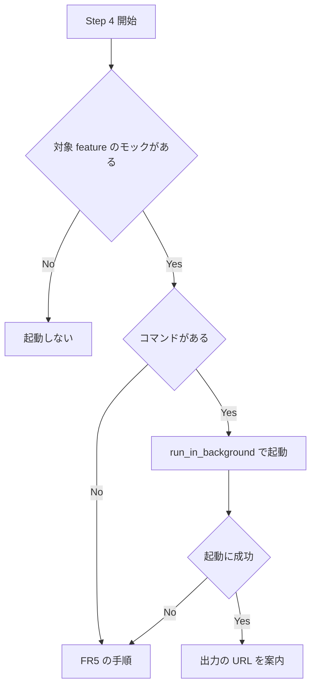

# design-mock-hot-reload - 要件定義書

## 1. 概要

### 1.1 背景

`/em-workflow:design` の合意ループ（`em-workflow/skills/design/SKILL.md` の Step 4）では、モックはユーザーにブラウザで直接開いてもらい、修正後はユーザーが手で再読み込みする。

### 1.2 目的

- `/em-workflow:design` の合意ループで、ブラウザでモックを確認 → チャットで指示 → 修正がホットリロードで即反映、の流れを回せるようにする。
- モックの表示状態（SPEC の空・エラー等）を URL のクエリで切り替えられるようにする。

### 1.3 スコープ

対象:

- `em-workflow/skills/design/SKILL.md` の Step 4（合意ループ）、Step 6（締め）、frontmatter の `allowed-tools`
- `em-workflow/agents/designer.md` の Design Artifact Rules にあるモック規律

対象外:

- WebMCP への対応
- `tokens.html` の開発用サーバーでの配信
- designer エージェント（develop の design ステップ）による開発用サーバーの起動
- `em-workflow/.claude-plugin/plugin.json` と `.claude-plugin/marketplace.json` の version の変更

## 2. ビジネス要件

### 2.1 ビジネス目標

- `/em-workflow:design` の合意ループで、モックの確認・指示・反映を、ホットリロードで途切れずに回せる。
- モックの表示状態を URL のクエリで切り替えられる。

### 2.2 対象ユーザー

| ユーザータイプ | 説明 |
|----------------|------|
| `/em-workflow:design` の利用者 | 合意ループでモックをブラウザで確認し、チャットで修正を指示する |
| designer エージェント | develop の design ステップでモックを書く。開発用サーバーは起動しない |

### 2.3 期待される効果

- モックの書き換えがブラウザに自動で反映される。
- `?state=<name>` で 1 つの表示状態だけを見られる。

## 3. ユースケース

### 3.1 ユースケース一覧

| ID | ユースケース名 | アクター | 優先度 |
|----|----------------|----------|--------|
| UC01 | 合意ループでモックをホットリロードで確認する | `/em-workflow:design` の利用者 | 高 |
| UC02 | URL のクエリで表示状態を切り替える | `/em-workflow:design` の利用者 | 高 |
| UC03 | 開発用サーバーが使えない環境で合意ループを回す | `/em-workflow:design` の利用者 | 中 |

### 3.2 ユースケース詳細

#### UC01: 合意ループでモックをホットリロードで確認する

**アクター**: `/em-workflow:design` の利用者

**事前条件**:
- 対象 feature のモックがある。
- 開発用サーバーのコマンド（例: `bun`）がある。

**基本フロー**:
1. Step 4 で、対象 feature のモックを配信する開発用サーバーを Bash の `run_in_background` で起動する。
2. サーバーの出力に出たローカルの URL をユーザーに案内する。
3. ユーザーがブラウザで確認し、チャットで修正を指示する。
4. モックファイルを書き換えると、ブラウザ側が自動で更新される。
5. Step 6 で、起動したサーバーのタスクを `TaskStop` で止める。

**代替フロー**:
- ループの途中でモックが増えたときは、`TaskStop` で止め、その feature の全モックを起動対象にして 1 つのサーバーとして起動し直す。
- Step 6 の時点でタスクがすでに終わっていて止められなくても、締めを続ける。

**事後条件**:
- 起動した開発用サーバーのタスクが止まっている。

#### UC02: URL のクエリで表示状態を切り替える

**アクター**: `/em-workflow:design` の利用者

**事前条件**:
- モックに SPEC の各状態の `data-state="<name>"` セクションがある。

**基本フロー**:
1. ユーザーがモックの URL に `?state=<name>` を付けて開く。
2. `data-state="<name>"` のセクションだけが表示される。

**代替フロー**:
- クエリが無い、または `state` の値に当たるセクションが無いときは、全状態のセクションを並べて表示する。

**事後条件**:
- 指定した状態のセクションだけが表示されている。

#### UC03: 開発用サーバーが使えない環境で合意ループを回す

**アクター**: `/em-workflow:design` の利用者

**事前条件**:
- 開発用サーバーのコマンドが無い、または起動に失敗した。

**基本フロー**:
1. モックファイルのパスを案内する。
2. ユーザーがブラウザで直接開く。
3. 修正後はユーザーが手で再読み込みする。

**代替フロー**:
- なし

**事後条件**:
- 新しい `AskUserQuestion` を出さずに合意ループが続いている。
- `?state=` での切り替えはこの場合も使える。

## 4. 機能要件

### 4.1 機能一覧

| ID | 機能名 | 説明 | 優先度 |
|----|--------|------|--------|
| FR1 | 合意ループでの開発用サーバー起動と URL 案内 | Step 4 で開発用サーバーを `run_in_background` で起動し、出力の URL を案内する | 高 |
| FR2 | 締めでの TaskStop による停止 | Step 6 で起動したサーバーを `TaskStop` で止める。`allowed-tools` に `TaskStop` を加える | 高 |
| FR3 | 書き換え時の自動更新 | モックの書き換えで、開発用サーバーの機能によりブラウザ側が自動で更新される | 高 |
| FR4 | URL クエリによる表示状態の切り替え | `?state=<name>` で `data-state="<name>"` のセクションだけを表示する | 高 |
| FR5 | 開発用サーバーのコマンドが無い環境での扱い | コマンドが無い・起動に失敗したときは現行手順に戻る | 中 |
| FR6 | モック規律の維持 | モック規律の既存 3 点と Step 4 の要約を残す | 高 |

### 4.2 機能詳細

#### FR1: 合意ループでの開発用サーバー起動と URL 案内

**説明**: `em-workflow/skills/design/SKILL.md` の Step 4（合意ループ）に、対象 feature のモックを配信するローカルの開発用サーバー（例: `bun ./<mock>.html`）を Bash の `run_in_background` で起動し、サーバーの出力に出た URL をユーザーに案内する手順を書く。「モックはブラウザで開いてもらう」の記述はこの手順に置き換える。

**入力**:
- 対象 feature のモックファイル: HTML - 配信するモック

**出力**:
- ローカルの URL: 文字列 - サーバーの出力の `url` / `Routes` 行から読んだもの

**処理フロー**:

**ビジネスルール**:
- サーバーは対象 feature のモックがあるときだけ、Step 4 で起動する。システム全体スコープでモックを扱わないときは起動しない。
- `tokens.html` はサーバーの対象に含めない。これまでどおりブラウザで直接開いてもらう。
- ポートは決め打ちしない。サーバーの出力の `url` / `Routes` 行から URL を読んで案内する。
- ループの途中でモックが増え、起動中のサーバーがそれを配信していないときは、`TaskStop` で止め、その feature の全モックを起動対象にして 1 つのサーバーとして起動し直す。複数のモックを渡すと、各モックは `/<ファイル名から拡張子を除いた名前>` で配信される。

**エラーケース**:
| エラー | 条件 | 対応 |
|--------|------|------|
| コマンドが無い | `command -v bun` 等で見つからない | FR5 の手順に戻る |
| 起動に失敗 | サーバーが起動しない | FR5 の手順に戻る |

#### FR2: 締めでの TaskStop による停止

**説明**: Step 6（締め）で、FR1 で起動したサーバーのタスクを `TaskStop` で止める手順を書く。design SKILL.md の frontmatter `allowed-tools` に `TaskStop` を加える。

**ビジネスルール**:
- サーバーを起動していない場合は何もしない。
- タスクがすでに終わっていて止められなくても締めを続ける。

#### FR3: 書き換え時の自動更新

**説明**: モックファイルを書き換えると、開発用サーバーの機能によりブラウザ側が自動で更新される。

**ビジネスルール**:
- モックのファイル自体には再読み込みのためのコードを書かない。
- 開発用サーバーが配信時に差し込む更新用スクリプトはモックのファイルには含まれない。

#### FR4: URL クエリによる表示状態の切り替え

**説明**: `em-workflow/agents/designer.md` の Design Artifact Rules にあるモック規律に、URL のクエリ `?state=<name>` で `data-state="<name>"` のセクションだけを表示する切り替えを入れる。

**ビジネスルール**:
- 切り替えはモック内の小さなインラインの素の JavaScript で行う（フレームワーク不使用・外部リクエストなし）。
- designer.md の Mockups の項を、小さなインラインスクリプトを認める書き方に直す。「no JS frameworks」は保つ。
- クエリが無いとき、または `state` の値に当たるセクションが無いときは、これまでどおり全状態のセクションを並べて表示する。

#### FR5: 開発用サーバーのコマンドが無い環境での扱い

**説明**: Step 4 でサーバーを起動する前に、コマンドがあるか（例: `command -v bun`）を timeout を指定した Bash で確かめる。コマンドが無いとき、または起動に失敗したときは、今の手順に戻る。

**ビジネスルール**:
- モックファイルのパスを案内し、ユーザーにブラウザで直接開いてもらう。
- 修正後はユーザーが手で再読み込みする。
- この場合も `?state=` での切り替えは使える。
- ユーザーに質問しない。新しい `AskUserQuestion` は足さない。

#### FR6: モック規律の維持

**説明**: モック規律の既存 3 点を崩さない。

**ビジネスルール**:
- 1 ファイルで完結する（インライン CSS、外部リクエストなし、JS フレームワークなし）。
- トークンを CSS カスタムプロパティとして埋め込む。
- SPEC に出てくる状態を全部入れる。
- design SKILL.md Step 4 のモック規律の要約（self-contained / token CSS 変数 / SPEC 状態網羅）も残す。
- 外部リクエストなしは、モックのファイルの中身に対する規則として保つ。

## 5. 非機能要件

### 5.1 非機能要件一覧

| ID | 要件名 | 内容 |
|----|--------|------|
| NFR1 | プロセス停止は TaskStop のみ | design SKILL.md の手順に、プロセスを止めるシグナル送出コマンドを書かない。開発用サーバーの停止は `TaskStop` だけで行う |
| NFR2 | version を触らない | `em-workflow/.claude-plugin/plugin.json` と `.claude-plugin/marketplace.json` の version を変えない |
| NFR3 | 対話の質問数を増やさない | `em-workflow/skills/design/SKILL.md` に出てくる `AskUserQuestion` は 2 回のまま（`tests/test_muse_consent_no_new_questions.py` で固定されている） |
| NFR4 | 書き込み範囲の境界 | design SKILL.md の「境界」節にある書き込み先の制限を変えない。開発用サーバーの起動は、書き込み先を増やす手順にしない |
| NFR5 | ローカルだけで配信する | 開発用サーバーはローカルの開発用として案内する。手順に書く URL は、サーバーの出力に出たローカルの URL にする |

### 5.2 その他

パフォーマンス・可用性・互換性の要件: 該当なし

## 6. UI/UX要件

この feature で作る UI は無い。デザインステップは実施しない。

## 7. データ要件

該当なし

## 8. 外部連携

### 8.1 連携システム

| システム名 | 連携方法 | データ |
|------------|----------|--------|
| ローカルの開発用サーバー（例: bun の HTML 開発サーバー） | Bash の `run_in_background` で起動し、`TaskStop` で止める | 対象 feature のモック HTML |

### 8.2 API仕様要件

該当なし

## 9. 制約条件

### 9.1 技術的制約

- 開発用サーバーの停止は `TaskStop` だけで行う（NFR1）。
- designer エージェントの tools に Bash を足さない。
- `em-workflow/agents/designer.md` の既存の文言のうち `tests/test_refitted_worker_agents.py` が固定しているもの（autonomy の宣言、Boundaries、write policy の文など）は変えない。
- `em-workflow/skills/design/SKILL.md` の `AskUserQuestion` は 2 回のまま（NFR3）。

### 9.2 ビジネス上の制約

- version を変えない（NFR2）。

### 9.3 スケジュール制約

- 該当なし

### 9.4 宣言された変更集合

このフィーチャー固有のパスは手動で列挙せず、create-plan で `workflow.yaml` の各タスクの `files` から導出する（`references/phases/create-plan-phase.md`）。

**デフォルトメンバー**（SPEC作成者が明示的に除外しない限り、常に宣言に含まれる）:
- `feature-docs/design-mock-hot-reload/**`
- `test-docs/design-mock-hot-reload/**`

`feature-docs/design-mock-hot-reload/**` に含まれるもの: `REQUIREMENTS.md`、`SPEC.md`、`IMPLEMENTATION.md`、`workflow.yaml`、`phase-state/`、`tasks/`、`reviews/roundN.yaml`、`VERIFICATION.md`、`retrospect.yaml`、およびデザインステップが生成するデザイン成果物。生成主体は各フェーズドキュメントおよび `references/phase-state.md` を参照（引用のみ、ルールは再掲しない）。

`test-docs/design-mock-hot-reload/**` に含まれるもの: `{T}.tests.yaml`（パス形式: `test-docs/design-mock-hot-reload/{T}.tests.yaml`）。生成主体は `implement-phase.md` を参照（引用のみ、ルールは再掲しない）。

**意味論**:
- デフォルトのメンバーは、SPEC作成者が明示的に除外しない限り宣言に含まれる。除外は意図的な絞り込みであり、記載漏れによる省略ではない。
- この宣言はスーパーセット（superset）の主張であり、実際の変更集合は宣言に含まれる（CONTAINED IN）必要がある。実際には生成されないパスが宣言されていても違反にはならない。implementタスクを1つも生成しないフィーチャーは `test-docs/design-mock-hot-reload/` ディレクトリを生成しないが、宣言された `test-docs/design-mock-hot-reload/**` は依然として正しい。

## 10. 想定される課題とリスク

### 10.1 技術的課題

| 課題 | 影響度 | 対応策 |
|------|--------|--------|
| 開発用サーバーのコマンドが無い、または起動に失敗する | 中 | 現行手順（直接開いてもらい、手で再読み込み）に戻る（FR5） |
| ループの途中でモックが増え、起動中のサーバーが配信していない | 中 | `TaskStop` で止め、全モックを対象に起動し直す（FR1） |
| 締めの時点でタスクがすでに終わっている | 低 | 止められなくても締めを続ける（FR2） |
| ホットリロードの実際の動作は単体テストにできない | 中 | 手動で確認する（TS-7） |

### 10.2 ビジネスリスク

該当なし

## 11. 成功基準

### 11.1 受け入れ基準

- [ ] AC-1: `em-workflow/skills/design/SKILL.md` の Step 4 に、モックを配信するローカルの開発用サーバー（例: `bun ./<mock>.html`）を `run_in_background` で起動し、URL をユーザーに案内する手順がある
- [ ] AC-2: 同じファイルの Step 6 に、起動したサーバーを `TaskStop` で止める手順がある。frontmatter の `allowed-tools` に `TaskStop` がある
- [ ] AC-3: モックを書き換えるとブラウザ側が自動で更新される（開発用サーバーの機能による。モックのファイルに再読み込みのコードは入れない）
- [ ] AC-4: `em-workflow/agents/designer.md` のモック規律に、URL のクエリ（`?state=<name>`）で表示状態を切り替える規則がある。クエリが無いときは全状態を表示する
- [ ] AC-5: モック規律の 1 ファイル完結・トークンの CSS 変数・SPEC 状態網羅の 3 点が designer.md に残っていて、design SKILL.md Step 4 の要約も残っている
- [ ] AC-6: 開発用サーバーのコマンドが無い、または起動に失敗したときの扱い（ファイルを直接開いてもらい、手で再読み込みしてもらう）が design SKILL.md に書かれている
- [ ] AC-7: design SKILL.md にプロセスを止めるシグナル送出コマンドが出てこない
- [ ] AC-8: 既存のテスト（`tests/test_refitted_worker_agents.py` と `tests/test_muse_consent_no_new_questions.py` を含む）が `python3 -m unittest discover -s tests` で全部通る

### 11.2 KPI

該当なし

## 12. テストシナリオ

### 12.1 テスト観点

- [ ] TS-1（AC-1）: design SKILL.md の Step 4 の節に `run_in_background` と開発用サーバーのコマンド例、URL の案内があることを確かめる静的テスト
- [ ] TS-2（AC-2）: Step 6 の節に `TaskStop` があり、frontmatter の `allowed-tools` に `TaskStop` があることを確かめる静的テスト
- [ ] TS-3（AC-4）: designer.md の Design Artifact Rules の Mockups の項に `?state=` と `data-state` があり、クエリが無いときに全状態を表示する旨があることを確かめる静的テスト
- [ ] TS-4（AC-5）: designer.md の Mockups の項に self-contained / CSS custom properties / SPEC の状態の必須が残っていること、design SKILL.md Step 4 にモック規律の要約が残っていることを確かめる静的テスト
- [ ] TS-5（AC-6）: design SKILL.md にコマンドが無いときの扱い（直接開く・手で再読み込み）が書かれていることを確かめる静的テスト
- [ ] TS-6（AC-7）: design SKILL.md 全体にプロセスを止めるシグナル送出コマンドが単語として出てこないことを確かめる静的テスト
- [ ] TS-7（AC-3）: 手動で確認する。サーバーを `run_in_background` で起動し、モックを書き換えてブラウザが更新されることを見て、`TaskStop` で止める
- [ ] TS-8（AC-8）: `python3 -m unittest discover -s tests` で全体を回す

## 13. 用語定義

| 用語 | 定義 |
|------|------|
| 合意ループ | `em-workflow/skills/design/SKILL.md` の Step 4 |
| 締め | `em-workflow/skills/design/SKILL.md` の Step 6 |
| 開発用サーバー | 対象 feature のモックをローカルで配信し、書き換え時にブラウザを自動で更新するサーバー（例: `bun ./<mock>.html`） |
| モック規律 | `em-workflow/agents/designer.md` の Design Artifact Rules にある、モックの書き方の規則 |

## 14. 確認事項

### 14.1 確認済み事項

- [x] 開発用サーバーが使えないとき: bun が無い・起動に失敗したときは質問せず現行手順（モックのパスを案内し直接開いてもらい、手で再読み込み）に戻る
- [x] ポート: 決め打ちせず、サーバー出力の `url` / `Routes` 行から URL を読んで案内する
- [x] 表示状態の切り替え方法: モック内の小さなインラインの素の script が `?state=<name>` を読み、一致する `data-state` セクションだけを表示する。無指定・未知の値は全状態表示
- [x] ループ途中でモックが増えたとき: `TaskStop` で止め、その feature の全モックを起動対象にして 1 つのサーバーとして起動し直す。複数のモックを渡すと各モックは `/<ファイル名から拡張子を除いた名前>` で配信される（Bun 1.4.4 で確認）
- [x] designer エージェントの役割: サーバーを起動しない。クエリ切り替えの規則に沿ったモックを書くだけ
- [x] 更新用スクリプトの扱い: 開発用サーバーが配信時に差し込む更新用スクリプトはモックのファイルには含まれない。モック規律の外部リクエストなしはファイルの中身に対する規則として保つ
- [x] `tokens.html`: サーバーの対象に含めず、これまでどおり直接開いてもらう

### 14.2 前提

- A-1: 自動更新は開発用サーバーの機能（例: bun の HTML 開発サーバーが入れる更新用クライアント）に任せ、モックのファイルには入れない。ファイル単体では 1 ファイル完結・外部リクエストなしのまま保たれる。
- A-2: `?state=` の切り替えはモック内のインラインの素の JavaScript で行う。規律の「no JS frameworks」は保ち、designer.md の Mockups の項を、小さなインラインスクリプトを認める書き方に直す。
- A-3: クエリが無いとき、または `state` の値に当たるセクションが無いときは、全状態のセクションを並べて表示する（今の兄弟セクションでの表示を保つ）。
- A-4: 開発用サーバーのコマンドが無いとき、または起動に失敗したときは、ユーザーに質問せず今の手順に戻る（直接開いてもらい、手で再読み込み）。
- A-5: サーバーは対象 feature のモックがあるときだけ、Step 4 で起動する。システム全体スコープでモックを扱わないときは起動しない。`tokens.html` はこれまでどおりブラウザで開いてもらい、サーバーの対象に含めない。
- A-6: 合意ループの途中で新しいモックファイルを作り、起動中のサーバーがそれを配信していないときは、`TaskStop` で止めてから起動し直す。
- A-7: 案内する URL はポートを決め打ちせず、サーバーの出力に出たものを使う。
- A-8: designer エージェント（develop の design ステップ）はサーバーを起動しない。tools に Bash を足さず、クエリ切り替えの規則に沿ったモックを書くだけにする。
- A-9: designer.md の既存の文言のうち `tests/test_refitted_worker_agents.py` が固定しているもの（autonomy の宣言、Boundaries、write policy の文など）は変えない。
- A-10: WebMCP への対応はスコープ外。

### 14.3 未確認・保留事項

- なし

## 15. 参考資料

- `feature-docs/design-mock-hot-reload/SPEC.md`
