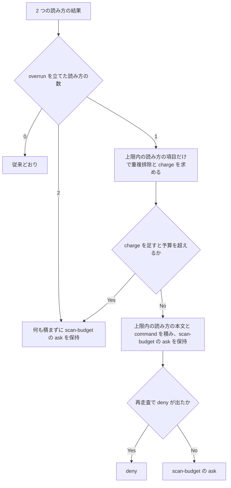

# env-route-partial-overrun-check - 要件定義書

## 1. 概要

### 1.1 背景

destructive-guard の env 経路では、`_args_json_env_combine()` が extglob の 2 つの読み方の overrun を OR でまとめている。`_queue_args_json_chunks()` は overrun が立つと値を何も積まずに scan-budget の ask を保持する。このため、上限内に収まった読み方が復号した command は再走査されない。

### 1.2 目的

- destructive-guard の env 経路で、extglob の 2 つの読み方のうち片方だけが上限を超えた（overrun）とき、上限内に収まった読み方が復号した notion ペアの本文と command も検査に回し、破壊的なコマンドを deny にする。
- overrun による scan-budget の ask は従来どおり残す。

### 1.3 スコープ

対象:

- env 経路（`_args_json_env_payload_values()` / `_args_json_env_body_readings()` / `_args_json_env_combine()`）で、2 つの読み方の一方だけが overrun を立てた場合の扱い。

対象外（挙動を変えない）:

- 読み方が 1 つだけで overrun を立てた場合と、2 つの読み方の両方が overrun を立てた場合。
- どちらの読み方も overrun を立てない場合。
- unrestorable の扱い。
- env 経路以外（通常の mcp-bridge run の文、静的に復元したコマンド語の lifted notion の文）で overrun が立った場合。
- env 経路以外の `--args-json` の手順で、1 つの読み方の中で一部の値だけが overrun を立てた場合。

## 2. ビジネス要件

### 2.1 ビジネス目標

- destructive-guard の env 経路で、extglob の 2 つの読み方のうち片方だけが上限を超えた（overrun）とき、上限内に収まった読み方が復号した notion ペアの本文と command も検査に回し、破壊的なコマンドを deny にする。
- overrun による scan-budget の ask は従来どおり残す。

### 2.2 対象ユーザー

該当なし。

### 2.3 期待される効果

- 片方の読み方だけが overrun を立てたペイロードで、上限内の読み方が復号した破壊的な command が deny になる。
- 上限内の読み方の command が破壊的でないときは、従来どおり scan-budget の ask になる。

## 3. ユースケース

### 3.1 ユースケース一覧

| ID | ユースケース名 | アクター |
|----|----------------|----------|
| UC01 | 片方の読み方だけが overrun を立てた env 経路のペイロードを判定する | destructive-guard フック |

### 3.2 ユースケース詳細

#### UC01: 片方の読み方だけが overrun を立てた env 経路のペイロードを判定する

**アクター**: destructive-guard フック

**事前条件**:
- env 経路の 2 つの読み方がそれぞれ結果を返し、一方が overrun を立て、もう一方が立てていない。

**基本フロー**:
1. 上限内に収まった読み方が復号した候補本文と command 文字列を、再走査のキューに積む（FR1、FR5）。
2. overrun による scan-budget の ask を保持し、その実行の残りでは `--args-json` の手順を止める（FR2）。
3. 積んだ項目を再走査し、deny が出たら保持された ask より deny を判定にする（FR3）。

**代替フロー**:
- 上限内の読み方の charge を足すと scan の予算を超えるときは、何も積まずに scan-budget の ask を保持する（FR6）。
- 積んだ項目の再走査で deny が出ないときは、判定は scan-budget の ask になる（FR2）。

**事後条件**:
- overrun を立てた読み方の項目は検査に回されていない（FR4）。
- overrun は立ったまま報告されている。

## 4. 機能要件

### 4.1 機能一覧

| ID | 機能名 | 説明 |
|----|--------|------|
| FR1 | 上限内の読み方の項目を検査に回す | 片方の読み方だけが overrun を立てたとき、立てなかった読み方が復号した候補本文と command 文字列を再走査のキューに積む |
| FR2 | overrun の ask は残す | overrun による scan-budget の ask を保持し、その実行の残りでは `--args-json` の手順を止める |
| FR3 | deny を ask より優先する | 積んだ項目の再走査で deny が出たら、保持された ask より deny を判定にする |
| FR4 | overrun を立てた読み方の項目は積まない | overrun を立てた読み方が見つけた本文と command は検査に回さない |
| FR5 | 重複排除と charge は上限内の読み方だけで行う | 積む項目と charge は上限内の読み方だけの和集合として既存の規則で求める |
| FR6 | 予算の判定 | charge を足すと予算を超えるときは何も積まずに scan-budget の ask を保持する |
| FR7 | 変えない場合 | 対象外の場合の挙動は変えない |

### 4.2 機能詳細

#### FR1: 上限内の読み方の項目を検査に回す

**説明**: env 経路（`_args_json_env_payload_values()` / `_args_json_env_body_readings()` / `_args_json_env_combine()`）で 2 つの読み方がそれぞれ結果を返し、一方が overrun を立て、もう一方が立てなかったとき、立てなかった読み方が復号した候補本文と command 文字列を、通常の `--args-json` の値と同じように再走査のキューに積む（`_queue_args_json_chunks()` の手順 3 と同じ扱い。キューの各項目はペイロードの語に結び付ける）。

#### FR2: overrun の ask は残す

**説明**: FR1 の場合も、overrun による scan-budget の ask（`SCAN_BUDGET_ASK`、`scan-budget-exceeded`）を従来どおり保持し、その実行の残りでは `--args-json` の手順を止める（`_DeferredAsks.stop_args_json()`）。

#### FR3: deny を ask より優先する

**説明**: FR1 で積んだ項目の再走査で deny が出たら、保持された ask より deny を判定にする。既存の「deny はどの保留中の ask にも勝つ」仕組み（`_DeferredAsks.settle()` と `main()` の扱い）で実現する。

#### FR4: overrun を立てた読み方の項目は積まない

**説明**: overrun を立てた読み方が見つけた本文と command は、上限内に収まった値も含めて従来どおり検査に回さない（D3 と同じく、overrun を立てたものからは何も積まない）。

#### FR5: 重複排除と charge は上限内の読み方だけで行う

**説明**: 積む項目と charge は、上限内に収まった読み方だけの和集合として、既存の規則（各文字列 1 回、同じ項目は 1 回だけ charge、1 つの読み方の中の重複は残す）で求める。overrun を立てた読み方の項目は、重複排除と charge の比較対象にしない。overrun を立てた読み方が先に読まれても、上限内の読み方の項目が欠けることはない。

#### FR6: 予算の判定

**説明**: FR5 の charge を足すと scan の予算を超えるときは、従来どおり何も積まずに scan-budget の ask を保持する。

#### FR7: 変えない場合

**説明**: 次の場合の挙動は変えない。
- 読み方が 1 つだけで overrun を立てた場合と、2 つの読み方の両方が overrun を立てた場合（何も積まずに ask）。
- どちらの読み方も overrun を立てない場合。
- unrestorable の扱い（`args-json-unrestorable` の ask を保持し、積むかどうかには影響しない）。
- env 経路以外（通常の mcp-bridge run の文、静的に復元したコマンド語の lifted notion の文）で overrun が立った場合（文の値を何も積まずに ask）。

**処理フロー**（FR1〜FR6、2 つの読み方がそれぞれ結果を返した場合）:

## 5. 非機能要件

### 5.1 非機能要件一覧

| ID | 要件 |
|----|------|
| NFR1 | テストは標準ライブラリだけで書く。`em-workflow/hooks/tests/destructive-guard-cases.json` に、攻撃シナリオを全体の判定で確かめるケースを足す。理由 ID（rule）を固定し、`CLAUDE_BATCH` は立てない（batch では ask が deny に格下げされ、区別がつかなくなるため）。`tests/test_destructive_guard_env_route.py` に、env 経路の結果を読み方ごとに確かめる単体テストを足す。 |
| NFR2 | 既存の deny / ask のケースは消さない（`.claude/rules/hook-tests.md`）。 |
| NFR3 | 変更後、`python3 em-workflow/hooks/tests/run-destructive-guard.py` と `python3 -m unittest tests.test_destructive_guard_env_route` がどちらも通る。 |
| NFR4 | プラグインの version は触らない（`.claude/rules/core-plugin-version-bump.md`、main への push で Actions が patch を上げる）。 |
| NFR5 | env 経路が `_lex_unreadable_met`、`_lex_extglob_met`、`_lex_extglob` の 3 つの状態を、入ったときの値に戻す性質（env-route-lex-flag-isolation FR1、FR2）と、extglob の単位を記録しない性質（NFR2）は保つ。 |

### 5.2 パフォーマンス要件

該当なし。

### 5.3 セキュリティ要件

1.2 目的と 4 章の機能要件のとおり。

### 5.4 可用性要件

該当なし。

### 5.5 保守性要件

NFR1、NFR2、NFR3 のとおり。

### 5.6 互換性要件

NFR5 のとおり。

## 6. UI/UX要件

該当なし（フック内部の判定ロジックの修正で、画面や見た目の変更は無い）。

## 7. データ要件

該当なし。

## 8. 外部連携

該当なし。

## 9. 制約条件

### 9.1 技術的制約

- テストは標準ライブラリだけで書く（NFR1）。
- プラグインの version は触らない（NFR4）。

### 9.2 ビジネス上の制約

該当なし。

### 9.3 スケジュール制約

該当なし。

### 9.4 宣言された変更集合

このフィーチャー固有のパスは手動で列挙せず、create-plan で `workflow.yaml` の各タスクの `files` から導出する（`references/phases/create-plan-phase.md`）。

**デフォルトメンバー**（SPEC作成者が明示的に除外しない限り、常に宣言に含まれる）:
- `feature-docs/env-route-partial-overrun-check/**`
- `test-docs/env-route-partial-overrun-check/**`

`feature-docs/env-route-partial-overrun-check/**` に含まれるもの: `REQUIREMENTS.md`、`SPEC.md`、`IMPLEMENTATION.md`、`workflow.yaml`、`phase-state/`、`tasks/`、`reviews/roundN.yaml`、`VERIFICATION.md`、`retrospect.yaml`、およびデザインステップが生成するデザイン成果物。生成主体は各フェーズドキュメントおよび `references/phase-state.md` を参照（引用のみ、ルールは再掲しない）。

`test-docs/env-route-partial-overrun-check/**` に含まれるもの: `{T}.tests.yaml`（パス形式: `test-docs/env-route-partial-overrun-check/{T}.tests.yaml`）。生成主体は `implement-phase.md` を参照（引用のみ、ルールは再掲しない）。

**意味論**:
- デフォルトのメンバーは、SPEC作成者が明示的に除外しない限り宣言に含まれる。除外は意図的な絞り込みであり、記載漏れによる省略ではない。
- この宣言はスーパーセット（superset）の主張であり、実際の変更集合は宣言に含まれる（CONTAINED IN）必要がある。実際には生成されないパスが宣言されていても違反にはならない。implementタスクを1つも生成しないフィーチャーは `test-docs/env-route-partial-overrun-check/` ディレクトリを生成しないが、宣言された `test-docs/env-route-partial-overrun-check/**` は依然として正しい。

## 10. 想定される課題とリスク

### 10.1 技術的課題

| 課題 | 対応策 |
|------|--------|
| TS-1 のペイロードの形（extglob on の読み方だけが overrun を立て、off の読み方が command を復号する）は、既存の TS-6 ケースの仕組みから推測したもので、実際に片方だけが overrun を立てるかは確かめていない | 実装時にフックで確かめる |
| 逆向き（off の読み方だけが overrun を立てる）を全体判定で作れるかは確かめていない | 単体テスト（TS-3）で確かめる |
| `tests/test_destructive_guard_env_route.py` の `test_overrun_raised_by_only_one_reading_is_reported` と `test_flags_of_a_statement_that_has_no_value_are_reported` は、`_args_json_env_combine()` が返す結果の形と overrun の扱いを固定している | 結果の形や値を変える場合は、この 2 つのテストの期待値を更新する。overrun が立ったまま報告されることを確かめる部分は残す |

### 10.2 ビジネスリスク

該当なし。

## 11. 成功基準

### 11.1 受け入れ基準

- [ ] AC-1: env 経路のペイロードで、片方の読み方だけが overrun を立て、もう片方の読み方が復号した notion ペアの command が破壊的（例: `git branch -D example`）なとき、対話実行（`CLAUDE_BATCH` なし）の判定は deny で、理由 ID はその破壊的コマンドのもの（例: `git-branch-force-delete`）になり、`scan-budget-exceeded` にはならない。（FR1、FR3）
- [ ] AC-2: AC-1 と同じ形で、上限内の読み方の command が破壊的でないとき、判定は従来どおり ask（`scan-budget-exceeded`）になる。（FR2）
- [ ] AC-3: overrun が 1 番目の読み方で立った場合と 2 番目の読み方で立った場合、入ったときの extglob 設定が off の場合と on の場合のすべての組み合わせで、上限内の読み方の本文と command が結果に入り、overrun を立てた読み方の項目は入らない。overrun は立ったまま報告される。（FR1、FR4、FR5）
- [ ] AC-4: 両方の読み方が overrun を立てた場合と、読み方が 1 つだけで overrun を立てた場合は、何も積まれず ask になる（従来どおり）。（FR7）
- [ ] AC-5: 上限内の読み方の charge を足すと予算を超えるとき、何も積まれず scan-budget の ask になる。（FR6）
- [ ] AC-6: env 経路以外の overrun の挙動と unrestorable の扱いは変わらない。既存の `destructive-guard-cases.json` のケースと `tests/test_destructive_guard_env_route.py` のテストがすべて通る（結果の形を変えたことで必要になる既存テストの期待値の更新は除く）。（FR7、NFR2、NFR3、NFR5）

### 11.2 KPI

該当なし。

## 12. テストシナリオ

### 12.1 テスト観点

- [ ] 正常系（TS-1）: 全体判定（cases.json、deny、rule 固定、batch なし）。片方の読み方だけが overrun を立て、もう片方の読み方が `git branch -D example` を復号するペイロードが deny になる。
- [ ] 正常系（TS-2）: 全体判定（cases.json、ask、rule `scan-budget-exceeded`）。TS-1 と同じ形で command を無害なもの（例: `echo hi`）にしたペイロードが ask になる。
- [ ] 境界値（TS-3）: 単体テスト。overrun を立てる読み方（1 番目 / 2 番目）と入ったときの extglob 設定の全組み合わせで、結果に入る本文、command、charge と、overrun が立ったまま報告されること。overrun を立てた読み方と上限内の読み方が同じ文字列を返す場合も含める。
- [ ] 異常系（TS-4）: 両方の読み方が overrun を立てる場合と、読み方が 1 つだけで overrun を立てる場合に、何も積まれないこと。
- [ ] 境界値（TS-5）: 単体テスト。上限内の読み方の charge を予算より大きくしたとき、何も積まれず scan-budget の ask が保持されること。
- [ ] 回帰（TS-6）: `run-destructive-guard.py` と `tests.test_destructive_guard_env_route` を全件通す。

## 13. 用語定義

| 用語 | 定義 |
|------|------|
| env 経路 | `_args_json_env_payload_values()` / `_args_json_env_body_readings()` / `_args_json_env_combine()` による判定の経路 |
| 読み方 | extglob の設定（off / on）ごとの読み取り。env 経路では 2 つの読み方がそれぞれ結果を返す |
| overrun | 読み方が上限を超えたことを示す状態 |
| 上限内の読み方 | overrun を立てなかった読み方 |
| charge | 積む項目について scan の予算に足す量 |
| scan-budget の ask | overrun または予算超過による ask（`SCAN_BUDGET_ASK`、理由 ID `scan-budget-exceeded`） |

## 14. 確認事項

### 14.1 確認済み事項

- [x] env 経路以外の `--args-json` の手順で overrun が立ったときの挙動: その文の値を何も積まずに scan-budget の ask を保持し、その実行の残りの `--args-json` の手順を止める（D3）挙動は変えない。1 つの読み方の中で一部の値だけが overrun を立てた場合も同じで、この feature の対象外とする。
- [x] 「上限内に収まった読み取り」の単位: 読み方の単位で判断する。overrun を立てた読み方の中にある上限内の値は積まない。修正案の 2 つ（上限内の読み方の項目も検査に回す / overrun を、それを起こした読み方の項目にだけ効かせる）は、この単位で判断すると同じ挙動になるので、両方を満たす形で要件にした。
- [x] deny を ask より優先する方法: 既存の仕組み（保留中の ask はキューを処理し終えた後に決まり、deny はどの ask にも勝つ）で実現する。新しい優先順位の規則は作らない。
- [x] 外部の修正版: 対象はこのリポジトリのコードで、外部の修正版は無い。完了の定義の「修正版に追随」は該当なしとし、この修正そのものが対応になる。
- [x] 既存テストの期待値: `tests/test_destructive_guard_env_route.py` の `test_overrun_raised_by_only_one_reading_is_reported` と `test_flags_of_a_statement_that_has_no_value_are_reported` は、`_args_json_env_combine()` が返す結果の形と overrun の扱いを固定している。結果の形や値を変える場合は、この 2 つのテストの期待値の更新が要る。overrun が立ったまま報告されることを確かめる部分は残す。

### 14.2 未確認・保留事項

なし。

## 15. 参考資料

- `.claude/rules/hook-tests.md`: destructive-guard のテストの規則
- `.claude/rules/core-plugin-version-bump.md`: プラグインの version の扱い
- env-route-lex-flag-isolation: FR1、FR2、NFR2
