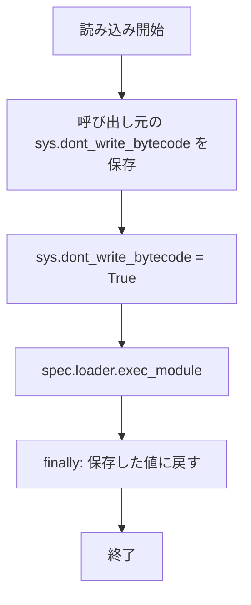

# hook-test-bytecode-suppression-others - 要件定義書

## 1. 概要

### 1.1 背景
次の 7 つのテストモジュールは、`em-workflow/hooks/` または `em-review/hooks/` のフックモジュールを、テストプロセス内で `importlib.util.spec_from_file_location` と `spec.loader.exec_module` によって読み込む。

- `tests/test_queue_stop_guard.py`
- `tests/test_queue_stop_guard_routeback_record.py`
- `tests/test_failed_run_cleanup_guard.py`
- `tests/test_hooks_registration.py`
- `tests/test_queue_failure_net_cross_hook.py`
- `tests/test_muse_guard.py`
- `tests/test_consultation_harness_chain.py`

`tests/test_merge_ci_wait.py` はモジュールの先頭で `sys.dont_write_bytecode = True` を設定し、元に戻さない。

### 1.2 目的
上記 7 モジュールのどれを単体で実行しても、`em-workflow/hooks/` と `em-review/hooks/` の下に `__pycache__` が残らないようにする。

### 1.3 スコープ
**対象**:
- 上記 7 モジュールの中で、フックモジュールをテストプロセス内で読み込む箇所（FR1 に列挙）

**対象外**:
- `tests/test_merge_ci_wait.py`（変更しない）
- `tests/test_destructive_guard_extglob_units.py`、`tests/test_destructive_guard_lexer_agreement.py`
- フックをサブプロセス（`sys.executable <hook>.py`）として実行する箇所。ただし TS-1 でフックのディレクトリに `__pycache__` が現れた場合は対象に含める
- `tests/test_consultation_harness_chain.py` の `_pinned_consent_check_command` が `tests/test_contributor_tier_criteria.py` を読み込むときに `tests/` の下に書かれるバイトコード
- プラグインのファイル（変更しないため、プラグインの version も変えない）

## 2. ビジネス要件

### 2.1 ビジネス目標
次の 7 つのテストモジュールのどれを単体で実行しても、`em-workflow/hooks/` と `em-review/hooks/` の下に `__pycache__` が残らない。

`tests/test_queue_stop_guard.py`、`tests/test_queue_stop_guard_routeback_record.py`、`tests/test_failed_run_cleanup_guard.py`、`tests/test_hooks_registration.py`、`tests/test_queue_failure_net_cross_hook.py`、`tests/test_muse_guard.py`、`tests/test_consultation_harness_chain.py`

### 2.2 対象ユーザー
該当なし（テストコードのみの変更）

### 2.3 期待される効果
- 7 モジュールのどれを単体で実行しても、`em-workflow/hooks/` と `em-review/hooks/` の下に `__pycache__` が残らない

## 3. ユースケース

### 3.1 ユースケース一覧
| ID | ユースケース名 | アクター | 優先度 |
|----|----------------|----------|--------|
| UC01 | テストモジュールを単体で実行する | テストの実行者 | 高 |
| UC02 | テストスイート全体を実行する | テストの実行者 | 高 |

### 3.2 ユースケース詳細

#### UC01: テストモジュールを単体で実行する

**アクター**: テストの実行者

**事前条件**:
- `em-workflow/hooks/` と `em-review/hooks/` の下に `__pycache__` が無い

**基本フロー**:
1. リポジトリのルートで `python3 -m unittest tests.<module>` を実行する（`<module>` は 7 モジュールのいずれか）
2. テストがフックモジュールをテストプロセス内で読み込む

**事後条件**:
- `em-workflow/hooks/` と `em-review/hooks/` の下に `__pycache__` が無い

#### UC02: テストスイート全体を実行する

**アクター**: テストの実行者

**基本フロー**:
1. リポジトリのルートで `python3 -m unittest discover -s tests` を実行する

**事後条件**:
- 変更前と同じく、すべてのテストが通る

## 4. 機能要件

### 4.1 機能一覧
| ID | 機能名 | 説明 | 優先度 |
|----|--------|------|--------|
| FR1 | テストプロセス内のフック読み込みでバイトコードを書かない | 7 モジュールでフックモジュールを読み込む箇所すべてで、バイトコードの書き込みを止めて読み込む | 高 |
| FR2 | 各モジュールを単体で実行しても成り立つ | FR1 が、他のモジュールが設定した `sys.dont_write_bytecode` に依存せずに成り立つ | 高 |

### 4.2 機能詳細

#### FR1: テストプロセス内のフック読み込みでバイトコードを書かない

**説明**: 7 つのテストモジュールの中で、`em-workflow/hooks/` または `em-review/hooks/` のフックモジュールをテストプロセス内で読み込む箇所（`importlib.util.spec_from_file_location` の後に `spec.loader.exec_module`）はすべて、バイトコードの書き込みを止めた状態で読み込む。この読み込みによって、どちらのフックのディレクトリにも `__pycache__` を書かない。

**対象の読み込み箇所**:
| テストモジュール | 読み込み箇所 | 読み込むフック |
|------------------|--------------|----------------|
| `tests/test_queue_stop_guard.py` | `TestQueueStopGuardOwnershipAmbiguity._load_hook_module` | `queue_stop_guard.py` |
| `tests/test_queue_stop_guard_routeback_record.py` | `load_hook_module` | `queue_stop_guard.py` |
| `tests/test_failed_run_cleanup_guard.py` | `load_hook_module`（`run_hook_in_process` からも使う） | `failed-run-cleanup-guard.py` |
| `tests/test_hooks_registration.py` | `load_hook_module` | `queue_launch_guard.py`、`queue_agent_index.py`、`queue_failure_net.py` |
| `tests/test_queue_failure_net_cross_hook.py` | `_load_module_from_path` | `queue_failure_net.py`、`queue_launch_guard.py` |
| `tests/test_muse_guard.py` | `_load_guard_module` | `em-workflow` と `em-review` の `muse_guard.py` |
| `tests/test_consultation_harness_chain.py` | `_load_guard` | `em-workflow` と `em-review` の `muse_guard.py` |

**処理フロー**（前提 A1 の形）:

**ビジネスルール**:
- `exec_module` が例外を投げても、呼び出し元の `sys.dont_write_bytecode` を元に戻す（EC1）

#### FR2: 各モジュールを単体で実行しても成り立つ

**説明**: 7 モジュールのそれぞれをリポジトリのルートで単体実行（`python3 -m unittest tests.<module>`）したときにも FR1 が成り立つ。同じプロセスで `tests/test_merge_ci_wait.py` が先に `sys.dont_write_bytecode` を設定していることに依存しない。

## 5. 非機能要件

- **NFR1**: テストは引き続き標準ライブラリだけを使う（`test/README.md`）。
- **NFR2**: 各テストモジュールは、`python3 -m unittest discover -s tests` と `python3 -m unittest tests.<module>` のどちらでも引き続き動く。

## 6. UI/UX要件

該当なし（テストコードのみの変更）

## 7. データ要件

該当なし

## 8. 外部連携

該当なし

## 9. 制約条件

### 9.1 技術的制約
- テストは標準ライブラリだけを使う（NFR1）
- `tests/test_merge_ci_wait.py` は変更しない（A2）
- プロセス全体の `sys.dont_write_bytecode` を変えたままにしない（A1）

### 9.2 ビジネス上の制約
- プラグインのファイルを変更しないため、プラグインの version は変えない（A5、`.claude/rules/core-plugin-version-bump.md`）

### 9.3 スケジュール制約
- なし

### 9.4 宣言された変更集合

このフィーチャー固有のパスは手動で列挙せず、create-plan で `workflow.yaml` の各タスクの `files` から導出する（`references/phases/create-plan-phase.md`）。

**デフォルトメンバー**（SPEC作成者が明示的に除外しない限り、常に宣言に含まれる）:
- `feature-docs/hook-test-bytecode-suppression-others/**`
- `test-docs/hook-test-bytecode-suppression-others/**`

`feature-docs/hook-test-bytecode-suppression-others/**` に含まれるもの: `REQUIREMENTS.md`、`SPEC.md`、`IMPLEMENTATION.md`、`workflow.yaml`、`phase-state/`、`tasks/`、`reviews/roundN.yaml`、`VERIFICATION.md`、`retrospect.yaml`、およびデザインステップが生成するデザイン成果物。生成主体は各フェーズドキュメントおよび `references/phase-state.md` を参照（引用のみ、ルールは再掲しない）。

`test-docs/hook-test-bytecode-suppression-others/**` に含まれるもの: `{T}.tests.yaml`（パス形式: `test-docs/hook-test-bytecode-suppression-others/{T}.tests.yaml`）。生成主体は `implement-phase.md` を参照（引用のみ、ルールは再掲しない）。

**意味論**:
- デフォルトのメンバーは、SPEC作成者が明示的に除外しない限り宣言に含まれる。除外は意図的な絞り込みであり、記載漏れによる省略ではない。
- この宣言はスーパーセット（superset）の主張であり、実際の変更集合は宣言に含まれる（CONTAINED IN）必要がある。実際には生成されないパスが宣言されていても違反にはならない。implementタスクを1つも生成しないフィーチャーは `test-docs/hook-test-bytecode-suppression-others/` ディレクトリを生成しないが、宣言された `test-docs/hook-test-bytecode-suppression-others/**` は依然として正しい。

## 10. 想定される課題とリスク

### 10.1 技術的課題
| 課題 | 影響度 | 対応策 |
|------|--------|--------|
| `tests/test_failed_run_cleanup_guard.py` の `run_hook_in_process` は、読み込みが終わった後にテストプロセス内で読み込んだフックの `main()` を呼ぶ。`main()` が `em-workflow/hooks/` のモジュールを遅延 import すると、その import はフラグを戻した後に走り、`__pycache__` を書く可能性がある（EC2） | 中 | AC-1 で検出する |
| 読み込んだフックのモジュール本体が、同じフックのディレクトリの別モジュールを import する場合、その import は `exec_module` の実行中に起きるので、書き込みの抑止が効く（EC3） | 低 | 対応不要 |
| フックのソース（`em-workflow/hooks/*.py`、`em-review/hooks/muse_guard.py`）は要件分析で読んでいない。読み込んだフックが、本体の実行中またはテストプロセス内の `main()` 呼び出しの中で、同じディレクトリのフックモジュールを import するかは確かめていない | 中 | A3、EC2、EC3 で扱い、単体実行の受け入れ基準（AC-1）で検出する |
| `tests/test_muse_guard.py` の `test_neither_plugins_hooks_tests_directory_gained_a_file` が調べるのは `em-workflow/hooks/tests` と `em-review/hooks/tests` だけで、フックのディレクトリ直下の `__pycache__` は調べない（EC4） | 低 | AC-1 で確認する |

### 10.2 ビジネスリスク
該当なし

## 11. 成功基準

### 11.1 受け入れ基準
- [ ] AC-1: `em-workflow/hooks/` と `em-review/hooks/` の下に `__pycache__` が無い状態から始める。リポジトリのルートで、7 モジュールのそれぞれを `python3 -m unittest tests.<module>` で単体実行する。各実行の後、どちらのディレクトリにも `__pycache__` が無い。（FR1、FR2）
- [ ] AC-2: `python3 -m unittest discover -s tests` が、変更前と同じく通る。（NFR1、NFR2）

### 11.2 KPI
該当なし

## 12. テストシナリオ

### 12.1 テスト観点
- [ ] 正常系（TS-1）: 7 モジュールのそれぞれについて、どちらのフックのディレクトリにも `__pycache__` が無いことを確かめ、そのモジュールを単体で実行し、再びどちらにも `__pycache__` が無いことを確かめる（AC-1）
- [ ] 正常系（TS-2）: `python3 -m unittest discover -s tests` でスイート全体を実行し、すべてのテストが通る（AC-2）
- [ ] 境界値（TS-3）: 読み込みのフラグを自動で確かめる場合は、`sys.dont_write_bytecode` の開始値（`False` と `True`）をテストの中で設定する。スイート全体の実行では `tests/test_merge_ci_wait.py` がこの値を `True` のままにするため（先例: `tests/test_destructive_guard_extglob_units.py` の `TestHookLoadWritesNoBytecode`）（FR2）
- [ ] 異常系（EC1）: `exec_module` が例外を投げても、呼び出し元の `sys.dont_write_bytecode` が元に戻る

## 13. 用語定義

| 用語 | 定義 |
|------|------|
| フックのディレクトリ | `em-workflow/hooks/` と `em-review/hooks/` |
| テストプロセス内の読み込み | `importlib.util.spec_from_file_location` の後に `spec.loader.exec_module` を呼んで、テストと同じプロセスにフックモジュールを読み込むこと |
| 単体実行 | リポジトリのルートで `python3 -m unittest tests.<module>` を実行すること |

## 14. 確認事項

### 14.1 確認済み事項
- [x] テストプロセス内の読み込み箇所: 4.2 の FR1 の表のとおり
- [x] 既存の抑止の形: `tests/test_destructive_guard_extglob_units.py` の `load_hook` と `tests/test_queue_launch_guard_linked_layout.py` の `load_hook_module` は、`exec_module` の実行中だけ `sys.dont_write_bytecode = True` にし、`finally` で呼び出し元の値に戻す
- [x] `tests/test_merge_ci_wait.py` はモジュールの先頭で `sys.dont_write_bytecode = True` を設定し、元に戻さない
- [x] テストの実行コマンド: `python3 -m unittest discover -s tests`（`test/README.md`）

### 14.2 未確認・保留事項
次は前提として扱う（いずれも後から変更できる）。
- [ ] A1: 抑止は、`tests/test_destructive_guard_extglob_units.py` の `load_hook` と `tests/test_queue_launch_guard_linked_layout.py` の `load_hook_module` で使われている形に従う。`exec_module` の実行中だけ `sys.dont_write_bytecode = True` にし、`finally` で呼び出し元の値に戻す。プロセス全体のフラグを変えたままにしない
- [ ] A2: `tests/test_merge_ci_wait.py`（モジュールの先頭で `sys.dont_write_bytecode = True` を設定し、戻さない）は変更しない。`tests/test_destructive_guard_extglob_units.py` と `tests/test_destructive_guard_lexer_agreement.py` はタスクの指定により対象外
- [ ] A3: 対象は FR1 に列挙したテストプロセス内の読み込み。フックをサブプロセス（`sys.executable <hook>.py`）として実行する箇所は、TS-1 でフックのディレクトリに `__pycache__` が現れない限り変更しない。`__main__` として実行されたフック自身はキャッシュされず、キャッシュされるのはそれが import する同じディレクトリのフックモジュールだけ
- [ ] A4: `tests/test_consultation_harness_chain.py` の `_pinned_consent_check_command` は `tests/test_contributor_tier_criteria.py` を読み込む。その読み込みのバイトコードは配布されない `tests/` の下に書かれるので、このフィーチャーの受け入れ基準の対象外
- [ ] A5: プラグインのファイルを変更しないので、プラグインの version も変えない（`.claude/rules/core-plugin-version-bump.md`）

## 15. 参考資料

- `test/README.md`: テストの実行方法と、標準ライブラリだけを使う方針
- `tests/test_destructive_guard_extglob_units.py`: `load_hook` と `TestHookLoadWritesNoBytecode`
- `tests/test_queue_launch_guard_linked_layout.py`: `load_hook_module`
- `.claude/rules/core-plugin-version-bump.md`
