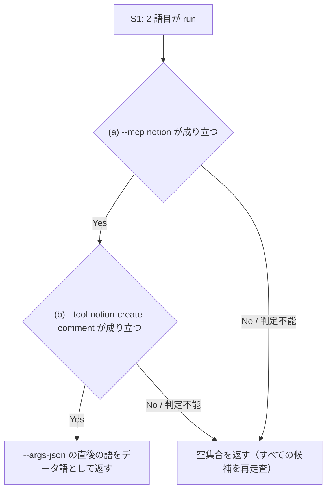

# mcp-bridge-exec-tool-rescan - 要件定義書

## 1. 概要

### 1.1 背景

destructive-guard は、静的な `mcp-bridge run` コマンドの `--args-json` に渡すシングルクォート値を、再走査の対象から外している。この扱いは引数を実行する MCP ツールにも及んでいる。そのため次のコマンドは、変更前のフックでは allow になる。

```
mcp-bridge run --mcp desktop-commander --tool start_process --args-json '{"command":"echo $(git branch -D example)","shell":"bash"}'
```

### 1.2 目的

- destructive-guard で、静的な `mcp-bridge run` コマンドの `--args-json` のシングルクォート値に対する再走査スキップを、引数を実行する MCP ツールには適用しない。上のようなコマンドは allow にならない。
- Notion の進捗コメント（`mcp-bridge run --mcp notion --tool notion-create-comment --args-json '...'`）に対する既存の誤 deny 修正は、allow のまま保つ。

### 1.3 スコープ

対象:

- `em-workflow/hooks/destructive-guard.py` の `_single_quote_skip_spans()` にある `mcp-bridge` アーム（条件 S1）
- 同ファイル内で、このスキップを説明している docstring とコメント
- `em-workflow/hooks/tests/destructive-guard-cases.json` へのケース追加
- このフィーチャーの SPEC と THREAT-MODEL への条件の記録

対象外:

- 条件 W1〜W4、C1、トップレベルの塊だけに限る制限、ANSI-C クォートのデータ語の扱い、`printf '%s\n'` アーム（S2）
- 候補の印付け（FR3 に列挙するもの）
- `feature-docs/destructive-guard-false-deny`（THREAT-MODEL の TM-1 と SPEC を含む）の編集
- `plugin.json` と `marketplace.json` の version

## 2. ビジネス要件

### 2.1 ビジネス目標

- 引数を実行する MCP ツールを呼ぶ `mcp-bridge run` コマンドに埋め込まれた破壊的なコマンドを、destructive-guard が見逃さない。
- `notion` の `notion-create-comment` による進捗コメントは、これまでどおり allow のまま通る。

### 2.2 対象ユーザー

| ユーザータイプ | 説明 |
|----------------|------|
| 該当なし | — |

### 2.3 期待される効果

- 1.1 のコマンドが allow にならない。
- Notion の進捗コメントは allow のまま。

## 3. ユースケース

該当なし（フック内部の静的解析の変更）。

## 4. 機能要件

### 4.1 機能一覧

| ID | 機能名 | 説明 | 優先度 |
|----|--------|------|--------|
| FR1 | mcp-bridge アームを notion / notion-create-comment の対に限定する | S1 は、`--mcp notion` / `--tool notion-create-comment` の対があるときだけデータ語をスキップ対象にする | 高 |
| FR2 | ほかのスキップ条件は変えない | W1〜W4、C1、トップレベル限定、ANSI-C クォート、S2 は変えない | 高 |
| FR3 | 候補の印付けは変えない | `pending` へのキュー投入だけを変える | 高 |
| FR4 | ケースの追加 | desktop-commander / start_process の deny ケース、対の境界の deny ケース、順序違いの allow ケースを追加する | 高 |
| FR5 | コード内の説明の更新 | docstring とコメントを対の条件を述べる文言に直す | 中 |
| FR6 | 条件はこのフィーチャーの文書にだけ記録する | このフィーチャーの SPEC と THREAT-MODEL に記録し、destructive-guard-false-deny は編集しない | 中 |

### 4.2 機能詳細

#### FR1: mcp-bridge アームを notion / notion-create-comment の対に限定する

**説明**: `_single_quote_skip_spans()`（`em-workflow/hooks/destructive-guard.py`）の `mcp-bridge` アーム（条件 S1）は、コマンドが `--mcp notion` / `--tool notion-create-comment` の対も持つときに限り、スキップするデータ語を返す。対があるのは次の両方が成り立つときだけ。

- (a) クォートされていない `--mcp` とちょうど一致する語がちょうど 1 つあり、その直後の語が、クォートを含まない 1 つの連なりで `notion` とちょうど一致する。
- (b) クォートされていない `--tool` とちょうど一致する語がちょうど 1 つあり、その直後の語が、クォートを含まない 1 つの連なりで `notion-create-comment` とちょうど一致する。

**入力**:
- コマンドの語の並び（`mcp-bridge` で始まる文）

**出力**:
- スキップするデータ語の集合。対が無いとき、または判定できないときは空集合

**処理フロー**:


**ビジネスルール**:
- (a)、(b) のどちらかが偽、または判定できないときは、アームは空集合を返し、すべての候補はこれまでどおり再走査される。
- S1 の既存部分は残す。2 語目はちょうど `run`。データ語は、`--args-json` とちょうど一致する語の直後の語。
- `run` より後ろの語の中での `--mcp`、`--tool`、`--args-json` の位置は制限しない。

**エラーケース**:

| エラー | 条件 | 対応 |
|--------|------|------|
| 判定できない形 | `--mcp` / `--tool` の語の重複、クォートされた値、`--opt=value` の形 | 対なしとして扱い、再走査する |

#### FR2: ほかのスキップ条件は変えない

**説明**: 条件 W1〜W4 と C1、トップレベルの塊だけに限る制限、ANSI-C クォートのデータ語の扱い、`printf '%s\n'` アーム（S2）は変えない。

#### FR3: 候補の印付けは変えない

**説明**: 変えるのは `pending` へのキュー投入だけ。トップレベルの範囲の計算、`_mark_substitutions()` / `_mark_quoted_substitutions()` による印付け、`all_subs` の拡張とその印のインデックス、トークンごとの `.unresolved` / `.substitution_only` フラグはそのまま。

#### FR4: ケースの追加

**説明**: `em-workflow/hooks/tests/destructive-guard-cases.json` に次を追加する。既存のケースは消さず、変えない。

- タスクの desktop-commander / start_process のシナリオの deny ケース（TS-1）
- 対の境界の deny ケース（TS-3〜TS-9）
- notion の対が別の順序で現れる allow ケース 1 件（TS-2）

#### FR5: コード内の説明の更新

**説明**: mcp-bridge のスキップを、任意の静的な `mcp-bridge run --args-json` に適用されると説明しているコード内の文言を、notion / notion-create-comment の対の条件を述べる文言に直す。対象は次の 4 か所。

- `_single_quote_skip_spans()` の docstring（S1）
- `scan_structure()` の docstring の、シングルクォート候補についての段落
- `statements()` の docstring
- `statements()` のキュー投入ループにある `FR2` コメント

#### FR6: 条件はこのフィーチャーの文書にだけ記録する

**説明**: このフィーチャーの SPEC と THREAT-MODEL に、次の 2 点を記録する。

- 再走査のスキップは、`notion` MCP サーバーの `notion-create-comment` が引数を実行しないことに依存する。
- それ以外の `--mcp` / `--tool` の対はすべて再走査される。

`feature-docs/destructive-guard-false-deny`（THREAT-MODEL の TM-1 と SPEC）は編集しない。

## 5. 非機能要件

### 5.1 パフォーマンス要件（NFR1）
- 1 回の判定は、hooks.json のタイムアウト（10 秒）と、ランナーの `GUARD_TIMEOUT_SECONDS`（10 秒）に収まる。
- `scan_budget` と `MAX_SHELL_PAYLOAD_EXPANSIONS` は変えない。

### 5.2 セキュリティ要件（NFR2: フェイルクローズ）
- 対の判定ができない形は、すべて再走査する（deny 側）。
- この変更は、既存の deny / ask の判定を allow に変えない。

### 5.3 可用性要件
該当なし。

### 5.4 保守性要件
- テスト手順（NFR3）: 同じ変更の中で `python3 em-workflow/hooks/tests/run-destructive-guard.py` を走らせる（`.claude/rules/hook-tests.md`）。新しい deny ケースは修正の前に追加し、変更前のフックがシナリオのケース（TS-1）を allow にすること（見逃しの再現）を確かめる。
- version（NFR4）: `plugin.json` と `marketplace.json` の version は変えない。patch の引き上げは GitHub Actions が行う（`.claude/rules/core-plugin-version-bump.md`）。

### 5.5 互換性要件
該当なし。

## 6. UI/UX要件

該当なし。

## 7. データ要件

該当なし。

## 8. 外部連携

該当なし。

## 9. 制約条件

### 9.1 技術的制約
- FR2、FR3 に挙げた条件と処理は変えない。
- `scan_budget` と `MAX_SHELL_PAYLOAD_EXPANSIONS` は変えない（NFR1）。

### 9.2 ビジネス上の制約
- `feature-docs/destructive-guard-false-deny` は編集しない（FR6）。
- version は変えない（NFR4）。

### 9.3 スケジュール制約
該当なし。

### 9.4 宣言された変更集合

このフィーチャー固有のパスは手動で列挙せず、create-plan で `workflow.yaml` の各タスクの `files` から導出する（`references/phases/create-plan-phase.md`）。

**デフォルトメンバー**（SPEC作成者が明示的に除外しない限り、常に宣言に含まれる）:
- `feature-docs/mcp-bridge-exec-tool-rescan/**`
- `test-docs/mcp-bridge-exec-tool-rescan/**`

`feature-docs/mcp-bridge-exec-tool-rescan/**` に含まれるもの: `REQUIREMENTS.md`、`SPEC.md`、`IMPLEMENTATION.md`、`workflow.yaml`、`phase-state/`、`tasks/`、`reviews/roundN.yaml`、`VERIFICATION.md`、`retrospect.yaml`、およびデザインステップが生成するデザイン成果物。生成主体は各フェーズドキュメントおよび `references/phase-state.md` を参照（引用のみ、ルールは再掲しない）。

`test-docs/mcp-bridge-exec-tool-rescan/**` に含まれるもの: `{T}.tests.yaml`（パス形式: `test-docs/mcp-bridge-exec-tool-rescan/{T}.tests.yaml`）。生成主体は `implement-phase.md` を参照（引用のみ、ルールは再掲しない）。

**意味論**:
- デフォルトのメンバーは、SPEC作成者が明示的に除外しない限り宣言に含まれる。除外は意図的な絞り込みであり、記載漏れによる省略ではない。
- この宣言はスーパーセット（superset）の主張であり、実際の変更集合は宣言に含まれる（CONTAINED IN）必要がある。実際には生成されないパスが宣言されていても違反にはならない。implementタスクを1つも生成しないフィーチャーは `test-docs/mcp-bridge-exec-tool-rescan/` ディレクトリを生成しないが、宣言された `test-docs/mcp-bridge-exec-tool-rescan/**` は依然として正しい。

## 10. 想定される課題とリスク

### 10.1 技術的課題
- 再走査のスキップは、前提 A1（`notion` の `notion-create-comment` が `--args-json` を実行しない）に依存する（FR6）。

### 10.2 ビジネスリスク
該当なし。

## 11. 成功基準

### 11.1 受け入れ基準
- [ ] AC-1（FR1, FR4）: 変更後のフックで、`mcp-bridge run --mcp desktop-commander --tool start_process --args-json '{"command":"echo $(git branch -D example)","shell":"bash"}'` が deny になる。変更前のフックでは同じケースが allow になる。
- [ ] AC-2（FR1, FR4）: 12 章の TS-3〜TS-9 の境界の deny ケースが、変更後のフックですべて deny になる。
- [ ] AC-3（FR1, FR2）: 既存の allow ケース（destructive-guard-false-deny の TS-3、TS-4、TS-5、TS-22 の 2 行）が allow のまま。新しい順序違いの allow ケース（TS-2）が allow になる。
- [ ] AC-4（FR2, FR3, NFR2）: `destructive-guard-cases.json` のほかの既存ケースは、期待する判定（理由 ID を固定しているケースはその理由 ID も）を保つ。`python3 em-workflow/hooks/tests/run-destructive-guard.py` が通り、既存ケースは 1 件も消されていない。
- [ ] AC-5（FR5）: FR5 に挙げた docstring とコメントが notion / notion-create-comment の対の条件を述べ、どれも「任意の静的な `mcp-bridge run --args-json` にスキップが適用される」と述べていない。
- [ ] AC-6（FR6）: このフィーチャーの SPEC と THREAT-MODEL が、許可する対と、その対が引数を実行しないという前提を述べている。`feature-docs/destructive-guard-false-deny` は変わっていない。

### 11.2 KPI
該当なし。

## 12. テストシナリオ

### 12.1 テスト観点

| ID | 期待 | コマンド | 観点 |
|----|------|----------|------|
| TS-1 | deny | `mcp-bridge run --mcp desktop-commander --tool start_process --args-json '{"command":"echo $(git branch -D example)","shell":"bash"}'` | タスクのシナリオ。変更前のフックでは allow |
| TS-2 | allow | `mcp-bridge run --tool notion-create-comment --args-json '{"body":"$(git branch -D example) と記載する"}' --mcp notion` | 対が別の順序で現れる |
| TS-3 | deny | `mcp-bridge run --mcp notion --tool notion-update-page --args-json '{"body":"$(git branch -D example)"}'` | notion サーバーのほかのツール |
| TS-4 | deny | `mcp-bridge run --mcp desktop-commander --tool notion-create-comment --args-json '{"body":"$(git branch -D example)"}'` | 許可するツール名がほかのサーバーの下にある |
| TS-5 | deny | `mcp-bridge run --args-json '{"body":"$(git branch -D example)"}'` | `--mcp` / `--tool` なし |
| TS-6 | deny | `mcp-bridge run --mcp notion --tool notion-create-comment --mcp desktop-commander --args-json '{"body":"$(git branch -D example)"}'` | `--mcp` が 2 回 |
| TS-7 | deny | `mcp-bridge run --mcp 'notion' --tool notion-create-comment --args-json '{"body":"$(git branch -D example)"}'` | クォートされたサーバー値 |
| TS-8 | deny | `mcp-bridge run --mcp=notion --tool=notion-create-comment --args-json '{"body":"$(git branch -D example)"}'` | `--opt=value` の形 |
| TS-9 | deny | `mcp-bridge run --mcp notion --args-json '{"body":"$(git branch -D example)"}'` | `--tool` なし |
| TS-10 | allow（既存） | 既存ケース: destructive-guard-false-deny の TS-3、TS-4、TS-5、TS-22 の 2 行 | 回帰 |

- [ ] 正常系: TS-2、TS-10
- [ ] 異常系: TS-1、TS-3、TS-4、TS-5、TS-9
- [ ] 境界値: TS-6、TS-7、TS-8
- [ ] セキュリティ: TS-1〜TS-9（引数を実行するツール、対の境界）
- [ ] パフォーマンス: NFR1

## 13. 用語定義

| 用語 | 定義 |
|------|------|
| S1 | `_single_quote_skip_spans()` の `mcp-bridge` アーム |
| S2 | `_single_quote_skip_spans()` の `printf '%s\n'` アーム |
| データ語 | S1 で、`--args-json` とちょうど一致する語の直後の語 |
| 対 | `--mcp notion` と `--tool notion-create-comment` の組（FR1 の (a)、(b)） |
| 再走査 | スキップされない候補を `pending` に積み、判定の対象にすること |

## 14. 確認事項

### 14.1 確認済み事項

なし。

### 14.2 未確認・保留事項

次の事項は前提として置いた。いずれも覆せる。

- [ ] A1: `notion` MCP サーバーの `notion-create-comment` は、`--args-json` をデータとしてだけ使い、シェルのコマンドとして実行しない。
- [ ] A2: destructive-guard-false-deny の A6（フェイルクローズ）に従い、`--mcp` / `--tool` の語の重複、クォートされた値、`--opt=value` の形は判定不能として扱い、再走査する。対の一致は語の順序に依存しない。
- [ ] A3: `printf '%s\n'` アームは対象外で、変えない。
- [ ] A4: 新しいケースに `rule` の要素は要らない。hook-tests.md が `rule` を求めるのは、再帰削除とほかの check を組み合わせたケースだけ。

## 15. 参考資料

- `em-workflow/hooks/destructive-guard.py`
- `em-workflow/hooks/tests/destructive-guard-cases.json`
- `feature-docs/destructive-guard-false-deny/SPEC.md`、`feature-docs/destructive-guard-false-deny/THREAT-MODEL.md`（編集しない）
- `.claude/rules/hook-tests.md`
- `.claude/rules/core-plugin-version-bump.md`
