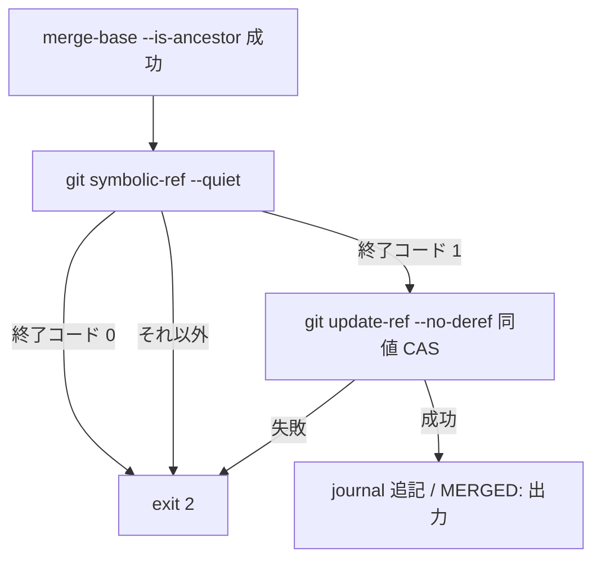

# merge-task-already-contained-symref-recheck - 要件定義書

## 1. 概要

### 1.1 背景
merge-task.sh の already-contained 経路では、シンボリック参照の検査と統合ブランチの値の取得の間に、統合ブランチ参照をシンボリック参照へ差し替えられる隙間がある。

### 1.2 目的
- merge-task.sh の already-contained 経路で、シンボリック参照の検査と統合ブランチの値の取得の間に統合ブランチ参照をシンボリック参照へ差し替えられても、統合していないタスクに merged が記録されず、exit 0 にならない
- シンボリック参照でない通常の統合ブランチに対する merge-task.sh の挙動（exit 0 / 1 / 2 の意味、already-contained・fast-forward・merge-commit の各経路、journal 追記）を変えない

### 1.3 スコープ
- merge-task.sh の already-contained 経路（"Parent already contains us" の分岐）への統合ブランチ参照の再確認の追加
- merge-task.sh 内コメントの更新
- `tests/test_merge_unverified_exit_doc_contract.py` の内容ピンの更新
- `tests/test_merge_task_journal.py` へのテスト追加

範囲外:
- fast-forward 経路と merge-commit 経路のコード
- 前 feature `merge-task-parent-symref-reject` の SPEC.md（Assumptions）と THREAT-MODEL.md（Accepted residuals）
- `em-workflow/references/implement-phase.md`、`em-workflow/skills/worktree-task-workflow/SKILL.md`、`em-workflow/agents/implementer.md`
- プラグインの version

## 2. ビジネス要件

### 2.1 ビジネス目標
- already-contained 経路で、統合していないタスクに merged が記録されず、exit 0 にならない
- 通常の統合ブランチに対する merge-task.sh の既存挙動を変えない

### 2.2 対象ユーザー
該当なし

### 2.3 期待される効果
- 1.2 の目的と同じ

## 3. ユースケース

該当なし

## 4. 機能要件

### 4.1 機能一覧
| ID | 機能名 | 説明 | 優先度 |
|----|--------|------|--------|
| FR1 | already-contained 経路での統合ブランチ参照の再確認 | merged の記録前に、シンボリック参照の再判定と同値 CAS をこの順で行う | 高 |
| FR2 | 再確認で拒否したときの副作用なし | 拒否時に journal 追記・`MERGED:` 出力・参照の書き換えをしない | 高 |
| FR3 | 拒否時のエラー出力 | 拒否時の stderr の ERROR 行の内容 | 高 |
| FR4 | スクリプト内コメントの更新 | merge-task.sh のコメントに再確認を書き足す | 中 |
| FR5 | 内容ピンの更新 | `EXPECTED_MERGE_TASK_SH_SHA256` を更新する | 中 |
| FR6 | 隙間を突くテストの追加 | 検査と値の取得の間で差し替えるテストを追加する | 高 |

### 4.2 機能詳細

#### FR1: already-contained 経路での統合ブランチ参照の再確認

**説明**: merge-task.sh は already-contained 経路（"Parent already contains us" の分岐）で `git merge-base --is-ancestor "$HEAD_SHA" "$PARENT"` が成功した後、journal 追記（append_merged_event）と `MERGED:` 行の出力より前に、次の順で統合ブランチ参照 `refs/heads/$PARENT_BRANCH` を確認する。

1. `git symbolic-ref --quiet "refs/heads/$PARENT_BRANCH"` を実行する。
    - 終了コード 0（シンボリック参照。dangling を含む）: exit 2 で終える
    - 終了コード 1: 続行する
    - それ以外: exit 2 で終える
2. `git update-ref --no-deref "refs/heads/$PARENT_BRANCH" "$PARENT" "$PARENT"`（新値・旧値とも PARENT の同値 CAS）を実行する。失敗した場合は exit 2 で終える。

(2) は journal 追記の前に行う最後の git 呼び出しとする。

**処理フロー**:

#### FR2: 再確認で拒否したときの副作用なし

**説明**: FR1 で拒否した実行では、次のとおりとする。

- journal.jsonl に merged を追記しない（journal.jsonl が無ければ作らず、あれば行を増やさない）
- stdout に `MERGED:` 行を出さない
- FR1 (1) で拒否した実行では、統合ブランチ参照（シンボリック参照ならその参照先の指定も）、参照先ブランチの値、タスク参照の値のいずれも書き換えない
- FR1 (2) で拒否した実行では、統合ブランチ参照の値とタスク参照の値を書き換えない

#### FR3: 拒否時のエラー出力

**説明**: FR1 で拒否するときは stderr に ERROR 行を 1 行だけ出し、その行に統合ブランチ名（PARENT_BRANCH）を含める。

**エラーケース**:
| エラー | 条件 | 対応 |
|--------|------|------|
| シンボリック参照 | FR1 (1) の終了コードが 0 | exit 2。ERROR 行に "symbolic ref" を含める |
| 判定できない終了コード | FR1 (1) の終了コードが 0 でも 1 でもない | exit 2。ERROR 行に終了コードを含める |
| 同値 CAS の失敗 | FR1 (2) が失敗 | exit 2。ERROR 行に "update-ref" を含める |

dirty worktree を示す文言（uncommitted / untracked / commit everything）は出さない。

#### FR4: スクリプト内コメントの更新

**説明**: merge-task.sh の次の箇所に、already-contained 経路では merged を記録する直前に統合ブランチ参照が直接参照のままであることを確認し、続けて値が PARENT のままであることを同値 CAS で確認し、そうでなければ exit 2 で終えることを書き足す。

- 冒頭の説明コメント（統合ブランチ参照は直接参照でなければならない旨の段落）
- exit 2 の例示
- 「Merge source and parent」節のコメント
- already-contained の分岐

"Parent already contains us" を含む行は 1 行のまま残し、その次の行は `merge-base --is-ancestor` の確認のままにする。

#### FR5: 内容ピンの更新

**説明**: `tests/test_merge_unverified_exit_doc_contract.py` の `EXPECTED_MERGE_TASK_SH_SHA256` を、変更後の merge-task.sh の sha256 に同じコミットで更新し、直前のコメントの来歴列挙に本 feature を追記する。

#### FR6: 隙間を突くテストの追加

**説明**: `tests/test_merge_task_journal.py` に、ロック取得後のシンボリック参照の検査を通過した後、統合ブランチの値の取得より前に統合ブランチ参照をタスク参照へのシンボリック参照に差し替えるテストを追加する。

- 差し替えは PATH に置いた git の仲介スクリプト（既存ヘルパ `_build_git_shim` に新しいモードを足す形）で、統合ブランチ参照を引数に含む最初の `show-ref` 呼び出しを捕まえ、本物の git に渡す前に行う。
- 変更前の merge-task.sh ではこのテストが失敗する（exit 0 で merged が記録される）ことを確認する。

## 5. 非機能要件

### 5.1 パフォーマンス要件
該当なし

### 5.2 セキュリティ要件
該当なし（FR1〜FR3 を参照）

### 5.3 可用性要件
該当なし

### 5.4 保守性要件
- NFR2 テストの実行形態: テストは標準ライブラリだけを使い、一時ディレクトリに作った使い捨ての git リポジトリで merge-task.sh をサブプロセスとして実行する（test/README.md）。
- NFR4 kill / pkill を使わない: テストでも実装でも kill / pkill / killall を使わない。ロック待機中の変更が必要な場合は既存ヘルパ `_run_merge_with_mutation_during_lock_wait` を使う。

### 5.5 互換性要件
- NFR1 既存挙動の維持: シンボリック参照でない通常の統合ブランチに対する既存の挙動（exit 0 / 1 / 2 の意味、already-contained・fast-forward・merge-commit の各経路、journal 追記、`already contained in` を含む stdout）は変えない。fast-forward 経路と merge-commit 経路のコードは変更しない。`tests/test_merge_task_journal.py` と `tests/test_merge_unverified_exit_doc_contract.py` の既存テストはすべて通る。
- NFR3 version を変更しない: プラグインの version は変更しない（core-plugin-version-bump）。
- NFR5 依存を増やさない: merge-task.sh の動作要件（git 2.40 以上、util-linux の flock）を増やさない。

## 6. UI/UX要件

該当なし（UI を持たない変更。シェルスクリプトとテストのみ）

## 7. データ要件

該当なし

## 8. 外部連携

該当なし

## 9. 制約条件

### 9.1 技術的制約
- NFR1〜NFR5 を参照

### 9.2 ビジネス上の制約
該当なし

### 9.3 スケジュール制約
該当なし

### 9.4 宣言された変更集合

このフィーチャー固有のパスは手動で列挙せず、create-plan で `workflow.yaml` の各タスクの `files` から導出する（`references/phases/create-plan-phase.md`）。

**デフォルトメンバー**（SPEC作成者が明示的に除外しない限り、常に宣言に含まれる）:
- `feature-docs/merge-task-already-contained-symref-recheck/**`
- `test-docs/merge-task-already-contained-symref-recheck/**`

`feature-docs/merge-task-already-contained-symref-recheck/**` に含まれるもの: `REQUIREMENTS.md`、`SPEC.md`、`IMPLEMENTATION.md`、`workflow.yaml`、`phase-state/`、`tasks/`、`reviews/roundN.yaml`、`VERIFICATION.md`、`retrospect.yaml`、およびデザインステップが生成するデザイン成果物。生成主体は各フェーズドキュメントおよび `references/phase-state.md` を参照（引用のみ、ルールは再掲しない）。

`test-docs/merge-task-already-contained-symref-recheck/**` に含まれるもの: `{T}.tests.yaml`（パス形式: `test-docs/merge-task-already-contained-symref-recheck/{T}.tests.yaml`）。生成主体は `implement-phase.md` を参照（引用のみ、ルールは再掲しない）。

**意味論**:
- デフォルトのメンバーは、SPEC作成者が明示的に除外しない限り宣言に含まれる。除外は意図的な絞り込みであり、記載漏れによる省略ではない。
- この宣言はスーパーセット（superset）の主張であり、実際の変更集合は宣言に含まれる（CONTAINED IN）必要がある。実際には生成されないパスが宣言されていても違反にはならない。implementタスクを1つも生成しないフィーチャーは `test-docs/{feature}/` ディレクトリを生成しないが、宣言された `test-docs/{feature}/**` は依然として正しい。

## 10. 想定される課題とリスク

### 10.1 技術的課題
| 課題 | 影響度 | 対応策 |
|------|--------|--------|
| 再判定の後、同値 CAS より前に統合ブランチ参照を同じ値のシンボリック参照へ差し替えられた場合、同値 CAS がそれを直接参照に置き換えて成功し得る | 低 | 統合ブランチ参照はタスクを含む直接参照になるため、統合せずに merged が記録される状態にはならない |
| 同値 CAS の後に統合ブランチ参照を書き換えられる場合 | 低 | マージ後に参照を書き換えられる場合と同じ扱いとし、範囲外とする（主体は参照を直接書き換えられる権限を既に持つ） |
| fast-forward 経路と merge-commit 経路で、旧値と一致する差し替えでシンボリック参照が直接参照に置き換わり得る | 低 | 前 feature の受容済みの残存リスクのまま |

### 10.2 ビジネスリスク
該当なし

## 11. 成功基準

### 11.1 受け入れ基準
- [ ] AC-1（FR1, FR2, FR3, FR6）: ロック取得後のシンボリック参照の検査を通過した直後、統合ブランチの値の取得より前に `refs/heads/<parent-branch>` をタスク参照へのシンボリック参照に差し替えると、merge-task.sh は exit 2 で終わる。ERROR 行は 1 行で、統合ブランチ名と "symbolic ref" を含み、dirty worktree の文言を含まない。journal.jsonl は作られず、stdout に `MERGED:` 行は無い。タスク参照の値は変わらず、統合ブランチ参照はタスク参照を指すシンボリック参照のまま残る
- [ ] AC-2（FR1, FR2, FR3）: AC-1 と同じ差し替えの後、再確認の `git symbolic-ref --quiet` の直前に統合ブランチ参照を元の値（タスクを含まない値）の直接参照へ戻すと、同値 CAS が値の不一致で失敗し exit 2 で終わる。ERROR 行は統合ブランチ名と "update-ref" を含み、journal.jsonl は作られず、統合ブランチ参照は元の値の直接参照のまま残る
- [ ] AC-3（FR1, FR2, FR3）: 統合ブランチが既にタスクブランチを含む状態（マージ済みのタスクの再実行）で、再確認の `git symbolic-ref --quiet` の終了コードが 0 でも 1 でもない場合、exit 2 で終わる。ERROR 行は統合ブランチ名と終了コードを含み、journal.jsonl の行は増えない
- [ ] AC-4（NFR1）: 通常の統合ブランチでマージ済みのタスクを再実行すると、従来どおり exit 0 で `already contained in` を出力し、merged を 1 行追記し、統合ブランチ参照の値は変わらない（既存テスト test_idempotent_already_merged_path_appends_merged_line_and_tolerates_duplicates が通る）
- [ ] AC-5（NFR1, FR4, FR5）: `tests/test_merge_task_journal.py` と `tests/test_merge_unverified_exit_doc_contract.py` の既存テストがすべて通る。内容ピンが変更後の merge-task.sh と一致し、"Parent already contains us" を含む行は 1 行でその次の行が `merge-base --is-ancestor` の確認である

### 11.2 KPI
該当なし

## 12. テストシナリオ

### 12.1 テスト観点
- [ ] 異常系 TS-1（AC-1）: `_build_git_shim` に新モードを足し、統合ブランチ参照を引数に含む最初の `show-ref` 呼び出しで、本物の git により `symbolic-ref refs/heads/<parent> refs/heads/em-workflow/feat/task0001` を実行してから元の呼び出しを渡す。タスクのコミットを持つ worktree で `_run_merge` を shim 付きの env で実行。exit 2、ERROR 行 1 行（PARENT_BRANCH と "symbolic ref" を含む）、journal なし、`MERGED:` なし、タスク参照の値は不変、`git symbolic-ref refs/heads/<parent>` はタスク参照を返す、捕捉回数は 1。変更前のスクリプトでは exit 0 と merged 記録になることを確認する
- [ ] 異常系 TS-2（AC-2）: TS-1 の差し替えに加え、統合ブランチ参照を引数に含む 2 回目の `symbolic-ref` 呼び出し（already-contained 経路での再確認）の直前に、本物の git により `update-ref --no-deref refs/heads/<parent> <元の値>` で元の値の直接参照に戻してから元の呼び出しを渡す。exit 2、ERROR 行に PARENT_BRANCH と "update-ref"、journal なし、統合ブランチ参照は元の値の直接参照
- [ ] 異常系 TS-3（AC-3）: 通常どおり 1 回マージしてから、統合ブランチ参照を引数に含む 2 回目の `symbolic-ref` 呼び出しだけを終了コード 128 で返す shim を付けて同じタスクを再実行する。exit 2、ERROR 行に PARENT_BRANCH と 128、journal の行は 1 行のまま
- [ ] 正常系 TS-4（AC-4, AC-5）: 既存テスト一式（`python3 -m unittest tests.test_merge_task_journal tests.test_merge_unverified_exit_doc_contract`）と `python3 -m unittest discover -s tests` を実行して通る
- [ ] 境界値: 再確認の同値 CAS が失敗する（統合ブランチ参照が消された、または値が変わった）: exit 2、journal 追記なし
- [ ] 境界値: シンボリック参照を値の取得の前に置き、再確認の前に元の値の直接参照へ戻す: 同値 CAS の値の不一致で exit 2（TS-2）
- [ ] 境界値: 再確認の symbolic-ref が判定できない終了コードを返す: exit 2（TS-3）
- [ ] 境界値: 既存の "status" モードの shim（統合ブランチ参照へのすべての symbolic-ref を 128 で返す）は、ロック後の最初の検査で従来どおり拒否される

## 13. 用語定義

| 用語 | 定義 |
|------|------|
| already-contained 経路 | merge-task.sh の "Parent already contains us" の分岐 |
| 同値 CAS | `git update-ref --no-deref "refs/heads/$PARENT_BRANCH" "$PARENT" "$PARENT"`。新値・旧値とも PARENT |
| 統合ブランチ参照 | `refs/heads/$PARENT_BRANCH` |

## 14. 確認事項

### 14.1 確認済み事項

- [x] 修正方式: merged を記録する直前に、シンボリック参照の再判定（シンボリック参照なら exit 2）と、新値・旧値とも PARENT の同値 CAS（`update-ref --no-deref`）をこの順で行う方式を採る。値の読み直しと種別の判定を別々に行う方式は、読み直しまでシンボリック参照を維持し最後の判定の直前に未統合の直接参照へ戻す競合が残るため採らない。同値 CAS だけの方式は、シンボリック参照を黙って直接参照に置き換えて exit 0 にするため、検出時に fail-closed で止まる再判定を先に置く（バッチ実行で Codex と相談して決めた）
- [x] 1 回の読み取りで判定と値の取得を行う案: 採らない（for-each-ref の %(symref) と %(objectname) を 1 回で読む等）。Git 呼び出しが 1 回でも、更新を伴う原子的な検証と同じ保証にはならないため
- [x] 同値 CAS の副作用: 通常の直接参照では参照の値を変えない。ロックファイルの作成・削除と reference-transaction フックの実行は起こり得るものとして受容する。reflog の有無はテストで固定しない
- [x] 再判定の後、同値 CAS より前の同じ値のシンボリック参照への差し替え: 同値 CAS がそれを直接参照に置き換えて成功し得る。このとき統合ブランチ参照はタスクを含む直接参照になるため、統合せずに merged が記録される状態にはならない。同値 CAS の後の書き換えは、マージ後に参照を書き換えられる場合と同じ扱いとし、範囲外とする（主体は参照を直接書き換えられる権限を既に持つ）
- [x] fast-forward 経路と merge-commit 経路: 変更しない。両経路は前 feature で update-ref に `--no-deref` が付いており、旧値と一致する差し替えでシンボリック参照が直接参照に置き換わり得る点は前 feature の受容済みの残存リスクのまま
- [x] ロック取得後・値の取得前の既存のシンボリック参照の検査: 残す（参照先が無いシンボリック参照を "symbolic ref" として拒否するもの）
- [x] 前 feature `merge-task-parent-symref-reject` の SPEC.md（Assumptions）と THREAT-MODEL.md（Accepted residuals）: 過去の記録として変更しない
- [x] `em-workflow/references/implement-phase.md` の「統合ブランチが既にタスクブランチを含むとき merge-task.sh は merged を再記録する」旨の記述、`em-workflow/skills/worktree-task-workflow/SKILL.md` の exit code 分岐、`em-workflow/agents/implementer.md`: 通常の直接参照ではそのまま正しいため変更しない
- [x] task_description の「追加指示」（remote への push と PR 作成、外部への相談とその記録）: ワークフロー運用の指示として扱い、プロダクトの要件には含めない
- [x] プラグインの version: 変更しない

### 14.2 未確認・保留事項
- なし

## 15. 参考資料

- test/README.md: テストの実行形態
