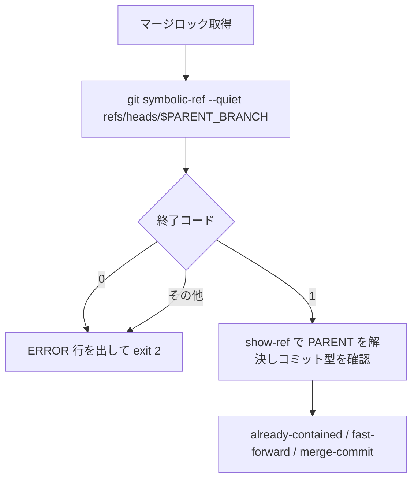

# merge-task-parent-symref-reject - 要件定義書

## 1. 概要

### 1.1 背景
merge-task.sh は統合ブランチ `refs/heads/<parent-branch>` の値を読み、fast-forward / merge-commit の各経路で `git update-ref` により統合ブランチを更新する。`refs/heads/<parent-branch>` がシンボリック参照に置き換えられた場合の扱いは定めていない。

### 1.2 目的
merge-task.sh が `refs/heads/<parent-branch>` に置かれたシンボリック参照を辿らず、統合ブランチ以外のブランチを動かさず、マージしていないタスクを merged として記録しないようにする。

### 1.3 スコープ
- 対象: merge-task.sh（統合ブランチのシンボリック参照の拒否、update-ref の `--no-deref`、スクリプト内コメント）
- 対象: `tests/test_merge_unverified_exit_doc_contract.py` の内容ピン
- 対象: `tests/test_merge_task_journal.py` への試験の追加
- 対象外: タスク参照側のコード（14.1 を参照）
- 対象外: already-contained 経路で、FR1 の確認後から merge-base までの間に参照が付け替えられた場合の誤った merged 記録（14.1 を参照）

## 2. ビジネス要件

### 2.1 ビジネス目標
- merge-task.sh が `refs/heads/<parent-branch>` に置かれたシンボリック参照を辿らず、統合ブランチ以外のブランチを動かさず、マージしていないタスクを merged として記録しない

### 2.2 対象ユーザー
| ユーザータイプ | 説明 |
|----------------|------|
| em-workflow 利用者 | merge-task.sh でタスクブランチを統合ブランチへマージする |

### 2.3 期待される効果
- 統合ブランチの参照がシンボリック参照のとき、参照先のブランチ（main など）が更新されない
- マージしていないタスクについて merged イベントが journal に記録されない

## 3. ユースケース

### 3.1 ユースケース一覧
| ID | ユースケース名 | アクター | 優先度 |
|----|----------------|----------|--------|
| UC01 | シンボリック参照になった統合ブランチへのマージを拒否する | merge-task.sh の呼び出し元 | - |
| UC02 | 通常の統合ブランチへマージする | merge-task.sh の呼び出し元 | - |

### 3.2 ユースケース詳細

#### UC01: シンボリック参照になった統合ブランチへのマージを拒否する

**アクター**: merge-task.sh の呼び出し元

**事前条件**:
- 実行前から、またはマージロックの待機中に、`refs/heads/<parent-branch>` がシンボリック参照になっている

**基本フロー**:
1. merge-task.sh がマージロックを取得する
2. 統合ブランチの値を show-ref で読む前に `git symbolic-ref --quiet "refs/heads/$PARENT_BRANCH"` を実行する
3. 終了コードが 0 なので exit 2 で終える

**代替フロー**:
- 終了コードが 0 でも 1 でもない場合も exit 2 で終える（FR2）

**事後条件**:
- シンボリック参照の参照先、参照先ブランチの値、タスク参照の値は実行前のまま
- journal.jsonl は作られない

#### UC02: 通常の統合ブランチへマージする

**アクター**: merge-task.sh の呼び出し元

**事前条件**:
- `refs/heads/<parent-branch>` はシンボリック参照ではない

**基本フロー**:
1. merge-task.sh がマージロックを取得する
2. `git symbolic-ref --quiet "refs/heads/$PARENT_BRANCH"` の終了コードが 1
3. 既存の show-ref による値の解決とコミット型の確認に進む
4. already-contained / fast-forward / merge-commit のいずれかの経路を既存どおり実行する。update-ref は `--no-deref` 付きで、旧値（PARENT）による比較を伴う

**事後条件**:
- 既存の挙動と同じ（NFR1）

## 4. 機能要件

### 4.1 機能一覧
| ID | 機能名 | 説明 | 優先度 |
|----|--------|------|--------|
| FR1 | 統合ブランチのシンボリック参照を拒否する | ロック取得後、show-ref の前に symbolic-ref で判定し、シンボリック参照なら exit 2 | - |
| FR2 | 判定できない場合は拒否する（fail-closed） | symbolic-ref の終了コードが 0 でも 1 でもなければ exit 2 | - |
| FR3 | 拒否時のエラー出力 | ERROR 行 1 行に統合ブランチ名を含め、dirty worktree の文言を出さない | - |
| FR4 | 参照先を変えない | 拒否後、参照・参照先ブランチ・タスク参照は実行前のまま、journal.jsonl は作られない | - |
| FR5 | スクリプト内コメントの更新 | merge-task.sh の説明コメントに拒否と `--no-deref` を書き足す | - |
| FR6 | 内容ピンの更新 | `EXPECTED_MERGE_TASK_SH_SHA256` を変更後の sha256 に更新する | - |
| FR7 | update-ref はシンボリック参照を辿らない | fast-forward / merge-commit の update-ref 2 箇所に `--no-deref` を付ける | - |

### 4.2 機能詳細

#### FR1: 統合ブランチのシンボリック参照を拒否する

**説明**: merge-task.sh は、マージロック取得後・統合ブランチの値（PARENT）を show-ref で読む前に `git symbolic-ref --quiet "refs/heads/$PARENT_BRANCH"` を実行する。終了コードが 0（シンボリック参照である）なら exit 2 で終える。拒否は already-contained / fast-forward / merge-commit のいずれの経路、update-ref、merge-tree、commit-tree、journal 追記よりも前に起きる。

**処理フロー**:

**エラーケース**:
| エラー | 条件 | 対応 |
|--------|------|------|
| 統合ブランチがシンボリック参照 | symbolic-ref の終了コードが 0 | exit 2 |

#### FR2: 判定できない場合は拒否する（fail-closed）

**説明**: FR1 の symbolic-ref の終了コードが 0（シンボリック参照）でも 1（シンボリック参照ではない）でもない場合も exit 2 で終える。終了コード 1 の場合だけ、既存の show-ref による値の解決とコミット型の確認に進む。

**エラーケース**:
| エラー | 条件 | 対応 |
|--------|------|------|
| 判定できない | symbolic-ref の終了コードが 0 でも 1 でもない | exit 2 |

#### FR3: 拒否時のエラー出力

**説明**: FR1 / FR2 の拒否では、stderr の ERROR 行 1 行に統合ブランチ名（PARENT_BRANCH）を含める。dirty worktree を示す文言（uncommitted / untracked / commit everything）は出さない。

#### FR4: 参照先を変えない

**説明**: 拒否された実行の後、シンボリック参照そのもの（`refs/heads/<parent-branch>` の参照先）、参照先ブランチの値、タスク参照の値はいずれも実行前のまま残り、journal.jsonl は作られない。

#### FR5: スクリプト内コメントの更新

**説明**: merge-task.sh 冒頭の説明コメント（統合ブランチの値を完全一致の参照名で読む旨の段落）、exit 2 の例示、および「Merge source and parent」節のコメントに、統合ブランチの参照がシンボリック参照なら exit 2 で終えること、および update-ref を `--no-deref` で呼ぶことを書き足す。"Parent already contains us" を含む行は 1 行のまま残し、その次の行は `merge-base --is-ancestor` の確認のままにする。

#### FR6: 内容ピンの更新

**説明**: `tests/test_merge_unverified_exit_doc_contract.py` の `EXPECTED_MERGE_TASK_SH_SHA256` を、変更後の merge-task.sh の sha256 に同じコミットで更新し、直前のコメントの来歴列挙に本 feature を追記する。

#### FR7: update-ref はシンボリック参照を辿らない

**説明**: fast-forward 経路と merge-commit 経路の `git update-ref "refs/heads/$PARENT_BRANCH" NEW OLD` の 2 箇所に `--no-deref` を付ける。既存の旧値（PARENT）による比較は残す。FR1 の確認の後、update-ref までの間に `refs/heads/<parent-branch>` がシンボリック参照へ付け替えられても、参照先のブランチ（main など）は更新されない。通常の直接参照に対しては更新先も旧値比較も変わらない。

## 5. 非機能要件

### 5.1 パフォーマンス要件
- 該当なし

### 5.2 セキュリティ要件
- 該当なし

### 5.3 可用性要件
- 該当なし

### 5.4 保守性要件
- NFR2: テストは標準ライブラリだけを使い、一時ディレクトリに作った使い捨ての git リポジトリで merge-task.sh をサブプロセスとして実行する（test/README.md）
- NFR3: プラグインの version は変更しない（core-plugin-version-bump）
- NFR4: kill / pkill を使わない。ロック待機中の変更は既存ヘルパ `_run_merge_with_mutation_during_lock_wait` を使う

### 5.5 互換性要件
- NFR1: シンボリック参照でない通常の統合ブランチに対する既存の挙動（exit 0 / 1 / 2 の意味、fast-forward・merge-commit・already-contained の各経路、journal 追記）は変えない。`tests/test_merge_task_journal.py` の既存テストはすべて通る

## 6. UI/UX要件

該当なし

## 7. データ要件

該当なし

## 8. 外部連携

該当なし

## 9. 制約条件

### 9.1 技術的制約
- テストは標準ライブラリだけを使う（NFR2）
- kill / pkill を使わない（NFR4）

### 9.2 ビジネス上の制約
- プラグインの version は変更しない（NFR3）

### 9.3 スケジュール制約
- 該当なし

### 9.4 宣言された変更集合

このフィーチャー固有のパスは手動で列挙せず、create-plan で `workflow.yaml` の各タスクの `files` から導出する（`references/phases/create-plan-phase.md`）。

**デフォルトメンバー**（SPEC作成者が明示的に除外しない限り、常に宣言に含まれる）:
- `feature-docs/merge-task-parent-symref-reject/**`
- `test-docs/merge-task-parent-symref-reject/**`

`feature-docs/merge-task-parent-symref-reject/**` に含まれるもの: `REQUIREMENTS.md`、`SPEC.md`、`IMPLEMENTATION.md`、`workflow.yaml`、`phase-state/`、`tasks/`、`reviews/roundN.yaml`、`VERIFICATION.md`、`retrospect.yaml`、およびデザインステップが生成するデザイン成果物。生成主体は各フェーズドキュメントおよび `references/phase-state.md` を参照（引用のみ、ルールは再掲しない）。

`test-docs/merge-task-parent-symref-reject/**` に含まれるもの: `{T}.tests.yaml`（パス形式: `test-docs/merge-task-parent-symref-reject/{T}.tests.yaml`）。生成主体は `implement-phase.md` を参照（引用のみ、ルールは再掲しない）。

**意味論**:
- デフォルトのメンバーは、SPEC作成者が明示的に除外しない限り宣言に含まれる。除外は意図的な絞り込みであり、記載漏れによる省略ではない。
- この宣言はスーパーセット（superset）の主張であり、実際の変更集合は宣言に含まれる（CONTAINED IN）必要がある。実際には生成されないパスが宣言されていても違反にはならない。implementタスクを1つも生成しないフィーチャーは `test-docs/{feature}/` ディレクトリを生成しないが、宣言された `test-docs/{feature}/**` は依然として正しい。

## 10. 想定される課題とリスク

### 10.1 技術的課題
| 課題 | 影響度 | 対応策 |
|------|--------|--------|
| update-ref `--no-deref` は、付け替え先の値が旧値と一致する場合にシンボリック参照そのものを直接参照へ置き換えて成功し得る | - | 参照先ブランチは動かないので許容する（14.1） |
| already-contained 経路には update-ref が無く、FR1 の確認後〜merge-base の間の付け替えで誤った merged 記録が起こり得る | - | 本 feature の範囲外とする（14.1） |

### 10.2 ビジネスリスク
該当なし

## 11. 成功基準

### 11.1 受け入れ基準
- [ ] AC-1（FR1, FR3, FR4）: ロック待機中に `refs/heads/<parent-branch>` をタスク参照へのシンボリック参照に付け替えると、merge-task.sh は exit 2 で終わり、merged イベントは記録されず、ERROR 行が統合ブランチ名を含む
- [ ] AC-2（FR1, FR4）: ロック待機中に `refs/heads/<parent-branch>` を別ブランチ（main など、fast-forward が成立する位置）へのシンボリック参照に付け替えると、exit 2 で終わり、その別ブランチの値は変わらず、journal.jsonl は作られない
- [ ] AC-3（FR1, FR4）: merge-commit 経路が成立する位置（統合ブランチと分岐した）の別ブランチへのシンボリック参照でも同様に exit 2 で、別ブランチの値と履歴は変わらない
- [ ] AC-4（FR1）: 実行前から `refs/heads/<parent-branch>` がシンボリック参照の場合（ロック待機なし）も exit 2 で終わる
- [ ] AC-5（FR1, FR3）: 参照先が存在しないシンボリック参照（dangling）の場合も exit 2 で終わり、ERROR 行が統合ブランチ名を含む
- [ ] AC-6（FR4）: 拒否後もシンボリック参照の参照先は付け替えた先のまま（merge-task.sh は参照を書き換えない）
- [ ] AC-7（NFR1, FR5, FR6）: 通常の統合ブランチに対する既存テストがすべて通り、`test_merge_unverified_exit_doc_contract` の内容ピンが変更後の merge-task.sh と一致する
- [ ] AC-8（FR7）: FR1 の確認を通過した後、fast-forward / merge-commit の update-ref の直前に `refs/heads/<parent-branch>` を別ブランチ（main）へのシンボリック参照に付け替えても、main の値は変わらない（両経路）。付け替え先の値が旧値と一致するケースを含む

### 11.2 KPI
該当なし

## 12. テストシナリオ

### 12.1 テスト観点
- [ ] TS-1（AC-1, AC-6）: `_run_merge_with_mutation_during_lock_wait` の mutate で `git symbolic-ref refs/heads/<parent> refs/heads/em-workflow/feat/task0001` を実行。exit 2、journal なし、ERROR 行に PARENT_BRANCH、タスク参照の値は不変
- [ ] TS-2（AC-2, AC-6）: mutate で `git symbolic-ref refs/heads/<parent> refs/heads/main` を実行（main は初期コミットでタスク先端の祖先）。exit 2、`refs/heads/main` の値は不変、journal なし、`git symbolic-ref refs/heads/<parent>` は `refs/heads/main` を返す
- [ ] TS-3（AC-3）: 統合ブランチから分岐したコミットを持つ別ブランチを作り、mutate でそのブランチへのシンボリック参照に付け替える。exit 2、そのブランチの値は不変で "merge: task0001" コミットは作られない
- [ ] TS-4（AC-4）: ロック待機なしで、実行前に `refs/heads/<parent>` を `refs/heads/main` へのシンボリック参照にしてから `_run_merge`。exit 2、main 不変
- [ ] TS-5（AC-5）: `refs/heads/<parent>` を存在しない `refs/heads/...` へのシンボリック参照にしてから実行。exit 2、ERROR 行に PARENT_BRANCH
- [ ] TS-6（AC-7）: 既存テスト一式と `test_merge_unverified_exit_doc_contract` を実行して通る
- [ ] TS-7（既存挙動の固定）: ロック待機中にタスク参照を別ブランチへのシンボリック参照に付け替えると、ロック後の HEAD の再確認で exit 2 になる
- [ ] TS-8（AC-8）: PATH に置いた git の仲介スクリプトで update-ref の呼び出しを捕まえ、その直前に `refs/heads/<parent>` を main へのシンボリック参照に付け替えてから本物の git に渡す（main の先端を旧値と一致させる）。fast-forward / merge-commit の両経路で main の値が変わらない。具体的な仲介の方式は計画段階で決める

## 13. 用語定義

| 用語 | 定義 |
|------|------|
| 統合ブランチ | merge-task.sh のマージ先。`refs/heads/<parent-branch>`（スクリプト内では PARENT_BRANCH） |
| PARENT | show-ref で読んだ統合ブランチの値。update-ref の旧値比較に使う |
| シンボリック参照 | 別の参照名を指す参照 |
| dangling なシンボリック参照 | 参照先が存在しないシンボリック参照 |

## 14. 確認事項

### 14.1 確認済み事項

- [x] update-ref のシンボリック参照の扱い（requirement.update-ref-no-deref）: 拒否に加えて update-ref に `--no-deref` を付ける（reject_plus_no_deref、batch の Codex 相談で決定）
- [x] シンボリック参照の検出の回数: ロック取得後に 1 回だけ行う。ロック前の識別の確認には追加しない（ロック後の確認がロック前に置かれた参照も捕捉するため）
- [x] `--no-deref` と already-contained 経路の扱い: update-ref `--no-deref` は、旧値と一致する付け替えの場合にシンボリック参照そのものを直接参照へ置き換えて成功し得る。参照先ブランチは動かないので許容する。また already-contained 経路には update-ref が無いため、FR1 の確認後〜merge-base の間の付け替えによる誤った merged 記録は本 feature の範囲外とする（主体は参照を直接書き換えられる権限を既に持つ）
- [x] タスク参照側の扱い: タスク参照側のコードは変更しない。ロック後の `git symbolic-ref --quiet HEAD` が再帰的に解決するので、別ブランチへの付け替えは既存の再確認で拒否される（TS-7 で固定する）
- [x] `git symbolic-ref --quiet <ref>` の終了コード: シンボリック参照なら 0、通常の参照・存在しない参照なら 1 として扱う。それ以外はすべて FR2 で拒否する

### 14.2 未確認・保留事項
- なし

## 15. 参考資料

- SPEC.md: `feature-docs/merge-task-parent-symref-reject/SPEC.md`
- テストの書き方: `test/README.md`
