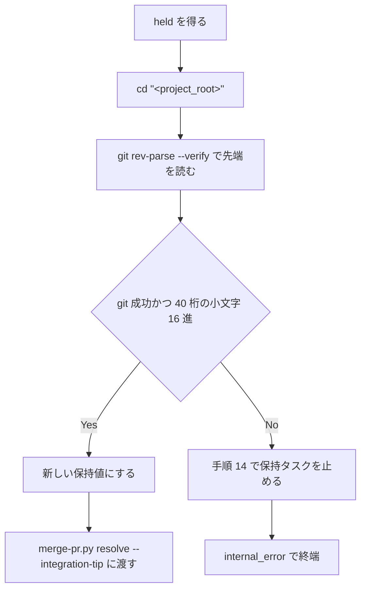
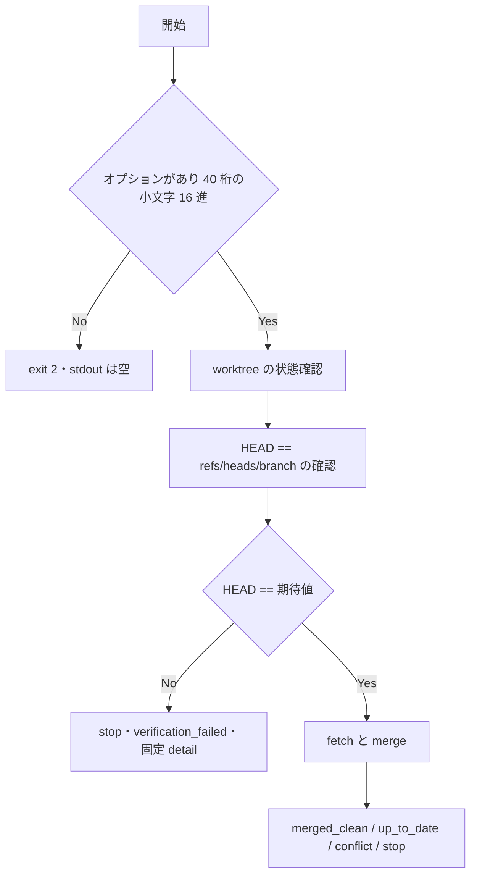

# merge-tip-binding - 要件定義書

## 1. 概要

### 1.1 背景

merge スキルでは、再判定・取り込み・検証・マージの対象となる integration ブランチの先端が、事前判定（preflight）か判定し直した先端に結び付いていない。

- 並行する走行が base を取り込んで先端を進め、その先端でマージを済ませていた場合、ロック後の再判定が already_merged ではなく internal_error で終わる。
- preflight の後・取り込みの前に integration ブランチへ足されたコミットが、照合を経ずに取り込まれうる。

### 1.2 目的

- merge スキルの再判定・取り込み・検証・マージの対象を、preflight か、判定し直した先端に結び付ける。判定を経ていない先端は base に入れない（fail-closed）。
- 並行する走行が base を取り込んで先端を進め、その先端でマージを済ませていた場合、ロック後の再判定を internal_error ではなく already_merged で終える。

### 1.3 スコープ

- merge スキルの SKILL.md（手順 6.4、手順 8、保持する値、結果の値の表）
- `merge-git.py integrate`（期待する先端との照合）
- `em-workflow/references/merge-result.md`（Reason codes 表の verification_failed 行）
- テスト（`tests/test_merge_skill_doc.py`、`tests/test_merge_git.py`、`tests/test_merge_local_route.py`、既存の固定テストの追従）

スコープ外:

- `merge-git.py merged`（ローカルルートの再判定）の挙動
- `merge-pr.py resolve` の挙動
- `merge-result.py` の `REASON_CODES`

## 2. ビジネス要件

### 2.1 ビジネス目標

- 判定を経ていない先端を base に入れない（fail-closed）。
- 並行する走行がマージを済ませていた場合、ロック後の再判定を already_merged で終える。

### 2.2 対象ユーザー

| ユーザータイプ | 説明 |
|----------------|------|
| merge スキルの実行者 | em-workflow の merge スキルでフィーチャーを base にマージする |

### 2.3 期待される効果

- preflight の後に integration ブランチへ足されたコミットは、取り込まれずに verification_failed で止まる。
- 並行する走行が先端を進めてマージを済ませていた PR は、ロック後の再判定で already_merged になる。

## 3. ユースケース

### 3.1 ユースケース一覧

| ID | ユースケース名 | アクター | 優先度 |
|----|----------------|----------|--------|
| UC01 | 並行する走行がマージ済みの PR を再判定する（PR ルート） | merge スキル | 未指定 |
| UC02 | preflight の後に先端が動いた状態で取り込む | merge スキル | 未指定 |
| UC03 | 手順 12 の redo から手順 8 に戻って取り込む | merge スキル | 未指定 |

### 3.2 ユースケース詳細

#### UC01: 並行する走行がマージ済みの PR を再判定する（PR ルート）

**アクター**: merge スキル

**事前条件**:
- 並行する走行が base を取り込んで integration ブランチの先端を進め、その先端で PR をマージ済みである。

**基本フロー**:
1. 手順 6.4 の PR ルートで held を得る。
2. 単独の `cd "<project_root>"` を実行する。
3. `git rev-parse --verify refs/heads/em-workflow/<feature>/integration` で現在の先端を読み、新しい保持値にする。
4. その値を `merge-pr.py resolve` の `--integration-tip` に渡す。
5. 再判定が already_merged で終わる。

**代替フロー**:
- git が失敗したとき、または読み取った値が 40 桁の小文字 16 進でないときは、手順 14 で保持タスクを止めてから internal_error で終端する。

**事後条件**:
- 保持値 `integration_tip` は上書きされていない。

#### UC02: preflight の後に先端が動いた状態で取り込む

**アクター**: merge スキル

**事前条件**:
- preflight で `integration_tip` を得た後、integration ブランチにコミットが足されている。

**基本フロー**:
1. 手順 8 で、期待する先端として `integration_tip` を渡して `merge-git.py integrate` を呼ぶ。
2. integrate は worktree の状態と HEAD == `refs/heads/<branch>` を確認した後、fetch と merge の前に期待する先端と照合する。
3. 不一致のため、fetch も merge もせず、ref も変えずに、outcome stop・reason verification_failed・detail `integration branch moved after preflight` を返す。
4. 手順 14 を行ってから、その reason と detail で終端する。

**代替フロー**:
- 先端が一致する場合は、従来どおり merged_clean / up_to_date / conflict / stop を返す。

**事後条件**:
- 足されたコミットは取り込まれず、base は変わらない。

#### UC03: 手順 12 の redo から手順 8 に戻って取り込む

**アクター**: merge スキル

**事前条件**:
- 手順 12 の redo で手順 8 に戻る（手順 9 の解消を経た場合も含む）。

**基本フロー**:
1. 手順 8 で、期待する先端として直前に検証した `head_sha` を渡して `merge-git.py integrate` を呼ぶ。
2. 一致すれば、従来どおりの outcome を返す。

**代替フロー**:
- 不一致なら verification_failed で止まり、手順 14 の後に終端する。

**事後条件**:
- 走行自身の取り込みコミットで照合が止まらない。

## 4. 機能要件

### 4.1 機能一覧

| ID | 機能名 | 説明 | 優先度 |
|----|--------|------|--------|
| FR1 | PR ルートのロック後の再判定は、その時点の先端で行う | 手順 6.4 の PR ルートで、held の後・resolve の前に integration ブランチの先端を読み、resolve に渡す | 未指定 |
| FR2 | merge-git.py integrate が期待する先端と照合する | integrate に期待する worktree HEAD の必須オプションを足し、fetch と merge の前に照合する | 未指定 |
| FR3 | 手順 8 が期待する先端を渡し、不一致なら verification_failed で止まる | 手順 8 の integrate 呼び出しに期待値を渡し、stop の列挙に verification_failed を足す | 未指定 |
| FR4 | 結果の値の契約に、手順 8 の不一致を足す | SKILL.md の結果の値の表と merge-result.md の verification_failed 行を変える | 未指定 |
| FR5 | 手順 6.4 と保持する値の記述を、実際の挙動に合わせる | 手順 6.4 の先端の記述と、保持する値の記述を書き換える | 未指定 |
| FR6 | 再発を検出するテスト | 文書テストとスクリプトテストを足し、合わなくなる既存の固定テストを直す | 未指定 |

### 4.2 機能詳細

#### FR1: PR ルートのロック後の再判定は、その時点の先端で行う

**説明**: 手順 6.4 の PR ルートでは、held を得てから resolve を呼ぶまでの間に、integration ブランチの現在の先端を読む。読み方は、単独の `cd "<project_root>"` と `git rev-parse --verify refs/heads/em-workflow/<feature>/integration` を、別々の Bash 呼び出しで行う（それぞれに timeout 行を付ける）。出力（末尾の改行を除く）が 40 桁の小文字 16 進のときだけ、その値を新しい保持値にする（名前は計画で決める。例: `locked_tip`）。その値を `merge-pr.py resolve` の `--integration-tip` に渡す。保持値 `integration_tip` は上書きしない。

**入力**:
- `git rev-parse --verify refs/heads/em-workflow/<feature>/integration` の出力: 文字列 - 末尾の改行を除いて扱う

**出力**:
- ロック後の先端の保持値（例: `locked_tip`）: 40 桁の小文字 16 進 - `merge-pr.py resolve` の `--integration-tip` に渡す

**処理フロー**:

**ビジネスルール**:
- `cd` と `git rev-parse` は別々の Bash 呼び出しにし、それぞれに timeout 行を付ける。
- 保持値 `integration_tip` は上書きしない。

**バリデーション**:
| 項目 | ルール | エラーメッセージ |
|------|--------|------------------|
| 読み取った先端 | 末尾の改行を除いて 40 桁の小文字 16 進 | internal_error で終端 |

**エラーケース**:
| エラー | 条件 | 対応 |
|--------|------|------|
| 読み取りの失敗 | git が失敗した | 手順 14 で保持タスクを止めてから internal_error で終端する |
| 不正な値 | 値が 40 桁の小文字 16 進でない | 手順 14 で保持タスクを止めてから internal_error で終端する |

#### FR2: merge-git.py integrate が期待する先端と照合する

**説明**: `merge-git.py integrate` に、期待する worktree HEAD を渡す必須オプションを足す（名前は計画で決める。例: `--expected-head`）。照合は、worktree の状態確認と HEAD == `refs/heads/<branch>` の確認の後、fetch と merge の前に行う。

**入力**:
- 期待する worktree HEAD（例: `--expected-head`）: 40 桁の小文字 16 進 - 必須

**出力**:
- 不一致: outcome stop・reason verification_failed・detail `integration branch moved after preflight`
- 一致: 従来どおり merged_clean / up_to_date / conflict / stop

**処理フロー**:

**ビジネスルール**:
- 不一致なら fetch も merge もせず、ref も変えない。

**バリデーション**:
| 項目 | ルール | エラーメッセージ |
|------|--------|------------------|
| 期待する HEAD | 必須。40 桁の小文字 16 進だけを受け付ける | exit 2、stdout には何も出さない |

**エラーケース**:
| エラー | 条件 | 対応 |
|--------|------|------|
| オプションの欠落・不正な値 | オプションが無い、または 40 桁の小文字 16 進でない | exit 2、stdout には何も出さない |
| 先端の不一致 | worktree HEAD が期待値と異なる | stop・verification_failed・detail `integration branch moved after preflight` |

#### FR3: 手順 8 が期待する先端を渡し、不一致なら verification_failed で止まる

**説明**: SKILL.md 手順 8 の integrate 呼び出しでは、期待する先端として、最初の取り込みで `integration_tip` を渡す。手順 12 の redo から戻ったときは、直前に検証した `head_sha` を渡す（手順 9 の解消を経た場合も含む）。手順 8 の stop の列挙に verification_failed を足す。

**入力**:
- 最初の取り込み: `integration_tip`
- 手順 12 の redo から戻ったとき: 直前に検証した `head_sha`

**ビジネスルール**:
- ロック保持中なので、verification_failed の stop では、描画の前に手順 14 を行ってから、その reason と detail で終端する。

**エラーケース**:
| エラー | 条件 | 対応 |
|--------|------|------|
| verification_failed | integrate が不一致の stop を返した | 手順 14 の後、その reason と detail で終端する |

#### FR4: 結果の値の契約に、手順 8 の不一致を足す

**説明**: 28 個の閉じた集合は変えない。

**ビジネスルール**:
- SKILL.md の結果の値の表の verification_failed 行で、次の 3 つを変える。
    - 出どころに merge-git integrate を足す。
    - 手順を 8, 10, 13 にする。
    - detail に、手順 8 の固定文 `integration branch moved after preflight` を足す。
- `em-workflow/references/merge-result.md` の Reason codes 表の verification_failed 行を変える。
    - Condition に「取り込み前の integration worktree HEAD が期待する先端と異なる」を足す。
    - Emitted by に merge-git integrate を足す。
- `merge-result.py` の `REASON_CODES` は変えない。

#### FR5: 手順 6.4 と保持する値の記述を、実際の挙動に合わせる

**説明**: 手順 6.4 の「先端は手順 4 / 5.2 と同じ `integration_tip`」を書き換える。

**ビジネスルール**:
- ローカルルートの再判定は、`merge-git.py merged` が、呼ばれた時点の integration ブランチの先端で判定する（挙動は変えない）。
- PR ルートは、FR1 で読んだ先端で判定する。
- 保持する値では、`integration_tip` に「手順 8 の照合でも使う」ことを書き足し、ロック後に読んだ先端を新しい保持値として足す。

#### FR6: 再発を検出するテスト

**説明**: FR1・FR3・FR4・FR5 の文書テストを `tests/test_merge_skill_doc.py` に足す。FR2 のスクリプトテストを `tests/test_merge_git.py` と `tests/test_merge_local_route.py` に足す。

**ビジネスルール**:
- 新しい形と合わなくなる既存の固定テスト（reference_impact に列挙）は、新しい形に合わせて直す。
- 既存の検知（偽の文書で照合が発火することを示すテスト）は削らない。

## 5. 非機能要件

### 5.1 パフォーマンス要件

- 該当なし

### 5.2 セキュリティ要件

- NFR1（fail-closed）: 照合できないとき、または値が不正なときは、マージ側に倒れずに止まる。
- NFR2（コマンド形）: ガード hook が判定する操作とコマンド形は、SKILL の呼び出しの規則を守る。リテラルだけを使い、変数展開・コマンド置換・グロブ・リビジョン接尾辞は使わない。`cd` は単独の呼び出しにする。前景の Bash 呼び出しにはすべて、600000 以下の timeout 行を付ける。
- NFR5（記載の秘匿）: 出力・detail・文書に、ホームディレクトリの絶対パスと Notion の URL を書かない。

### 5.3 可用性要件

- 該当なし

### 5.4 保守性要件

- NFR3（状態の持ち方）: 状態ファイルを新しく作らない。`workflow.yaml` には書き込まない。
- NFR4（テストの書き方）: テストは標準ライブラリの unittest だけで書き、一時ディレクトリの git リポジトリを使う。CPU に意図的な負荷をかけない（並行する書き手は、コミットを足して決定的に再現する）。
- NFR6（version）: em-workflow の version は手で上げない（patch は Actions が上げる）。

### 5.5 互換性要件

- 該当なし

## 6. UI/UX要件

### 6.1 画面設計要件

該当なし（UI が無い。変更はスキル手順書・Python スクリプト・契約文書・テストだけ）

### 6.2 画面遷移

該当なし

### 6.3 レスポンシブ対応

該当なし

## 7. データ要件

### 7.1 データモデル概要

新しい状態ファイルは作らない（NFR3）。扱う値は SKILL.md の保持する値だけ。

### 7.2 データ項目

| エンティティ | 項目名 | 型 | 必須 | 説明 |
|--------------|--------|-----|------|------|
| 保持する値 | `integration_tip` | 40 桁の小文字 16 進 | ○ | 手順 4 / 5.2 の先端。手順 5.2 / 5.3 の resolve と、手順 8 の最初の取り込みの照合で使う。上書きしない |
| 保持する値 | ロック後の先端（名前は計画で決める。例: `locked_tip`） | 40 桁の小文字 16 進 | ○ | 手順 6.4 の PR ルートで held の後に読んだ先端。手順 6.4 の resolve にだけ使う |
| 保持する値 | `head_sha` | 40 桁の小文字 16 進 | ○ | 直前に検証した先端。手順 12 の redo から戻ったときの手順 8 の照合と、手順 13.2 の resolve で使う |

### 7.3 データ保持期間

| データ種別 | 保持期間 |
|------------|----------|
| 保持する値 | merge スキルの 1 回の走行の間 |

## 8. 外部連携

### 8.1 連携システム

| システム名 | 連携方法 | データ |
|------------|----------|--------|
| git | `git rev-parse --verify refs/heads/em-workflow/<feature>/integration` | integration ブランチの先端 |

### 8.2 API仕様要件

- `merge-git.py integrate` に、期待する worktree HEAD を渡す必須オプションを足す（名前は計画で決める。例: `--expected-head`）。
- `merge-pr.py resolve` の挙動は変えない。

## 9. 制約条件

### 9.1 技術的制約

- コマンド形は NFR2 に従う。
- 状態ファイルを新しく作らず、`workflow.yaml` には書き込まない（NFR3）。
- テストは標準ライブラリの unittest と一時ディレクトリの git リポジトリで書く（NFR4）。
- `merge-git.py merged`・`merge-pr.py resolve` の挙動と、`merge-result.py` の `REASON_CODES` は変えない。

### 9.2 ビジネス上の制約

- em-workflow の version は手で上げない（NFR6）。

### 9.3 スケジュール制約

- 該当なし

### 9.4 宣言された変更集合

このフィーチャー固有のパスは手動で列挙せず、create-plan で `workflow.yaml` の各タスクの `files` から導出する（`references/phases/create-plan-phase.md`）。

**デフォルトメンバー**（SPEC作成者が明示的に除外しない限り、常に宣言に含まれる）:
- `feature-docs/merge-tip-binding/**`
- `test-docs/merge-tip-binding/**`

`feature-docs/merge-tip-binding/**` に含まれるもの: `REQUIREMENTS.md`、`SPEC.md`、`IMPLEMENTATION.md`、`workflow.yaml`、`phase-state/`、`tasks/`、`reviews/roundN.yaml`、`VERIFICATION.md`、`retrospect.yaml`、およびデザインステップが生成するデザイン成果物。生成主体は各フェーズドキュメントおよび `references/phase-state.md` を参照（引用のみ、ルールは再掲しない）。

`test-docs/merge-tip-binding/**` に含まれるもの: `{T}.tests.yaml`（パス形式: `test-docs/merge-tip-binding/{T}.tests.yaml`）。生成主体は `implement-phase.md` を参照（引用のみ、ルールは再掲しない）。

**意味論**:
- デフォルトのメンバーは、SPEC作成者が明示的に除外しない限り宣言に含まれる。除外は意図的な絞り込みであり、記載漏れによる省略ではない。
- この宣言はスーパーセット（superset）の主張であり、実際の変更集合は宣言に含まれる（CONTAINED IN）必要がある。実際には生成されないパスが宣言されていても違反にはならない。implementタスクを1つも生成しないフィーチャーは `test-docs/merge-tip-binding/` ディレクトリを生成しないが、宣言された `test-docs/merge-tip-binding/**` は依然として正しい。

## 10. 想定される課題とリスク

### 10.1 技術的課題

該当なし

### 10.2 ビジネスリスク

該当なし

## 11. 成功基準

### 11.1 受け入れ基準

- [ ] AC-1: 手順 6.4 の PR ルートで、held の後・resolve の前に、単独の `cd "<project_root>"` と `git rev-parse --verify refs/heads/em-workflow/<feature>/integration` がこの順に並び、それぞれに timeout 行がある。resolve の `--integration-tip` には、その読み取り値の保持値が入り、`<integration_tip>` ではない。値が 40 桁の小文字 16 進でないとき、または git が失敗したときは、手順 14 の後 internal_error と書かれている
- [ ] AC-2: MERGED・headRefOid=T2 の PR は、`--integration-tip T2` で merged、T1 で none のまま（既存の `test_task0010_ac4_*` が通る）。手順 6.4 がロック後の先端を渡すことは、AC-1 の文書テストで検出する
- [ ] AC-3: `merge-git.py integrate` に、worktree HEAD と異なる期待値を渡すと、stop・verification_failed・detail `integration branch moved after preflight` を返す。このとき fetch と merge は走らず、integration ブランチの先端も変わらない。一致する値なら従来どおりの outcome を返す。オプションが無い、または 40 桁の小文字 16 進でないときは exit 2 で、stdout は空
- [ ] AC-4: 再現手順 2 の場面。preflight の後・integrate の前に integration ブランチへコミットを足すと、`integration_tip` を渡した integrate が verification_failed で止まり、そのコミットは取り込まれない（`tests/test_merge_local_route.py` の連鎖でも確かめる）
- [ ] AC-5: 手順 8 に次のことが書かれている。最初の取り込みでは `integration_tip` を、手順 12 の redo から戻ったときは `head_sha` を、期待値として渡す。verification_failed の stop では、手順 14 の後に終端する
- [ ] AC-6: SKILL.md の結果の値の表の verification_failed 行が、手順 8, 10, 13、出どころ merge-git integrate、手順 8 の固定文を含む。merge-result.md の verification_failed 行の Condition に手順 8 の不一致があり、Emitted by に merge-git integrate がある。reason code の数は 28 のまま
- [ ] AC-7: 手順 6.4 に「先端は手順 4 / 5.2 と同じ `integration_tip`」が無い。ローカルルートの再判定は、呼ばれた時点の先端で判定すると書かれている
- [ ] AC-8: `python3 -m unittest discover -s tests` が通る

### 11.2 KPI

該当なし

## 12. テストシナリオ

### 12.1 テスト観点

- [ ] 正常系: TS2（AC-2）`tests/test_merge_pr.py` の既存の `test_task0010_ac4_*` で、resolve の先端での絞り込みが変わっていないことを確かめる
- [ ] 正常系: TS4（AC-4）コミットを足さない連鎖は、従来どおりマージまで進む
- [ ] 異常系: TS3（AC-3）`tests/test_merge_git.py`。一時リポジトリで integrate を呼び、期待値が不一致なら stop・verification_failed・固定 detail になり、ブランチの先端と worktree が変わらない。git のシムのログで fetch と merge が走っていない。一致なら既存の各 outcome を返す
- [ ] 異常系: TS4（AC-4）`tests/test_merge_local_route.py` の連鎖。preflight で `integration_tip` を得た後、integration ブランチにコミットを足す。integrate に `integration_tip` を渡すと verification_failed で止まり、base は変わらない
- [ ] 境界値: TS3（AC-3）オプションが無い、大文字、短い値のときは exit 2 で stdout が空
- [ ] 文書: TS1（AC-1）手順 6 の Bash ブロックを文書の順に並べ、verify --wait、`cd "<project_root>"`、TIP_REF の読み取り、resolve の順になっている。resolve の `--integration-tip` の値は、ロック後の保持値の placeholder である。各ブロックに timeout 行がある。読み取りの失敗の扱いに internal_error と手順 14 がある。偽の文書（読み取りが無い、または `<integration_tip>` のまま）では、照合が発火する
- [ ] 文書: TS5（AC-5）手順 8 の integrate 形に期待値のオプションがあり、初回の値 `integration_tip` と redo の値 `head_sha` の両方が書かれている。手順 8 の stop の列挙に verification_failed と手順 14 がある
- [ ] 文書: TS6（AC-6）結果の値の表の verification_failed 行の手順が {8, 10, 13} で、出どころに merge-git がある。merge-result.md の verification_failed 行に、手順 8 の不一致の条件と merge-git integrate がある。`REASON_CODES` は 28 個のまま
- [ ] 文書: TS7（AC-7）手順 6.4 の項目 4 に「手順 4 / 5.2 と同じ `integration_tip`」が無く、ローカルルートは呼ばれた時点の先端で判定すると書かれている
- [ ] 全体: TS8（AC-8）`python3 -m unittest discover -s tests`
- [ ] セキュリティ: 該当なし
- [ ] パフォーマンス: 該当なし

## 13. 用語定義

| 用語 | 定義 |
|------|------|
| preflight | merge スキルの事前判定 |
| `integration_tip` | 手順 4 / 5.2 で得た integration ブランチの先端の保持値 |
| `head_sha` | 直前に検証した先端の保持値 |
| held | ロックを得た状態 |
| fail-closed | 照合できないとき、または値が不正なときに、マージ側に倒れずに止まること |
| ロック後の先端（例: `locked_tip`） | 手順 6.4 の PR ルートで held の後に読んだ integration ブランチの先端の保持値。名前は計画で決める |

## 14. 確認事項

### 14.1 確認済み事項

前提として確定した事項:

- [x] a1: 取り込み前の照合は `merge-git.py integrate` の中で行う。期待する先端は、新しい必須オプションで渡す。値は 40 桁の小文字 16 進だけを受け付け、それ以外は exit 2。不一致なら fetch も merge もせず、ref を変えずに stop を返す
- [x] a2: 手順 8 の期待値は、最初の取り込みで `integration_tip`、手順 12 の redo から戻ったときは直前に検証した `head_sha`（手順 9 の解消を経た場合も含む）
- [x] a3: ロック後の先端の読み取りで git が失敗したとき、または出力が不正な値のときは、手順 14 の後 internal_error で終端する
- [x] a4: ロック後に読んだ先端は、新しい保持値として手順 6.4 の resolve にだけ使う。`integration_tip` は上書きせず、手順 8 の照合は preflight の値で行う
- [x] a5: ローカルルートの再判定（`merge-git.py merged`）の挙動は変えず、手順 6.4 の記述を実際の挙動に合わせる
- [x] a6: `merge-pr.py resolve` の挙動は変えない。手順 5.2 / 5.3 は `integration_tip`、手順 13.2 は `head_sha` のまま
- [x] a7: em-workflow の version は触らない

### 14.2 未確認・保留事項

- なし

## 15. 参考資料

- `em-workflow/references/merge-result.md`: Reason codes 表
- `feature-docs/merge-tip-binding/SPEC.md`: 実装仕様
