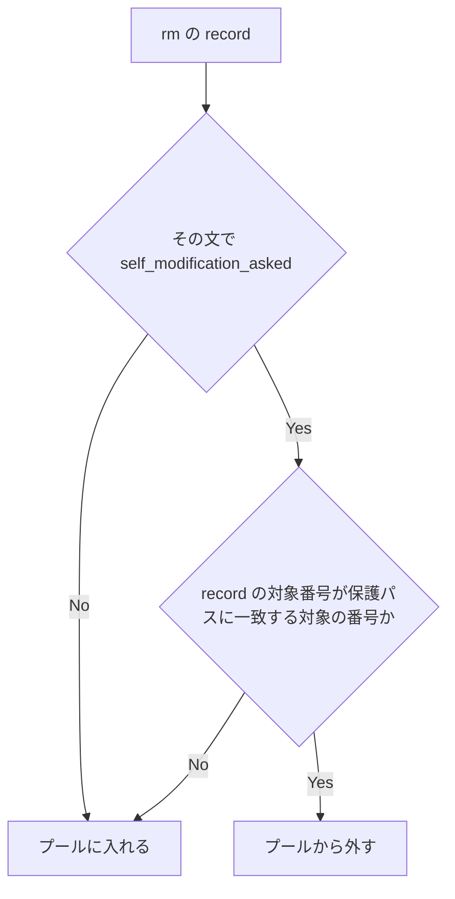

# mixed-rm-self-config-deny - 要件定義書

## 1. 概要

### 1.1 背景
1 つの rm の対象に、保護された自己設定パスと、deny になる再帰削除の対象が並んでいるとき、保護パスでない側の対象の deny（rm-recursive / rm-root）が self-modification の ask に飲み込まれている。

### 1.2 目的
- 保護パスと deny になる対象が 1 つの rm に並ぶ形で、保護パスでない側の対象の deny（rm-recursive / rm-root）を出す。
- 保護パスだけを消す rm（単体、または他の対象が deny にならない形）は、今と同じく self-modification の ask のままにする。

### 1.3 スコープ
- `em-workflow/hooks/destructive-guard.py` の、self-modification の ask が出た文で rm 判定をプールから外す処理（除外の単位を rm の呼び出しから対象に改める）
- `rm_operands_name_self_config()` と、除外にかかわるコメント
- `em-workflow/hooks/tests/destructive-guard-cases.json` のケース（旧 feature の TS-15 の書き換えと、この feature のケースの追加）
- `tests/test_destructive_guard_mixed_rm_precedence.py`
- `feature-docs/destructive-guard-mixed-rm-precedence/SPEC.md` の FR8・AC9・TS-15
- `.claude/rules/hook-tests.md` の優先順位の箇条

範囲外:
- `~/.claude/skills/../../valuable` の形（生の形が SELF_CONFIG に一致するので今も除外される）。今の動作のまま残す。
- `feature-docs/destructive-guard-mixed-rm-precedence/` の REQUIREMENTS.md と VERIFICATION.md。当時の記録として残す。

## 2. ビジネス要件

### 2.1 ビジネス目標
- 1 つの rm の対象に保護された自己設定パスと deny になる再帰削除の対象が並んでいるとき、保護パスでない側の対象の deny（rm-recursive / rm-root）を出す。
- 保護パスだけを消す rm（単体、または他の対象が deny にならない形）は、今と同じく self-modification の ask のままにする。

### 2.2 対象ユーザー
該当なし（要件分析で定めていない）。

### 2.3 期待される効果
- 保護パスと deny になる対象が並ぶ rm が、deny（rm-recursive / rm-root）になる。
- 保護パスだけを消す rm の判定は変わらない。

## 3. ユースケース

### 3.1 ユースケース一覧
| ID | ユースケース名 | アクター |
|----|----------------|----------|
| UC01 | 保護パスと deny になる対象が並ぶ rm を判定する | destructive-guard.py に渡る Bash コマンド |
| UC02 | 保護パスだけを消す rm を判定する | destructive-guard.py に渡る Bash コマンド |

### 3.2 ユースケース詳細

#### UC01: 保護パスと deny になる対象が並ぶ rm を判定する

**アクター**: destructive-guard.py に渡る Bash コマンド

**事前条件**:
- 文で self-modification の ask が出ている。
- 1 つの再帰 rm の対象に、保護された自己設定パスと、deny になる対象が並んでいる。

**基本フロー**:
1. 保護パスに一致する対象の rm 判定だけをプールから外す。
2. 同じ rm の残りの対象の判定をプールに入れる。
3. 解決の段で deny が勝ち、理由 ID は rm-recursive（root やホームの形なら rm-root）になる。

**代替フロー**:
- CLAUDE_BATCH を立てても、同じ deny と理由 ID になる。

**事後条件**:
- 理由の本文は、保護パスを外した後の勝ちの対象だけで作られる。位置表記は外した対象も数えた番号のままで、self-modification の文言と降格の文言は入らない。

#### UC02: 保護パスだけを消す rm を判定する

**アクター**: destructive-guard.py に渡る Bash コマンド

**事前条件**:
- rm の保護パス以外の対象が、ask 止まり（解決できない、グロブ）、安全な領域の中（例 /tmp/x）、全部が保護パス、のどれかである。または rm が再帰でない。

**基本フロー**:
1. 判定は今と同じく self-modification の ask になる。

**代替フロー**:
- CLAUDE_BATCH なら deny / self-modification。

**事後条件**:
- 判定段と理由 ID は今と変わらない。

## 4. 機能要件

### 4.1 機能一覧
| ID | 機能名 | 説明 |
|----|--------|------|
| FR1 | 除外の単位を rm の呼び出しから対象に改める | 保護パスに一致する対象の rm 判定だけをプールから外し、残りの対象の判定はプールに入れる |
| FR2 | 保護パスの判定方法は今と同じ | 生の形か正規化した形のどちらかが SELF_CONFIG に一致すれば保護パス |
| FR3 | 混ざった形の判定 | 保護パスと deny になる対象が並ぶ形は、並び順にかかわらず deny |
| FR4 | rm_operands_name_self_config() とコメントを直す | 保護パスに一致する対象の番号の集まりを返す形に変え、コメントを書き直す |
| FR5 | ケース表 | 旧 feature の TS-15 をその場で書き換え、この feature のケースを表の最後に足す |
| FR6 | 単体テスト | tests/test_destructive_guard_mixed_rm_precedence.py を新しい動作に合わせる |
| FR7 | 旧 feature の SPEC.md | FR8・AC9・TS-15 だけを新しい動作に改める |
| FR8 | .claude/rules/hook-tests.md | 優先順位の箇条を、除外が対象単位であることに合わせて書き直す |

### 4.2 機能詳細

#### FR1: 除外の単位を rm の呼び出しから対象に改める

**説明**: その文で self-modification の ask が出ていて（self_modification_asked）、rm の削除対象のうち保護された自己設定パスに一致する対象がある場合、プールから外すのはその対象の rm 判定だけにする。同じ rm の残りの対象の判定はプールに入れる。

**入力**:
- 文の self_modification_asked
- rm の削除対象（`_number_rm_operands()` の対象番号つき）

**出力**:
- プールに入る rm 判定（保護パスに一致する対象の判定を除いたもの）

**処理フロー**:

**ビジネスルール**:
- 対象の特定には、check_rm() の record と同じ `_number_rm_operands()` の対象番号を使う。同じ呼び出しの record は同じ anchor を持つ。
- 普通の経路（destructive-guard.py の 10584-10588 行）と、コマンド置換が先頭の経路（10550-10555 行。オペランドの土台は shaped_words[skip_index:]、check_rm() に渡すものと同じ）の両方に当てはめる。
- どちらの経路でも、除外の条件（その文の self_modification_asked）は変えない。
- 対象を数える土台は check_rm() と同じにする（`--` の規則、operator syntax は数えない、`-` で始まる対象は判定しない）。

#### FR2: 保護パスの判定方法は今と同じ

**説明**: 保護された自己設定パスかどうかは、今の rm_operands_name_self_config() と同じく判定する。

**ビジネスルール**:
- 生のオペランドか normalize_candidate() で正規化した形のどちらかが SELF_CONFIG に一致すれば保護パスとみなす。
- 正規化後の形だけで判定する方式にはしない。

#### FR3: 混ざった形の判定

**説明**: 1 つの rm に保護パスと deny になる対象が並ぶ形は、対象の並び順にかかわらず deny とする。

**ビジネスルール**:
- 理由 ID は rm-recursive（root やホームの形なら rm-root）。
- 理由の本文は、保護パスを外した後の勝ちの対象だけで作る。
- 位置表記は外した対象も数えた番号のまま（例 `rm -rf ~/.claude/skills/foo /home/user/valuable` なら「1番目のrmの2番目の対象」）。
- self-modification の文言と降格の文言は入れない。
- CLAUDE_BATCH を立てても同じ deny と理由 ID になる（優先を決めてから降格する）。
- 保護パス以外の対象が ask 止まり（解決できない、グロブ）か、安全な領域の中（例 /tmp/x）か、全部が保護パスか、rm が再帰でないときは、今と同じく self-modification の ask のまま。

#### FR4: rm_operands_name_self_config() とコメントを直す

**説明**: rm_operands_name_self_config() を、保護パスに一致する対象の番号の集まりを返す形に変える（名前を変えるか、別の関数に置き換えてもよい）。

**ビジネスルール**:
- main() のループにある除外のコメント（10499-10509 行）と、解決の段の前のコメント（10613-10616 行）を、除外の単位が対象になったことに合わせて書き直す。
- strongest_rm_decision( の直前のコメントブロックには、tests/test_destructive_guard_mixed_rm_precedence.py:809-815 が固定している語（"held ask"、"resolution step"、"self-modification"、"left out"）を残す。

#### FR5: ケース表

**説明**: em-workflow/hooks/tests/destructive-guard-cases.json を新しい動作に合わせる。

**ビジネスルール**:
- 旧 feature の TS-15（1249 行）を、その場で書き換える。期待する判定を deny に、rule を rm-recursive に、ラベルを新しい動作に合わせる。ラベルの先頭 "destructive-guard-mixed-rm-precedence TS-15" はそのまま残す。
- この feature のケースは、表の最後に rule 付きで足し、ラベルを "mixed-rm-self-config-deny TS-" で始める。
- マシン固有のパスは書かない。
- 42 行目（`rm -rf ~/.claude/skills/foo` ask）と 31 行目は変えない。

#### FR6: 単体テスト

**説明**: tests/test_destructive_guard_mixed_rm_precedence.py を新しい動作に合わせる。

**ビジネスルール**:
- test_a_protected_and_an_unprotected_target_in_one_rm_stay_an_ask（271-275 行）の期待を deny / rm-recursive に変え、テスト名も実態に合わせる。
- TestCaseTable.test_each_scenario_has_its_case にある TS-15 のタプル（449 行）を ("deny", ..., "rm-recursive", False) に変える。
- 新しい形の理由の本文（位置表記、self-modification の文言が無いこと、batch でも同じこと）を確かめるテストを足す。

#### FR7: 旧 feature の SPEC.md

**説明**: feature-docs/destructive-guard-mixed-rm-precedence/SPEC.md のうち、次の 3 箇所だけを新しい動作（deny / rm-recursive）に改める。

**ビジネスルール**:
- FR8 の「わかっている影響」の文
- AC9 の第 3 文（`rm -rf ~/.claude/skills/foo /home/user/valuable` は ask / self-modification）
- TS-15 の行（183 行）
- 同じ feature の REQUIREMENTS.md と VERIFICATION.md は当時の記録として残し、変えない。

#### FR8: .claude/rules/hook-tests.md

**説明**: 優先順位の箇条「同じ文の rm の削除対象が保護された自己設定パスのときは、代わりに self-modification の `ask` が残る。」を、除外が対象単位であることに合わせて書き直す。

**ビジネスルール**:
- 保護パスの対象だけを候補から外す。
- 同じ rm の残りの対象の deny は勝つ。

## 5. 非機能要件

### 5.1 パフォーマンス要件
- NFR4 性能: 走査は既存の scan budget と線形の作業上限の中に収まる。どのケースも GUARD_TIMEOUT_SECONDS（10 秒）を超えない。

### 5.2 セキュリティ要件
- NFR1 変化の向き: 判定が変わるのは、今 ask（self-modification）の形が deny に変わる方向だけにする。今 deny の形を弱めない。ケース表のうち判定が変わるのは TS-15 だけ。

### 5.3 可用性要件
該当なし。

### 5.4 保守性要件
- NFR3 決定性: 判定は今までどおりコマンド文字列だけで決まる。同じ文字列からは同じ判定段、理由 ID、理由の本文が出る。
- NFR5 version: plugin.json と marketplace.json の version は触らない（patch は Actions が上げる）。

### 5.5 互換性要件
- NFR2 deny の無い形の互換: 保護パス以外の対象が deny にならない形の判定段と理由 ID は今と変えない（self-modification の ask。CLAUDE_BATCH なら deny / self-modification）。

## 6. UI/UX要件

該当なし（UI が無い）。

## 7. データ要件

該当なし。

## 8. 外部連携

該当なし。

## 9. 制約条件

### 9.1 技術的制約
- 保護パスの判定は今の方式（生の形か正規化後の形のどちらかが SELF_CONFIG に一致）を使う。
- 対象の番号は check_rm() の record と同じ `_number_rm_operands()` の番号を使う。

### 9.2 ビジネス上の制約
- 旧 feature の REQUIREMENTS.md と VERIFICATION.md は変えない。

### 9.3 スケジュール制約
該当なし。

### 9.4 宣言された変更集合

このフィーチャー固有のパスは手動で列挙せず、create-plan で `workflow.yaml` の各タスクの `files` から導出する（`references/phases/create-plan-phase.md`）。

**デフォルトメンバー**（SPEC作成者が明示的に除外しない限り、常に宣言に含まれる）:
- `feature-docs/mixed-rm-self-config-deny/**`
- `test-docs/mixed-rm-self-config-deny/**`

`feature-docs/mixed-rm-self-config-deny/**` に含まれるもの: `REQUIREMENTS.md`、`SPEC.md`、`IMPLEMENTATION.md`、`workflow.yaml`、`phase-state/`、`tasks/`、`reviews/roundN.yaml`、`VERIFICATION.md`、`retrospect.yaml`、およびデザインステップが生成するデザイン成果物。生成主体は各フェーズドキュメントおよび `references/phase-state.md` を参照（引用のみ、ルールは再掲しない）。

`test-docs/mixed-rm-self-config-deny/**` に含まれるもの: `{T}.tests.yaml`（パス形式: `test-docs/mixed-rm-self-config-deny/{T}.tests.yaml`）。生成主体は `implement-phase.md` を参照（引用のみ、ルールは再掲しない）。

**意味論**:
- デフォルトのメンバーは、SPEC作成者が明示的に除外しない限り宣言に含まれる。除外は意図的な絞り込みであり、記載漏れによる省略ではない。
- この宣言はスーパーセット（superset）の主張であり、実際の変更集合は宣言に含まれる（CONTAINED IN）必要がある。実際には生成されないパスが宣言されていても違反にはならない。implementタスクを1つも生成しないフィーチャーは `test-docs/mixed-rm-self-config-deny/` ディレクトリを生成しないが、宣言された `test-docs/mixed-rm-self-config-deny/**` は依然として正しい。

## 10. 想定される課題とリスク

### 10.1 技術的課題
| 課題 | 対応策 |
|------|--------|
| コマンド置換が先頭の経路で、今 self-modification の ask が出ているかどうかは確かめていない（A7） | その経路の判定と理由の本文は、実際の出力に合わせて単体テストで固定する |

### 10.2 ビジネスリスク
該当なし。

## 11. 成功基準

### 11.1 受け入れ基準
- [ ] AC1: `rm -rf ~/.claude/skills/foo /home/user/valuable` は deny / rm-recursive。理由の本文に「1番目のrmの2番目の対象」が入り、「1番目のrmの1番目の対象」と self-modification の文言は入らない。
- [ ] AC2: 対象の順序を逆にした `rm -rf /home/user/valuable ~/.claude/skills/foo` も deny / rm-recursive（位置表記は「1番目のrmの1番目の対象」）。
- [ ] AC3: CLAUDE_BATCH を立てた AC1 の形は deny / rm-recursive で、理由の本文は CLAUDE_BATCH なしのときと同じ。
- [ ] AC4: `rm -rf ~/.claude/skills/foo ~` は deny / rm-root。
- [ ] AC5: `rm -rf ~/.claude/skills/foo`、`rm -rf ~/.claude/skills/foo tmp/$X`、`rm -rf ~/.claude/skills/foo /tmp/x`、`rm -rf ~/.claude/skills/foo ~/.claude/hooks/bar`、`rm ~/.claude/skills/foo /home/user/valuable` は ask / self-modification のまま。
- [ ] AC6: 保護パスの書き方（`~/`、`$HOME/`、`--` の後）が変わっても AC1 と同じく deny / rm-recursive。
- [ ] AC7: 旧 feature のケース TS-12・TS-13・TS-14・TS-16・TS-20、42 行目、31 行目の判定と理由 ID は変わらない。
- [ ] AC8: `python3 em-workflow/hooks/tests/run-destructive-guard.py` と `python3 -m unittest discover -s tests` が全件通る。
- [ ] AC9: 旧 feature の SPEC.md の FR8・AC9・TS-15 と hook-tests.md の優先順位の箇条が新しい動作を書いている。旧 feature の REQUIREMENTS.md と VERIFICATION.md は変わっていない。

### 11.2 KPI
該当なし。

## 12. テストシナリオ

### 12.1 テスト観点
- [ ] 正常系: 保護パスと deny になる対象が並ぶ rm が deny / rm-recursive（root やホームなら rm-root）になる。対象の順序、保護パスの書き方（`~/`、`$HOME/`、`--` の後）、後ろに別の文が続く形でも同じ。
- [ ] 正常系: 保護パス以外の対象が deny にならない形（ask 止まり、安全な領域の中、全部が保護パス、再帰でない rm）は ask / self-modification のまま。
- [ ] 異常系: 該当なし。
- [ ] 境界値: 同じ保護パスを 2 回書いた形は、どちらも除外される。リダイレクト先だけが保護パスの形（旧 feature の TS-20）は今までどおり除外しない。
- [ ] セキュリティ: CLAUDE_BATCH を立てても同じ deny と理由 ID、同じ理由の本文になる。今 deny の形を弱めない。
- [ ] パフォーマンス: どのケースも GUARD_TIMEOUT_SECONDS（10 秒）を超えない。

## 13. 用語定義

| 用語 | 定義 |
|------|------|
| 保護された自己設定パス（保護パス） | 生の形か normalize_candidate() で正規化した形のどちらかが SELF_CONFIG に一致する rm の対象 |
| self_modification_asked | その文で self-modification の ask が出ていること |
| プール | 解決の段で優先を決める対象になる rm 判定の集まり |
| 旧 feature | destructive-guard-mixed-rm-precedence |

## 14. 確認事項

### 14.1 確認済み事項

- [x] 保護パスの判定方法: 生の形か正規化後の形のどちらかが SELF_CONFIG に一致すること（回答 raw_or_normalized）。正規化後の形だけにすると、HOME が /home 配下に無い環境で単体の自己設定削除が ask から deny に変わってしまう。（A1）
- [x] 旧 feature の文書の扱い: SPEC.md の FR8・AC9・TS-15 だけを改める（回答 spec_only）。（A4）
- [x] デザインステップ: UI が無いので省く（回答 decide_autonomously）。

前提:
- A2: `~/.claude/skills/../../valuable` の形はこの feature の範囲外で、今の動作のまま残す。
- A3: 除外には、今と同じく、その文で self-modification の ask が出ていることが要る。変えるのは除外の単位だけ。
- A5: TS-15 の書き換えは ask から deny への変更で、ケースを消すわけではない。検出力は上がるので、hook-tests.md の「既存の deny / ask ケースは消さない」に反しない。
- A6: tests/ 配下でケース表の先頭からのダイジェストを固定しているテストの範囲に TS-15 の位置（index 1226）は入らない（固定は先頭 942 件と 1208 件まで）。
- A8: LICENSE ファイル、パッケージマニフェスト、E2E の仕組み、UI はどれも無い。

### 14.2 未確認・保留事項
- [ ] A7: コマンド置換が先頭の経路で、今 self-modification の ask が出ているかどうかは確かめていない。出ていなければ、その経路では今も除外が効いておらず、この変更でも判定は変わらない（deny のまま）。

## 15. 参考資料

- em-workflow/hooks/destructive-guard.py
- em-workflow/hooks/tests/destructive-guard-cases.json
- tests/test_destructive_guard_mixed_rm_precedence.py
- feature-docs/destructive-guard-mixed-rm-precedence/SPEC.md
- .claude/rules/hook-tests.md
