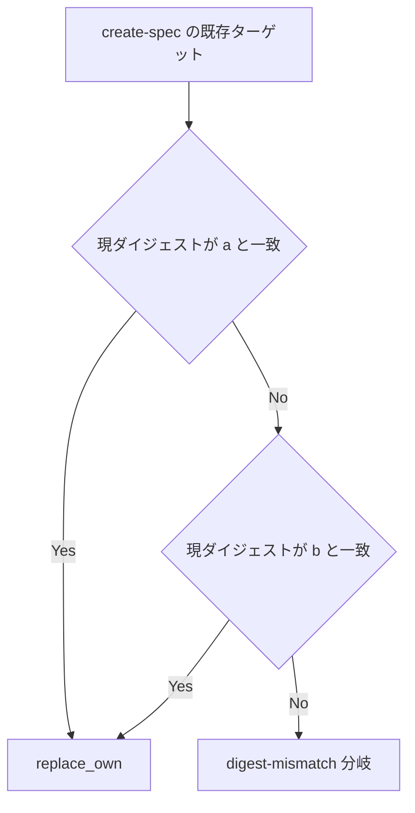

# orchestrator-spec-edit-overwrite - 要件定義書

## 1. 概要

### 1.1 背景
バッチ実行で、オーケストレーターが create-plan 中に自 feature の SPEC.md を直してコミットすると、spec-change 後の create-spec 再実行で SPEC.md の現在のダイジェストが直前の create-spec 出力と一致せず、digest-mismatch 分岐に入る。batch ではその決定が `preserve_and_reuse` のため、決定済みの SPEC 変更が書き込まれず、run が止まる。

### 1.2 目的
- create-plan 中にオーケストレーターが直してコミットした SPEC.md / REQUIREMENTS.md を、create-spec 再実行で `replace_own` として上書きできるようにする。
- 人の手など、ほかの経路で変わった SPEC.md は従来どおり digest-mismatch 分岐で守る。

### 1.3 スコープ
対象:
- create-plan 中にオーケストレーターが自 feature の SPEC.md / REQUIREMENTS.md を変更してコミットしたときの記録（`skills/develop/SKILL.md`、`references/phase-state.md`）
- create-spec の書き込み方針（action）決定への一致条件の追加（`references/contracts/spec-writer-contract.md`）
- `references/phases/create-spec-phase.md` §9 の `write_policy` の記述の整合
- 再発検出テスト（`tests/`）

`references/`・`skills/`・`scripts/` は em-workflow プラグイン内のパスを指す。

対象外:
- minimal tier の TASK.md（A-4）
- create-plan 以外のフェーズ（review / verify / rework）でのオーケストレーターによる SPEC.md 変更（A-6）
- 記録の無い過去の修正で既に止まっている別 feature の再開（A-7）
- design step の action 決定と create-plan の planning-lineage rule の変更（FR5）

## 2. ビジネス要件

### 2.1 ビジネス目標
- バッチ実行で、オーケストレーターが create-plan 中に直してコミットした SPEC.md が、spec-change 後の create-spec 再実行で digest 不一致による preserve にならず、決定済みの SPEC 変更が書き込まれて run が止まらないようにする。
- 人の手など、ほかの経路で変わった SPEC.md は従来どおり digest-mismatch 分岐で守る。

### 2.2 対象ユーザー
| ユーザータイプ | 説明 |
|----------------|------|
| em-workflow の利用者 | em-workflow をバッチ実行または対話実行で使う Claude Code 利用者 |

### 2.3 期待される効果
- create-plan 中のオーケストレーターによる SPEC 修正の後に spec-change が起きても、バッチ実行が create-spec で止まらない。
- オーケストレーターが記録していない変更は、従来どおり digest-mismatch 分岐で保護される。

## 3. ユースケース

### 3.1 ユースケース一覧
| ID | ユースケース名 | アクター | 優先度 |
|----|----------------|----------|--------|
| UC01 | create-plan 中に直した SPEC.md を create-spec 再実行で上書きする | オーケストレーター | 高 |
| UC02 | 人の手で変わった SPEC.md を保護する | オーケストレーター | 高 |

### 3.2 ユースケース詳細

#### UC01: create-plan 中に直した SPEC.md を create-spec 再実行で上書きする

**アクター**: オーケストレーター

**事前条件**:
- batch の create-plan で、オーケストレーターが SPEC.md を直してコミットし、その版のダイジェストを `phase-state/create-plan.yaml` に記録した。
- その後 spec-change で create-spec が needs_update になった。

**基本フロー**:
1. create-spec が spec-writer を起動する前に、各ターゲットの書き込み方針を決める。
2. SPEC.md の現在のダイジェストが `phase-state/create-plan.yaml` の記録の、そのパスの最後のエントリと一致する。
3. SPEC.md の action を `replace_own` にする。
4. spec-writer が決定済みの SPEC 変更を書き込む。

**代替フロー**:
- `phase-state/create-plan.yaml` の記録が数えられない場合（FR4）は、直前の create-spec 出力との比較だけで決める。

**事後条件**:
- `preserve_and_reuse` に入らず、決定済みの SPEC 変更が SPEC.md に書き込まれている。

#### UC02: 人の手で変わった SPEC.md を保護する

**アクター**: オーケストレーター

**事前条件**:
- 記録した後に人の手で SPEC.md が変わり、現在のダイジェストが `phase-state/create-spec.yaml` の最後のエントリとも `phase-state/create-plan.yaml` の記録とも一致しない。

**基本フロー**:
1. create-spec の書き込み方針を決める。
2. どちらとも一致しないので、digest-mismatch 分岐に入る。

**代替フロー**:
- interactive では `create-spec.artifact-overwrite` ゲートを出す。batch では `references/batch-policies.yaml` の決定（`preserve_and_reuse`）に従う。

**事後条件**:
- 人の手による変更が上書きされていない。

## 4. 機能要件

### 4.1 機能一覧
| ID | 機能名 | 説明 | 優先度 |
|----|--------|------|--------|
| FR1 | create-plan 中のオーケストレーターによる自 feature 文書修正の記録 | 変更後のパスとダイジェストを `phase-state/create-plan.yaml` に追記し、同じコミットに含める | 高 |
| FR2 | 記録のスキーマ | `references/phase-state.md` に記録のフィールドを定義する | 高 |
| FR3 | create-spec の書き込み方針決定で記録版を replace_own にする | (a) 直前の同フェーズ出力または (b) FR1 の記録と一致すれば `replace_own` | 高 |
| FR4 | 記録を読むときの条件 | (b) の記録を数える条件と、記録なしとして扱う場合 | 高 |
| FR5 | 適用範囲を create-spec に限る | design step と create-plan の決定は変えない | 高 |
| FR6 | replace_own 行と create-spec §9 の整合 | action 表の `replace_own` 行と §9 を owner セクションの引用で揃える | 高 |
| FR7 | 再発検出テスト | FR1〜FR6 の記述の存在・不在を検査する unittest を追加する | 高 |

### 4.2 機能詳細

#### FR1: create-plan 中のオーケストレーターによる自 feature 文書修正の記録

**説明**: create-plan 中に、オーケストレーター自身が自 feature の SPEC.md または REQUIREMENTS.md を変更してコミットするとき、変更後のパスと、`references/artifact-digest.md`（`Calculation`）で計算したその時点のダイジェストを、`phase-state/create-plan.yaml` の追記専用の記録に 1 件追加する。この記録は文書の変更と同じコミットに含める。この手順は `skills/develop/SKILL.md` に書き、記録の形は `references/phase-state.md` を引用する。

**ビジネスルール**:
- ダイジェストの計算が失敗したときは記録しない。
- 対象は自 feature の SPEC.md と REQUIREMENTS.md とする（A-4）。

**エラーケース**:
| エラー | 条件 | 対応 |
|--------|------|------|
| ダイジェスト計算の失敗 | `Calculation` によるダイジェスト計算が失敗した | 記録しない |
| コミットの exit 4 | 記録を含むコミットが `commit-docs.sh` の exit 4 になった | 既存の exit-4 リカバリに従い、最新ツリーの上で編集を作り直した本文からダイジェストを計算し直して、記録と一緒に再試行する（A-10） |

#### FR2: 記録のスキーマ

**説明**: `references/phase-state.md` に FR1 の記録のフィールドを定義する。

**ビジネスルール**:
- `phase: create-plan` のときだけ持つ。
- 追記専用で、書き換えも消去もしない。
- phase の再開始（`generation` の増加）でも残る。
- 各エントリは `path`、`sha256`（`references/artifact-digest.md` の `Digest definition` が定める値）、`reason` を持つ。
- このフィールドが無い既存のファイルも有効のままとする。
- 置き場所は `phase-state/create-plan.yaml` とする。フィールド名は A-3 の例 `orchestrator_doc_edits` を用いる（A-3）。

#### FR3: create-spec の書き込み方針決定で記録版を replace_own にする

**説明**: `references/contracts/spec-writer-contract.md` の「How the orchestrator chooses each target's action before dispatch」で、create-spec の既存ターゲットについて、現在のダイジェストが次のどちらかと一致すれば `replace_own` にする。

- (a) 直前の同フェーズ出力（`phase-state/create-spec.yaml` にある、そのパスの最後の `artifacts` エントリ）
- (b) `phase-state/create-plan.yaml` の FR1 の記録にある、そのパスの最後のエントリ

**処理フロー**:

**ビジネスルール**:
- どちらとも一致しなければ、従来どおり digest-mismatch 分岐に入る（interactive では `create-spec.artifact-overwrite` ゲート、batch では `references/batch-policies.yaml` の決定）。
- 同じパスの記録が複数あるときは、最後のエントリだけを数える。前のエントリとだけ一致する場合は一致として数えない（TS-4）。
- 一致条件はモードによらず適用する（A-5）。
- (b) によって `replace_own` になったターゲットにも、起動直前の `expect_digest` の照合（`references/artifact-digest.md` の Pre-dispatch verification）をそのまま適用する（A-11）。

#### FR4: 記録を読むときの条件

**説明**: FR3 (b) の記録を数えるのは、`phase-state/create-plan.yaml` のマッピングが phase `create-plan` を持ち、feature が workflow の feature と等しいときだけとする。

**ビジネスルール**:
- 次のどれも「(b) の記録なし」として扱い、判定は (a) との比較だけで決める。
    - ファイルが無い
    - 読めない
    - 壊れている
    - phase や feature が合わない
    - そのパスのエントリが無い
- 記録された値の比較は、ほかの記録値と同じく `references/artifact-digest.md` の「Legacy records」に従う。

#### FR5: 適用範囲を create-spec に限る

**説明**: FR3 (b) の一致条件は create-spec の action 決定だけに加える。

**ビジネスルール**:
- design step の決定は変えない。
- create-plan の planning-lineage rule（`No other condition gives replace_own` を含む）は変えない。
- spec-change の記録や再計画の許可が `replace_own` の根拠にならないことも、従来どおりとする。

#### FR6: replace_own 行と create-spec §9 の整合

**説明**: spec-writer-contract.md の「The `write_policy` actions」表の `replace_own` 行は、既存の文を残したまま、create-spec の spec-writer dispatch では「同フェーズ出力」に FR3 (b) の記録版が含まれることを、owner セクションを引用して述べる。

**ビジネスルール**:
- 行の中に最後のエントリの規則やファイル名を書き直さない。
- `references/phases/create-spec-phase.md` §9 の `write_policy` の記述は owner セクションと食い違わないようにし、規則を書き直さずに引用する。

#### FR7: 再発検出テスト

**説明**: `tests/` に unittest を追加し、FR1 から FR6 の記述がそれぞれの文書にあることを検査する。

**ビジネスルール**:
- 各存在検査には、その記述を取り除いた偽の写しで失敗することを確かめるテストを付ける。
- 各不在検査には、その語句を入れた偽の写しで検出することを確かめるテストを付ける。
- 既存の `tests/test_artifact_digest_docs.py` の方式に合わせる（A-1）。

## 5. 非機能要件

### 5.1 パフォーマンス要件
- 該当なし

### 5.2 セキュリティ要件
- 該当なし

### 5.3 可用性要件
- 該当なし

### 5.4 保守性要件
- NFR1: write_policy の action を増やさない。新しい action は追加しない。spec-writer-contract.md の action 表は 7 行のままとし、`scripts/self-write-digest.py` の `ACTIONS` と self-write の表は変えない。
- NFR2: 文書構造の固定を壊さない。`references/artifact-digest.md` の level-2 セクションは 6 つのまま、`references/phases/create-spec-phase.md` の level-2 見出しは今の並びのままとする。`references/batch-policies.yaml` の `create-spec.artifact-overwrite` の決定（`preserve_and_reuse`）は変えない。
- NFR3: 既存テストがすべて通る。`python3 -m unittest discover -s tests` がすべて通る。既存のテストメソッドは消さず、弱めない。
- NFR4: 引用で済ませ、書き直さない。規則は owner 文書（spec-writer-contract.md、phase-state.md、artifact-digest.md）に一度だけ書き、ほかの文書はパスとセクション名で引用する。`git hash-object` を手段として新しく書かない。

### 5.5 互換性要件
- FR2 の記録フィールドが無い既存の `phase-state/create-plan.yaml` も有効のままとする。

## 6. UI/UX要件

### 6.1 画面設計要件
該当なし（UI が無い）

### 6.2 画面遷移
該当なし

### 6.3 レスポンシブ対応
該当なし

## 7. データ要件

### 7.1 データモデル概要
`phase-state/create-plan.yaml` に、`phase: create-plan` のときだけ持つ追記専用の記録を加える（FR2）。

### 7.2 データ項目
| エンティティ | 項目名 | 型 | 必須 | 説明 |
|--------------|--------|-----|------|------|
| `phase-state/create-plan.yaml` の記録のエントリ | `path` | 文字列 | ○ | 変更後の文書のパス |
| `phase-state/create-plan.yaml` の記録のエントリ | `sha256` | 文字列 | ○ | `references/artifact-digest.md` の `Digest definition` が定める値 |
| `phase-state/create-plan.yaml` の記録のエントリ | `reason` | 文字列 | ○ | 変更の理由 |

### 7.3 データ保持期間
| データ種別 | 保持期間 |
|------------|----------|
| FR1 の記録 | 書き換えも消去もしない。phase の再開始（`generation` の増加）でも残る |

## 8. 外部連携

### 8.1 連携システム
該当なし

### 8.2 API仕様要件
該当なし

## 9. 制約条件

### 9.1 技術的制約
- action decision は文書（オーケストレーターの手順）で決まり、判定するスクリプトは無い（A-1）。
- 新しい action は追加せず、既存の `replace_own` を使う（A-2、NFR1）。
- 規則は owner 文書に一度だけ書き、ほかの文書は引用する（NFR4）。

### 9.2 ビジネス上の制約
- plugin の version は触らない（A-8）。

### 9.3 スケジュール制約
- なし

### 9.4 宣言された変更集合

このフィーチャー固有のパスは手動で列挙せず、create-plan で `workflow.yaml` の各タスクの `files` から導出する（`references/phases/create-plan-phase.md`）。

**デフォルトメンバー**（SPEC作成者が明示的に除外しない限り、常に宣言に含まれる）:
- `feature-docs/orchestrator-spec-edit-overwrite/**`
- `test-docs/orchestrator-spec-edit-overwrite/**`

`feature-docs/orchestrator-spec-edit-overwrite/**` に含まれるもの: `REQUIREMENTS.md`、`SPEC.md`、`IMPLEMENTATION.md`、`workflow.yaml`、`phase-state/`、`tasks/`、`reviews/roundN.yaml`、`VERIFICATION.md`、`retrospect.yaml`、およびデザインステップが生成するデザイン成果物。生成主体は各フェーズドキュメントおよび `references/phase-state.md` を参照（引用のみ、ルールは再掲しない）。

`test-docs/orchestrator-spec-edit-overwrite/**` に含まれるもの: `{T}.tests.yaml`（パス形式: `test-docs/orchestrator-spec-edit-overwrite/{T}.tests.yaml`）。生成主体は `implement-phase.md` を参照（引用のみ、ルールは再掲しない）。

**意味論**:
- デフォルトのメンバーは、SPEC作成者が明示的に除外しない限り宣言に含まれる。除外は意図的な絞り込みであり、記載漏れによる省略ではない。
- この宣言はスーパーセット（superset）の主張であり、実際の変更集合は宣言に含まれる（CONTAINED IN）必要がある。実際には生成されないパスが宣言されていても違反にはならない。implementタスクを1つも生成しないフィーチャーは `test-docs/orchestrator-spec-edit-overwrite/` ディレクトリを生成しないが、宣言された `test-docs/orchestrator-spec-edit-overwrite/**` は依然として正しい。

## 10. 想定される課題とリスク

### 10.1 技術的課題
| 課題 | 影響度 | 対応策 |
|------|--------|--------|
| create-spec が新しい版を書いた後に本文が create-plan で記録した版と同じバイト列に戻ると、(b) との一致で `replace_own` になる | 低 | 許容する。記録した版はオーケストレーターが承認した版である（A-9） |
| 記録を含むコミットが `commit-docs.sh` の exit 4 になる | 中 | 既存の exit-4 リカバリに従い、ダイジェストを計算し直して記録と一緒に再試行する（A-10） |

### 10.2 ビジネスリスク
| リスク | 発生確率 | 影響度 | 対応策 |
|--------|----------|--------|--------|
| 記録の無い過去の修正で既に止まっている別 feature は、この変更で自動的には復旧しない | 中 | 低 | 対象外とする（A-7） |

## 11. 成功基準

### 11.1 受け入れ基準
- [ ] AC-1（FR1）: SKILL.md に、create-plan 中にオーケストレーターが自 feature の SPEC.md / REQUIREMENTS.md を変更してコミットするとき、パスと artifact digest を phase-state/create-plan.yaml の記録に追加し、同じコミットに含める手順が書かれている
- [ ] AC-2（FR2）: phase-state.md のスキーマに、phase: create-plan だけが持つ追記専用の記録（path / sha256 / reason）が定義され、generation が増えても残ること、無い既存ファイルも有効であることが書かれている
- [ ] AC-3（FR3）: spec-writer-contract.md の owner セクションに、create-spec の既存ターゲットの現ダイジェストが create-spec.yaml の最後のエントリ、または create-plan.yaml の記録の最後のエントリと一致すれば replace_own、どちらとも一致しなければ digest-mismatch 分岐、と書かれている
- [ ] AC-4（FR4）: owner セクションに、create-plan.yaml の記録を数える条件（phase と feature の一致）と、記録なしとして扱う 5 つの場合、判定が create-spec.yaml との比較だけになること、Legacy records の引用が書かれている
- [ ] AC-5（FR5）: create-plan の planning-lineage rule の既存の記述（No other condition gives replace_own を含む）と design step の扱いが変わっていない
- [ ] AC-6（FR6、NFR1）: replace_own 行が既存の文を残し、create-spec の記録版を owner セクションの引用で含め、行の中に last artifacts entry や phase-state/rework.yaml を書いていない。action 表は 7 行のまま
- [ ] AC-7（FR7、NFR3）: 追加したテストを含め、python3 -m unittest discover -s tests がすべて通る。追加した存在検査はそれぞれ、偽の写しで失敗する
- [ ] AC-8（NFR2、NFR4）: artifact-digest.md の level-2 セクション数、create-spec-phase.md の見出しの並び、batch-policies.yaml の create-spec.artifact-overwrite の決定が変わっていない

### 11.2 KPI
| 指標 | 目標値 | 測定方法 |
|------|--------|----------|
| 該当なし | - | - |

## 12. テストシナリオ

### 12.1 テスト観点
- [ ] 正常系: TS-1 batch の create-plan でオーケストレーターが SPEC.md を直してコミットし、記録した後、spec-change で create-spec が needs_update になった。書き込み方針の決定で SPEC.md は `replace_own` になり、`preserve_and_reuse` に入らず、決定済みの SPEC 変更が書き込まれる（FR1、FR3）
- [ ] 異常系: TS-2 記録した後に人の手で SPEC.md が変わり、現ダイジェストがどちらとも一致しない。digest-mismatch 分岐に入る（batch では `preserve_and_reuse`）（FR3）
- [ ] 異常系: TS-3 create-plan.yaml が無い、壊れている、phase か feature が合わない、または SPEC.md のエントリが無い。(b) の記録なしとして扱い、create-spec.yaml との比較だけで決まる（FR4）
- [ ] 境界値: TS-4 同じパスの記録が複数あり、現ダイジェストが最後のエントリではなく前のエントリとだけ一致する。一致として数えず、digest-mismatch 分岐に入る（FR3）
- [ ] 境界値: TS-5 create-plan のターゲットまたは design step のターゲットでは、create-plan.yaml の新しい記録は判定に使われず、既存の規則のまま決まる（FR5）
- [ ] 回帰: TS-6 変更後の文書群に対して追加したテストと既存のテストを走らせ、存在検査と不在検査がすべて通り、各存在検査は記述を取り除いた偽の写しで失敗し、action 表 7 行・見出しの並び・level-2 セクション数の固定も通る（FR7、FR6、NFR1、NFR2）
- [ ] セキュリティ: 該当なし
- [ ] パフォーマンス: 該当なし

## 13. 用語定義

| 用語 | 定義 |
|------|------|
| (a) の記録 | `phase-state/create-spec.yaml` にある、そのパスの最後の `artifacts` エントリ |
| (b) の記録 | `phase-state/create-plan.yaml` の FR1 の記録にある、そのパスの最後のエントリ |
| digest-mismatch 分岐 | interactive では `create-spec.artifact-overwrite` ゲート、batch では `references/batch-policies.yaml` の決定に従う分岐 |
| owner セクション | `references/contracts/spec-writer-contract.md` の「How the orchestrator chooses each target's action before dispatch」 |

## 14. 確認事項

### 14.1 確認済み事項
対話による確認事項はない。次の前提を置く。

- [x] A-1: action decision は文書（オーケストレーターの手順）で決まり、判定するスクリプトは無い。再発検出テストは、既存の test_artifact_digest_docs.py と同じ文書検査（偽の写しによる非空虚性の確認つき）とする
- [x] A-2: 新しい action は追加せず、既存の replace_own を使う（create-plan で rework-planner の記録版を replace_own に含めた先例に合わせる）。action 表 7 行と self-write-digest.py の ACTIONS は既存テストで固定されている
- [x] A-3: 記録のフィールド名は spec 側で決める（例: orchestrator_doc_edits）。置き場所は既存の other_feature_doc_fixes と同じく phase-state/create-plan.yaml とする
- [x] A-4: 対象は自 feature の SPEC.md と REQUIREMENTS.md（spec-writer のターゲット）とする。minimal tier の TASK.md は spec-writer が書かないので対象外とする
- [x] A-5: 一致条件はモードによらず適用する。条件はオーケストレーターが記録した版とのダイジェスト一致であり、interactive でも同じ版を上書きしてよい版として扱える
- [x] A-6: create-plan 以外のフェーズ（review / verify / rework）でのオーケストレーターによる SPEC.md 変更は対象外とする
- [x] A-7: 記録の無い過去の修正で既に止まっている別 feature は、この変更で自動的には復旧しない。その再開は対象外とする
- [x] A-8: plugin の version は触らない（core-plugin-version-bump.md、patch は Actions が上げる）
- [x] A-9: (a) と (b) のどちらかとの一致で replace_own にするため、create-spec が新しい版を書いた後に本文が create-plan で記録した版と同じバイト列に戻った場合も replace_own になる。これは許容する（記録した版はオーケストレーターが承認した版である）
- [x] A-10: 記録を含むコミットが commit-docs.sh の exit 4 になった場合は、既存の exit-4 リカバリに従い、最新ツリーの上で編集を作り直した本文からダイジェストを計算し直して、記録と一緒に再試行する
- [x] A-11: (b) によって replace_own になったターゲットにも、起動直前の expect_digest の照合（references/artifact-digest.md の Pre-dispatch verification）をそのまま適用する

### 14.2 未確認・保留事項
- なし

## 15. 参考資料

- `references/contracts/spec-writer-contract.md`
- `references/phase-state.md`
- `references/artifact-digest.md`
- `references/phases/create-spec-phase.md`
- `references/batch-policies.yaml`
- `skills/develop/SKILL.md`
- `tests/test_artifact_digest_docs.py`
