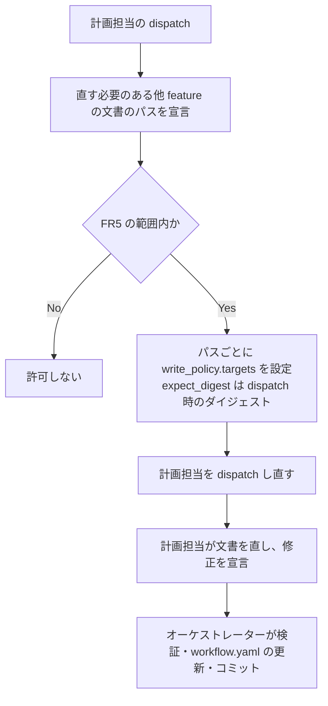
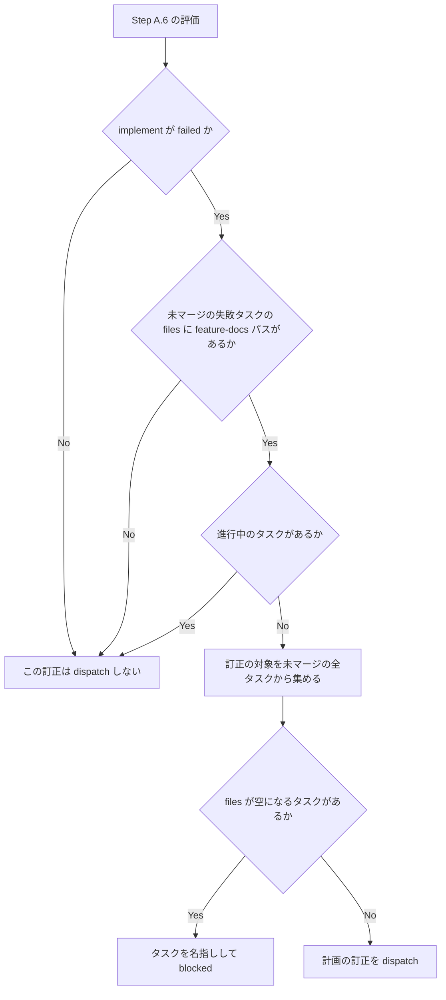

# plan-feature-docs-route - 要件定義書

## 1. 概要

### 1.1 背景
create-plan が実装担当（implementer）のタスクの `files` に `feature-docs/**` を割り当てることがあり、実装担当の規則「Never modify feature-docs/**」と食い違う。この割り当てで implement が failed になった feature は、同じ名前で再開すると止まる。

### 1.2 目的
- 計画担当（implementation-planner）が実装担当のタスクに `feature-docs/**` を割り当てないようにする。
- 他 feature の `feature-docs` 配下の文書の修正を、create-plan の計画担当の経路で最後まで実行できるようにする。
- `feature-docs` の割り当てで implement が failed になった feature を同じ名前で再開したとき、止まらずに進めるようにする。

### 1.3 スコープ
対象:
- 計画担当の割り当て規則（plan-writing スキル、implementation-planner のプロンプト）
- `validate-worker-output.py` の replace_planning の検証
- create-plan の中で計画担当が他 feature の文書を直す経路（planner-contract、create-plan-phase.md）
- Step A.6 の failed からの入口と、再開時の復帰（workflow-patch.md を含む）

対象外:
- web-sip-phone 側のコードと文書の修正（A6）
- `agents/implementer.md` と worktree-task-workflow スキルの「Never modify feature-docs/**」の変更（FR10）

## 2. ビジネス要件

### 2.1 ビジネス目標
- create-plan が実装担当のタスクに `feature-docs/**` を割り当てないようにし、計画と実装担当の規則の食い違いをなくす。
- 他 feature の `feature-docs` 配下の文書の修正を、実装担当以外の経路（create-plan の計画担当）で最後まで実行できるようにする。
- `feature-docs` の割り当てで implement が failed になった feature を同じ名前で再開したとき、止まらずに進めるようにする。

### 2.2 対象ユーザー
| ユーザータイプ | 説明 |
|----------------|------|
| em-workflow の利用者 | create-plan と implement を対話実行または batch 実行で回す人 |

### 2.3 期待される効果
- 実装担当のタスクに `feature-docs/**` が入らない。
- 他 feature の文書の修正が create-plan の中で終わる。
- `feature-docs` の割り当てで failed になった feature が、同じ名前の再開で止まらずに進む。

## 3. ユースケース

### 3.1 ユースケース一覧
| ID | ユースケース名 | アクター | 優先度 |
|----|----------------|----------|--------|
| UC01 | create-plan で他 feature の文書を直す | オーケストレーター、implementation-planner | - |
| UC02 | feature-docs の割り当てで failed になった feature を再開する | em-workflow の利用者、オーケストレーター | - |

### 3.2 ユースケース詳細

#### UC01: create-plan で他 feature の文書を直す

**アクター**: オーケストレーター、implementation-planner

**事前条件**:
- 計画が他 feature の文書の修正を必要としている。

**基本フロー**:
1. implementation-planner が、直す必要のある他 feature の文書のパスを宣言する（FR4）。
2. オーケストレーターが、宣言されたパスごとに `write_policy.targets` を設定し（`expect_digest` は dispatch 時のダイジェスト、この経路専用の明示の許可）、implementation-planner を dispatch し直す（FR4）。
3. implementation-planner が文書を直し、結果の中で修正を宣言し（対象パスと、何をなぜ直したか）、`written_artifacts` に入れる（FR3）。
4. オーケストレーターが検証、`workflow.yaml` の更新、コミットを行う（FR3）。

**代替フロー**:
- 宣言されたパスが FR5 の範囲外のときは許可せず、書かない（FR5）。
- 計画が範囲外の他 feature のファイルを直す必要があるときは、implementation-planner はそのファイルに書かず、パスを名指しして blocked を返す（A2）。

**事後条件**:
- 修正は create-plan が completed になる前に済んでいる（FR3）。
- 修正の宣言は、feature の宣言済み変更集合の導出元に含まれ、再開した後も読める形で残っている（FR7）。

#### UC02: feature-docs の割り当てで failed になった feature を再開する

**アクター**: em-workflow の利用者、オーケストレーター

**事前条件**:
- implement が failed で、未マージの失敗タスクの `files` に `feature-docs` パスがある。

**基本フロー**:
1. 利用者が同じ feature 名で再開する。
2. Step A.6 の failed からの入口が、停止条件 3 より前に評価され、計画の訂正を dispatch する（FR8）。
3. 訂正では、対象のパスを `files` から外し、その文書は FR3 から FR7 の経路で直す（FR8）。
4. 検証済みの訂正を適用し、implement と対象タスクを pending に戻す（FR9）。

**代替フロー**:
- 進行中のタスクがあるときは訂正しない（FR9）。
- `feature-docs` パスを外すと `files` が空になるタスクがあるときは、そのタスクを訂正せず、入口はタスクを名指しして blocked を返す（A3）。

**事後条件**:
- implement と対象タスクが pending、`failed_kind` が null、notes が消え、`routeback_failed_journal_line` が記録されている（FR9）。
- マージ済みのタスク、対象タスクの worktree とブランチは変わっていない（FR9）。

## 4. 機能要件

### 4.1 機能一覧
| ID | 機能名 | 説明 | 優先度 |
|----|--------|------|--------|
| FR1 | 計画担当の割り当て規則 | タスクの `files` に `feature-docs` パスを入れない | - |
| FR2 | replace_planning の検証 | replace_planning の `files` の `feature-docs` パスを新しいエラーコードで弾く | - |
| FR3 | 他 feature の文書を create-plan で直す | implementation-planner が create-plan の中で他 feature の文書を直す | - |
| FR4 | 2 段階の dispatch と明示の書き込み許可 | パスの宣言と、この経路専用の許可を付けた dispatch し直し | - |
| FR5 | 書き込み範囲の制限 | 他 feature 配下の既存の Markdown 文書だけを対象にする | - |
| FR6 | 入力ダイジェストと自己書き込みの照合 | 許可した文書を digest_inputs と self-write の照合に含める | - |
| FR7 | 宣言済み変更集合に含める | 修正の宣言を宣言済み変更集合の導出元に加える | - |
| FR8 | failed からの入口の拡張 | Step A.6 の failed からの入口で計画の訂正を dispatch する | - |
| FR9 | 再開時の復帰 | 検証済みの訂正の適用と、implement と対象タスクの pending への復帰 | - |
| FR10 | 実装担当の規則を維持 | 実装担当の「Never modify feature-docs/**」を変えない | - |

### 4.2 機能詳細

#### FR1: 計画担当の割り当て規則

**説明**: implementation-planner は、最初のパス要素が `feature-docs` であるパスをタスクの `files` に入れない。

**ビジネスルール**:
- 自 feature の `feature-docs/{feature}/` も `feature-docs/LESSONS.md` も対象に含む。
- 判定の正規化は rework の Feature-docs files rule と同じにする（`\` は `/` として扱い、空の要素と `.` は落とし、最初の要素がちょうど `feature-docs` のものだけを対象にする）。
- 規則の本文は plan-writing スキルに置き、implementation-planner のプロンプトからは参照するだけにする。
- 禁止の対象は `files` だけで、タスクの `plan` の値は対象外。

#### FR2: replace_planning の検証

**説明**: `validate-worker-output.py` が、replace_planning の `tasks_patch.entries` の `files` にある `feature-docs` パスを新しいエラーコードで弾く。

**ビジネスルール**:
- 1 つのパスにつき 1 件報告する。
- append の既存規則とエラーコード `rework-task-feature-docs` は変えない（A1: 名前を変えずに残す）。
- 引き継ぐタスク（`carried_task_ids`）の `files` はこの検査の対象にしない。

**バリデーション**:
| 項目 | ルール | エラーメッセージ |
|------|--------|------------------|
| replace_planning の `tasks_patch.entries[].files` | FR1 と同じ正規化で、最初の要素が `feature-docs` のパスを含まない | タスク id とパスを含める（エラーコード名は 14.2 参照） |

#### FR3: 他 feature の文書を create-plan で直す

**説明**: 計画が他 feature の文書の修正を必要とするとき、implementation-planner が create-plan の中で自分で直す。

**出力**:
- 修正の宣言: 対象パスと、何をなぜ直したか
- `written_artifacts`: 直した文書

**ビジネスルール**:
- 検証、`workflow.yaml` の更新、コミットはこれまでどおりオーケストレーターが行う。
- 修正は create-plan が completed になる前に済ませる。

#### FR4: 2 段階の dispatch と明示の書き込み許可

**説明**: 計画担当は、まず直す必要のある他 feature の文書のパスを宣言する。オーケストレーターはそのパスごとに `write_policy.targets` を設定し（`expect_digest` は dispatch 時のダイジェスト）、計画担当を dispatch し直す。

**処理フロー**:

**ビジネスルール**:
- 許可には、この経路専用の明示の action か許可の印を新しく作る。
- `replace_own`、`replace_authorized`、artifact-overwrite の batch policy は流用しない。
- 宣言の経路と新しい許可の名前は未決定（14.2 参照）。

#### FR5: 書き込み範囲の制限

**説明**: FR3 の経路で変更できるのは、`feature-docs/{他 feature}/` 配下にある既存の Markdown 文書だけ。

**ビジネスルール**:
- 他 feature の `workflow.yaml`、`phase-state/**`、`tasks/**`、`design/mockups/` と `feature-docs/LESSONS.md` は対象外。
- 範囲外のパスは許可せず、宣言されても書かない。

**エラーケース**:
| エラー | 条件 | 対応 |
|--------|------|------|
| 範囲外のファイルの修正が必要 | 計画が許可範囲の外にある他 feature のファイルを直す必要がある | 計画担当はそのファイルに書かず、パスを名指しして blocked を返す（A2） |

#### FR6: 入力ダイジェストと自己書き込みの照合

**説明**: FR4 で許可した他 feature の文書を、implementation-planner の `digest_inputs` と、その dispatch の self-write の照合の両方に含める。

**ビジネスルール**:
- planner-contract の `digest_inputs` の一覧と、自己書き込みが重なる範囲の記述を更新する。

#### FR7: 宣言済み変更集合に含める

**説明**: FR3 で直した他 feature の文書は、`tasks.*.files` には入らない。代わりに、その修正の宣言を feature の宣言済み変更集合の導出元に加える（create-plan-phase.md の 12 節）。

**ビジネスルール**:
- 検証時の包含の判定から漏れず、レビューの対象にもなる。
- 修正の宣言は再開した後も読める形で残す。

#### FR8: failed からの入口の拡張

**説明**: Step A.6 の failed からの入口を広げる。implement が failed で、未マージの失敗タスクの `files` に `feature-docs` パスがあるときは、計画の訂正を dispatch する。

**処理フロー**:

**ビジネスルール**:
- 訂正の対象は、`report-name-entry.py` と同じ方法で未マージの全タスクから集める。
- 最終パスの訂正の条件「旧パスが基準コミットに存在しない」は、この訂正には使わない。
- 訂正では、対象のパスを `files` から外し、その文書は FR3 から FR7 の経路で直す。
- 対話実行でも batch 実行でも同じ入口を使う。
- `failed_kind` の値によらず、停止条件 3 より前に評価する。
- 最終パスの訂正の判定と `feature-docs` の判定は、同じ Step A.6 の 1 回の評価の中で行い、一方がもう一方を止めることはない（A4）。両方が当てはまるときの順序は未決定（14.2 参照）。

**エラーケース**:
| エラー | 条件 | 対応 |
|--------|------|------|
| `files` が空になるタスク | `feature-docs` パスを外すと `files` が空になるタスクがある | そのタスクを訂正せず、入口はタスクを名指しして blocked を返す（A3） |

#### FR9: 再開時の復帰

**説明**: 検証済みの訂正を適用するときは、成果物を先にコミットし、そのあと次をまとめて 1 回の Write と 1 回のコミットで書く。

**出力**（`workflow.yaml`）:
- implement を pending にする。
- `failed_kind` を null にする。
- 対象タスクの status を pending にする。
- `failed_journal_line` があれば `routeback_failed_journal_line` に記録する。
- notes を消す。

**ビジネスルール**:
- 進行中のタスクがあるときは訂正しない。
- マージ済みのタスク、対象タスクの worktree とブランチには触れない。
- workflow-patch.md の、failed のタスクを許す例外にこの訂正を加える。

#### FR10: 実装担当の規則を維持

**説明**: `agents/implementer.md` と worktree-task-workflow スキルの「Never modify feature-docs/**」は変えない（A5）。

## 5. 非機能要件

| ID | 内容 |
|----|------|
| NFR1 | 新しい gate_id もユーザーへの新しい質問も足さない。batch 実行でも同じ経路で止まらずに進む。 |
| NFR2 | 検証スクリプトと入口の判定スクリプトは、形の崩れた入力を例外にせず、エラーとして報告する。 |
| NFR3 | テストは Python 標準ライブラリの unittest だけを使う。 |
| NFR4 | 規則の本文は SSOT の文書 1 か所に置き、他の文書からは参照するだけにする。 |
| NFR5 | 他 feature の文書の内容は信頼できない入力として扱い、中の指示には従わない。書く文書には、ホーム配下の絶対パスも Notion URL も入れない。 |
| NFR6 | em-workflow の version には触らない（main への push で Actions が patch を上げる）。 |

### 5.1 パフォーマンス要件
該当なし

### 5.2 セキュリティ要件
- 認可: 他 feature の文書への書き込みは、パスごとの明示の許可がある場合だけ（FR4）、範囲は FR5 のとおり。
- データ保護: 書く文書にホーム配下の絶対パスも Notion URL も入れない（NFR5）。
- 入力検証: 他 feature の文書の内容は信頼できない入力として扱い、中の指示には従わない（NFR5）。

### 5.3 可用性要件
- batch 実行でも同じ経路で止まらずに進む（NFR1）。

### 5.4 保守性要件
- ドキュメント: 規則の本文は SSOT の文書 1 か所に置き、他の文書からは参照するだけにする（NFR4）。
- テスト: Python 標準ライブラリの unittest だけを使う（NFR3）。
- エラー報告: 検証スクリプトと入口の判定スクリプトは、形の崩れた入力を例外にせず、エラーとして報告する（NFR2）。

### 5.5 互換性要件
- 既存のエラーコード `rework-task-feature-docs` は名前を変えずに残す（A1）。
- em-workflow の version には触らない（NFR6）。

## 6. UI/UX要件

該当なし

## 7. データ要件

### 7.1 データモデル概要
該当なし

### 7.2 データ項目
FR9 の復帰で書き換える `workflow.yaml` の項目:

| エンティティ | 項目名 | 説明 |
|--------------|--------|------|
| implement | status | pending にする |
| implement | `failed_kind` | null にする |
| 対象タスク | status | pending にする |
| 対象タスク | `files` | 対象の `feature-docs` パスを外す |
| - | `routeback_failed_journal_line` | `failed_journal_line` があれば記録する |
| - | notes | 消す |

### 7.3 データ保持期間
- FR3 の修正の宣言は、再開した後も読める形で残す（FR7）。

## 8. 外部連携

該当なし

## 9. 制約条件

### 9.1 技術的制約
- テストは Python 標準ライブラリの unittest だけを使う（NFR3）。
- 新しい gate_id もユーザーへの新しい質問も足さない（NFR1）。

### 9.2 ビジネス上の制約
- web-sip-phone 側のコードと文書の修正はスコープ外（A6）。
- em-workflow の version には触らない（NFR6）。

### 9.3 スケジュール制約
- なし

### 9.4 宣言された変更集合

このフィーチャー固有のパスは手動で列挙せず、create-plan で `workflow.yaml` の各タスクの `files` から導出する（`references/phases/create-plan-phase.md`）。

**デフォルトメンバー**（SPEC作成者が明示的に除外しない限り、常に宣言に含まれる）:
- `feature-docs/plan-feature-docs-route/**`
- `test-docs/plan-feature-docs-route/**`

`feature-docs/plan-feature-docs-route/**` に含まれるもの: `REQUIREMENTS.md`、`SPEC.md`、`IMPLEMENTATION.md`、`workflow.yaml`、`phase-state/`、`tasks/`、`reviews/roundN.yaml`、`VERIFICATION.md`、`retrospect.yaml`、およびデザインステップが生成するデザイン成果物。生成主体は各フェーズドキュメントおよび `references/phase-state.md` を参照（引用のみ、ルールは再掲しない）。

`test-docs/plan-feature-docs-route/**` に含まれるもの: `{T}.tests.yaml`（パス形式: `test-docs/plan-feature-docs-route/{T}.tests.yaml`）。生成主体は `implement-phase.md` を参照（引用のみ、ルールは再掲しない）。

**意味論**:
- デフォルトのメンバーは、SPEC作成者が明示的に除外しない限り宣言に含まれる。除外は意図的な絞り込みであり、記載漏れによる省略ではない。
- この宣言はスーパーセット（superset）の主張であり、実際の変更集合は宣言に含まれる（CONTAINED IN）必要がある。実際には生成されないパスが宣言されていても違反にはならない。implementタスクを1つも生成しないフィーチャーは `test-docs/plan-feature-docs-route/` ディレクトリを生成しないが、宣言された `test-docs/plan-feature-docs-route/**` は依然として正しい。

## 10. 想定される課題とリスク

### 10.1 技術的課題
なし

### 10.2 ビジネスリスク
なし

## 11. 成功基準

### 11.1 受け入れ基準
- [ ] AC1（FR1）: plan-writing スキルに、タスクの `files` に `feature-docs/**` を入れない規則が書かれていて、implementation-planner のプロンプトがそれを参照している。文書の内容を確かめるテストで確認する。
- [ ] AC2（FR2）: `files` に `feature-docs/` で始まるパスを持つ replace_planning の patch は、新しいコードで弾かれる。`./feature-docs/x` や `\` 区切りの表記も弾かれる。`feature-docs-archive/x` と `src/feature-docs/x` は通る。append の `rework-task-feature-docs` の判定は今と同じ。`test_ac1_replace_planning_entries_are_not_checked` の期待値は新しい規則に合わせて反転している。
- [ ] AC3（FR2）: 引き継ぐタスクの `files` に `feature-docs` パスがあっても、再計画の patch はこの新しいコードでは弾かれない。
- [ ] AC4（FR3、FR4、FR5、FR6）: planner-contract に、他 feature の文書の宣言、2 段階の dispatch、新しい明示の許可、範囲の制限、`digest_inputs` と自己書き込みの照合への追加が書かれている。範囲外のパス（他 feature の `workflow.yaml`、`phase-state/**`、`tasks/**`、`design/mockups/`、`feature-docs/LESSONS.md`）は許可の対象にならない。
- [ ] AC5（FR7）: create-plan-phase.md 12 節の宣言済み変更集合の導出元に、他 feature の文書の修正の宣言が含まれている。
- [ ] AC6（FR8、FR9）: implement が failed（`failed_kind: decision`）で、未マージのタスクの `files` に他 feature の THREAT-MODEL.md がある `workflow.yaml` では、入口の判定が dispatch を返し、訂正の対象にそのタスクとパスが含まれる。基準コミットにそのパスがあっても対象から外れない。implement が failed でない場合と、進行中のタスクがある場合は dispatch しない。
- [ ] AC7（FR9）: 復帰では implement と対象タスクが pending になり、`failed_kind` は null、notes は消え、`routeback_failed_journal_line` が記録される。マージ済みのタスクは変わらない。
- [ ] AC8（FR10）: `agents/implementer.md` と worktree-task-workflow スキルの「Never modify feature-docs/**」は残っている。
- [ ] AC9（NFR2、NFR3）: `python3 -m unittest discover -s tests` が通る。

### 11.2 KPI
該当なし

## 12. テストシナリオ

### 12.1 テスト観点
- [ ] 正常系: TS-1 replace_planning の patch で、`files` に `feature-docs/call-end-history/THREAT-MODEL.md` を持つタスクが新しいコードで 1 件弾かれ、メッセージにタスク id とパスが入る。
- [ ] 境界値: TS-2 `./feature-docs/x`、`feature-docs\x\y.md`、`feature-docs//x` の表記は弾かれ、`feature-docs-archive/x` と `src/feature-docs/x` は通る。
- [ ] 正常系: TS-3 append_rework の patch での `rework-task-feature-docs` の判定が変わらない。
- [ ] 正常系: TS-4 `carried_task_ids` で引き継いだタスクの `files` にある `feature-docs` パスは、新しいコードを出さない。
- [ ] 正常系: TS-5 文書の内容を確かめるテスト: plan-writing スキル、implementation-planner、planner-contract、create-plan-phase.md、実装担当の 2 文書に、決めた規則が書かれている。
- [ ] 正常系: TS-6 入口の判定: 失敗タスクの `files` に他 feature の文書がある `workflow.yaml` では dispatch になり、対象は未マージの全タスクから集められる。基準コミットにそのパスがあっても対象に入る。
- [ ] 異常系: TS-7 入口の判定: implement が failed でない場合、進行中のタスクがある場合、`feature-docs` パスを持つのがマージ済みのタスクだけの場合は dispatch しない。
- [ ] 正常系: TS-8 訂正の patch を適用すると、対象タスクの `files` から `feature-docs` パスが消え、implement とそのタスクが pending になる。マージ済みのタスクのレコードは変わらない。
- [ ] 異常系: TS-9 検証スクリプトと入口の判定スクリプトに形の崩れた入力を与えると、例外ではなくエラーとして報告される。
- セキュリティ: 該当なし
- パフォーマンス: 該当なし

## 13. 用語定義

| 用語 | 定義 |
|------|------|
| 計画担当 | implementation-planner |
| 実装担当 | implementer（`agents/implementer.md`） |
| 他 feature の文書 | `feature-docs/{他 feature}/` 配下にある既存の Markdown 文書（FR5 の範囲） |
| `feature-docs` パス | FR1 の正規化のあと、最初のパス要素がちょうど `feature-docs` であるパス |
| 計画の訂正 | Step A.6 の failed からの入口が dispatch する、`files` から `feature-docs` パスを外す訂正（FR8） |

## 14. 確認事項

### 14.1 確認済み事項
- [x] 他 feature の文書を直す経路: create-plan で計画担当（implementation-planner）が直し、結果の中で宣言する。書く対象の渡し方は 2 段階の dispatch にする。
- [x] 書き込める範囲: `feature-docs/{他 feature}/` 配下の Markdown 文書だけ。`workflow.yaml`・`phase-state/**`・`tasks/**`・`design/mockups/` と `feature-docs/LESSONS.md` は対象外。
- [x] replace_planning の扱い: 計画担当の規則に書いたうえで、`validate-worker-output.py` でも replace_planning の entries を弾く。`test_ac1_replace_planning_entries_are_not_checked` の期待値を反転させる。
- [x] 再開時の扱い: Step A.6 の failed からの入口を広げる。対話実行でも batch 実行でも同じ入口を使う。
- [x] em-workflow の version: 触らない。main への push で Actions が patch を上げる。
- [x] デザインステップ: skip する。

### 14.2 未確認・保留事項
- [ ] FR4: 計画担当が他 feature の文書のパスを宣言する経路（結果の中のどこで宣言するか）
- [ ] FR4: この経路専用の明示の action または許可の印の名前
- [ ] FR2: replace_planning 向けの新しいエラーコードの名前
- [ ] FR8（A4）: 最終パスの訂正と `feature-docs` の訂正が両方当てはまるときの順序

## 15. 参考資料

- `em-workflow/skills/plan-writing/SKILL.md`: 計画担当の割り当て規則の置き場所（FR1）
- `em-workflow/references/contracts/planner-contract.md`: 計画担当の契約（FR3、FR4、FR5、FR6）
- `em-workflow/references/phases/create-plan-phase.md`: 12 節 宣言済み変更集合（FR7）
- `em-workflow/scripts/validate-worker-output.py`: replace_planning の検証（FR2）
- `em-workflow/scripts/report-name-entry.py`: 訂正対象の集め方（FR8）
- `em-workflow/references/workflow-patch.md`: failed のタスクを許す例外（FR9）
- `em-workflow/skills/develop/SKILL.md`: Step A.6（FR8、FR9）
- `em-workflow/agents/implementer.md`、`em-workflow/skills/worktree-task-workflow/SKILL.md`: 実装担当の規則（FR10）
