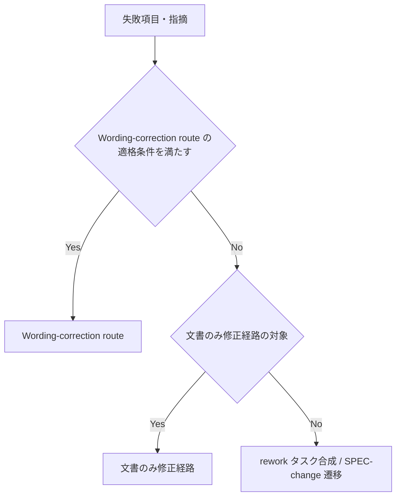

# rework-docs-only-task-routing - 要件定義書

## 1. 概要

### 1.1 背景
rework で `feature-docs/**` だけを直せば解消する修正が、implementer 向けのタスクとして合成される。implementer は `feature-docs/**` を変更しないため、無人実行（`--batch`）はこの修正で implement の failed（`failed_kind: decision`）に止まる。

### 1.2 目的
- rework で `feature-docs/**` だけを直せば解消する修正を implementer 向けのタスクにせず、rework-planner が文書を直す経路で処理する
- 無人実行（`--batch`）が、文書だけの修正で implement の failed（`failed_kind: decision`）に止まらず先へ進む

### 1.3 スコープ

**対象**:
- `rework-task-synthesis.md` 第 9 節への文書のみ修正経路の小節の追加（FR1、FR5）
- `agents/rework-planner.md` と `contracts/rework-planner-contract.md` の文書更新範囲と、タスクの `files` の規則（FR2、FR3）
- `references/workflow-patch.md` の `requirements_patch` への tests 参照の置き換え操作の追加（FR4）
- `em-workflow/scripts/validate-worker-output.py` の検証の追加（FR3、FR4、FR5、FR7）
- `skills/develop/SKILL.md` の verify 失敗分岐と「--once のフェーズ境界」の表の更新（FR8）
- `tests/test_validate_worker_output.py` の fixture と文書テストの追加（FR9）

**対象外**:
- Wording-correction route の対象・3 つの適格条件・適格時の結果（FR1）
- SPEC.md / REQUIREMENTS.md の変更が要る修正の扱い。これまでどおり SPEC-change 遷移に回す（FR1）
- `agents/implementer.md` の 'Never modify `feature-docs/**`'（NFR3）
- batch の系譜 cap / hard cap の数え方（FR8）
- plugin version（NFR6）

## 2. ビジネス要件

### 2.1 ビジネス目標
- rework で `feature-docs/**` だけを直せば解消する修正を implementer 向けのタスクにせず、rework-planner が文書を直す経路で処理する
- 無人実行（`--batch`）が、文書だけの修正で implement の failed（`failed_kind: decision`）に止まらず先へ進む

### 2.2 対象ユーザー
| ユーザータイプ | 説明 |
|----------------|------|
| em-workflow の利用者 | review / verify の rework を対話または無人実行（`--batch`）で回す |

### 2.3 期待される効果
- 文書だけで解消する修正が implementer 向けのタスクにならない
- 無人実行が、文書だけの修正で implement の failed（`failed_kind: decision`）に止まらない

## 3. ユースケース

### 3.1 ユースケース一覧
| ID | ユースケース名 | アクター | 優先度 |
|----|----------------|----------|--------|
| UC01 | 文書だけで解消する rework を処理する | rework-planner / develop スキル | 高 |

### 3.2 ユースケース詳細

#### UC01: 文書だけで解消する rework を処理する

**アクター**: rework-planner / develop スキル

**事前条件**:
- verify または review が失敗し、rework-planner が dispatch される
- その修正は Wording-correction route の適格条件を満たさず、`feature-docs/{feature}/` の VERIFICATION.md・IMPLEMENTATION.md・既存の `tasks/*.md` と、`workflow.yaml` の要件の tests 参照だけを変えれば解消する

**基本フロー**:
1. rework-planner が「Wording-correction route → 文書のみ修正経路 → rework タスク合成 / SPEC-change 遷移」の順で判定し、文書のみ修正経路に当てはめる（FR1）
2. rework-planner がタスクを作らず、VERIFICATION.md・IMPLEMENTATION.md・既存の `tasks/*.md` を自分で書き換える（FR2）
3. rework-planner が、文書だけで直した項目ごとに、変えた文書と発生元を宣言する（FR7）
4. rework-planner が、`tasks_patch.entries` が空で、要件の tests 参照を期待値付きで置き換え、発生元の step だけを pending に戻す append_rework patch を返す（FR4、FR5）
5. develop スキルが implement を戻さず、発生元の step を pending に戻してコミットする（FR8）

**代替フロー**:
- 同じ回にコード修正が混ざる場合、文書の部分は rework-planner が直接直し、コードの部分だけをタスクにする。タスクが 1 件以上ある回は、implement と発生元の step を pending に戻す（FR6）
- SPEC.md / REQUIREMENTS.md の変更が要る修正は SPEC-change 遷移に回す（FR1）

**事後条件**:
- 文書のみの回では、implement が completed のまま、発生元の step（verify 由来なら verify、review 由来なら review）が pending になる

## 4. 機能要件

### 4.1 機能一覧
| ID | 機能名 | 説明 | 優先度 |
|----|--------|------|--------|
| FR1 | 文書のみ修正経路を rework-task-synthesis.md 第 9 節に追加 | 第 9 節に文書のみの修正の小節を足し、判定の順序を定める | 高 |
| FR2 | rework-planner が既存の feature-docs 文書を直接修正 | 文書のみ修正経路では rework-planner が文書を書き換える | 高 |
| FR3 | 合成タスクの files に feature-docs/** を含めない | 合成タスクの files に feature-docs のパスを含めず、検証器が拒否する | 高 |
| FR4 | 要件の tests 参照を期待値付きで置き換える操作 | requirements_patch に tests 参照の置き換え操作を足す | 高 |
| FR5 | 文書のみの回は発生元の step だけを pending に戻す | 文書のみの回は implement を戻さない | 高 |
| FR6 | コード修正と文書修正が混在する回の分割 | 混在する回は同じ dispatch の中で分ける | 中 |
| FR7 | 文書修正の宣言と、改名したシナリオ ID のカバレッジ判定 | 文書修正と ID の改名対応を宣言し、検証器がそれで判定する | 中 |
| FR8 | develop の verify 失敗分岐と --once の再開先を更新 | develop スキルに文書のみの回の遷移と再開先を書く | 高 |
| FR9 | 再発検出テスト | fixture と文書テストを足す | 高 |

### 4.2 機能詳細

#### FR1: 文書のみ修正経路を rework-task-synthesis.md 第 9 節に追加

**説明**: `rework-task-synthesis.md` の第 9 節に、文書だけの修正のための小節を追加する。対象は、Wording-correction route の適格条件を満たさず、`feature-docs/{feature}/` の VERIFICATION.md・IMPLEMENTATION.md・既存の `tasks/*.md` と、`workflow.yaml` の要件の tests 参照だけを変えれば解消する修正。

**処理フロー**:

**ビジネスルール**:
- 判定の順序は「Wording-correction route → 文書のみ修正経路 → rework タスク合成 / SPEC-change 遷移」とする
- Wording-correction route の Guard と Ordering の記述をこの順序に合わせる
- Wording-correction route の対象・3 つの適格条件・適格時の結果は変えない
- SPEC.md / REQUIREMENTS.md の変更が要る修正は、これまでどおり SPEC-change 遷移に回す

#### FR2: rework-planner が既存の feature-docs 文書を直接修正

**説明**: 文書のみ修正経路では rework-planner がタスクを作らず、VERIFICATION.md・IMPLEMENTATION.md・既存の `tasks/*.md` を自分で書き換える。

**ビジネスルール**:
- `agents/rework-planner.md` と `contracts/rework-planner-contract.md` の文書更新範囲の表を改める
- 既存の `tasks/*.md` を書き換える回では、そのパスを `write_policy.targets` に `action: replace_own` で列挙する。書き換えない回には列挙しない
- この列挙は、VERIFICATION.md / IMPLEMENTATION.md を `replace_own` で扱っている既存の前例（`rework-planner-contract.md:129-140`）と同じ扱いとする
- `contracts/spec-writer-contract.md` の `replace_own` の定義とどう整合するかを、契約の中で明記する

#### FR3: 合成タスクの files に feature-docs/** を含めない

**説明**: rework-planner が合成するタスクの `files` に、先頭のパス要素が `feature-docs` のパスを 1 つも含めない。

**ビジネスルール**:
- この規則を `rework-task-synthesis.md` と `agents/rework-planner.md` に書く

**バリデーション**:
| 項目 | ルール | エラーメッセージ |
|------|--------|------------------|
| append_rework の `tasks_patch.entries[].files` | 先頭のパス要素が `feature-docs` のパスを 1 つでも含むエントリを `em-workflow/scripts/validate-worker-output.py` が拒否する | — |

#### FR4: 要件の tests 参照を期待値付きで置き換える操作

**説明**: workflow patch の `requirements_patch` に、要件の tests 参照を置き換える操作を追加する。

**ビジネスルール**:
- 置き換え前の ID が現在の tests に含まれることを `expected` で確かめ、旧 ID を除いて新 ID を入れる
- 現状の `_append` 系の追加と status 等の直接代入はそのまま残す
- `references/workflow-patch.md`、`validate-worker-output.py` の構造検証（`REQUIREMENTS_PATCH_SET_KEYS`）・`--dry-run-apply` の `expected` 検証・`apply_patch` にこの操作を入れる

**エラーケース**:
| エラー | 条件 | 対応 |
|--------|------|------|
| expected-mismatch | `expected` の旧 ID が現在の tests に無い | 拒否する |

#### FR5: 文書のみの回は発生元の step だけを pending に戻す

**説明**: 文書のみの回（`tasks_patch.entries` が空）の append_rework patch では、発生元の step だけを pending に戻す（verify 由来なら verify、review 由来なら review）。implement は completed のまま残す。

**ビジネスルール**:
- Invariant 1 と `implement-phase.md` の Step I.0 の文言は緩めない
- 新しい小節で「この経路は implement を pending に戻さない」と明記する

**バリデーション**:
| 項目 | ルール | エラーメッセージ |
|------|--------|------------------|
| append_rework patch の `step_patches` | `tasks_patch.entries` が空なのに implement を pending に戻すものを `validate-worker-output.py` が拒否する | — |

#### FR6: コード修正と文書修正が混在する回の分割

**説明**: 同じ回の失敗項目・指摘にコード修正と文書だけの修正が混ざる場合、同じ dispatch の中で分ける。

**ビジネスルール**:
- 文書の部分は rework-planner が直接直し、コードの部分だけを既存のグループ化規則（第 4 節）でタスクにする
- タスクが 1 件以上ある回は、これまでどおり implement（と発生元の step）を pending に戻す
- 発生元の step だけを戻す規則は文書のみの回に限る

#### FR7: 文書修正の宣言と、改名したシナリオ ID のカバレッジ判定

**説明**: rework-planner の completed の結果で、文書だけで直した項目ごとに、変えた文書と発生元（`origin_kind` / `origin_id`）を宣言する。

**ビジネスルール**:
- シナリオ ID の改名（例: `TS<N>` → `TS-<N>`）では、改名前と改名後の ID の対応も宣言する
- 宣言のフィールド名と形は計画段階で決める

**バリデーション**:
| 項目 | ルール | エラーメッセージ |
|------|--------|------------------|
| 混在する回の `rework_index` の `covered_by_existing` | 改名後の ID を挙げる場合、宣言された対応を通じて入力の `verification_index` の改名前 ID に当たるかで `validate-worker-output.py` が判定する | — |

#### FR8: develop の verify 失敗分岐と --once の再開先を更新

**説明**: `skills/develop/SKILL.md` の verify 失敗時の対話分岐と batch 分岐に、文書のみの回の結果を書く。

**ビジネスルール**:
- 文書のみの回は implement を戻さず、verify を pending に戻してコミットする
- タスクが 1 件以上ある回の既存の記述（'新しい rework task が 1 件以上 workflow.yaml へ登録されるまで戻さない'）は残す
- '--once のフェーズ境界' の表には、文書のみの回の再開先が verify になる行（または注記）を足す
- batch の系譜 cap / hard cap の数え方は変えない

#### FR9: 再発検出テスト

**説明**: `tests/test_validate_worker_output.py` の既存の fixture 実行の仕組みで、rework-planner の fixture を追加する。

**ビジネスルール**:
- 拒否される例は 2 つ: `files` が `feature-docs/**` だけのタスク、コードと `feature-docs/**` が混ざったタスク
- 通る例は 2 つ: コードだけのタスク、文書のみの回
- 文書のみの回は、`TS<N>` → `TS-<N>` の改名と既存の `tasks/task0001.md`・`tasks/task0003.md` の書き換えを想定し、新しいタスクが無い・旧 tests 参照が除かれている・implement が completed のまま・verify だけが pending に戻ることを確かめる
- 改名後の ID を `covered_by_existing` に挙げる混在の例も足す
- 文書テスト（unittest）では、対話・batch の両方の新経路と、タスクがある場合の既存の前提（`test_develop_skill_rewiring.py:276-333` が固定している内容）が残ることを固定する

## 5. 非機能要件

| ID | 名称 | 内容 |
|----|------|------|
| NFR1 | 4 経路の同一性 | review/verify × interactive/batch の 4 経路で同じ規則にする（`rework-task-synthesis.md` Invariant 7） |
| NFR2 | 固定済み構造の維持 | `rework-task-synthesis.md` の 13 節の構成と順序、'## 14.' が無いこと、Invariant が 11 件、Wording-correction route の 3 条件・'conjunctive'・Guard 内の 'rework-task synthesis' / 'SPEC-change transition' / 'concrete' / 'artefact' を壊さない。既存テストを変えずに通す |
| NFR3 | implementer の制約は不変 | `agents/implementer.md` の 'Never modify `feature-docs/**`' を変えない |
| NFR4 | SSOT の参照規律 | 規則は所有文書に一度だけ書き、他の文書からはパスで参照し、言い直さない（既存文書の書き方に合わせる） |
| NFR5 | テスト依存 | テストは Python 標準ライブラリの unittest だけを使う（`test/README.md`） |
| NFR6 | version | plugin version は変えない（`.claude/rules/core-plugin-version-bump.md`） |

### 5.1 パフォーマンス要件
- 該当なし

### 5.2 セキュリティ要件
- 該当なし

### 5.3 可用性要件
- 該当なし

### 5.4 保守性要件
- ドキュメント: NFR2、NFR4
- テスト: NFR5

### 5.5 互換性要件
- 経路の同一性: NFR1
- 既存の制約の維持: NFR3、NFR6

## 6. UI/UX要件

該当なし

## 7. データ要件

### 7.1 データモデル概要
該当なし

### 7.2 データ項目
| エンティティ | 項目名 | 型 | 必須 | 説明 |
|--------------|--------|-----|------|------|
| workflow.yaml の要件 | `requirements[].tests` | シナリオ ID の配列 | — | 「要件の tests 参照」。VERIFICATION.md のシナリオ ID を指す（FR4） |

### 7.3 データ保持期間
該当なし

## 8. 外部連携

該当なし

## 9. 制約条件

### 9.1 技術的制約
- `agents/implementer.md` の 'Never modify `feature-docs/**`' を変えない（NFR3）
- テストは Python 標準ライブラリの unittest だけを使う（NFR5）
- plugin version は変えない（NFR6）

### 9.2 ビジネス上の制約
- 該当なし

### 9.3 スケジュール制約
- 該当なし

### 9.4 宣言された変更集合

このフィーチャー固有のパスは手動で列挙せず、create-plan で `workflow.yaml` の各タスクの `files` から導出する（`references/phases/create-plan-phase.md`）。

**デフォルトメンバー**（SPEC作成者が明示的に除外しない限り、常に宣言に含まれる）:
- `feature-docs/rework-docs-only-task-routing/**`
- `test-docs/rework-docs-only-task-routing/**`

`feature-docs/rework-docs-only-task-routing/**` に含まれるもの: `REQUIREMENTS.md`、`SPEC.md`、`IMPLEMENTATION.md`、`workflow.yaml`、`phase-state/`、`tasks/`、`reviews/roundN.yaml`、`VERIFICATION.md`、`retrospect.yaml`、およびデザインステップが生成するデザイン成果物。生成主体は各フェーズドキュメントおよび `references/phase-state.md` を参照（引用のみ、ルールは再掲しない）。

`test-docs/rework-docs-only-task-routing/**` に含まれるもの: `{T}.tests.yaml`（パス形式: `test-docs/rework-docs-only-task-routing/{T}.tests.yaml`）。生成主体は `implement-phase.md` を参照（引用のみ、ルールは再掲しない）。

**意味論**:
- デフォルトのメンバーは、SPEC作成者が明示的に除外しない限り宣言に含まれる。除外は意図的な絞り込みであり、記載漏れによる省略ではない。
- この宣言はスーパーセット（superset）の主張であり、実際の変更集合は宣言に含まれる（CONTAINED IN）必要がある。実際には生成されないパスが宣言されていても違反にはならない。implementタスクを1つも生成しないフィーチャーは `test-docs/rework-docs-only-task-routing/` ディレクトリを生成しないが、宣言された `test-docs/rework-docs-only-task-routing/**` は依然として正しい。

## 10. 想定される課題とリスク

### 10.1 技術的課題
該当なし

### 10.2 ビジネスリスク
該当なし

## 11. 成功基準

### 11.1 受け入れ基準
- [ ] AC1: タスクの再現手順（feature-docs 配下の文書だけで解消し、要件の tests 参照が変わるため Wording-correction route の対象外になる verify 失敗）に当たる rework-planner の結果が、タスクを含まない append_rework patch として `validate-worker-output.py --dry-run-apply` を通る。適用後は implement が completed、verify が pending で、旧 tests 参照が除かれ新 ID が入っている
- [ ] AC2: `files` に `feature-docs/**` のパスを含むタスク（文書だけでも、コードと混在でも）を持つ rework-planner の結果を、`validate-worker-output.py` が拒否する
- [ ] AC3: `tasks_patch.entries` が空なのに implement を pending に戻す append_rework patch を、`validate-worker-output.py` が拒否する
- [ ] AC4: `requirements_patch` の tests 置き換えは、`expected` の旧 ID が現在の tests に無いとき expected-mismatch で拒否される
- [ ] AC5: 混在する回で、改名後の ID を `covered_by_existing` に挙げ、改名の対応を宣言した結果が通り、対応の宣言が無い結果は拒否される
- [ ] AC6: `rework-task-synthesis.md` 第 9 節に文書のみ修正経路の小節があり、判定順序（Wording-correction route → 文書のみ修正経路 → タスク合成 / SPEC-change）と、implement を pending に戻さないことが書かれている
- [ ] AC7: `agents/rework-planner.md` と `contracts/rework-planner-contract.md` が、既存の `tasks/*.md`・VERIFICATION.md の直接修正、`write_policy` の `replace_own` による列挙、タスクの `files` に `feature-docs/**` を含めない規則を書いている
- [ ] AC8: `skills/develop/SKILL.md` の verify 失敗分岐（対話・batch）と '--once のフェーズ境界' の表が、文書のみの回の遷移と再開先（verify）を書いている
- [ ] AC9: `python3 -m unittest discover -s tests` が全件通る（既存テストの変更なし、または意図した更新だけ）

### 11.2 KPI
該当なし

## 12. テストシナリオ

### 12.1 テスト観点
- [ ] 正常系: TS-1: 文書のみの回の fixture（`TS<N>`→`TS-<N>` の改名、既存の `tasks/task0001.md`・`task0003.md` の書き換え）が `--dry-run-apply` で通り、適用後の状態が AC1 のとおりになる
- [ ] 異常系: TS-2: `files` が `feature-docs/**` だけのタスクを含む fixture が拒否される
- [ ] 異常系: TS-3: `files` がコードと `feature-docs/**` の混在するタスクを含む fixture が拒否される
- [ ] 正常系: TS-4: `files` がコードだけのタスクの fixture が通る（既存の挙動を回帰確認）
- [ ] 異常系: TS-5: entries が空で implement を pending に戻す patch の fixture が拒否される
- [ ] 異常系: TS-6: tests 置き換えの `expected` が満たされない fixture が expected-mismatch で拒否される
- [ ] 正常系・異常系: TS-7: 改名後の ID を `covered_by_existing` に挙げる混在の fixture が、対応の宣言ありで通り、宣言なしで拒否される
- [ ] 文書: TS-8: `rework-task-synthesis.md` の新しい小節と判定順序を固定する文書テスト（13 節・Invariant 11 件・Wording-correction route の固定内容は変えない）
- [ ] 文書: TS-9: `rework-planner.md` / `rework-planner-contract.md` の文書更新範囲と `files` 規則を固定する文書テスト
- [ ] 文書: TS-10: `develop/SKILL.md` の対話・batch の verify 失敗分岐と --once の表の新しい記述を固定し、タスクがある回の既存の文言が残ることを確かめる文書テスト

## 13. 用語定義

| 用語 | 定義 |
|------|------|
| 文書のみ修正経路 | Wording-correction route の適格条件を満たさず、`feature-docs/{feature}/` の VERIFICATION.md・IMPLEMENTATION.md・既存の `tasks/*.md` と、`workflow.yaml` の要件の tests 参照だけを変えれば解消する修正を、rework-planner が直接直す経路（FR1、FR2） |
| 文書のみの回 | `tasks_patch.entries` が空の append_rework patch を返す rework の回（FR5） |
| 混在する回 | 同じ回の失敗項目・指摘にコード修正と文書だけの修正が混ざる回（FR6） |
| 発生元の step | rework の発生元になった step。verify 由来なら verify、review 由来なら review（FR5） |
| 要件の tests 参照 | `workflow.yaml` の `requirements[].tests`（VERIFICATION.md のシナリオ ID） |

## 14. 確認事項

### 14.1 確認済み事項

- [x] A1 経路の担い手（`requirement.docs-only.channel`）: 経路の担い手は rework-planner（`rework_planner_doc_update`）
- [x] A2 文書のみの回の step の戻し方（`requirement.docs-only.step-rerun`）: 文書のみの回は発生元の step だけを pending に戻し、implement は completed のまま残す（`origin_step_only`）
- [x] A3 混在する回（`requirement.docs-only.mixed-round`）: 混在する回は同じ dispatch の中で分ける（`split_same_round`）
- [x] A4 再発検出（`requirement.docs-only.recurrence-test`）: 再発検出は、検証器の機械的な拒否と fixture、文書テストの組み合わせ（`validator_and_doc_tests`）
- [x] A5 Wording-correction route との関係（`requirement.docs-only.wording-route-relation`）: Wording-correction route は変えず、第 9 節に小節を足す（`keep_and_add`）
- [x] A6 既存の tasks/*.md の書き換え（`requirement.docs-only.channel`）: 既存の `tasks/*.md` の書き換えは `write_policy` の `replace_own` で列挙する
- [x] A7 要件の tests 参照値（`requirement.docs-only.channel`）: 「要件の tests 参照値」は `workflow.yaml` の `requirements[].tests`（VERIFICATION.md のシナリオ ID）を指す。REQUIREMENTS.md / SPEC.md を変える修正は対象外で、SPEC-change 遷移のまま
- [x] A8 batch の数え方（`requirement.docs-only.mixed-round`）: 文書のみの回も、batch の verify rework の `rounds` / `failed_id_counts` に通常どおり数える
- [x] A9 4 経路（`requirement.docs-only.step-rerun`）: 4 経路すべてに同じ規則を入れる。review 由来の文書のみの回は review を pending に戻す
- [x] A10 implementer の制約: implementer の `feature-docs/**` 変更禁止は変えない
- [x] A11 version: plugin version は変えない

### 14.2 未確認・保留事項
- [ ] FR7 の宣言のフィールド名と形（計画段階で決める）

## 15. 参考資料

該当なし
