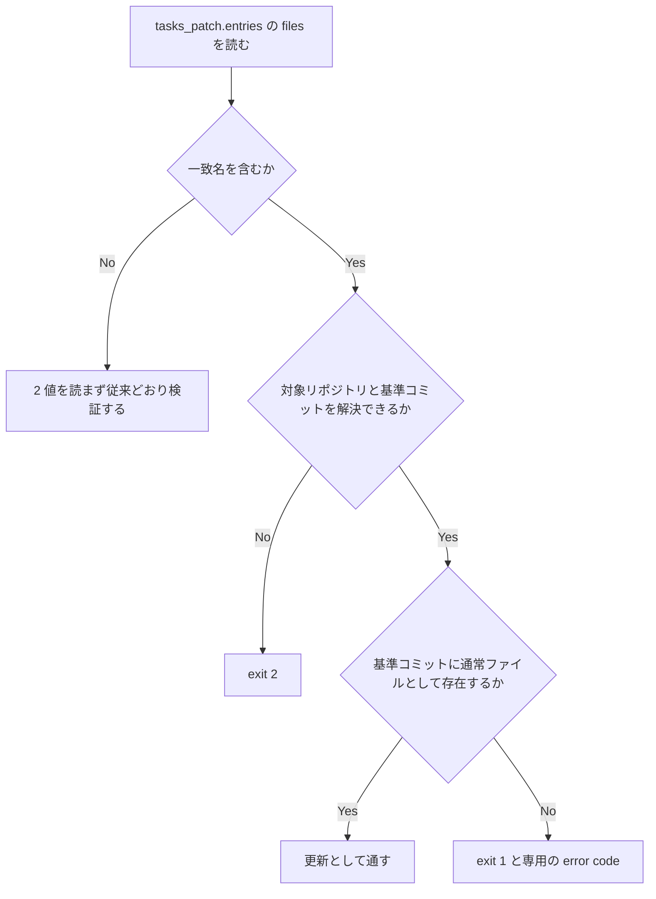
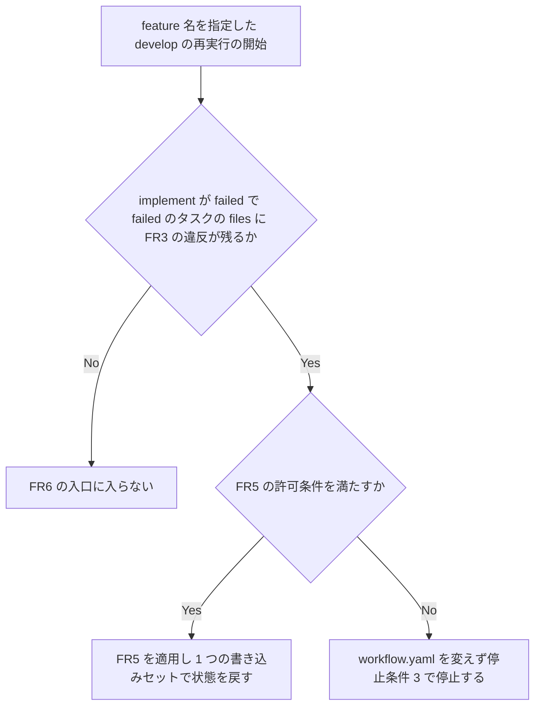

# subagent-report-write-block - 要件定義書

## 1. 概要

### 1.1 背景

em-workflow の計画が、ファイル名の先頭が REPORT のレポートを実装者（サブエージェント）の成果物にすると、実装者の Write が毎回拒否されて implement が止まる。

拒否の文面: `Subagents should return findings as text, not write report files. Include this content in your final response instead.`

拒否するのは Claude Code 本体の Write ツールの入力検証（2.1.318、`tengu_subagent_md_report_blocked`）である。hook でも permission でもないため、設定では通せない。拒否の条件はファイル名だけで、置き場所と書き込み内容には依存しない。

再現手順:

1. 計画の `tasks.<id>.files` に `test-docs/<feature>/REPORT.md` を持つ feature を `/em-workflow:develop --batch` で実行する。
2. 実装者が Write でそのファイルを書く。
3. 2 回とも上の文面で拒否され、batch の再試行を使い切って implement が `failed_kind: decision` で止まる。

発生例は web-sip-phone のタスク（2026-11-05 22:52 JST と 23:00 JST の 2 回）である。

### 1.2 目的

計画に沿ったレポートの成果物を、実装者の Write の拒否で止まらずに親ブランチへ取り込めるようにする。計画済みの web-sip-phone の feature tcp-send-path-fr8-race-audit（`test-docs/tcp-send-path-fr8-race-audit/REPORT.md`）も再開できるようにする。

### 1.3 スコープ

対象:

- 計画の命名規則と一致名の定義（FR1、FR2）
- 新規の一致名の検証と基準の入力契約（FR3、FR4）
- 既存計画の最終パスを直す手順と failed からの入口（FR5、FR6）
- 実装者の即時失敗と親の再試行抑止（FR7、FR8）
- 再発を検出するテスト（FR9）
- tcp-send-path-fr8-race-audit の再開手順（FR10）

対象外:

- Claude Code の Write の拒否を迂回すること（NFR1）
- web-sip-phone への書き込み（NFR6）

## 2. ビジネス要件

### 2.1 ビジネス目標

- 計画に沿ったレポートの成果物が、実装者の Write の拒否で止まらずに親ブランチへ取り込まれる
- 一致名の新規ファイルを持つ計画を implement の前に検証で止める
- 拒否が起きたときに同じ原因の再試行を使い切らず、原因の修正を再開条件にする
- tcp-send-path-fr8-race-audit を再開する手順が決まっている

### 2.2 対象ユーザー

| ユーザータイプ | 説明 |
|----------------|------|
| em-workflow の利用者 | `/em-workflow:develop` で feature を進める Claude Code 利用者 |

### 2.3 期待される効果

- 再現手順で現象が起きない
- 再発を検出するテストがある
- tcp-send-path-fr8-race-audit を再開する手順が決まっている

## 3. ユースケース

### 3.1 ユースケース一覧

| ID | ユースケース名 | アクター |
|----|----------------|----------|
| UC01 | 計画を検証する | implementation-planner、rework-planner、orchestrator |
| UC02 | Write の拒否で止まる | 実装者、親（orchestrator） |
| UC03 | failed の feature を再開する | 利用者、implementation-planner、orchestrator |

### 3.2 ユースケース詳細

#### UC01: 計画を検証する

**アクター**: implementation-planner、rework-planner、orchestrator

**事前条件**:
- 計画の workflow patch がある
- 一致名を含む patch では、orchestrator が対象リポジトリと基準コミットを解決している

**基本フロー**:
1. planner がレポートの成果物に一致しない名前をつけて計画を書く
2. orchestrator が validate-worker-output.py で patch を検証する
3. 検証を通った計画が implement へ進む

**代替フロー**:
- 基準コミットに存在しない一致名が files にあれば、検証が exit 1 で拒否する
- 基準コミットに通常ファイルとして存在する一致名は更新として通す
- 一致名を含む patch で 2 値が欠ける、または解決できないときは exit 2 とし、通さない

**事後条件**:
- 新規の一致名を files に持つ計画は implement へ進まない

#### UC02: Write の拒否で止まる

**アクター**: 実装者、親（orchestrator）

**事前条件**:
- 実装者の Write が FR2 の名前で拒否された

**基本フロー**:
1. 実装者が作業を止め、リポジトリ相対の対象パスと拒否文を添えて `status: failed` を返す
2. 親が同じ原因の retry をせず、in-flight のタスクを従来どおり回収する
3. 親が原因を wake commit で `tasks.{T}.notes` に記録する
4. 親が対象パス、拒否文、再開条件を停止報告に載せる

**代替フロー**:
- batch は自動 retry を消費せず abort phase へ進み、failed_kind は decision とする
- interactive は選択肢から retry を外す

**事後条件**:
- 中断後の再開でも自動 retry しない

#### UC03: failed の feature を再開する

**アクター**: 利用者、implementation-planner、orchestrator

**事前条件**:
- implement が failed で、failed のタスクの files に FR3 の違反が残っている

**基本フロー**:
1. 利用者が feature 名を指定して develop を再実行する
2. 開始時の判定で FR5 の手順へ入る
3. implementation-planner が計画文書を直し、files の変更を提案する
4. orchestrator が workflow.yaml へ適用し、対象タスクを起動できる状態にする

**代替フロー**:
- FR5 の許可条件を満たさないときは workflow.yaml を変えず、停止条件 3 で停止する
- 失敗した run の中ではこの入口に入らない

**事後条件**:
- 対象タスクが再起動できる

## 4. 機能要件

### 4.1 機能一覧

| ID | 機能名 | 説明 | 状態 |
|----|--------|------|------|
| FR1 | 計画の命名規則 | planner は新規の一致名を成果物にしない | confirmed |
| FR2 | 一致名の定義 | ファイル名だけを正規表現で判定する | confirmed |
| FR3 | 新規の一致名を検証で拒否する | validate-worker-output.py が patch を拒否する | confirmed |
| FR4 | 基準の入力契約 | 対象リポジトリと基準コミットを引数で受ける | confirmed |
| FR5 | 既存計画の最終パスを直す手順 | 許可条件を満たす修正でパスを揃える | confirmed |
| FR6 | failed からの入口 | 再実行の開始時に FR5 の手順へ入る | assumed |
| FR7 | 実装者の即時失敗 | 拒否されたら直ちに `status: failed` を返す | confirmed |
| FR8 | 親の再試行抑止と再開条件 | 同じ原因の retry をしない | confirmed |
| FR9 | 再発を検出するテスト | 判定、検証、文書の規則を検査する | confirmed |
| FR10 | tcp-send-path-fr8-race-audit の再開手順 | SPEC に再開手順を書く | confirmed |

### 4.2 機能詳細

#### FR1: 計画の命名規則

**説明**: implementation-planner と rework-planner は、基準コミットに存在しない FR2 の一致名のファイルを、tasks の files、タスク本文、受け入れ条件、VERIFICATION.md の成果物にしない。

**ビジネスルール**:
- レポートの成果物は FR2 に一致しない名前にする。
- 別名で書いて改名する手順を計画に入れない。
- 基準コミットに存在する一致名のファイルを更新するタスクは、本文でそのファイルの更新を Edit で行うと書く。
- 規則本文は `em-workflow/skills/plan-writing/SKILL.md` の 1 節が持ち、他の文書は引用する。

#### FR2: 一致名の定義

**説明**: 判定の対象はパスの最終セグメントのファイル名だけとする。ファイル名が正規表現 `/^(REPORT|SUMMARY|FINDINGS|ANALYSIS).*\.md$/i` に一致するものを一致名とする。

**ビジネスルール**:
- 大文字と小文字は区別しない。
- ディレクトリ名は判定しない。

#### FR3: 新規の一致名を検証で拒否する

**説明**: `em-workflow/scripts/validate-worker-output.py` は workflow patch の検証で、`tasks_patch.entries` の files に、基準コミットに存在しない一致名があれば拒否する。

**出力**:
- exit 1、専用の error code、task id とパス

**処理フロー**:

**ビジネスルール**:
- replace_planning と append_rework の両方に適用し、tier は問わない。
- 基準コミットに通常ファイルとして存在する一致名は更新として通す。
- `--dry-run-apply` では、carried_task_ids のうち status が merged でないタスクの files にも同じ判定を行う。

#### FR4: 基準の入力契約

**説明**: 対象リポジトリは integration worktree とする。基準コミットは、検証の実行前に orchestrator が解決した `em-workflow/{feature}/integration` の tip の完全なコミット ID とする。

**入力**:
- 対象リポジトリ: integration worktree
- 基準コミット: 完全なコミット ID

**ビジネスルール**:
- validate-worker-output.py はこの 2 値を引数で受け、create-plan、rework、FR5 の修正のすべての検証呼び出しが渡す。
- 一致名を含まない patch では 2 値を読まず、省略も許す。

**エラーケース**:

| エラー | 条件 | 対応 |
|--------|------|------|
| 基準の入力欠落 | 一致名を含む patch で 2 値が欠ける | exit 2 とし、通さない |
| 基準の解決失敗 | 一致名を含む patch で 2 値を解決できない | exit 2 とし、通さない |

#### FR5: 既存計画の最終パスを直す手順

**説明**: 既存計画の一致名を一致しない名前へ直す手順をプラグインの規則として定める。1 回の修正で、旧パスから新パスへ、`tasks.{T}.files`、`tasks/{T}.md` の Files 節と本文と受け入れ条件、IMPLEMENTATION.md、VERIFICATION.md の検証条件、テスト内の参照を揃える。

**担当**:
- 計画文書の修正と files の変更の提案は implementation-planner、workflow.yaml への適用は orchestrator が担う。
- 実装者と rework-planner は計画を直さない。
- テスト内の参照は、未マージのものは修正後の計画に沿って当該タスクの実装者が直し、マージ済みのものは同じ修正で追加する新規タスクが直す。

**許可条件**（すべて満たすこと）:
1. in-flight のタスクが無い。
2. 対象タスクの status と journal の最終イベントがどちらも merged でない。
3. 旧パスが一致名で、基準コミットに存在しない。
4. 新パスが一致名でなく、`is_safe_relative_path` を通り、基準コミットに存在しない。
5. 変更はパス文字列の置き換えに限り、要件と受け入れ条件の意味を変えない。

**ビジネスルール**:
- 条件を 1 つでも満たさない修正は適用しない。
- carried タスクの record を verbatim にコピーする規則の例外として `references/workflow-patch.md` に定義し、route back から入る re-planning でも使える。

#### FR6: failed からの入口

**説明**: feature 名を指定した develop の再実行の開始時に、implement が failed で、failed のタスクの files に FR3 の違反が残っているかを判定する。残っていれば、failed_kind が decision でも停止条件 3 の前に FR5 の手順へ入る。

**処理フロー**:

**ビジネスルール**:
- 失敗した run の中ではこの入口に入らない。
- FR5 の適用後は 1 つの書き込みセットで、implement を pending、failed_kind を null にし、対象タスクを起動できる状態にして再試行消費の記録を除く。
- 対象タスクの worktree と branch、merged のタスクには触れない。
- 未コミットの変更が残る worktree を自動で破棄しない。
- FR5 の許可条件を満たさないときは workflow.yaml を変えず、停止条件 3 で停止する。

#### FR7: 実装者の即時失敗

**説明**: 実装者は Write が FR2 の名前で拒否されたら、作業を止めて直ちに `status: failed` を返す。

**出力**:
- 報告の専用フィールド: リポジトリ相対の対象パスと拒否文

**ビジネスルール**:
- merge_script は実行しない。
- 改名、別名での書き込み、Edit による新規作成、Bash での書き込み、親への代行依頼で回避しない。
- この規則は基準コミットに存在するファイルへの Write の拒否にも適用する。
- 基準コミットに存在する一致名のファイルの更新は最初から Edit で行い、拒否を受けた後に Edit へ切り替えない。

#### FR8: 親の再試行抑止と再開条件

**説明**: 親は FR7 の報告を受けたら、interactive と batch のどちらでも同じ原因の retry をしない。in-flight のタスクは従来どおり回収する。

**ビジネスルール**:
- batch は自動 retry を消費せず abort phase へ進み、failed_kind は decision とする。
- interactive は選択肢から retry を外す。
- 再開条件は原因の修正、すなわち FR5 の完了とする。
- 親は原因を wake commit で `tasks.{T}.notes` に記録し、中断後の再開でも自動 retry しない。
- 停止報告に対象パス、拒否文、再開条件を載せる。
- 他の原因の失敗の扱いは変えない。

#### FR9: 再発を検出するテスト

**説明**: `tests/` に、FR2 の判定、FR3 の拒否と通過、FR4 の入力欠落、FR5 の許可条件を検査するテストを追加する。

**ビジネスルール**:
- plan-writing、implementer、implement-phase、batch-mode の文書が FR1、FR7、FR8 の規則を持つことを検査する文書契約テストも追加する。
- 再現手順の計画に相当する patch が拒否されることを検査する。
- 検証スクリプトの規則に対応する `references/fixtures/` を揃える。

#### FR10: tcp-send-path-fr8-race-audit の再開手順

**説明**: SPEC に web-sip-phone の feature tcp-send-path-fr8-race-audit の再開手順を書く。プラグインには書かない。

**ビジネスルール**:
- 手順は実状態の確認を先頭に置く。確認する項目は implement の status と failed_kind、tasks の status、journal の最終イベント、worktree と branch の有無、integration の tip に `test-docs/tcp-send-path-fr8-race-audit/REPORT.md` が無いこと。
- failed の場合は FR6 の入口を使う手順を明記する。
- 確認結果が failed 以外の場合と FR5 の許可条件を満たさない場合の扱いも書く。
- 反映に Claude Code の再起動が要ることを手順に含める。

## 5. 非機能要件

### 5.1 パフォーマンス要件

該当なし。

### 5.2 セキュリティ要件

- **NFR1 拒否を迂回しない**: Claude Code の Write の拒否を迂回する設定、hook、改名の手順、親が代わりに書く手順を導入しない。
- **NFR5 入力の扱い**: files の値は信頼しない入力として扱い、シェルを経由せずに git へ渡す。基準コミットは完全な 16 進のコミット ID だけを受ける。

### 5.3 可用性要件

該当なし。

### 5.4 保守性要件

- **NFR3 定義の単一化**: 正規表現の実装は validate-worker-output.py の 1 箇所に置く。規則本文は plan-writing の 1 節に置き、他の文書は引用する。文書の正規表現と実装の定数の一致をテストで固定する。
- **NFR4 テストの実行条件**: テストは標準ライブラリの unittest で書き、`python3 -m unittest discover -s tests` で実行する。git を使う検証は一時ディレクトリの使い捨てリポジトリで行い、実環境の Claude Code の設定に触れない。

### 5.5 互換性要件

- **NFR2 既存動作の維持**: 一致名を含まない計画の検証結果と、他の原因の implement 失敗の扱いを変えない。既存のテストはすべて通る。

## 6. UI/UX要件

### 6.1 画面設計要件

該当なし。

### 6.2 画面遷移

該当なし。

### 6.3 レスポンシブ対応

該当なし。

## 7. データ要件

### 7.1 データモデル概要

該当なし。

### 7.2 データ項目

| エンティティ | 項目名 | 説明 |
|--------------|--------|------|
| workflow.yaml | `tasks.{T}.files` | FR3 の判定の対象、FR5 の修正の対象 |
| workflow.yaml | `tasks.{T}.notes` | FR8 の原因の記録先 |
| workflow.yaml | implement の status、failed_kind | FR6 の判定の対象と適用先 |
| workflow patch | `tasks_patch.entries` の files | FR3 の判定の対象 |
| workflow patch | carried_task_ids | `--dry-run-apply` の判定の対象 |

### 7.3 データ保持期間

該当なし。

## 8. 外部連携

### 8.1 連携システム

| システム名 | 連携方法 | データ |
|------------|----------|--------|
| git | シェルを経由しない呼び出し | files の値、基準コミット |

### 8.2 API仕様要件

該当なし。

## 9. 制約条件

### 9.1 技術的制約

- Claude Code の Write の拒否は hook でも permission でもなく、設定では通せない。
- テストは標準ライブラリの unittest で書く（NFR4）。

### 9.2 ビジネス上の制約

- **NFR6 範囲と記載の制約**: この feature の実装は web-sip-phone へ書き込まない。成果物に Notion URL とホームディレクトリ配下の絶対パスを含めない。

### 9.3 スケジュール制約

該当なし。

### 9.4 宣言された変更集合

このフィーチャー固有のパスは手動で列挙せず、create-plan で `workflow.yaml` の各タスクの `files` から導出する（`references/phases/create-plan-phase.md`）。

**デフォルトメンバー**（SPEC作成者が明示的に除外しない限り、常に宣言に含まれる）:
- `feature-docs/subagent-report-write-block/**`
- `test-docs/subagent-report-write-block/**`

`feature-docs/subagent-report-write-block/**` に含まれるもの: `REQUIREMENTS.md`、`SPEC.md`、`IMPLEMENTATION.md`、`workflow.yaml`、`phase-state/`、`tasks/`、`reviews/roundN.yaml`、`VERIFICATION.md`、`retrospect.yaml`、およびデザインステップが生成するデザイン成果物。生成主体は各フェーズドキュメントおよび `references/phase-state.md` を参照（引用のみ、ルールは再掲しない）。

`test-docs/subagent-report-write-block/**` に含まれるもの: `{T}.tests.yaml`（パス形式: `test-docs/subagent-report-write-block/{T}.tests.yaml`）。生成主体は `implement-phase.md` を参照（引用のみ、ルールは再掲しない）。

**意味論**:
- デフォルトのメンバーは、SPEC作成者が明示的に除外しない限り宣言に含まれる。除外は意図的な絞り込みであり、記載漏れによる省略ではない。
- この宣言はスーパーセット（superset）の主張であり、実際の変更集合は宣言に含まれる（CONTAINED IN）必要がある。実際には生成されないパスが宣言されていても違反にはならない。implementタスクを1つも生成しないフィーチャーは `test-docs/subagent-report-write-block/` ディレクトリを生成しないが、宣言された `test-docs/subagent-report-write-block/**` は依然として正しい。

## 10. 想定される課題とリスク

### 10.1 技術的課題

要件分析で挙げられた課題はない。前提は 14.2 に記載する。

### 10.2 ビジネスリスク

要件分析で挙げられたリスクはない。

## 11. 成功基準

### 11.1 受け入れ基準

- [ ] AC-1: 新規の `test-docs/<feature>/REPORT.md` を tasks の files に持つ計画は検証で拒否され、implement へ進まない。（FR1、FR2、FR3、FR4）
- [ ] AC-2: 一致しない名前のレポートを成果物にする計画は検証を通り、実装者の Write で拒否されずに親ブランチへマージされる。（FR1、FR2、FR3）
- [ ] AC-3: 基準コミットに存在する一致名のファイルを更新する計画は検証を通る。（FR3、FR4）
- [ ] AC-4: FR5 の許可条件を満たす修正は、files、タスク本文、検証条件、テスト内の参照を揃えて適用され、条件を 1 つでも満たさない修正は適用されない。（FR5）
- [ ] AC-5: feature 名を指定した再実行で、implement が failed かつ FR3 の違反が残るときに FR5 へ入り、適用後に対象タスクが再起動できる。失敗した run の中では入らない。（FR6）
- [ ] AC-6: 実装者は拒否を受けると対象パスと拒否文を添えて `status: failed` を返し、親は同じ原因の retry をせず、中断後の再開でも自動 retry しない。（FR7、FR8、NFR1）
- [ ] AC-7: 再発を検出するテストがあり、`python3 -m unittest discover -s tests` が通る。（FR9、NFR2、NFR3、NFR4）
- [ ] AC-8: SPEC に tcp-send-path-fr8-race-audit の再開手順があり、実状態の確認と failed からの入口が書かれている。（FR10）

### 11.2 KPI

該当なし。

## 12. テストシナリオ

### 12.1 テスト観点

| ID | シナリオ | 期待結果 | 対応要件 |
|----|----------|----------|----------|
| TS-1 | 新規の `test-docs/x/REPORT.md` を files に持つ replace_planning の patch を検証する | exit 1、専用の error code、task id とパスを示す | FR2、FR3、FR9 |
| TS-2 | `report.md`、`Analysis-notes.md`、`SUMMARY_x.MD`、`findings.md` を新規の files に持つ patch を検証する | すべて拒否される | FR2、FR3 |
| TS-3 | `report.txt`、`reports/foo.md`、`audit-report.md`、`README.md` を files に持つ patch を検証する | すべて通る | FR2、FR3、NFR2 |
| TS-4 | 基準コミットに通常ファイルとして存在する一致名を files に持つ patch を検証する | 通る | FR3、FR4 |
| TS-5 | 基準コミットにディレクトリとして存在する一致名を files に持つ patch を検証する | 新規として拒否される | FR3 |
| TS-6 | 一致名を含む patch を、基準の入力なしと解決できない基準で検証する | どちらも exit 2 で通らない | FR4 |
| TS-7 | 一致名を含まない patch を基準の入力なしで検証する | 従来どおり通る | FR4、NFR2 |
| TS-8 | append_rework の patch と、plan が TASK.md のタスクに新規の一致名を入れて検証する | どちらも拒否される | FR3 |
| TS-9 | `--dry-run-apply` で、carried の merged でないタスクと merged のタスクの files に一致名がある re-planning patch を検証する | merged でないタスクの違反だけを拒否する | FR3、FR5 |
| TS-10 | FR5 の許可条件を満たす修正と、各条件を 1 つずつ破る修正を適用する | 満たす修正だけが適用される | FR5 |
| TS-11 | 修正後のタスクの Files 節と files が一致しない状態で検証する | `task-plan-files-mismatch` で拒否される | FR5 |
| TS-12 | 文書契約テストで implementer.md と worktree-task-workflow の規則を読む | 即時失敗、対象パスと拒否文の報告、回避の禁止が書かれている | FR7、FR9、NFR1 |
| TS-13 | 文書契約テストで implement-phase.md と batch-mode.md の規則を読む | 再試行の抑止、`tasks.{T}.notes` への記録、再開条件が書かれている | FR8、FR9 |
| TS-14 | 文書契約テストで develop の入口の規則を読む | 再実行の開始時の判定、失敗した run の中では入らないこと、許可条件を満たさないときの停止が書かれている | FR6、FR9 |
| TS-15 | plan-writing の正規表現と検証スクリプトの定数を比べる | 一致する | FR2、NFR3 |
| TS-16 | SPEC の再開手順を読む（手動確認） | 実状態の確認、failed からの入口、再起動、条件を満たさない場合の扱いがある | FR10 |

## 13. 用語定義

| 用語 | 定義 |
|------|------|
| 一致名 | FR2 の正規表現に一致するファイル名 |
| 対象リポジトリ | integration worktree |
| 基準コミット | 検証の実行前に orchestrator が解決した `em-workflow/{feature}/integration` の tip の完全なコミット ID |
| 再開条件 | 原因の修正、すなわち FR5 の完了 |

## 14. 確認事項

### 14.1 確認済み事項

- [x] 拒否の主体: Claude Code 本体の Write ツールの入力検証である。hook でも permission でもない。
- [x] 拒否の条件: ファイル名だけで、置き場所と書き込み内容には依存しない。`.md` 以外、または先頭が 4 語以外の名前は一致しない。
- [x] デザインステップ: UI を含まないため実行しない。

### 14.2 未確認・保留事項

status が tbd の要件はない。次の前提を置く。

- [ ] A1（影響度: 中）: FR6 の入口は、feature 名を指定した develop の再実行の開始時に判定する。batch の再実行でも同じ入口を使い、新しい gate は追加しない。
- [ ] A2（影響度: 中）: FR5 の担当は、計画文書の修正と files の提案が implementation-planner、workflow.yaml への適用が orchestrator である。
- [ ] A3（影響度: 中）: Edit は Claude Code の拒否の対象ではなく、基準コミットに存在する一致名のファイルを Edit で更新できる。
- [ ] A4（影響度: 低）: FR2 の正規表現は Claude Code 2.1.318 の拒否条件と同じである。
- [ ] A5（影響度: 中）: web-sip-phone の実状態は未確認であり、FR10 の手順はその確認を前提に書く。

## 15. 参考資料

- SPEC: `feature-docs/subagent-report-write-block/SPEC.md`
