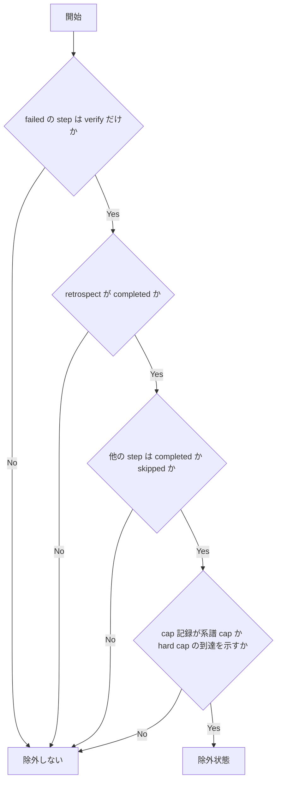

# verify-cap-worktree-cleanup - 要件定義書

## 1. 概要

### 1.1 背景
verify が cap 到達で failed のまま Step C（完了処理）に入る batch 走行では、develop の Step C の規定と failed-run-cleanup-guard の判定が一致していない。Step C が completion_aborted で止まり、worktree の削除を人が手で行う必要がある。

### 1.2 目的
- verify が cap 到達で failed のまま Step C に入る batch 走行で、develop の Step C の規定と failed-run-cleanup-guard の判定を一致させる。Step C が completion_aborted で止まらず、worktree の削除を人が手で行わなくてよい状態にする。
- 同じ食い違いの再発を検出するテストを用意する。

### 1.3 スコープ
- `em-workflow/hooks/failed-run-cleanup-guard.py` の判定（除外状態の追加）とモジュール docstring
- `em-workflow/README.md` のフック一覧にある failed-run-cleanup-guard.py の行
- `tests/test_failed_run_cleanup_guard.py` へのケース追加

対象外:
- `em-workflow/skills/develop/SKILL.md` の Step C 2. の worktree 削除規定と、cap 到達走行の detail 文言
- プラグインの version
- デザインステップ（UI・画面・ビジュアルの変更が無いため skipped）

## 2. ビジネス要件

### 2.1 ビジネス目標
1.2 に同じ。

### 2.2 対象ユーザー
| ユーザータイプ | 説明 |
|----------------|------|
| em-workflow の batch 走行 | verify が cap 到達で failed のまま Step C に入る走行 |

### 2.3 期待される効果
- cap 到達走行の Step C が completion_aborted で止まらない
- worktree の削除を人が手で行わなくてよい
- 同じ食い違いの再発をテストで検出できる

## 3. ユースケース

### 3.1 ユースケース一覧
| ID | ユースケース名 | アクター | 優先度 |
|----|----------------|----------|--------|
| UC01 | cap 到達走行の Step C での worktree 削除と PR 作成 | batch 走行 | 高 |

### 3.2 ユースケース詳細

#### UC01: cap 到達走行の Step C での worktree 削除と PR 作成

**アクター**: batch 走行

**事前条件**:
- 対象 feature の workflow.yaml が除外状態（FR2）にある

**基本フロー**:
1. Step C で integration worktree に対し `git worktree remove` を実行する
2. フックは判定を出さない
3. integration worktree を cwd として `gh pr create` を実行した場合も、フックは判定を出さない

**代替フロー**:
- 除外状態の feature のブランチに対する `git branch -d` / `--delete` は従来どおり deny される
- 除外状態にあたらない failed では、S1/S2/S3 は従来どおり deny される

**事後条件**:
- Step C が completion_aborted で止まらない

## 4. 機能要件

### 4.1 機能一覧
| ID | 機能名 | 説明 | 優先度 |
|----|--------|------|--------|
| FR1 | 揃える方向 | failed-run-cleanup-guard 側で揃え、除外状態の S1/S3 に判定を出さない | 高 |
| FR2 | 除外状態の判定 | workflow.yaml の step と cap 記録から除外状態を判定する | 高 |
| FR3 | cap 記録の読み方 | batch.verify_rework の欠落・型不正の扱い | 高 |
| FR4 | S2 は従来どおり | 除外状態の S2 は deny する | 高 |
| FR5 | 静的に解決できない対象での扱い | any_failed_worktree をコマンド形ごとに判定する | 高 |
| FR6 | 除外状態以外の deny の維持 | 除外状態にあたらない failed の判定と文言を保つ | 高 |
| FR7 | 文書の更新 | フックの docstring と README のフック一覧を更新する | 中 |
| FR8 | 再発検出テスト | 除外状態と各条件欠落のケースを追加する | 高 |

### 4.2 機能詳細

#### FR1: 揃える方向

**説明**: failed-run-cleanup-guard 側で揃える。除外状態（FR2）の feature を対象とする S1（`git worktree remove`）と S3（`gh pr create`）には、フックは判定を出さない。`em-workflow/skills/develop/SKILL.md` の Step C 2. の worktree 削除規定と、cap 到達走行の detail 文言（「Step C まで到達し、worktree 掃除と終了報告は完了した」）は変えない。

#### FR2: 除外状態の判定

**説明**: 対象 feature の workflow.yaml が次をすべて満たすときを除外状態とする。

- (a) status が failed のトップレベル step は id が verify の step だけ
- (b) id が retrospect の step があり、その status が completed
- (c) それ以外のトップレベル step の status はすべて completed か skipped
- (d) batch.verify_rework が系譜 cap（failed_id_counts のいずれかの値が 2 以上）か hard cap（rounds が 3 以上）の到達を示す

**処理フロー**:

#### FR3: cap 記録の読み方

**説明**:
- batch または batch.verify_rework が無い場合、または mapping でない場合は除外しない。
- verify_rework の rounds / failed_id_counts のうち欠けているメンバーは未設定（rounds: 0、failed_id_counts: {}）として読む。
- 存在するメンバーの型が不正な場合は、cap 記録全体を不正として除外しない。型が不正とは次のいずれか。
    - rounds が整数でない（bool を含む）
    - failed_id_counts が mapping でない
    - failed_id_counts の値に整数でない（bool を含む）ものがある
- 廃止キー verify_rework_count は無視する。
- batch ブロックがあることだけを batch 実行の根拠にはしない。

**エラーケース**:
| エラー | 条件 | 対応 |
|--------|------|------|
| cap 記録の欠落 | batch または batch.verify_rework が無い、または mapping でない | 除外しない |
| cap 記録の型不正 | 上記の型不正のいずれか | 除外しない |

#### FR4: S2 は従来どおり

**説明**: S2（`git branch -d` / `--delete`）は除外しない。除外状態の feature を対象とする S2 は従来どおり deny する。

#### FR5: 静的に解決できない対象での扱い

**説明**: 対象を静的に解決できない場合の判定（any_failed_worktree）はコマンド形ごとに行う。

- S1 では、除外状態の worktree を健全なものとして数える。
- S2 では、除外状態の worktree も従来どおり failed として数える。
- 判定結果のメモ化は、コマンド形の違いで結果が混ざらないようにする。
- worktree を 1 つも列挙できない場合に ask を残す挙動は変えない。

#### FR6: 除外状態以外の deny の維持

**説明**: 除外状態にあたらない failed では、S1/S2/S3 に対する deny と、静的に解決できない対象への ask（CLAUDE_BATCH 下では deny）、deny 理由の文言を今のまま保つ。除外状態にあたらない failed とは次のいずれか。

- implement / review などの failed
- verify と他の step が同時に failed
- verify だけが failed で retrospect が completed でない
- cap 記録が cap 到達を示さない・欠落・不正

#### FR7: 文書の更新

**説明**: `em-workflow/hooks/failed-run-cleanup-guard.py` のモジュール docstring の判定モデルと、`em-workflow/README.md` のフック一覧にある failed-run-cleanup-guard.py の行を、除外状態と S2 の扱いを含めて更新する。

#### FR8: 再発検出テスト

**説明**: `tests/test_failed_run_cleanup_guard.py` に、次を確認するケースを追加する。

- 除外状態の workflow.yaml フィクスチャで S1/S3 に判定が出ないこと
- S2 が deny されること
- 除外の各条件が欠けたときに deny されること

## 5. 非機能要件

### 5.1 パフォーマンス要件
- workflow.yaml の読み込みは対象 1 件につき 1 回までとする（NFR2）。

### 5.2 セキュリティ要件
- NFR1 allow を出さない: ガードは allow を出さない。除外は「判定なし」で表す。
- NFR2 静的解析のみ: subprocess を起動せず、ファイルを書かない。workflow.yaml の読み込みは対象 1 件につき 1 回までとする。
- NFR3 信頼できない入力: workflow.yaml は信頼できない入力として扱う。判定に使うのはトップレベル step の id / status と batch.verify_rework の数値だけで、goal などの自由記述は判定に使わない。

### 5.3 可用性要件
- NFR4 fail-open の維持: workflow.yaml の欠落・パース失敗・PyYAML が使えない・内部エラーのときに判定を出さない挙動を変えない。

### 5.4 保守性要件
- NFR5 cap 値の一致: フックが持つ cap の閾値（failed_id_counts の値 2、rounds 3）は、`skills/develop/SKILL.md`「batch 自動 rework の系譜 cap」の定義と一致する。
- NFR6 テスト規約: テストは標準ライブラリの unittest だけを使い、tempfile のフィクスチャで動かす。実際の worktree や ~/.claude には触れない。
- NFR7 version: プラグインの version は変更しない。

### 5.5 互換性要件
- 除外状態にあたらない failed に対する判定と理由文言は変えない（FR6）。

## 6. UI/UX要件

該当なし。

## 7. データ要件

### 7.2 データ項目
| エンティティ | 項目名 | 型 | 必須 | 説明 |
|--------------|--------|-----|------|------|
| workflow.yaml のトップレベル step | id | 文字列 | ○ | step の識別子 |
| workflow.yaml のトップレベル step | status | 文字列 | ○ | step の状態 |
| batch.verify_rework | rounds | 整数（bool を除く） | × | 欠けていれば 0 として読む |
| batch.verify_rework | failed_id_counts | mapping（値は bool を除く整数） | × | 欠けていれば {} として読む |
| batch.verify_rework | verify_rework_count | - | × | 廃止キー。無視する |

## 8. 外部連携

該当なし。

## 9. 制約条件

### 9.1 技術的制約
- ガードは allow を出さない（NFR1）
- subprocess を起動せず、ファイルを書かない（NFR2）
- テストは標準ライブラリの unittest と tempfile のフィクスチャだけを使う（NFR6）

### 9.2 ビジネス上の制約
- プラグインの version は変更しない（NFR7）

### 9.3 スケジュール制約
- なし

### 9.4 宣言された変更集合

このフィーチャー固有のパスは手動で列挙せず、create-plan で `workflow.yaml` の各タスクの `files` から導出する（`references/phases/create-plan-phase.md`）。

**デフォルトメンバー**（SPEC作成者が明示的に除外しない限り、常に宣言に含まれる）:
- `feature-docs/verify-cap-worktree-cleanup/**`
- `test-docs/verify-cap-worktree-cleanup/**`

`feature-docs/verify-cap-worktree-cleanup/**` に含まれるもの: `REQUIREMENTS.md`、`SPEC.md`、`IMPLEMENTATION.md`、`workflow.yaml`、`phase-state/`、`tasks/`、`reviews/roundN.yaml`、`VERIFICATION.md`、`retrospect.yaml`、およびデザインステップが生成するデザイン成果物。生成主体は各フェーズドキュメントおよび `references/phase-state.md` を参照（引用のみ、ルールは再掲しない）。

`test-docs/verify-cap-worktree-cleanup/**` に含まれるもの: `{T}.tests.yaml`（パス形式: `test-docs/verify-cap-worktree-cleanup/{T}.tests.yaml`）。生成主体は `implement-phase.md` を参照（引用のみ、ルールは再掲しない）。

**意味論**:
- デフォルトのメンバーは、SPEC作成者が明示的に除外しない限り宣言に含まれる。除外は意図的な絞り込みであり、記載漏れによる省略ではない。
- この宣言はスーパーセット（superset）の主張であり、実際の変更集合は宣言に含まれる（CONTAINED IN）必要がある。実際には生成されないパスが宣言されていても違反にはならない。implementタスクを1つも生成しないフィーチャーは `test-docs/verify-cap-worktree-cleanup/` ディレクトリを生成しないが、宣言された `test-docs/verify-cap-worktree-cleanup/**` は依然として正しい。

## 10. 想定される課題とリスク

該当なし。

## 11. 成功基準

### 11.1 受け入れ基準
- [ ] AC1: 除外状態の workflow.yaml を持つ integration worktree の絶対パスを対象とした `git worktree remove` に対し、フックは何も出力せず終了コード 0 で終わる。CLAUDE_BATCH を設定した場合も同じ。（FR1, FR2）
- [ ] AC2: 除外状態の integration worktree を cwd とする `gh pr create` に対し、フックは判定を出さない。（FR1, FR2）
- [ ] AC3: 除外状態の feature の `git branch -d em-workflow/{feature}/integration` に対し、フックは deny を出し、理由に feature と step verify を含む。（FR4）
- [ ] AC4: 次のいずれかの場合、S1 は deny される: retrospect が completed でない、verify 以外の step も failed、failed が verify 以外の step だけ、batch ブロックが無い、rounds < 3 かつ failed_id_counts の全値 < 2、cap 記録の型が不正。（FR2, FR3, FR6）
- [ ] AC5: 系譜 cap だけ（failed_id_counts のある値が 2、rounds が 1）と hard cap だけ（rounds が 3、failed_id_counts の全値が 1）の両方で、除外が成り立つ。（FR2, FR3）
- [ ] AC6: S1 の対象を静的に解決できない（変数展開）場合、到達できる integration worktree が除外状態の 1 つだけなら判定を出さない。S2 の対象を静的に解決できない場合は、同じ配置で ask（CLAUDE_BATCH 下では deny）を出す。（FR5）
- [ ] AC7: フックの docstring と README のフック一覧の行が、除外状態と S2 の扱いを記述している。（FR7）
- [ ] AC8: 既存のテスト（`tests/test_failed_run_cleanup_guard.py`, `tests/test_guard_deferral_parity.py`, `tests/test_verify_cap_run_continuation.py`, `tests/test_step_c_verify_failed_default.py`, `tests/test_hooks_registration.py`, `tests/test_guardrail_hooks_migration.py`）と `python3 -m unittest discover -s tests` が通る。（FR6, FR8, NFR1, NFR2, NFR4）

### 11.2 KPI

該当なし。

## 12. テストシナリオ

### 12.1 テスト観点
- [ ] 正常系: 除外状態での S1（TS-1）、hard cap だけでの S1（TS-2）、除外状態での S3（TS-3）
- [ ] 異常系: 除外状態での S2 が deny される（TS-4）、除外条件の欠落で S1 が deny される（TS-5）
- [ ] 境界値: 系譜 cap（failed_id_counts の値 2）と hard cap（rounds 3）のそれぞれ単独での成立（TS-1, TS-2）、rounds 2 かつ failed_id_counts の全値 1 で不成立（TS-5）
- [ ] 静的に解決できない対象: S1 は判定なし、S2 は ask（CLAUDE_BATCH 下では deny）（TS-6）
- [ ] 回帰: 既存テストの全件 pass（TS-7）
- [ ] 文書: docstring と README の記述（TS-8）

## 13. 用語定義

| 用語 | 定義 |
|------|------|
| S1 | `git worktree remove` |
| S2 | `git branch -d` / `--delete` |
| S3 | `gh pr create` |
| 除外状態 | FR2 の (a)〜(d) をすべて満たす workflow.yaml の状態 |
| 系譜 cap | batch.verify_rework.failed_id_counts のいずれかの値が 2 以上 |
| hard cap | batch.verify_rework.rounds が 3 以上 |
| any_failed_worktree | 対象を静的に解決できない場合の判定 |

## 14. 確認事項

### 14.1 確認済み事項

- [x] cap 記録が欠落・不正の場合: 除外しない（FR3）

### 14.2 前提とした事項

- [x] A1: 除外状態にあたらない failed に対する S1/S2/S3 の deny と、その理由文言は変えない。
- [x] A2: ガードが allow を出さない不変条件と、subprocess を使わない不変条件は保つ。
- [x] A3: cap 記録のメンバーが欠けている場合は workflow-schema.md の未設定の読み方（rounds: 0、failed_id_counts: {}）に従い、存在するメンバーの型が不正な場合は記録全体を不正として除外しない。
- [x] A4: destructive-guard.py の matches_target_shape() による blanket allow の保留は変えない。除外状態の S1/S3 は、健全な worktree に対する S1/S3 と同じ扱いになる。
- [x] A5: SKILL.md の Step C 2. の --force を使わない規定と、remove が失敗したら worktree とブランチを残して中断する規定は変えない。
- [x] A6: プラグインの version は変更しない。

### 14.3 未確認・保留事項
- なし

## 15. 参考資料

- `em-workflow/skills/develop/SKILL.md`: Step C、「batch 自動 rework の系譜 cap」
- `em-workflow/hooks/failed-run-cleanup-guard.py`
- `em-workflow/README.md`: フック一覧
- `tests/test_failed_run_cleanup_guard.py`
