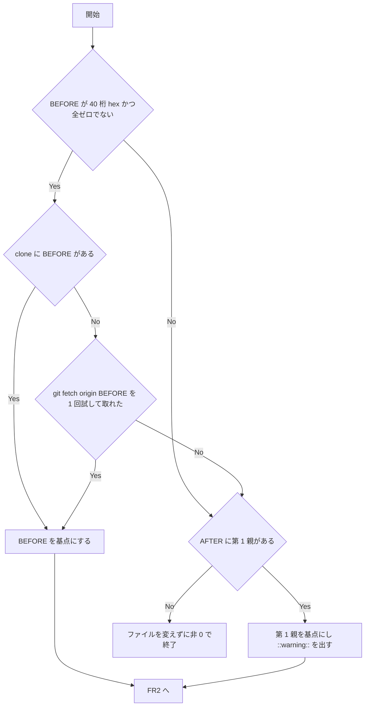

# version-bump-missing-base - 要件定義書

## 1. 概要

### 1.1 背景
- `.github/workflows/plugin-version-bump.yml` は、main への push で変更のあったプラグインの version を上げる。
- push の base commit（BEFORE）を取得できないとき、現在の workflow は skip を出して exit 0 で終わり、version を上げない。
- Actions の version 更新コミットを含まない commit で main が置き換えられた後の push で、em-workflow の version 更新が失われた。

### 1.2 目的
- base commit を取得できない push でも、main に入ったプラグインの変更が version の更新を伴い、インストール済みプラグインに届くようにする。
- Actions の version 更新コミットを含まない push で origin/main が置き換わらないようにする。
- 既に失われた em-workflow の version 更新を、人の操作 1 回で取り戻せるようにする。

### 1.3 スコープ
対象:
- `.github/workflows/plugin-version-bump.yml` の push 時の基点の決定、version の比較規則、workflow_dispatch の追加
- `plugin-dev/skills/plugin-dev/templates/plugin-version-bump.yml`（workflow とバイト単位で同一にする）
- main への non-fast-forward 更新を禁止するルールセットの定義ファイル
- PR マージ後に人が行う手順の文書
- `plugin-dev/skills/plugin-dev/references/create.md` の「動き」
- `tests/` の unittest

対象外:
- GitHub へのルールセット適用、workflow_dispatch の実行、マーケットプレイス更新と Claude Code の再起動（PR マージ後の人の手順。この実行では行わない）
- 既存の GitHub ルールセット main の変更
- plugin.json と marketplace.json の version の手での変更

## 2. ビジネス要件

### 2.1 ビジネス目標
- main に入ったプラグインの変更が、base commit を取得できない push でも version の更新を伴い、インストール済みプラグインに届く。
- Actions の version 更新コミットを含まない push で origin/main が置き換わらない。
- 既に失われた em-workflow の version 更新を、人の操作 1 回で取り戻せる。

### 2.2 対象ユーザー
| ユーザータイプ | 説明 |
|----------------|------|
| マーケットプレイス利用者 | このマーケットプレイスを追加し、プラグインをインストールしている Claude Code 利用者 |
| リポジトリの保守者 | main への push、workflow_dispatch の実行、ルールセットの作成を行う人 |

### 2.3 期待される効果
- base commit を取得できない push でも、変更プラグインの version が上がる。
- 失われた version 更新を workflow_dispatch 1 回で取り戻せる。
- main への non-fast-forward 更新が拒否される。

## 3. ユースケース

### 3.1 ユースケース一覧
| ID | ユースケース名 | アクター | 優先度 |
|----|----------------|----------|--------|
| UC01 | push 時の version 自動更新 | GitHub Actions（main への push） | 高 |
| UC02 | workflow_dispatch による version の手動更新 | リポジトリの保守者 | 高 |
| UC03 | non-fast-forward を禁止するルールセットの作成 | リポジトリの保守者 | 高 |

### 3.2 ユースケース詳細

#### UC01: push 時の version 自動更新

**アクター**: GitHub Actions（main への push で起動）

**事前条件**:
- main に push された。

**基本フロー**:
1. BEFORE と AFTER から基点を決める（FR1）。
2. 基点と AFTER の差分から変更プラグインを集める（FR2）。
3. 変更プラグインごとに version を比べ、必要なら patch を上げる（FR3）。
4. 上げたプラグインを GITHUB_OUTPUT の bumped に書き、空でなければ既存の PR 作成・マージのステップで main に取り込む（FR5）。

**代替フロー**:
- BEFORE を取得できない、全ゼロ、または 40 桁 hex でないとき、AFTER の第 1 親を基点にし、::warning:: を出して続行する。
- AFTER に第 1 親も無いとき、ファイルを変えずに非 0 で終了する。

**事後条件**:
- 変更プラグインの version が基点より大きく、plugin.json と marketplace.json の値が一致している。

#### UC02: workflow_dispatch による version の手動更新

**アクター**: リポジトリの保守者

**事前条件**:
- main を ref にして workflow_dispatch を実行する。

**基本フロー**:
1. plugin と min_version を入力して実行する。
2. 対象の現在の version が min_version 以下で、major と minor が min_version と同じなら、min_version の patch を 1 上げた値を plugin.json と marketplace.json に書く。
3. bumped が空でなければ、push 時と同じ PR 作成・マージのステップで main に取り込む。

**代替フロー**:
- 現在の version が min_version を超えていれば、ファイルを変えずに成功で終わる。
- plugin が未登録、または min_version が MAJOR.MINOR.PATCH の形でないときは、ファイルを変えずに非 0 で終了する。
- 現在の version が min_version 以下だが major か minor が違うときは、ファイルを変えずに非 0 で終了する。
- main 以外の ref では version 更新のステップを実行しない。

**事後条件**:
- 対象プラグインの version が min_version より大きく、plugin.json と marketplace.json の値が一致している。

#### UC03: non-fast-forward を禁止するルールセットの作成

**アクター**: リポジトリの保守者

**事前条件**:
- この feature の PR が main にマージされている。

**基本フロー**:
1. リポジトリ内のルールセット定義ファイルを使い、gh api でルールセットを作成する。
2. 作成後、ルールセットが作られたことを確かめる。

**事後条件**:
- main への non-fast-forward 更新が拒否される。
- 既存の main ルールセットは変わっていない。

## 4. 機能要件

### 4.1 機能一覧
| ID | 機能名 | 説明 | 優先度 |
|----|--------|------|--------|
| FR1 | push 時の基点の決定 | BEFORE を基点にし、取れないときは AFTER の第 1 親を基点にする | 高 |
| FR2 | 変更プラグインの検出 | 基点と AFTER の差分からプラグインを集める | 高 |
| FR3 | version の比較と上げ方 | 基点と AFTER の version を比べて patch を上げる | 高 |
| FR4 | workflow_dispatch による手動の version 更新 | plugin と min_version を入力に version を上げる | 高 |
| FR5 | 更新結果の出力と main への取り込み | bumped を出力し、既存の PR 作成・マージのステップで取り込む | 高 |
| FR6 | workflow と template の一致 | workflow と plugin-dev の template をバイト単位で同一にする | 高 |
| FR7 | non-fast-forward を禁止するルールセットの定義 | ルールセット定義をリポジトリ内のファイルとして置く | 高 |
| FR8 | マージ後に人が行う手順の文書 | ルールセット作成、workflow_dispatch 実行、キャッシュへの反映確認の手順 | 高 |
| FR9 | plugin-dev の説明の更新 | create.md の「動き」を FR1〜FR5 に合わせる | 中 |
| FR10 | 再発を検出するテスト | workflow の heredoc を一時リポジトリ上で実行して確かめる | 高 |

### 4.2 機能詳細

#### FR1: push 時の基点の決定

**説明**: push で動くとき、次の順で基点を決める。
- BEFORE（github.event.before）が 40 桁 hex かつ全ゼロでなく clone にあれば、BEFORE を基点にする。
- clone に無ければ `git fetch origin <BEFORE>` を 1 回だけ試し、取れたら BEFORE を基点にする。
- 取れないとき、全ゼロのとき、40 桁 hex でないときは、AFTER の第 1 親を基点にし、その旨を `::warning::` で出して続行する。
- AFTER に第 1 親も無ければ、ファイルを変えずに非 0 で終了する。
- skip を出して exit 0 で終わる分岐は残さない。

**入力**:
- BEFORE: 文字列 - github.event.before
- AFTER: commit - push 後の commit

**出力**:
- 基点: commit
- `::warning::`: stdout - 第 1 親を基点にしたとき

**処理フロー**:

**ビジネスルール**:
- `git fetch origin <BEFORE>` は 1 回だけ試す。
- BEFORE が 40 桁 hex でないとき（形が不正）は、取得できないときと同じく第 1 親を基点にする（A1）。

**エラーケース**:
| エラー | 条件 | 対応 |
|--------|------|------|
| 基点を決められない | BEFORE を基点にできず、AFTER に第 1 親も無い | ファイルを変えずに非 0 で終了 |

#### FR2: 変更プラグインの検出

**説明**: 基点と AFTER の差分に含まれるファイルから、`.claude-plugin/plugin.json` を持つ最も近い祖先ディレクトリをプラグインとして集める。

**入力**:
- 基点: commit - FR1 の結果
- AFTER: commit

**出力**:
- 変更プラグイン: ディレクトリの集合

#### FR3: version の比較と上げ方

**説明**: 変更プラグインごとに、基点の plugin.json と AFTER の plugin.json の version を整数 3 要素（MAJOR.MINOR.PATCH）で比べる。

**入力**:
- 基点の plugin.json の version
- AFTER の plugin.json の version

**出力**:
- plugin.json の version
- marketplace.json の同じ name のエントリ（version を持つもの）の version

**ビジネスルール**:
- AFTER が基点と同じか低いときは、大きい方の patch を 1 上げた値を plugin.json と marketplace.json の同じ name のエントリ（version を持つもの）に書く。
- AFTER が基点より高いときは上げない。
- 基点に plugin.json が無いプラグイン（新規追加）は上げない。
- どちらかの version が MAJOR.MINOR.PATCH の形でないプラグインは上げない。
- marketplace.json の version を持たないエントリは書き換えない。

#### FR4: workflow_dispatch による手動の version 更新

**説明**: workflow に workflow_dispatch を足す。main でだけ動く。

**入力**:
- plugin: 文字列（必須） - marketplace.json に登録済みのプラグイン名
- min_version: 文字列（必須） - MAJOR.MINOR.PATCH

**出力**:
- plugin.json と marketplace.json の version

**ビジネスルール**:
- 対象の現在の version が min_version 以下で、major と minor が min_version と同じなら、min_version の patch を 1 上げた値を plugin.json と marketplace.json に書く。
- 現在の version が min_version を超えていれば、ファイルを変えずに成功で終わる。
- 現在の version が min_version 以下だが major か minor が違うときは、ファイルを変えずに非 0 で終了する（A2）。
- main 以外の ref では version 更新のステップを実行しない。

**バリデーション**:
| 項目 | ルール | エラーメッセージ |
|------|--------|------------------|
| plugin | marketplace.json に登録済み | 未登録の旨（ファイルを変えずに非 0 で終了） |
| min_version | MAJOR.MINOR.PATCH の形 | 形が違う旨（ファイルを変えずに非 0 で終了） |

**エラーケース**:
| エラー | 条件 | 対応 |
|--------|------|------|
| 未登録の plugin | plugin が marketplace.json に無い | ファイルを変えずに非 0 で終了 |
| 形の違う min_version | MAJOR.MINOR.PATCH でない | ファイルを変えずに非 0 で終了 |
| major・minor の不一致 | 現在の version が min_version 以下で major か minor が違う | ファイルを変えずに非 0 で終了 |

#### FR5: 更新結果の出力と main への取り込み

**説明**: push と workflow_dispatch のどちらでも、上げたプラグインを `name@version` のカンマ区切りで GITHUB_OUTPUT の bumped に書く。上げなかったときは空にする。bumped が空でないとき、既存の PR 作成・マージのステップで main に取り込む。

**出力**:
- bumped: 文字列 - `name@version` のカンマ区切り、または空

**ビジネスルール**:
- workflow_dispatch の version 更新は、push 時と同じ PR 作成・マージのステップを使う（A3）。

#### FR6: workflow と template の一致

**説明**: `.github/workflows/plugin-version-bump.yml` と `plugin-dev/skills/plugin-dev/templates/plugin-version-bump.yml` はバイト単位で同一にする。

#### FR7: non-fast-forward を禁止するルールセットの定義

**説明**: main への non-fast-forward 更新を禁止するルールセットの定義を、リポジトリ内のファイルとして置く。

**ビジネスルール**:
- ルールは non_fast_forward だけ。
- bypass_actors は空。
- enforcement は active。
- 対象は main。
- 既存の main ルールセットは変えない。
- 定義は GitHub REST API のルールセット作成ペイロードの形の JSON として `.github/` 配下に置く。置き場所とファイル名は SPEC で決める（A4）。

#### FR8: マージ後に人が行う手順の文書

**説明**: PR マージ後に人が行う手順を文書に書く。
- (a) gh api によるルールセットの作成と、作成後の確認。
- (b) workflow_dispatch を plugin と min_version を指定して 1 回実行し、version が上がったことを確かめる手順。
- (c) マーケットプレイスの更新と Claude Code の再起動で、インストール済みキャッシュに main の内容が届いたことを確かめる手順。

**ビジネスルール**:
- 文書の置き場所は SPEC で決める（A5）。
- (b) の入力は、plugin が em-workflow、min_version が失われた Actions 更新コミットの記録した version。この値は人の手順にだけ書き、受け入れ条件には書かない（A6）。

#### FR9: plugin-dev の説明の更新

**説明**: `plugin-dev/skills/plugin-dev/references/create.md` の「動き」を、FR1〜FR5 の挙動（基点の決定と `::warning::`、基点を取れないときの非 0 終了、version の比較規則、workflow_dispatch の入力と挙動）に合わせる。

#### FR10: 再発を検出するテスト

**説明**: `tests/` の unittest（標準ライブラリだけ）が workflow の YAML から heredoc を 1 つだけ抜き出し、一時ディレクトリの bare リポジトリと `git clone --no-local` で作った clone の上で実行する。

**ビジネスルール**:
- 終了コード、GITHUB_OUTPUT、plugin.json と marketplace.json の中身、workflow と template のバイト一致を確かめる。
- ルールセット定義ファイルの中身（FR7）も確かめる。

## 5. 非機能要件

### 5.1 パフォーマンス要件
- 該当なし

### 5.2 セキュリティ要件
- 認証: 該当なし
- 認可: 該当なし
- データ保護: 該当なし
- 入力検証: workflow_dispatch の plugin と min_version を FR4 のバリデーションで検証する

### 5.3 可用性要件
- 該当なし

### 5.4 保守性要件
- ログ出力: 第 1 親を基点にしたとき `::warning::` を出す（FR1）
- 監視: 該当なし
- ドキュメント: create.md の「動き」を更新する（FR9）。マージ後の人の手順を文書に書く（FR8）

### 5.5 互換性要件
- 該当なし

### 5.6 その他の非機能要件
| ID | 要件 |
|----|------|
| NFR1 | workflow 内のスクリプトは Python 標準ライブラリと git だけを使う |
| NFR2 | workflow の YAML に含まれる heredoc は 1 つだけ。push と workflow_dispatch の処理はその 1 つに入れる |
| NFR3 | テストはネットワークに出ず、`~/.claude` を読まず、一時ディレクトリの中だけで git を操作する |
| NFR4 | この feature の変更は plugin.json と marketplace.json の version を変えない |
| NFR5 | SPEC・計画・受け入れ条件に具体的な version の値を書かない |

## 6. UI/UX要件

### 6.1 画面設計要件
該当なし（UI を持たない変更）

### 6.2 画面遷移
該当なし

### 6.3 レスポンシブ対応
該当なし

## 7. データ要件

### 7.1 データモデル概要
該当なし

### 7.2 データ項目
| エンティティ | 項目名 | 型 | 必須 | 説明 |
|--------------|--------|-----|------|------|
| workflow_dispatch 入力 | plugin | 文字列 | ○ | marketplace.json に登録済みのプラグイン名 |
| workflow_dispatch 入力 | min_version | 文字列 | ○ | MAJOR.MINOR.PATCH |
| GITHUB_OUTPUT | bumped | 文字列 | ○ | `name@version` のカンマ区切り。上げなかったときは空 |
| ルールセット定義 | rules | 配列 | ○ | non_fast_forward だけ |
| ルールセット定義 | bypass_actors | 配列 | ○ | 空 |
| ルールセット定義 | enforcement | 文字列 | ○ | active |
| ルールセット定義 | 対象 | - | ○ | main |

### 7.3 データ保持期間
該当なし

## 8. 外部連携

### 8.1 連携システム
| システム名 | 連携方法 | データ |
|------------|----------|--------|
| GitHub Actions | push、workflow_dispatch | github.event.before、AFTER、plugin、min_version、GITHUB_OUTPUT |
| GitHub REST API | gh api（マージ後の人の手順） | ルールセット作成ペイロード |

### 8.2 API仕様要件
- ルールセット定義は GitHub REST API のルールセット作成ペイロードの形の JSON とする（A4）。

## 9. 制約条件

### 9.1 技術的制約
- workflow 内のスクリプトは Python 標準ライブラリと git だけを使う（NFR1）。
- workflow の YAML に含まれる heredoc は 1 つだけ（NFR2）。
- テストはネットワークに出ず、`~/.claude` を読まず、一時ディレクトリの中だけで git を操作する（NFR3）。
- workflow と template はバイト単位で同一にする（FR6）。

### 9.2 ビジネス上の制約
- この feature の変更は plugin.json と marketplace.json の version を変えない（NFR4）。plugin-dev の template を変えると plugin-dev の patch は Actions が上げる（A8）。
- SPEC・計画・受け入れ条件に具体的な version の値を書かない（NFR5）。
- 既存の GitHub ルールセット main（deletion / non_fast_forward / pull_request、admin の bypass は always）は変えない（A9）。

### 9.3 スケジュール制約
- GitHub へのルールセット適用、workflow_dispatch の実行、マーケットプレイス更新と再起動は、この実行では行わない（A7）。

### 9.4 宣言された変更集合

このフィーチャー固有のパスは手動で列挙せず、create-plan で `workflow.yaml` の各タスクの `files` から導出する（`references/phases/create-plan-phase.md`）。

**デフォルトメンバー**（SPEC作成者が明示的に除外しない限り、常に宣言に含まれる）:
- `feature-docs/version-bump-missing-base/**`
- `test-docs/version-bump-missing-base/**`

`feature-docs/version-bump-missing-base/**` に含まれるもの: `REQUIREMENTS.md`、`SPEC.md`、`IMPLEMENTATION.md`、`workflow.yaml`、`phase-state/`、`tasks/`、`reviews/roundN.yaml`、`VERIFICATION.md`、`retrospect.yaml`、およびデザインステップが生成するデザイン成果物。生成主体は各フェーズドキュメントおよび `references/phase-state.md` を参照（引用のみ、ルールは再掲しない）。

`test-docs/version-bump-missing-base/**` に含まれるもの: `{T}.tests.yaml`（パス形式: `test-docs/version-bump-missing-base/{T}.tests.yaml`）。生成主体は `implement-phase.md` を参照（引用のみ、ルールは再掲しない）。

**意味論**:
- デフォルトのメンバーは、SPEC作成者が明示的に除外しない限り宣言に含まれる。除外は意図的な絞り込みであり、記載漏れによる省略ではない。
- この宣言はスーパーセット（superset）の主張であり、実際の変更集合は宣言に含まれる（CONTAINED IN）必要がある。実際には生成されないパスが宣言されていても違反にはならない。implementタスクを1つも生成しないフィーチャーは `test-docs/version-bump-missing-base/` ディレクトリを生成しないが、宣言された `test-docs/version-bump-missing-base/**` は依然として正しい。

## 10. 想定される課題とリスク

### 10.1 技術的課題
| 課題 | 影響度 | 対応策 |
|------|--------|--------|
| 該当なし | - | - |

### 10.2 ビジネスリスク
| リスク | 発生確率 | 影響度 | 対応策 |
|--------|----------|--------|--------|
| 該当なし | - | - | - |

## 11. 成功基準

### 11.1 受け入れ基準
- [ ] AC-1: BEFORE が clone に無く origin から取得できるとき、BEFORE を基点に比較し、変更プラグインの version を上げて exit 0 で終わる
- [ ] AC-2: BEFORE を取得できないとき、および全ゼロのとき、AFTER の第 1 親を基点にし、`::warning::` を出し、変更プラグインの version を上げて exit 0 で終わる
- [ ] AC-3: 基点を取得できず AFTER に第 1 親も無いとき、非 0 で終了し、plugin.json と marketplace.json は変わらない
- [ ] AC-4: 再現手順（Actions の更新コミットを含まない commit で main を置き換えた後の push）を一時リポジトリで再現したとき、AFTER の version は基点の version より大きくなり、plugin.json と marketplace.json の値は一致する
- [ ] AC-5: AFTER の version が基点と同じか低いとき、大きい方の patch を 1 上げた値が両 JSON に書かれる
- [ ] AC-6: AFTER の version が基点より高いとき、version は変わらず、bumped は空になる
- [ ] AC-7: 基点に plugin.json が無いプラグインと、version が MAJOR.MINOR.PATCH の形でないプラグインは上げない
- [ ] AC-8: workflow_dispatch で現在の version が min_version 以下かつ major・minor が同じとき、実行後の version は min_version より大きく、その patch は min_version の patch + 1 で、両 JSON の値は一致する
- [ ] AC-9: workflow_dispatch で現在の version が min_version を超えているとき、ファイルは変わらず、bumped は空で、exit 0 で終わる
- [ ] AC-10: workflow_dispatch で plugin が未登録、または min_version が MAJOR.MINOR.PATCH の形でないとき、非 0 で終了しファイルは変わらない
- [ ] AC-11: workflow_dispatch は main 以外の ref では version 更新のステップを実行しない
- [ ] AC-12: workflow と template はバイト単位で同一で、どちらにも base commit が無いときに exit 0 で終わる skip の分岐が無い
- [ ] AC-13: ルールセット定義ファイルは non_fast_forward のルールだけを持ち、bypass_actors が空で、enforcement が active、対象が main である
- [ ] AC-14: マージ後の人の手順（ルールセットの作成と確認、workflow_dispatch の実行、キャッシュへの反映の確認）が文書にある
- [ ] AC-15: create.md の「動き」が FR1〜FR5 の挙動を述べている
- [ ] AC-16: `python3 -m unittest discover -s tests` が exit 0 で終わる

### 11.2 KPI
| 指標 | 目標値 | 測定方法 |
|------|--------|----------|
| 該当なし | - | - |

## 12. テストシナリオ

### 12.1 テスト観点
- [ ] 正常系: BEFORE が clone にあり、プラグイン配下が変わった push で patch が 1 上がる
- [ ] 正常系: BEFORE が bare リポジトリで到達不能（ref から外した commit）、bare 側で uploadpack.allowAnySHA1InWant を有効にして fetch で取得できる
- [ ] 異常系: BEFORE が bare リポジトリにも無い → 第 1 親を基点、stdout に `::warning::`
- [ ] 境界値: BEFORE が全ゼロ → 第 1 親を基点、`::warning::`
- [ ] 異常系: BEFORE が取得できず AFTER が root commit → 非 0、両 JSON 不変
- [ ] 正常系: 再現手順（更新コミットを積んだ後、それを含まない merge commit で main を置き換え、次の push を流す）
- [ ] 境界値: 基点より AFTER の version が低い / 同じ / 高い の 3 通り
- [ ] 異常系: 新規プラグイン、MAJOR.MINOR.PATCH でない version
- [ ] 境界値: marketplace.json の version を持たないエントリは書き換えない
- [ ] 正常系・異常系: workflow_dispatch（現在 <= min_version（major・minor 同じ）、現在 > min_version、未登録の plugin、形の違う min_version、現在 <= min_version で major・minor が違う）
- [ ] 正常系: GITHUB_OUTPUT の bumped の値（空を含む）
- [ ] 正常系: YAML から heredoc がちょうど 1 つ抜き出せる
- [ ] 正常系: workflow と template のバイト一致
- [ ] 正常系: ルールセット定義ファイルの中身
- [ ] セキュリティ: workflow_dispatch の入力検証（上の workflow_dispatch の観点に含む）
- [ ] パフォーマンス: 該当なし

## 13. 用語定義

| 用語 | 定義 |
|------|------|
| BEFORE | push イベントの github.event.before |
| AFTER | push 後の commit |
| 基点 | version の比較元にする commit |
| bumped | GITHUB_OUTPUT に書く、上げたプラグインの `name@version` のカンマ区切り |
| 変更プラグイン | 基点と AFTER の差分に含まれるファイルから、`.claude-plugin/plugin.json` を持つ最も近い祖先ディレクトリ |

## 14. 確認事項

### 14.1 確認済み事項

- [x] A1: BEFORE が 40 桁 hex でないとき（形が不正）は、取得できないときと同じく第 1 親を基点にする
- [x] A2: workflow_dispatch で現在の version が min_version 以下だが major か minor が違うときは、ファイルを変えずに非 0 で終了する
- [x] A3: workflow_dispatch の version 更新は、push 時と同じ PR 作成・マージのステップを使う
- [x] A4: ルールセット定義は GitHub REST API のルールセット作成ペイロードの形の JSON として `.github/` 配下に置く。置き場所とファイル名は SPEC で決める
- [x] A5: マージ後の人の手順の文書の置き場所は SPEC で決める
- [x] A6: マージ後の workflow_dispatch の入力は、plugin が em-workflow、min_version が失われた Actions 更新コミットの記録した version。この値は人の手順にだけ書き、受け入れ条件には書かない
- [x] A7: GitHub へのルールセット適用、workflow_dispatch の実行、マーケットプレイス更新と再起動は、この実行では行わない（PR マージ後の人の手順）
- [x] A8: plugin-dev の template を変えると plugin-dev の patch は Actions が上げる。この feature で version は手で変えない
- [x] A9: 既存の GitHub ルールセット main（deletion / non_fast_forward / pull_request、admin の bypass は always）は変えない

### 14.2 未確認・保留事項
- なし

## 15. 参考資料

- なし
